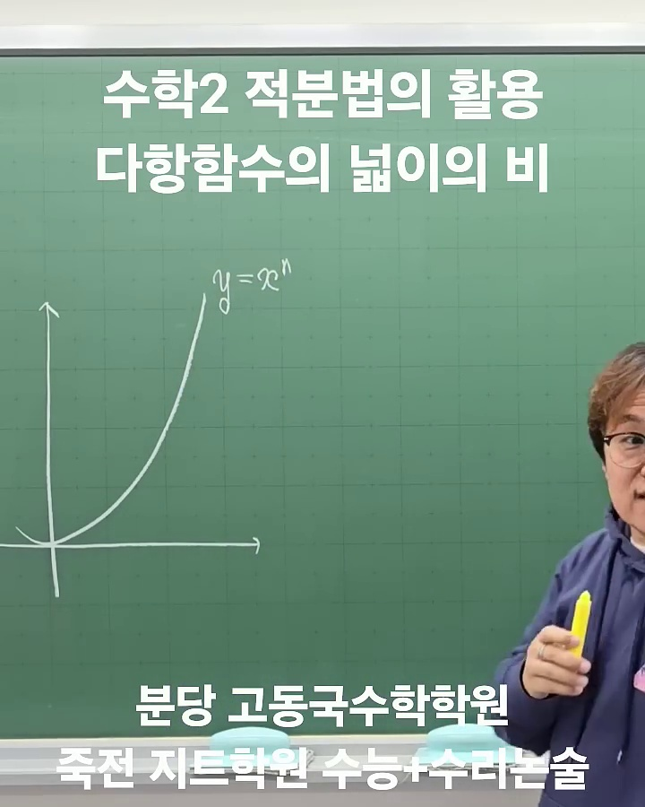
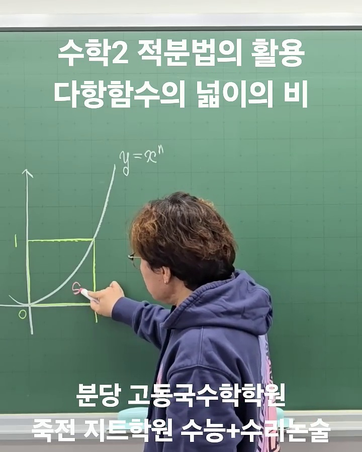
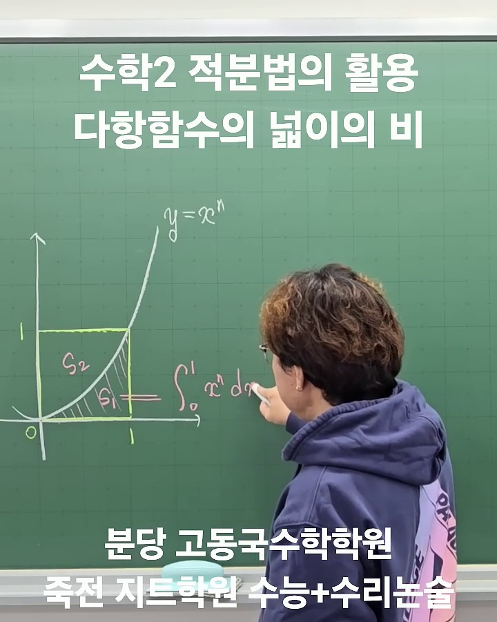
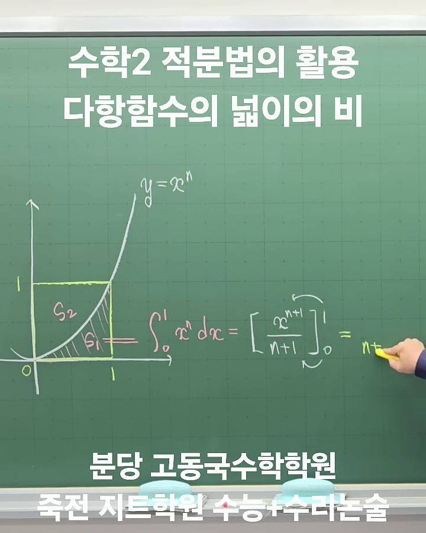
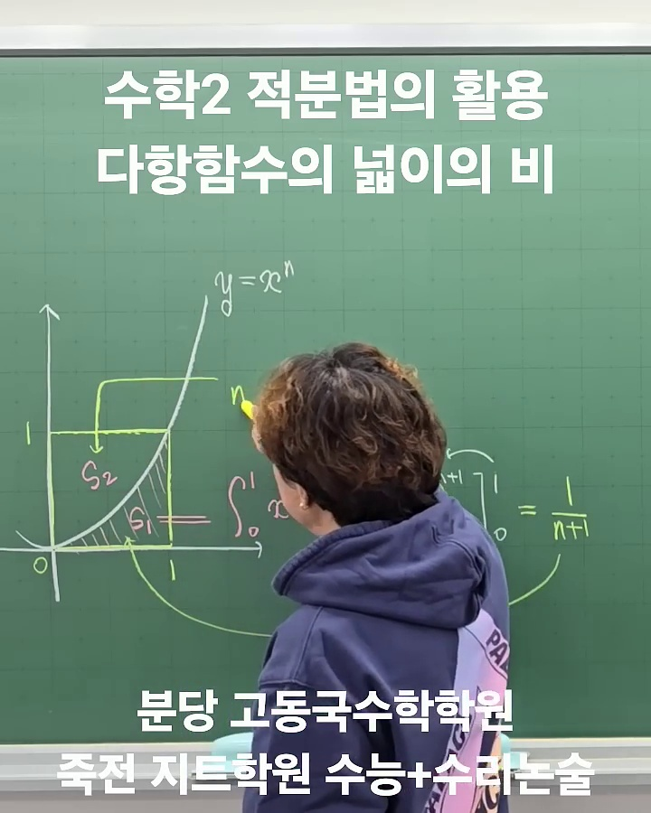
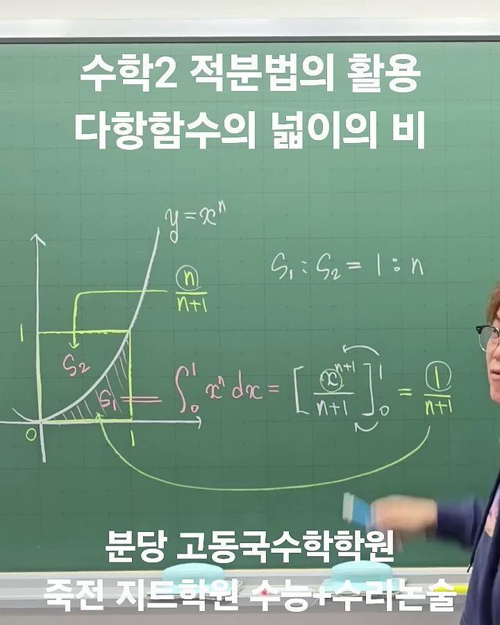

# [수학 II] 적분법의 활용: 다항함수의 넓이의 비 공식 & 완전 해설

> **원본 영상 정보**
> - **출처**: [고동국 수학연구소 YouTube](https://youtu.be/yxzZv1z_A2I?si=AeoWmNc11E1P1D1u)
> - **영상 제목**: 수학2 적분법의 활용 다항함수의 넓이의 비
> - **주요 태그**: `#수학2 #정적분 #적분 #넓이 #적분넓이공식 #수능수학 #수리논술`

---

## 1. 핵심 요약 (Key Summary)

다항함수 $y = x^n$ ($n \ge 1$)의 그래프와 $x$축, 그리고 직선 $x=1$로 둘러싸인 직사각형 영역 $[0, 1] \times [0, 1]$에서 곡선 아래쪽 넓이($S_1$)와 곡선 위쪽 넓이($S_2$)의 비는 항상 **차수($n$)에 반비례/비례하는 일정한 정수비**를 이룹니다.

$$\mathbf{S_1 : S_2 = 1 : n}$$

* **2차 함수 ($n=2$)**: $S_1 : S_2 = \mathbf{1 : 2}$  (전체 직사각형 넓이의 $\frac{1}{3}$과 $\frac{2}{3}$)
* **3차 함수 ($n=3$)**: $S_1 : S_2 = \mathbf{1 : 3}$  (전체 직사각형 넓이의 $\frac{1}{4}$과 $\frac{3}{4}$)
* **4차 함수 ($n=4$)**: $S_1 : S_2 = \mathbf{1 : 4}$  (전체 직사각형 넓이의 $\frac{1}{5}$과 $\frac{4}{5}$)

> 💡 **수능 및 내신 실전 가치**:  
> 복잡한 정적분 계산 $\int_a^b (ax^n + \cdots) dx$을 전개하여 일일이 계산하지 않고, 꼭짓점을 공유하는 **외접 직사각형의 넓이(가로 $\times$ 세로)**에 $\frac{1}{n+1}$을 곱하는 것만으로 **3초 만에 넓이를 계산**할 수 있습니다.

---

## 2. 타임라인별 강의 캡처 & 상세 설명

### 1단계 [00:05] 좌표평면 설정 및 곡선 정의

* **선생님 설명**: 
  > "$y = x^n$이란 녀석이 있어. 여기다가 내가 $1$을 대입하면 얼마 나오지? $1$ 대입하면 $1$ 나오지."
* **해설**:
  * 원점 $(0, 0)$과 점 $(1, 1)$을 지나며, $x \ge 0$ 범위에서 증가하는 다항함수 $y = x^n$을 설정합니다.
  * $x=0$부터 $x=1$, $y=0$부터 $y=1$까지 가로 길이 $1$, 세로 길이 $1$인 **단위 정사각형**이 형성됩니다.
  * 전체 직사각형의 넓이는 $1 \times 1 = 1$입니다.

---

### 2단계 [00:24] 영역 $S_1$과 $S_2$의 분할

* **선생님 설명**: 
  > "자, 나는 얘를 볼 거야. 이제 증명을 하는 거야. 여기를 내가 $S_1$이라고 하고, 여기를 $S_2$라고 할게."
* **해설**:
  * 곡선 $y=x^n$에 의해 직사각형이 두 개의 영역으로 나뉩니다.
    * **$S_1$**: 곡선 아래쪽과 $x$축 사이의 영역 ($x \in [0, 1]$)
    * **$S_2$**: 곡선 위쪽과 $y$축 사이의 영역 ($y \in [0, 1]$)

---

### 3단계 [00:38 ~ 00:52] 정적분을 통한 $S_1$ 공식 유도

* **선생님 설명**:
  > "어디부터 어디까지 적분하면 되는 거야? $\int_0^1 x^n dx$가 되는 거지. 적분하게 되면 $\left[ \frac{x^{n+1}}{n+1} \right]_0^1$에다가 $1$ 대입한 값에서 $0$ 대입한 값을 빼면 $\frac{1}{n+1}$이 되는 거지."
* **유도 과정**:
  $$S_1 = \int_0^1 x^n dx = \left[ \frac{1}{n+1} x^{n+1} \right]_0^1 = \frac{1^{n+1}}{n+1} - 0 = \frac{1}{n+1}$$

---

### 4단계 [00:60 ~ 00:72] $S_2$ 계산 및 넓이의 비 $1:n$ 도출

* **선생님 설명**:
  > "전체 넓이가 얼마야? $1$이지! 그러면 요 녀석($S_2$)의 넓이는 얼마가 될까? $1 - \frac{1}{n+1} = \frac{n}{n+1}$이 되는 거야. 그럼 $S_1 : S_2$의 비는 몇 대 몇? $1 : n$이 되는 거야!"
* **비율 유도**:
  $$S_2 = S_{\text{전체}} - S_1 = 1 - \frac{1}{n+1} = \frac{(n+1) - 1}{n+1} = \frac{n}{n+1}$$
  $$S_1 : S_2 = \frac{1}{n+1} : \frac{n}{n+1} = 1 : n$$

---

## 3. 수학적 정형화 및 일반화 (Mathematical Rigor)

강의에서는 $[0, 1] \times [0, 1]$의 특수 케이스로 설명했지만, 이 원리는 **임의의 계수 $a$와 임의의 구간 $[0, W]$를 갖는 모든 거듭제곱꼴 다항함수**에 완전히 동일하게 성립합니다.

### 📐 일반화 정리 (Theorem)
구간 $[0, W]$에서 꼭짓점이 원점인 함수 $y = c \cdot x^n$ ($c > 0$)에 대하여,  
점 $(W, H)$ (단, $H = c W^n$)를 마주보는 꼭짓점으로 하는 외접 직사각형 $R = [0, W] \times [0, H]$을 잡으면:

1. **외접 직사각형의 총넓이**:
   $$S_{\text{Box}} = W \times H = c \cdot W^{n+1}$$

2. **곡선 아래 영역 ($S_1$)**:
   $$S_1 = \int_0^W c x^n dx = \left[ \frac{c}{n+1} x^{n+1} \right]_0^W = \frac{c W^{n+1}}{n+1} = \frac{1}{n+1} (W \times H)$$

3. **곡선 위 영역 ($S_2$)**:
   $$S_2 = S_{\text{Box}} - S_1 = \left(1 - \frac{1}{n+1}\right)(W \times H) = \frac{n}{n+1} (W \times H)$$

4. **넓이의 비**:
   $$\mathbf{S_1 : S_2 = 1 : n}$$

---

## 4. 실전 수능/내신 적용 공식표

| 다항함수 | 곡선 형태 | 외접 직사각형 대비 $S_1$ 넓이 | 넓이의 비 $S_1 : S_2$ | 대표 기출 활용 |
| :--- | :--- | :---: | :---: | :--- |
| **1차 함수** ($n=1$) | $y = mx$ (직선) | $\frac{1}{2}$ | **$1 : 1$** | 직각삼각형 넓이 공식 |
| **2차 함수** ($n=2$) | $y = ax^2$ (포물선) | $\frac{1}{3}$ | **$1 : 2$** | 아르키메데스 포물선 공식, 접선과 둘러싸인 넓이 |
| **3차 함수** ($n=3$) | $y = a(x-\alpha)^3$ | $\frac{1}{4}$ | **$1 : 3$** | 3중근 접선과 곡선 사이 넓이 |
| **4차 함수** ($n=4$) | $y = a(x-\alpha)^4$ | $\frac{1}{5}$ | **$1 : 4$** | 4차 함수 극값 대칭축 기준 분할 넓이 |

---

## 5. 실전 예제 풀이 (정적분 vs 3초 공식 비교)

### [예제]
곡선 $y = 3x^2$과 $x$축, 직선 $x=2$로 둘러싸인 도형의 넓이를 구하시오.

* **기존 정석 풀이 (약 40초 소요)**:
  $$S = \int_0^2 3x^2 dx = \left[ x^3 \right]_0^2 = 2^3 - 0 = 8$$

* **넓이의 비 공식 풀이 (3초 소요)**:
  1. $x=2$일 때 $y = 3(2)^2 = 12$
  2. 외접 직사각형의 넓이 = $\text{가로}(2) \times \text{세로}(12) = 24$
  3. 2차 함수이므로 $S_1 : S_2 = 1 : 2 \implies S_1 = \frac{1}{1+2} \times 24 = \mathbf{8}$
