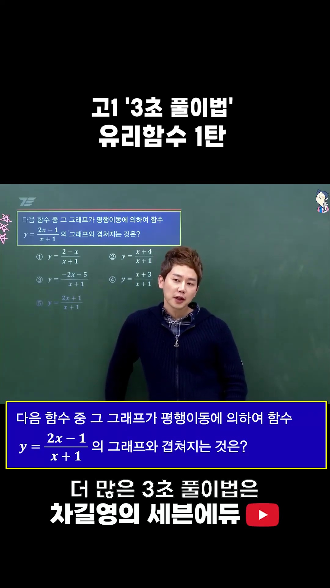
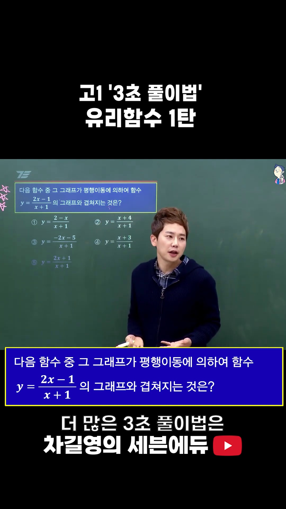
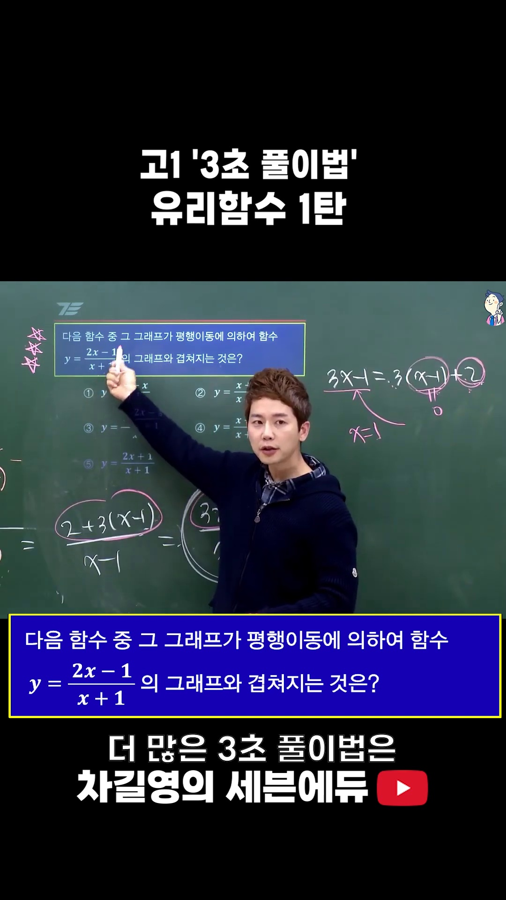
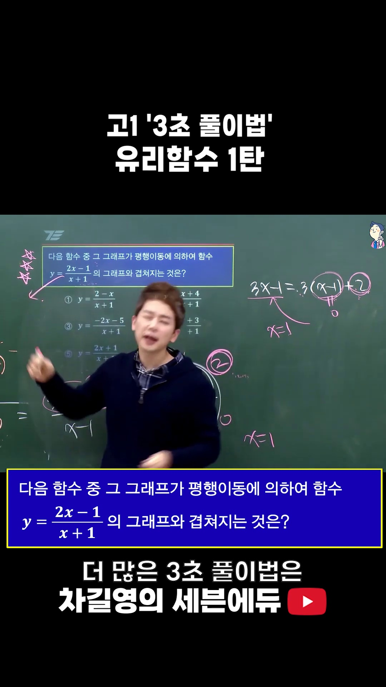
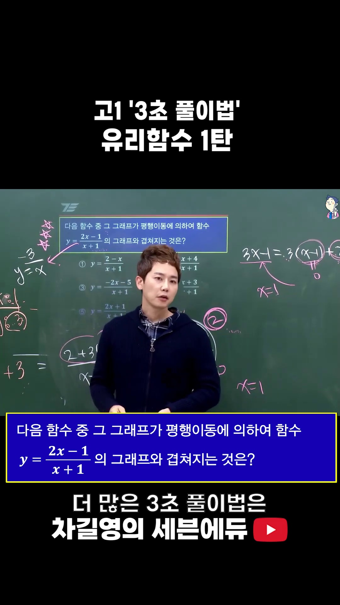
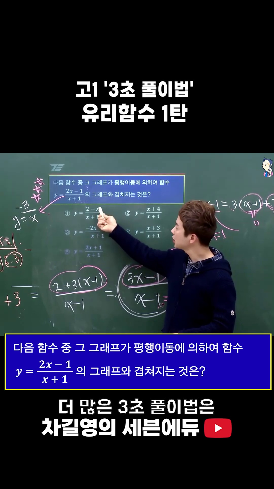
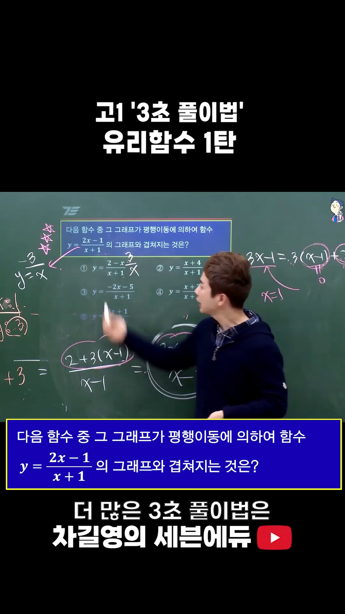
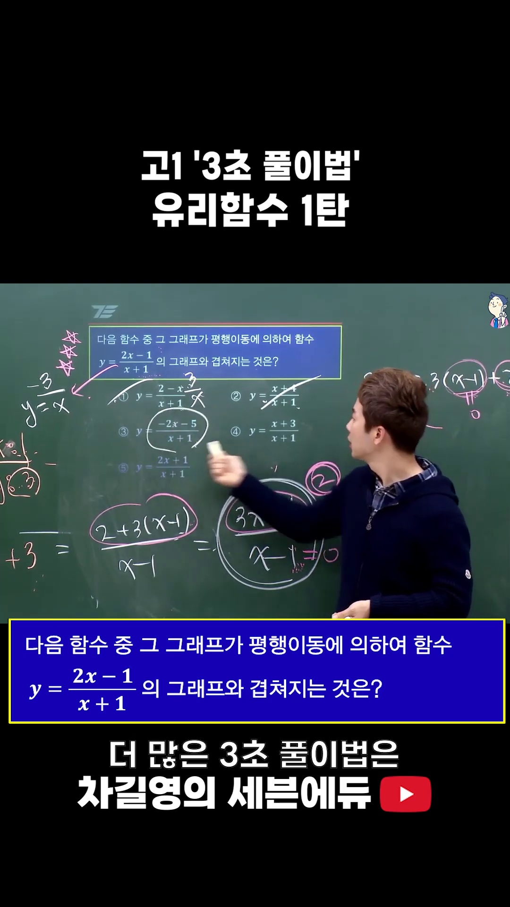
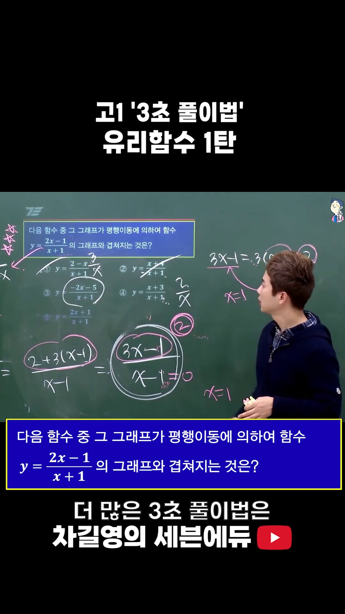
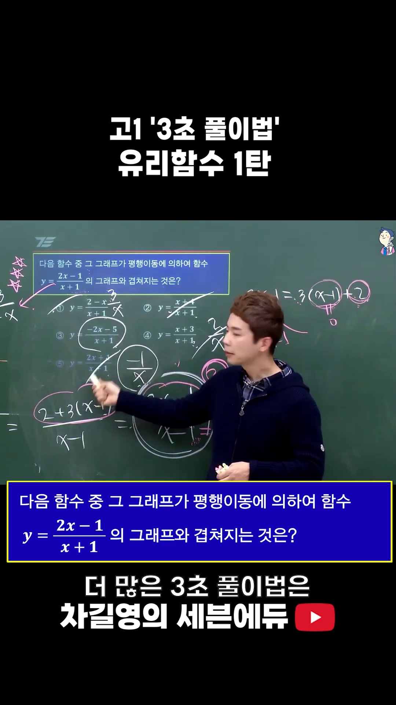

# [고1 수학 (하)] 유리함수 평행이동 완전 정복 : 나머지 정리와 3초 판정법

> **원본 영상 정보**
> - **출처**: [차길영의 세븐에듀 YouTube Shorts](https://youtube.com/shorts/vYo2lh83hu0)
> - **영상 제목**: [고1] 2학기 기말고사 수학🌟유리함수 1탄🌟 3초 풀이법
> - **강사**: 차길영 선생님 (세븐에듀 대표강사)
> - **영상 길이**: 56초
> - **주요 태그**: `#고1수학 #유리함수 #평행이동 #3초풀이법 #차길영 #세븐에듀 #기말고사수학`

---

## 1. 핵심 요약 (Key Summary)

내신 및 모의고사에서 단골로 출제되는 **"다음 유리함수 중 평행이동에 의하여 $y = \frac{ax+b}{cx+d}$와 겹쳐지는 것은?"** 유형은
학교 교과서 방식대로 대분수 꼴로 직접 나누고 통분하여 표준형 $y = \frac{k}{x-p} + q$로 변형하면 1분 이상의 아까운 시간이 소요됩니다.

차길영 선생님이 공개한 **"3초 풀이법"**은 다항식의 **나머지 정리(Remainder Theorem)**를 적용하여
표준형의 핵심 파라미터인 **분자 상수 $k$(태어났을 때의 출생식)**를 암산으로 단 1초 만에 구하는 기법입니다:

1. **평행이동과 겹침의 본질**:
   - 두 유리함수가 오직 **평행이동**에 의해서만 겹쳐질 필요충분조건은 기본형 곡선의 **분자 상수 $k$가 부호까지 완벽히 일치($k_1 = k_2$)**하는 것입니다.
   - (참고: 대칭이동까지 허용하면 절댓값 일치 $|k_1| = |k_2|$)

2. **나머지 정리를 활용한 $k$ 초고속 도출 공식**:
   - 유리함수 $y = \frac{ax+b}{cx+d}$에서 **분모가 $0$이 되는 $x = -\frac{d}{c}$를 분자에 그대로 대입**한 후 분모의 $x$ 계수 $c$로 나눈다!
   $$k = \frac{a\left(-\frac{d}{c}\right) + b}{c} = \frac{bc - ad}{c^2}$$
   - 특히 분모의 $x$ 계수가 $1$인 $y = \frac{ax+b}{x+d}$ 형태(시험의 95% 이상)에서는:
     $$\mathbf{k = a(-d) + b} \quad \text{(분모 0 되는 x를 분자에 바로 대입!)}$$

---

### 📊 유리함수 변환 방법 비교

| 구분 | 교과서 정석 풀이 (직접 나눗셈) | 차길영 3초 풀이법 (나머지 정리) |
| :--- | :--- | :--- |
| **변환 방식** | $y = \frac{a(x+d) + (b-ad)}{x+d} = \frac{b-ad}{x+d} + a$ | 분모 $x+d=0 \implies x=-d$를 분자에 대입 $\to k = b-ad$ |
| **소요 시간** | 40초 ~ 1분 (식 변형 및 부호 실수 빈발) | **단 3초 (암산 가능)** |
| **출생 함수** | $y = \frac{k}{x}$ 파악 후 대조 | $k$ 값만 즉시 뽑아내어 선지와 원클릭 매칭 |
| **실전 판정** | 5개 선지 모두 표준형으로 변형 필요 | 선지 분모 0 되는 값 5개 암산 대입 즉시 끝 |

---

## 2. 영상 타임라인별 판서 캡처 & 10단계 상세 해설

### 1단계 [00:00:03] 시험 출제 문제 세팅 & 3초 풀이 선언

* **선생님 설명**:
  > "이 문제가 시험에 나오면 어? 무조건 3초 풀이야! 자 답부터 얘기해 줄게."
* **문제 분석**:
  * 문제: 함수 $y = \frac{2x - 1}{x + 1}$의 그래프를 평행이동하여 겹쳐지는 것을 보기 ①~⑤에서 고르시오.

---

### 2단계 [00:00:08] 평행이동 겹침의 핵심: 분자의 그 숫자($k$)를 찾아라!

* **선생님 설명**:
  > "겹쳐지는 걸 찾잖아? 그러면 그걸 찾아야 돼. 그 분자에 있는 그 숫자를 찾아야 돼!"
* **수학적 배경**:
  * 평행이동($x \to x-p, y \to y-q$)은 그래프의 위치만 바꿀 뿐, 곡선의 벌어진 정도(곡률)를 결정하는 상수 $k$는 절대 변하지 않습니다.

---

### 3단계 [00:00:13] 분모가 0 되는 $x = -1$의 분자 대입

* **선생님 설명**:
  > "그럼 분모가 0이 되는 $x$값 얼마야? $-1$이지. $-1$을 분자에 넣어 봐. 얼마야? $-3$!"
* **초고속 연산**:
  $$\text{분모 } x + 1 = 0 \implies x = -1$$
  $$\text{분자 } 2x - 1 \text{에 } x = -1 \text{ 대입 } \implies 2(-1) - 1 = \mathbf{-3}$$

---

### 4단계 [00:00:18] 출생 함수(태어났을 때의 식): $y = \frac{-3}{x}$

* **선생님 설명**:
  > "그러니까 얘는 태어났을 때 응애응애 하고 태어났을 때 식이 뭐라는 거야? $y = \frac{-3}{x}$이라는 거야!"
* **해설**:
  * $y = \frac{2x - 1}{x + 1} = \frac{2(x+1) - 3}{x + 1} = \frac{-3}{x+1} + 2$.
  * 즉, 기본형 $y = \frac{-3}{x}$을 $x$축 방향으로 $-1$, $y$축 방향으로 $2$만큼 평행이동한 것입니다.

---

### 5단계 [00:00:25] 선지 탐색 전략: 분자 대입 결과가 $-3$인 것 찾기

* **선생님 설명**:
  > "그럼 이제 $-3$ 나오는 것만 찾으면 돼!"
* **판정 기준**:
  * 각 보기의 분모를 0으로 만드는 $x = -1$을 분자에 대입하여 결과가 **$-3$**이 되는 선지만 고르면 정답!

---

### 6단계 [00:00:31] ①번 선지 검증: 탈락

* **선생님 설명**:
  > "1번 봐봐. 분모가 0 되는 거 뭐야? $-1$. 분자에 넣어 봐. 얼마야? $3$. 그러니까 얘는 태어났을 때 $3$이었다는 거야. 아니지!"
* **검산**:
  * ① $y = \frac{2-x}{x+1} \implies 2 - (-1) = 3 \ne -3$ (불일치)

---

### 7단계 [00:00:36] ②번 선지 검증: 탈락

* **선생님 설명**:
  > "2번도 $-1$ 넣어봐. 얼마야? $3$ 나오니까 아니지!"
* **검산**:
  * ② $y = \frac{x+4}{x+1} \implies (-1) + 4 = 3 \ne -3$ (불일치)

---

### 8단계 [00:00:42] ③번 선지 검증: 정확히 $-3$ 일치!

* **선생님 설명**:
  > "3번 봐봐. $-1$ 넣어 봐. $-2(-1) - 5 = 2 - 5 = -3$! 똑같네! 답은 3번이야!"
* **검산**:
  * ③ $y = \frac{-2x-5}{x+1} \implies -2(-1) - 5 = \mathbf{-3}$ (완벽 일치!)
  * 실제로 $y = \frac{-2(x+1) - 3}{x+1} = \frac{-3}{x+1} - 2$이므로 출생 함수 $y = \frac{-3}{x}$와 100% 일치합니다.

---

### 9단계 [00:00:48] ④, ⑤번 선지 확인

* **선생님 설명**:
  > "4번은 $-1$ 넣으면 $2$, 5번은 $-1$ 넣으면 $-1$. 아니야!"
* **검산**:
  * ④ $y = \frac{x+3}{x+1} \implies (-1) + 3 = 2 \ne -3$
  * ⑤ $y = \frac{2x+1}{x+1} \implies 2(-1) + 1 = -1 \ne -3$

---

### 10단계 [00:00:54] 3초 풀이 완결: 정답 ③번!

* **선생님 설명**:
  > "답 몇 번이야? 답은 3번이야! 3초 만에 끝!"

---

## 3. 수능/내신 실전 유리함수 5대 치트키

### [치트키 1] 점근선 방정식 1초 도출
$$y = \frac{ax + b}{cx + d} \implies \begin{cases} \text{세로 점근선}: x = -\frac{d}{c} \quad (\text{분모} = 0) \\ \text{가로 점근선}: y = \frac{a}{c} \quad (x \text{의 계수비}) \end{cases}$$

### [치트키 2] 점근선 교점 대칭과 선대칭 2대 직선
* 점근선의 교점: $\left(-\frac{d}{c}, \frac{a}{c}\right)$
* 모든 유리함수는 **점근선의 교점을 지나고 기울기가 $\pm 1$인 두 직선에 대하여 선대칭**입니다:
  $$y - q = \pm (x - p) \implies y = \pm\left(x + \frac{d}{c}\right) + \frac{a}{c}$$

### [치트키 3] 유리함수 역함수 1초 공식
주대각선($a, d$)의 자리와 부호를 동시에 바꾼다:
$$f(x) = \frac{ax + b}{cx + d} \iff f^{-1}(x) = \frac{-dx + b}{cx - a}$$
* $f(x) = f^{-1}(x)$일 필요충분조건: $a + d = 0$ (즉, 점근선의 교점이 $y=x$ 위에 위치).
