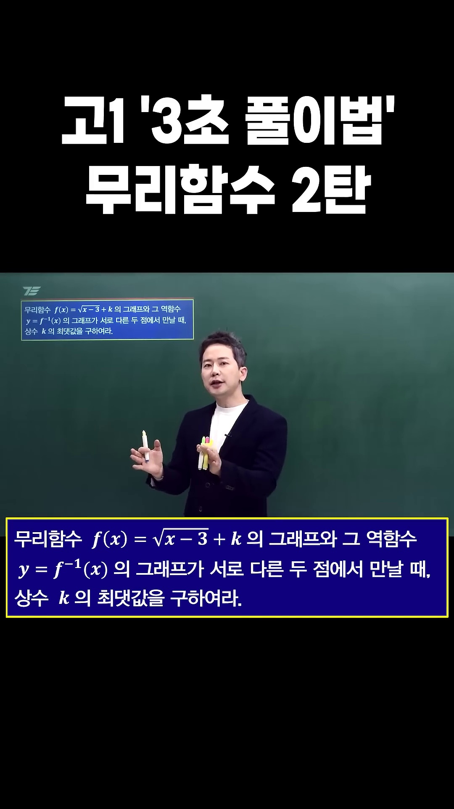
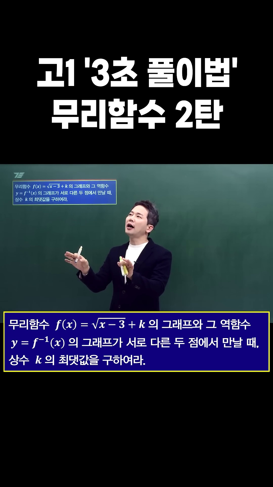
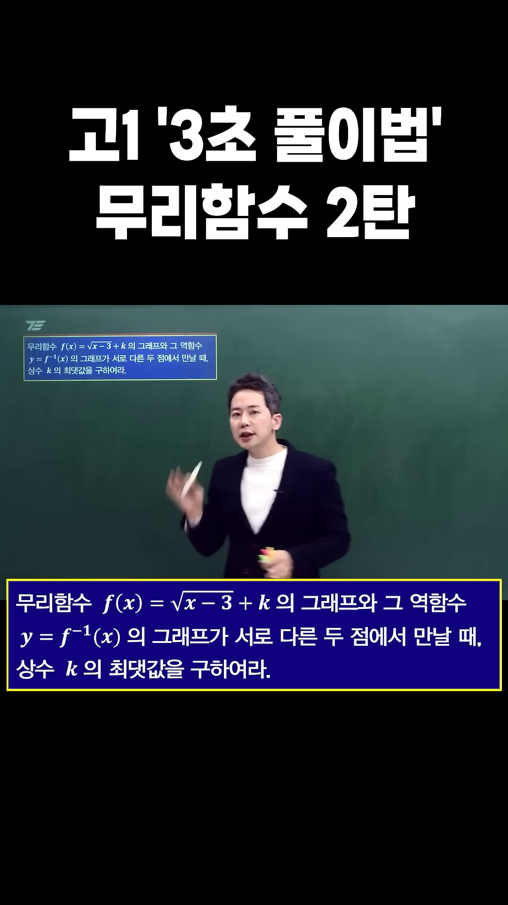
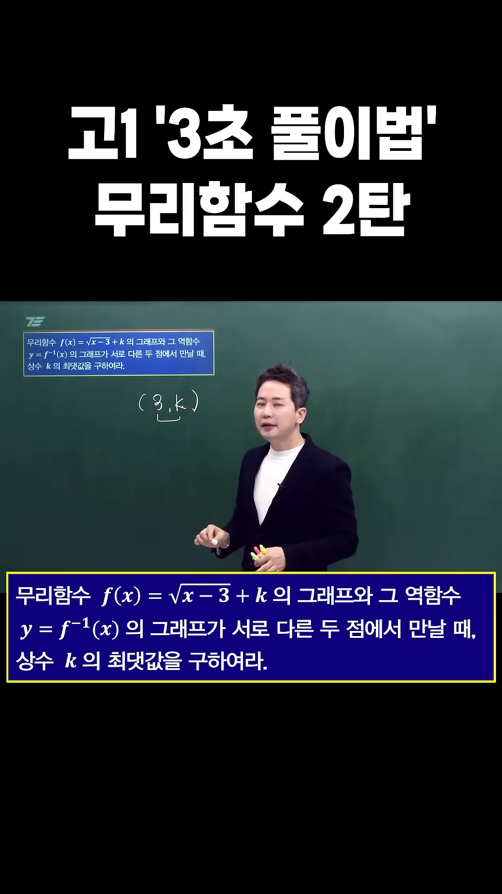
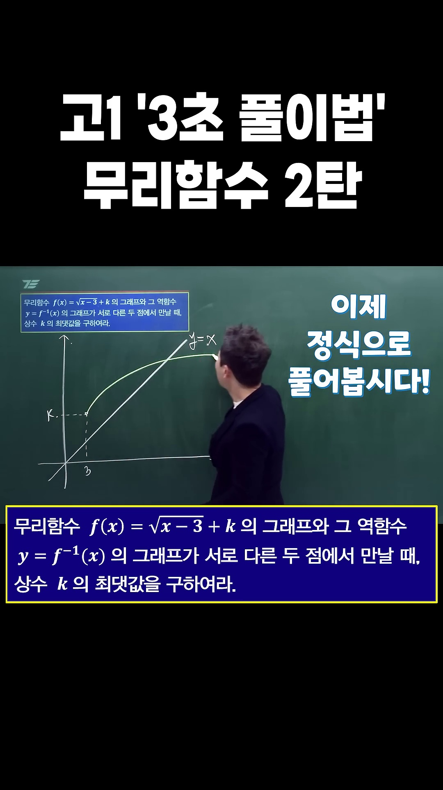
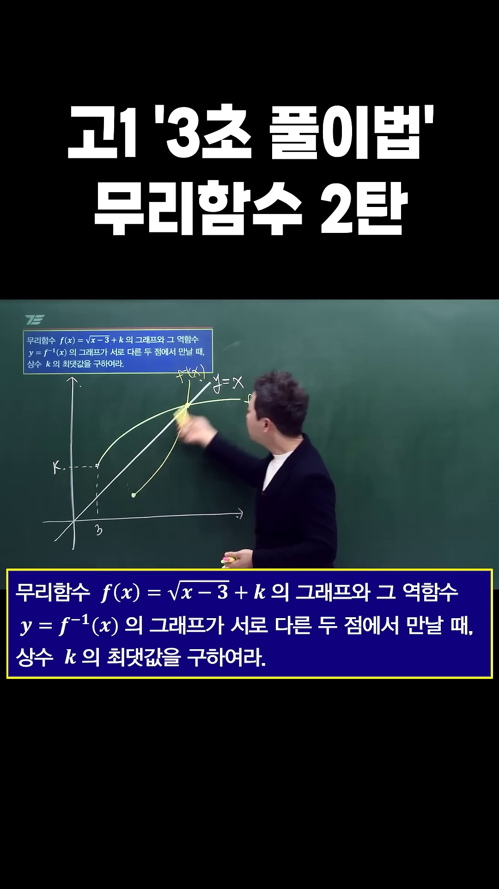
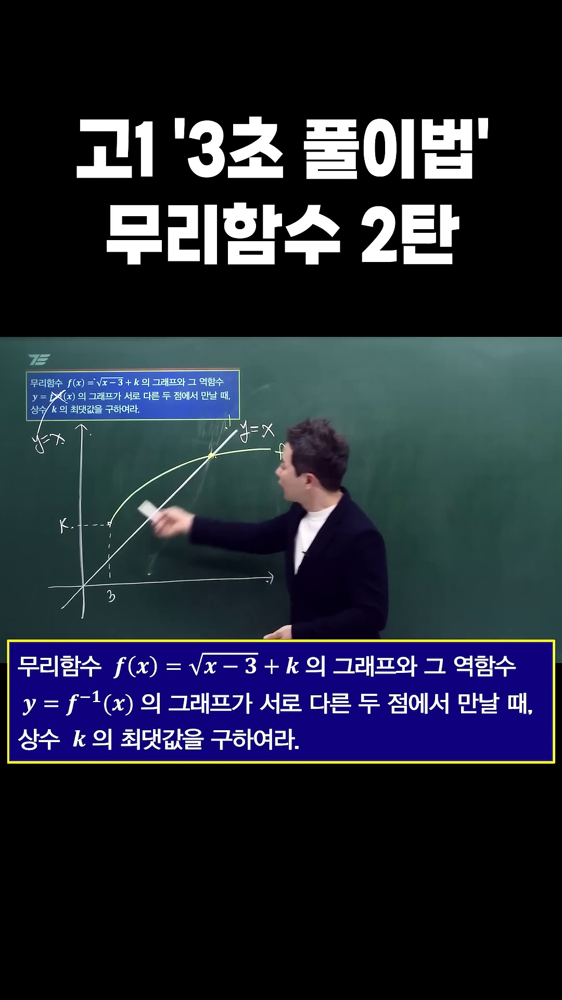
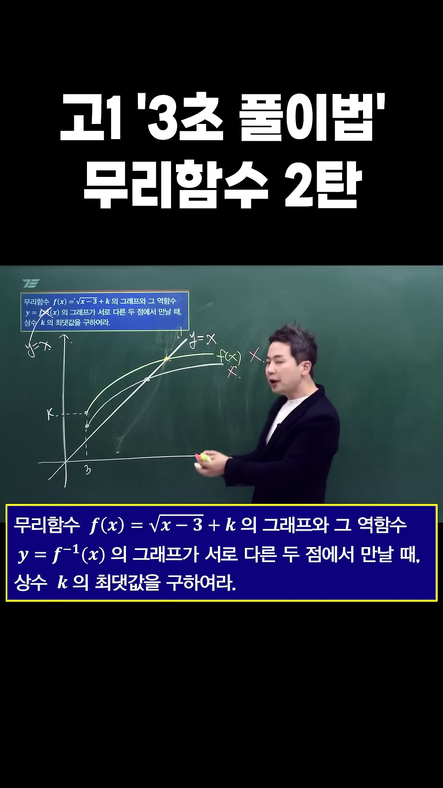
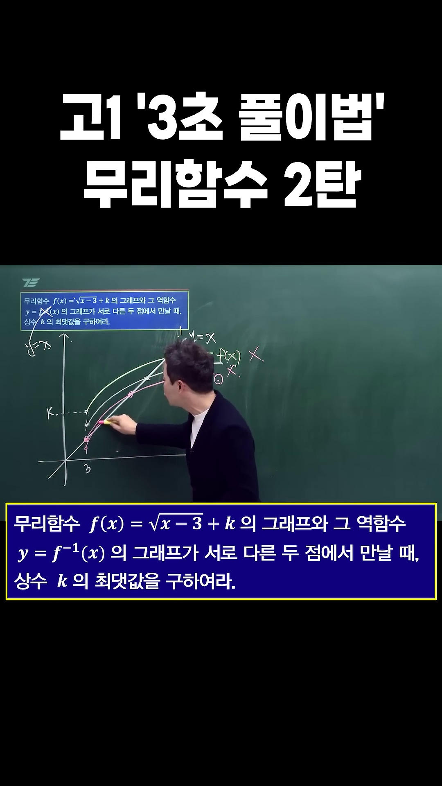
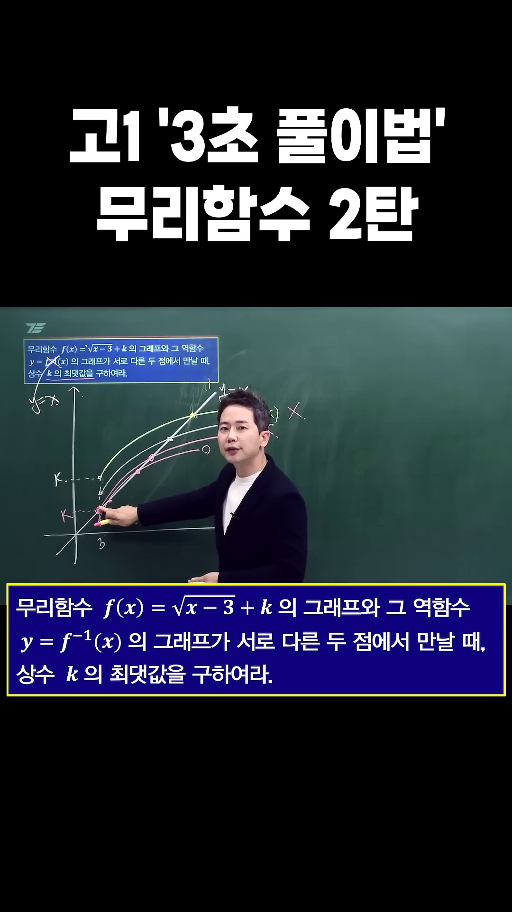

# [고1 수학 (하)] 무리함수와 역함수의 교점 : 3초 풀이법과 시작점 $y=x$ 불변 공식

> **원본 영상 정보**
> - **출처**: [차길영의 세븐에듀 YouTube Shorts](https://youtube.com/shorts/R2khenQ29ug)
> - **영상 제목**: 고1 '3초 풀이법' 무리함수 2탄
> - **강사**: 차길영 선생님 (세븐에듀 대표강사)
> - **영상 길이**: 1분 (60초)
> - **주요 태그**: `#고1수학 #무리함수 #역함수 #3초풀이법 #차길영 #세븐에듀 #기말고사수학 #수학하`

---

## 1. 핵심 요약 (Key Summary)

고1 수학(하) 기말고사 및 모의고사에서 킬러 문항으로 출제되는 대표 유형:
> **"무리함수 $f(x) = \sqrt{x - p} + k$의 그래프와 그 역함수 $y = f^{-1}(x)$의 그래프가 서로 다른 두 점에서 만날 때, 실수 $k$의 최댓값을 구하시오."**

일반적인 교과서 풀이대로 역함수를 직접 구해서 $f(x) = f^{-1}(x)$ 방정식을 풀거나, 이차방정식 판별식 $D$만 무작정 계산하면 
**가짜 근(무연근)**과 범위 조건($x \ge p, y \ge k$) 때문에 오답을 내거나 2분 이상의 시간을 낭비하게 됩니다.

차길영 선생님의 **"3초 풀이법"**은 역함수의 본질인 **대칭축 $y = x$의 기하학적 성질**을 꿰뚫어 봅니다:

1. **역함수와의 교점 $\iff$ 직선 $y = x$와의 교점**:
   - 증가함수인 무리함수 $f(x) = \sqrt{x - p} + k$와 그 역함수 $f^{-1}(x)$의 교점은 **항상 직선 $y = x$ 위에서만 존재**합니다!
   - 따라서 복잡한 역함수를 지우고 **$y = x$와의 교점 문제로 단순화**합니다.

2. **$k$의 최댓값은 시작점 $(p, k)$가 $y = x$ 위에 안착하는 순간 ($k = p$)**:
   - $k$는 무리함수의 상하 평행이동을 결정합니다.
   - 시작점 $(p, k)$가 $y = x$보다 위쪽($k > p$)에 있으면, 곡선은 $y = x$와 최대 1개의 교점만 갖습니다.
   - 곡선이 $y = x$와 **서로 다른 두 점**에서 만나기 위한 상한선은 바로 **시작점 $(p, k)$가 직선 $y = x$ 위에 정확히 놓일 때**입니다.
   $$\text{시작점 } (p, k) \text{가 } y = x \text{ 위} \iff \mathbf{k = p}$$
   - 본 문제에서는 $p = 3$이므로, **보자마자 $k_{\max} = 3$**이 3초 만에 나옵니다!

---

### 📊 교과서 정석 풀이 vs 차길영 3초 풀이법 비교

| 구분 | 교과서 정석 풀이 (대수적 판별식 & 구간 검증) | 차길영 3초 풀이법 (기하학적 시작점 $y=x$ 법칙) |
| :--- | :--- | :--- |
| **방정식 세팅** | $\sqrt{x-3} + k = x \implies x-3 = (x-k)^2$ | $f(x)$와 $y=x$의 기하학적 접촉 상태 파악 |
| **조건 검증** | 판별식 $D > 0$ 및 $x \ge 3, x \ge k$ 무연근 판정 | 시작점 $(3, k)$가 $y=x$에 닿을 때가 최대! |
| **소요 시간** | 1분 30초 ~ 2분 (판별식 계산 및 부등식 검산) | **단 3초 (암산: 시작점 x좌표가 곧 k최댓값)** |
| **두 교점 범위** | $\frac{11}{4} \le k \le 3$ (접할 때 $\le k \le$ 시작점) | 최댓값: $k = 3$, 접선 하한: $k = \frac{11}{4}$ |

---

## 2. 영상 타임라인별 판서 캡처 & 10단계 상세 해설

### 1단계 [00:00:03] 시험 출제 문제 세팅 & 역함수 $y=x$ 연상

* **선생님 설명**:
  > "우리는 $f^{-1}(x)$ 그러면 $y = x$ 대칭이 생각나잖아? 근데 $y = x$는 뭔가 $x$랑 $y$랑 같다! 이거를 잘 연상을 해 보란 말이야!"
* **문제 분석**:
  * $f(x) = \sqrt{x - 3} + k$와 역함수 $y = f^{-1}(x)$가 서로 다른 두 점에서 만날 때, 상수 $k$의 최댓값을 구하는 문제입니다.

---

### 2단계 [00:00:06] $y = x$의 본질: $x$좌표와 $y$좌표의 일치

* **선생님 설명**:
  > "$y = x$ 대칭이라는 건 $x$와 $y$가 같다는 거야. 이걸 잘 기억해!"
* **핵심 개념**:
  * 직선 $y = x$ 위의 모든 점은 $(t, t)$ 꼴입니다.

---

### 3단계 [00:00:10] 무리함수의 출발점(시작점): $(3, k)$

* **선생님 설명**:
  > "지금 이 $f(x)$를 보면 시작점이 $(3, k)$지? 눈치 챘어?"
* **해설**:
  * 근호 내부 $x - 3 = 0 \implies x = 3$.
  * 따라서 무리함수 $f(x) = \sqrt{x - 3} + k$의 시작점은 $(3, k)$입니다.

---

### 4단계 [00:00:14] 3초 예고: $k = 3$일 수밖에 없는 이유

* **선생님 설명**:
  > "$k$ 얼마여야 돼? 3이어야 돼!"
* **직관적 통찰**:
  * 시작점 $(3, k)$에서 $x$좌표가 $3$이므로, $y=x$ 위에 오려면 $y$좌표인 $k$도 $3$이어야 합니다.

---

### 5단계 [00:00:20] $f(x)$와 $f^{-1}(x)$ 곡선의 기하학적 스케치

* **선생님 설명**:
  > "시작점이 $(3, k)$라 그래프를 그려 보니까 뭐 이렇게 되나 봐. 이제 얘를 $y = x$ 대칭하면 요게 이제 $f^{-1}(x)$일 거 아니야."
* **작도 해설**:
  * 무리함수는 오른쪽 위로 뻗어나가고, 역함수인 이차함수의 우측 반쪽 역시 대칭으로 뻗어나갑니다.

---

### 6단계 [00:00:28] 역함수를 지우고 $y = x$로 대체하기

* **선생님 설명**:
  > "근데 $f(x)$와 $f^{-1}(x)$의 교점은 이 $f(x)$와 $y = x$의 교점이랑 똑같은 거잖아! 그러니까 이 $f^{-1}(x)$는 없애버리고 $y = x$로 대체하겠다는 거지!"
* **치환 정리**:
  $$f(x) \cap f^{-1}(x) \iff f(x) \cap (y = x)$$

---

### 7단계 [00:00:35] 한 점에서 만나는 경우의 실패 (조건 불만족)

* **선생님 설명**:
  > "서로 다른 두 점에서 만나라고 했는데 지금 내가 그린 그림은 안 되잖아. 왜? 한 점에서 만나니까!"
* **실패 원인**:
  * 시작점 $(3, k)$가 $y = x$보다 너무 위쪽에 있으면 곡선이 $y = x$를 한 번만 뚫고 지나가므로 교점이 1개뿐입니다.

---

### 8단계 [00:00:42] 곡선이 아래로 내려와 시작점이 $y = x$ 위에 도달!

* **선생님 설명**:
  > "그러면 확 내려와 가지고 얘가 $y = x$ 위에 있을 때 쭉 그려 보니까 어머 되네!"
* **핵심 기하학**:
  * 시작점 $(3, k)$가 정확히 $y = x$ 위에 닿으면 $(3, 3)$이 첫 번째 교점이 되고, 완만한 곡선이 뻗어나가며 $(4, 4)$에서 두 번째 교점이 생겨 **완벽한 2개 교점**이 형성됩니다!

---

### 9단계 [00:00:48] 더 내려와도 두 점에서 만나는 유효 구간

* **선생님 설명**:
  > "조금만 더 내려와도 두 점에서 만나니까 된단 말이야. 하지만 우리가 원하는 거는 $k$의 최댓값이기 때문에!"
* **전체 범위 분석**:
  * 곡선이 접할 때인 $k = \frac{11}{4} = 2.75$부터 시작점이 닿는 $k = 3$까지가 두 점에서 만나는 구간입니다:
    $$\frac{11}{4} \le k \le 3$$

---

### 10단계 [00:00:55] $k$의 최댓값 완결: $k_{\max} = 3$!

* **선생님 설명**:
  > "$k$가 여기 왔을 때, $y = x$ 위에 왔을 때, $y$랑 $x$가 같을 때! 그래서 $k$는 3일 수밖에 없다는 거야!"
* **최종 결론**:
  $$\mathbf{k_{\max} = 3}$$

---

## 3. 수능/내신 실전 무리함수 5대 치트키

### [치트키 1] 무리함수와 역함수 교점 2개 존재 일반 공식
무리함수 $f(x) = \sqrt{a(x - p)} + k$ ($a > 0$)와 $y = x$가 서로 다른 두 점에서 만날 조건:
$$\mathbf{\frac{4p - a}{4} \le k \le p}$$
* **최댓값**: $k_{\max} = p$ (시작점이 $y = x$ 위에 있을 때)
* **최솟값**: $k_{\min} = \frac{4p - a}{4}$ (곡선이 $y = x$에 접할 때, $D = 0$)
* 본 문제 적용: $a = 1, p = 3 \implies \frac{4(3) - 1}{4} \le k \le 3 \iff \mathbf{\frac{11}{4} \le k \le 3}$ (암산 1초 컷!)

### [치트키 2] 역함수를 직접 구하지 않는 절대 원칙
무리함수의 역함수는 정의역이 제한된 이차함수입니다:
$$y = \sqrt{x - p} + k \iff f^{-1}(x) = (x - k)^2 + p \quad (x \ge k)$$
역함수와 연립하면 4차방정식 또는 번거로운 이차방정식이 되므로, **절대로 $f^{-1}(x)$를 직접 구하지 말고 항상 $y = x$와 연립**하십시오.

### [치트키 3] 두 교점 사이의 거리 공식
두 교점의 $x$좌표가 $\alpha, \beta$일 때, 두 교점은 모두 $y = x$ 위의 점 $(\alpha, \alpha), (\beta, \beta)$이므로
거리 $l$은 직각이등변삼각형 비율에 의해:
$$l = \sqrt{2}|\beta - \alpha|$$
