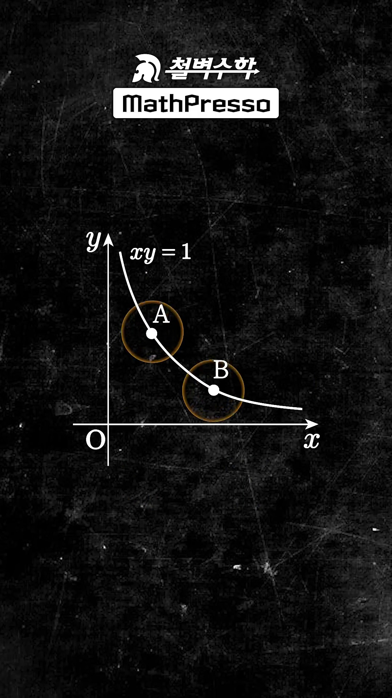
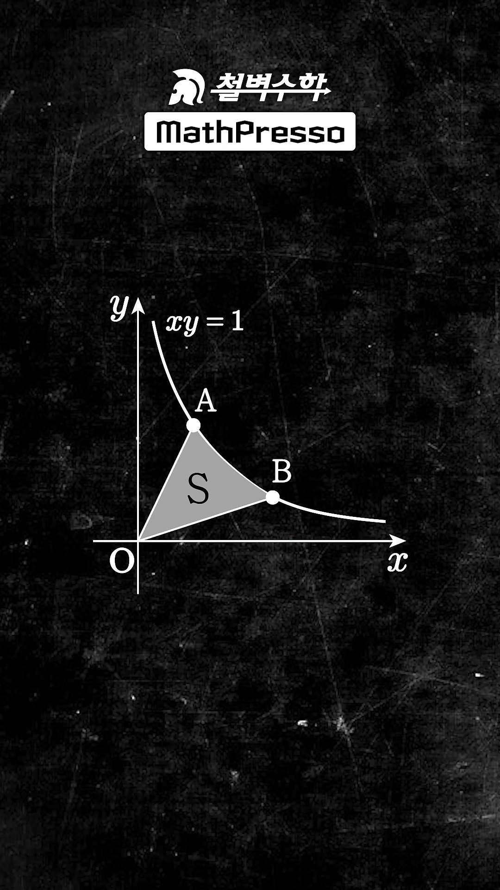
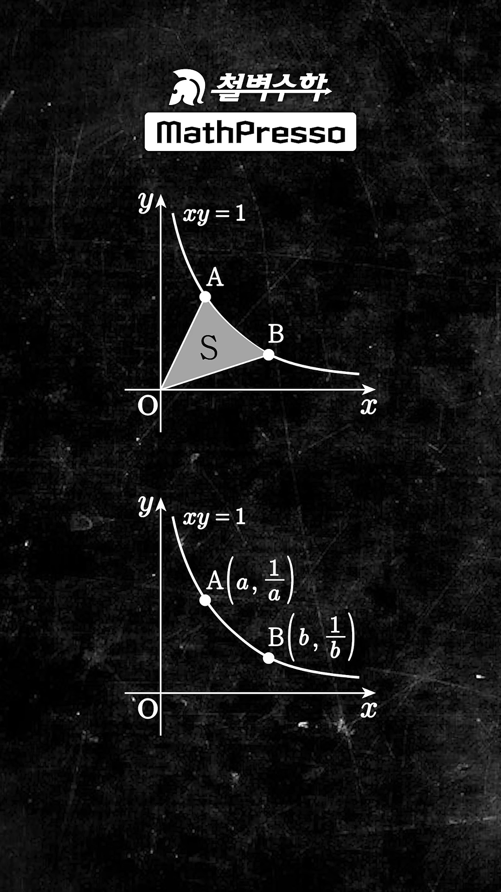
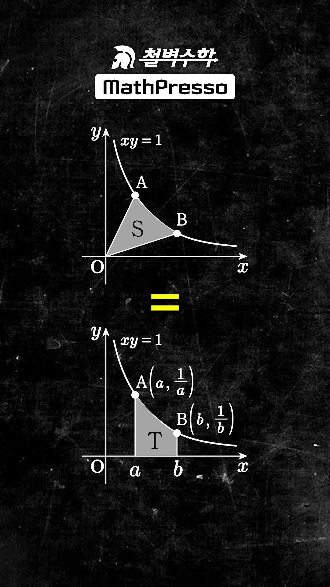
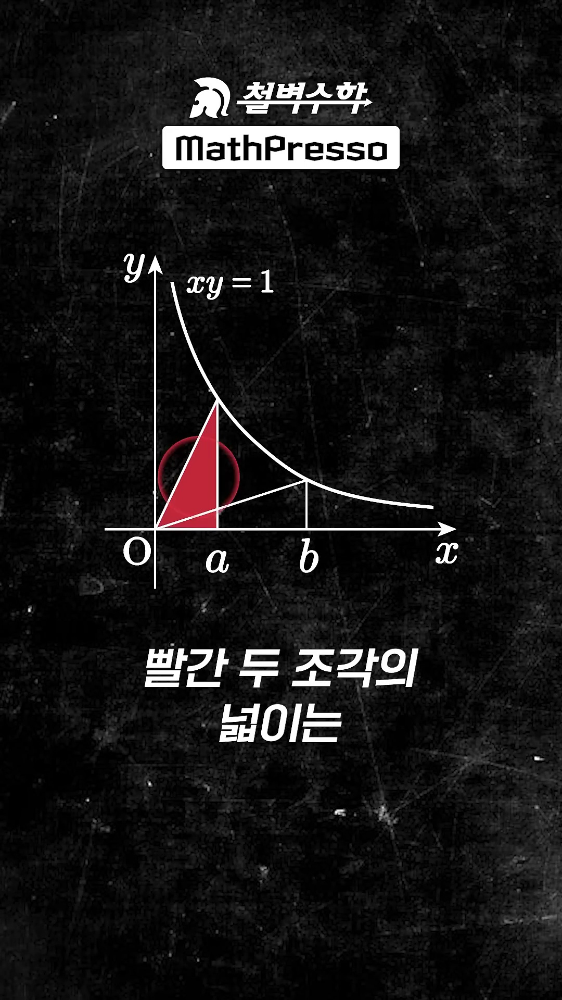
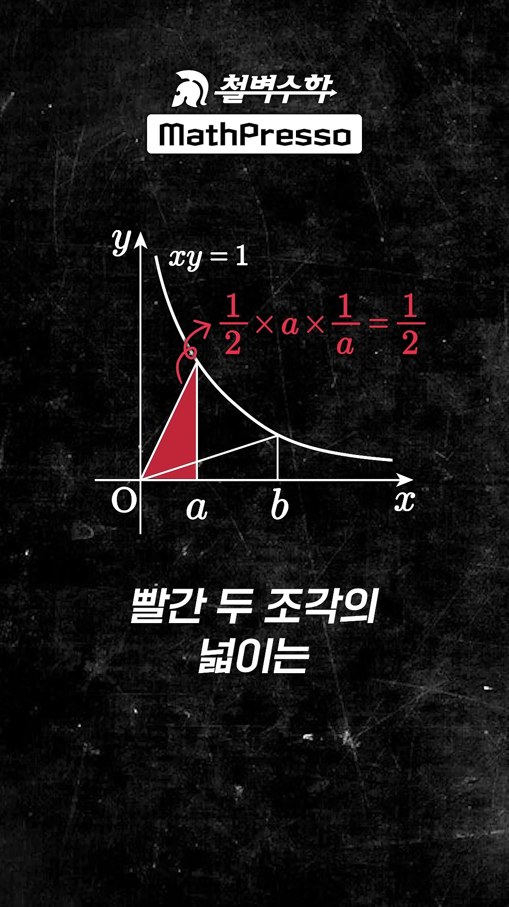
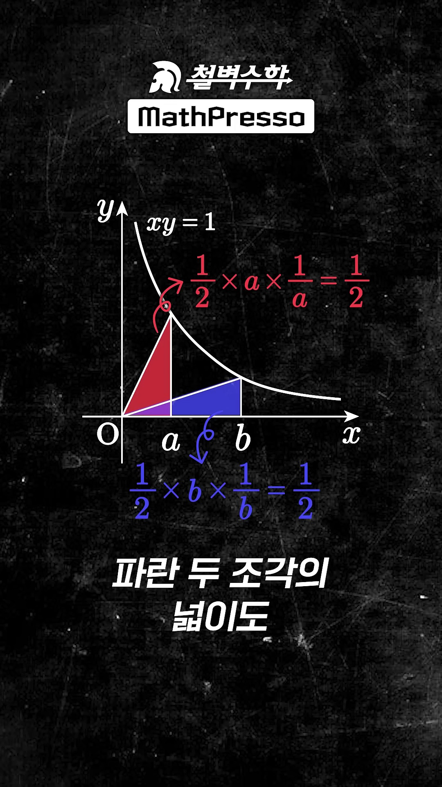
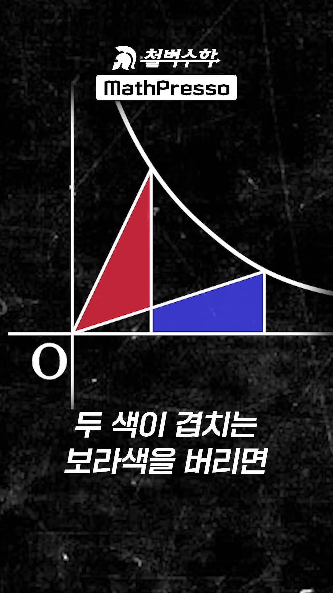
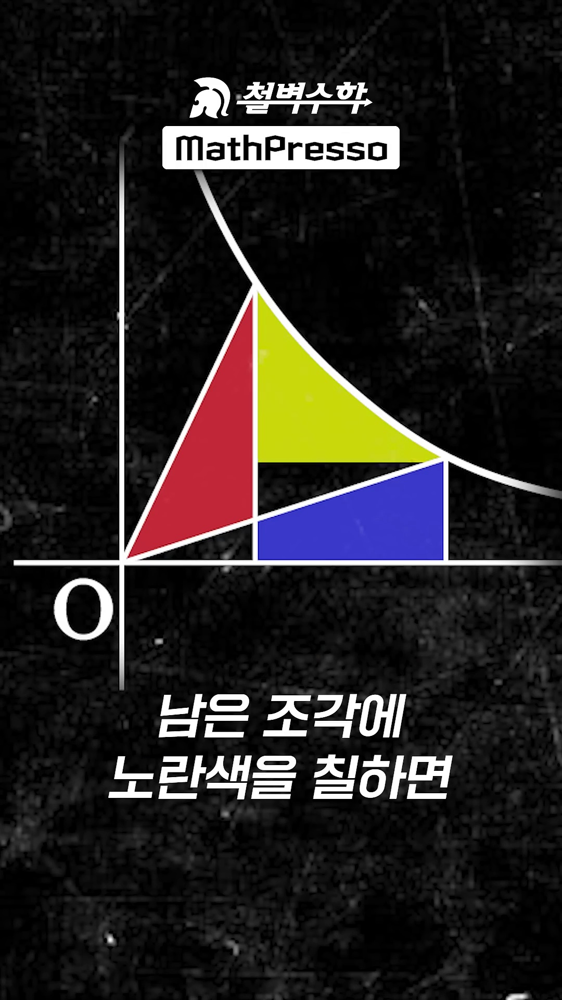
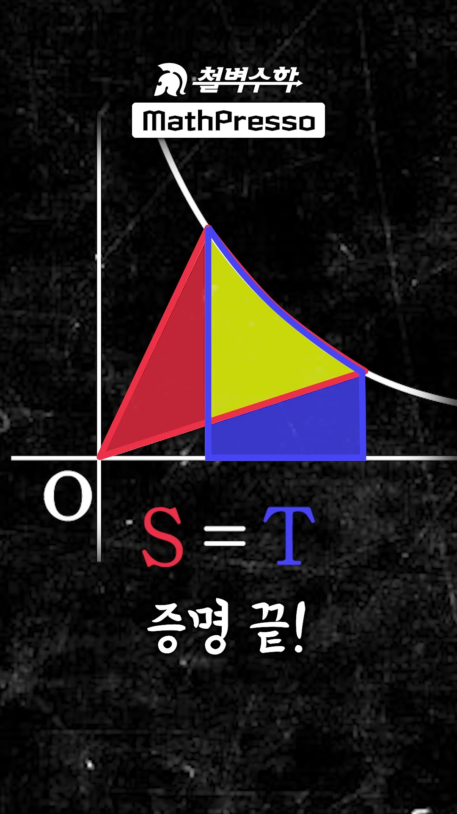

# [고1 수학 (하)] 직각쌍곡선(유리함수)의 기하학적 넓이 불변 정리 : $S = T$ 증명과 자연로그의 기원

> **원본 영상 정보**
> - **출처**: [매스프레소 MathPresso YouTube Shorts](https://youtube.com/shorts/uiHX6PxDIB4)
> - **영상 제목**: [고1] 유리함수 넓이 꿀팁!!
> - **강사**: 배상면 선생님 (철벽수학 / MathPresso)
> - **영상 길이**: 40초
> - **주요 태그**: `#고1수학 #유리함수 #넓이꿀팁 #쌍곡선 #수학하 #수능수학 #적분 #자연로그`

---

## 1. 핵심 요약 (Key Summary)

고1 수학(하) 유리함수 대단원 및 수능/모의고사 미적분에서 출제되는 전설적인 기하학적 정리:
> **"직각쌍곡선 $xy = 1$ (유리함수 $y = \frac{1}{x}$) 위의 두 점 $A(a, \frac{1}{a}), B(b, \frac{1}{b})$ ($0 < a < b$)에 대하여,  
> 원점 $O$와 선분 $OA, OB$, 그리고 쌍곡선 호 $AB$로 둘러싸인 부채꼴 형태의 넓이 $S$는,  
> 쌍곡선과 두 수직선 $x = a, x = b$, 그리고 $x$축으로 둘러싸인 밑면 적분 사다리꼴 넓이 $T$와 기하학적으로 완전히 같다! ($S = T$)"**

이 정리는 1647년 벨기에의 수학자 **그레고아 드 생뱅상(Grégoire de Saint-Vincent)**이 직각쌍곡선 아래의 넓이가 등비수열에 대응하여 등차수열을 이룬다는 사실을 밝혀내며, **자연로그($\ln x$)의 기원이 된 역사적인 기하학 정리**입니다.

배상면 선생님은 미적분의 정적분을 단 한 줄도 쓰지 않고, **고등학교 1학년 수준의 직각삼각형 등적변형 및 영역 상쇄(Inclusion-Exclusion Principle)**를 통해 단 4단계 만에 우아하게 증명합니다:

$$\mathbf{S = T = \int_a^b \frac{1}{x}\,dx = \ln\left(\frac{b}{a}\right)}$$

---

### 📊 영역 분할 및 4단계 기하학적 증명 메커니즘

| 단계 | 기하학적 영역 및 수식 | 핵심 원리 및 물리적 의미 |
| :--- | :--- | :--- |
| **1단계** | $\triangle OAA' = \frac{1}{2} \cdot a \cdot \frac{1}{a} = \frac{1}{2}$ | $A(a, \frac{1}{a})$에서 $x$축에 내린 수선의 발 $A'(a, 0)$과 원점이 이루는 직각삼각형 넓이는 항상 일정($\frac{1}{2}$) |
| **2단계** | $\triangle OBB' = \frac{1}{2} \cdot b \cdot \frac{1}{b} = \frac{1}{2}$ | $B(b, \frac{1}{b})$에서 $x$축에 내린 수선의 발 $B'(b, 0)$과 원점이 이루는 직각삼각형 넓이도 항상 일정($\frac{1}{2}$) |
| **3단계** | $\text{빨간 조각} = \text{파란 조각}$ | 두 삼각형에서 공통으로 겹치는 **보라색 삼각형 영역**을 빼면: $\triangle OAA' - \text{공통} = \triangle OBB' - \text{공통}$ |
| **4단계** | $\text{빨강} + \text{노랑} = \text{파랑} + \text{노랑} \implies \mathbf{S = T}$ | 양변에 쌍곡선 호 $AB$ 아래의 **노란색 곡면 조각**을 공통으로 더해주면, 좌변은 $S$, 우변은 $T$가 되어 증명 완료! |

---

## 2. 영상 타임라인별 판서 캡처 & 10단계 상세 해설

### 1단계 [00:00:03] 직각쌍곡선 $xy=1$과 두 점 $A, B$ 세팅

* **선생님 설명**:
  > "직각쌍곡선 $xy=1$ 위의 두 점을 $A, B$라 할 때..."
* **수학적 분석**:
  * $xy = 1 \iff y = \frac{1}{x}$ ($x > 0$ 제1사분면 기준).
  * 점 $A$와 $B$는 곡선 위의 임의의 두 점이며, 편의상 $0 < a < b$로 둡니다.

---

### 2단계 [00:00:05] 쌍곡선 부채꼴 넓이 $S$ 정의

* **선생님 설명**:
  > "...선분 $OA, OB$와 쌍곡선으로 둘러싸인 넓이 $S$는..."
* **수학적 분석**:
  * 원점 $O(0, 0)$에서 점 $A$로 뻗은 동경 선분 $OA$, 점 $B$로 뻗은 동경 선분 $OB$, 그리고 쌍곡선의 호 $AB$가 이루는 부채꼴(Hyperbolic Sector)의 넓이를 $S$로 정의합니다.

---

### 3단계 [00:00:10] $x$축 투영 적분 영역 넓이 $T$ 정의

* **선생님 설명**:
  > "...점 $A(a, \frac{1}{a})$, 점 $B(b, \frac{1}{b})$이라 할 때 쌍곡선과 직선 $x=a, x=b$, $x$축으로 둘러싸인 넓이 $T$와..."
* **수학적 분석**:
  * 점 $A$에서 $x$축에 내린 수선 $x = a$, 점 $B$에서 $x$축에 내린 수선 $x = b$, $x$축($y = 0$), 그리고 곡선 $y = \frac{1}{x}$로 둘러싸인 사다리꼴 형태의 곡면 넓이를 $T$로 정의합니다.
  * 미적분학의 정적분 기호로 나타내면 $T = \int_a^b \frac{1}{x}\,dx$ 입니다.

---

### 4단계 [00:00:15] 핵심 정리 제시: $S = T$의 일치 선언

* **선생님 설명**:
  > "...넓이 $T$와 같다!"
* **수학적 분석**:
  * 원점에서 뻗은 방사형 부채꼴 $S$와, $x$축으로 똑바로 내린 사다리꼴 적분 영역 $T$가 완벽하게 동일한 넓이를 가집니다.
  * 이제 적분을 전혀 사용하지 않고 기하학적으로 이를 증명합니다.

---

### 5단계 [00:00:17] 기하학적 4영역 분할 (Partition of Planar Regions)

* **선생님 설명**:
  > "그림을 네 영역으로 쪼개면..."
* **수학적 분석**:
  * 선분 $OB$와 수선 $x = a$의 교점을 $C$라 하고, $x$축 위의 수선의 발들을 $A'(a, 0), B'(b, 0)$이라 할 때, 전체 도형은 4개의 상호 배타적인 영역으로 분할됩니다:
    1. 빨간색 조각: $\triangle OAC$
    2. 파란색 조각: 사각형 $A' C B B'$ (선분 $CB$, 수선 $x=a, x=b$, $x$축으로 둘러싸인 사다리꼴)
    3. 보라색 조각 (공통 영역): $\triangle OA'C$
    4. 노란색 조각: 쌍곡선 호 $AB$와 선분 $AB$ 사이의 곡면 조각

---

### 6단계 [00:00:20] 빨간 직각삼각형의 넓이 계산 ($\frac{1}{2}$)

* **선생님 설명**:
  > "빨간 두 조각의 넓이는 $\frac{1}{2} \cdot a \cdot \frac{1}{a} = \frac{1}{2}$..."
* **수학적 분석**:
  * 직각삼각형 $\triangle OAA'$는 밑변의 길이가 $a$, 높이가 $A$의 $y$좌표인 $\frac{1}{a}$입니다.
  * 따라서 넓이는:
    $$\text{Area}(\triangle OAA') = \frac{1}{2} \times a \times \frac{1}{a} = \frac{1}{2}$$
  * 이 직각삼각형은 [빨간 조각($\triangle OAC$)] + [보라색 공통 조각($\triangle OA'C$)]의 합입니다.

---

### 7단계 [00:00:23] 파란 직각삼각형의 넓이 계산 ($\frac{1}{2}$)

* **선생님 설명**:
  > "...파란 두 조각의 넓이도 $\frac{1}{2} \cdot b \cdot \frac{1}{b} = \frac{1}{2}$로 빨강, 파랑의 넓이는 같다."
* **수학적 분석**:
  * 직각삼각형 $\triangle OBB'$는 밑변의 길이가 $b$, 높이가 $B$의 $y$좌표인 $\frac{1}{b}$입니다.
  * 따라서 넓이는:
    $$\text{Area}(\triangle OBB') = \frac{1}{2} \times b \times \frac{1}{b} = \frac{1}{2}$$
  * 점 $B$의 위치가 아무리 달라져도 원점과 수선의 발이 만드는 삼각형의 넓이는 언제나 $\frac{1}{2}$로 불변입니다!
  * 따라서 $\text{Area}(\triangle OAA') = \text{Area}(\triangle OBB') = \frac{1}{2}$ 입니다.

---

### 8단계 [00:00:28] 공통 보라색 영역 제거 (등식의 양변 상쇄)

* **선생님 설명**:
  > "두 색이 겹치는 보라색을 버리면, 빨강, 파랑 한 조각의 넓이도 같다."
* **수학적 분석**:
  * $\triangle OAA' = \text{빨간 조각} + \text{보라색 조각} = \frac{1}{2}$
  * $\triangle OBB' = \text{파란 조각} + \text{보라색 조각} = \frac{1}{2}$
  * 양변에서 공통 영역인 **보라색 조각($\triangle OA'C$)**을 감산(Subtraction)합니다:
    $$\text{빨간 조각} = \frac{1}{2} - \text{보라색 조각} = \text{파란 조각}$$
  * 즉, 순수한 **빨간 조각 = 파란 조각**이 증명됩니다.

---

### 9단계 [00:00:32] 노란색 곡면 영역 공통 덧셈 (Inclusion)

* **선생님 설명**:
  > "남은 조각에 노란색을 칠하면, 빨강+노랑의 합은 파랑+노랑의 합이므로..."
* **수학적 분석**:
  * 호 $AB$와 선분 $AB$ 사이의 곡면 조각을 **노란색 조각**이라 합니다.
  * 등식 $\text{빨간 조각} = \text{파란 조각}$의 양변에 동일한 **노란색 조각**을 더합니다:
    $$\text{빨간 조각} + \text{노란 조각} = \text{파란 조각} + \text{노란 조각}$$

---

### 10단계 [00:00:34] 최종 결론 도출: $S = T$ 증명 끝!

* **선생님 설명**:
  > "...빨강+노랑의 합은 파랑+노랑의 합이므로 $S$는 $T$다. 증명 끝!"
* **수학적 분석**:
  * **좌변**: $\text{빨간 조각} + \text{노란 조각} + \triangle OAB = \text{원점 } O \text{와 호 } AB\text{로 이루어진 쌍곡선 부채꼴 } S$
  * **우변**: $\text{파란 조각} + \text{노란 조각} + \text{사다리꼴} = \text{수직선 } x=a, x=b \text{와 } x\text{축, 곡선이 이루는 적분 영역 } T$
  * 따라서 완벽하게:
    $$\mathbf{S = T}$$
  * Q.E.D. (증명 완료!)

---

## 3. 심화 수학적 배경: 자연로그와 쌍곡선 함수의 기원

### (1) 그레고아 드 생뱅상 정리 (1647년)
17세기 수학자 그레고아 드 생뱅상은 직각쌍곡선 $y = \frac{1}{x}$ 아래의 면적 $T(a, b) = \int_a^b \frac{1}{x}\,dx$가 다음 성질을 만족함을 기하학적으로 증명했습니다:
$$T(1, x_1 \cdot x_2) = T(1, x_1) + T(1, x_2)$$
이는 곧 곱셈을 덧셈으로 바꾸는 **로그(Logarithm)의 정의**와 정확히 일치하며, 이후 자연로그 밑 $e$의 발견과 미적분학의 발전으로 직결되었습니다.

### (2) 일반 직각쌍곡선 $xy = k$로의 확장
임의의 상수 $k > 0$에 대하여:
1. 직각삼각형 넓이: $\triangle OAA' = \triangle OBB' = \frac{1}{2} k$ (여전히 상수로 동일)
2. 따라서 임의의 유리함수 $y = \frac{k}{x}$에서도:
   $$S = T = \int_a^b \frac{k}{x}\,dx = k \ln\left(\frac{b}{a}\right)$$
   가 정확하게 성립합니다!

### (3) 수능/내신 실전 킬러 기출 적용 꿀팁
* **유리함수 위의 점에서 축에 내린 직사각형의 넓이는 항상 $k$로 일정**하며, 원점과 잇는 삼각형의 넓이는 항상 $\frac{1}{2}k$로 일정합니다.
* 모의고사에서 원점과 쌍곡선 위의 두 점이 이루는 부채꼴이나 삼각형 복합 넓이를 구할 때, 복잡한 삼각비나 신발끈 공식을 쓸 필요 없이 **$x$축으로 내린 정적분 사다리꼴 넓이 $T$로 즉시 치환**하여 암산할 수 있습니다!
