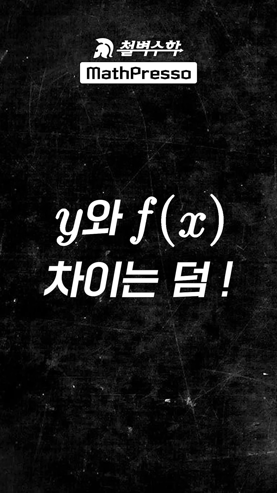
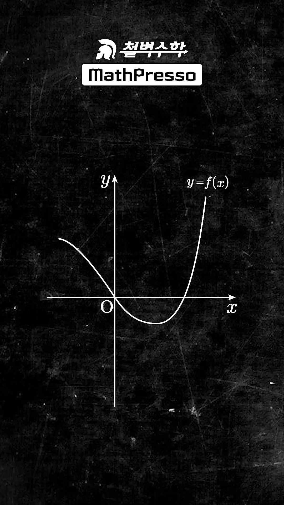
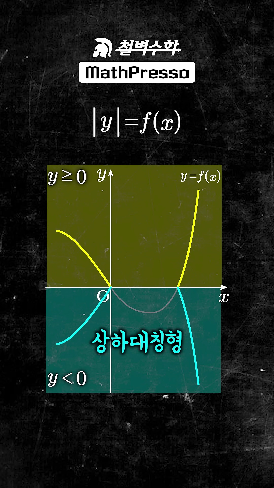
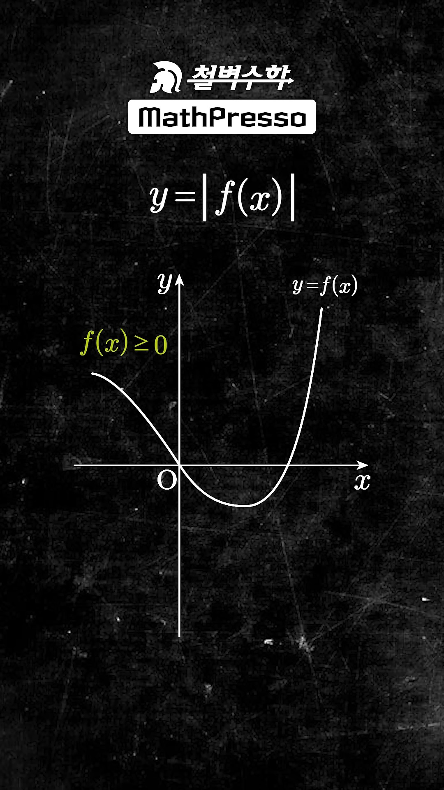
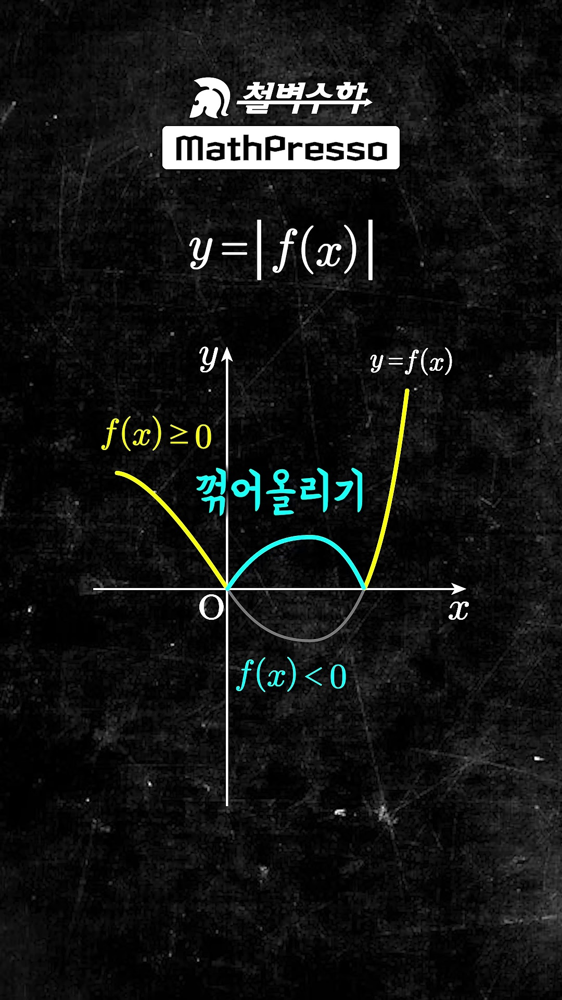
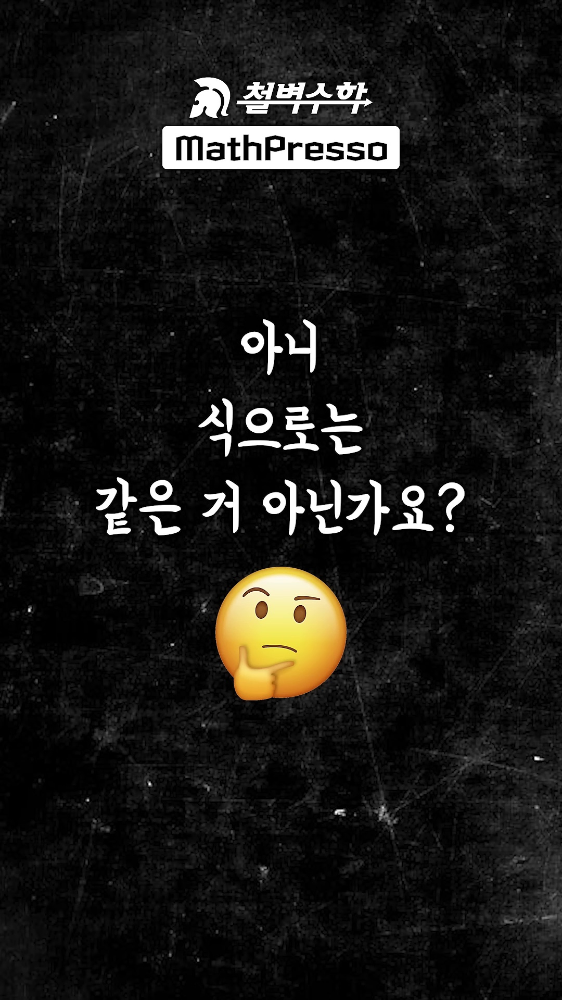
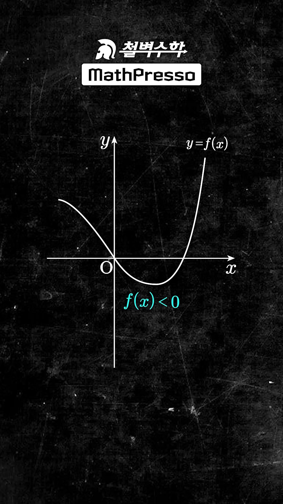
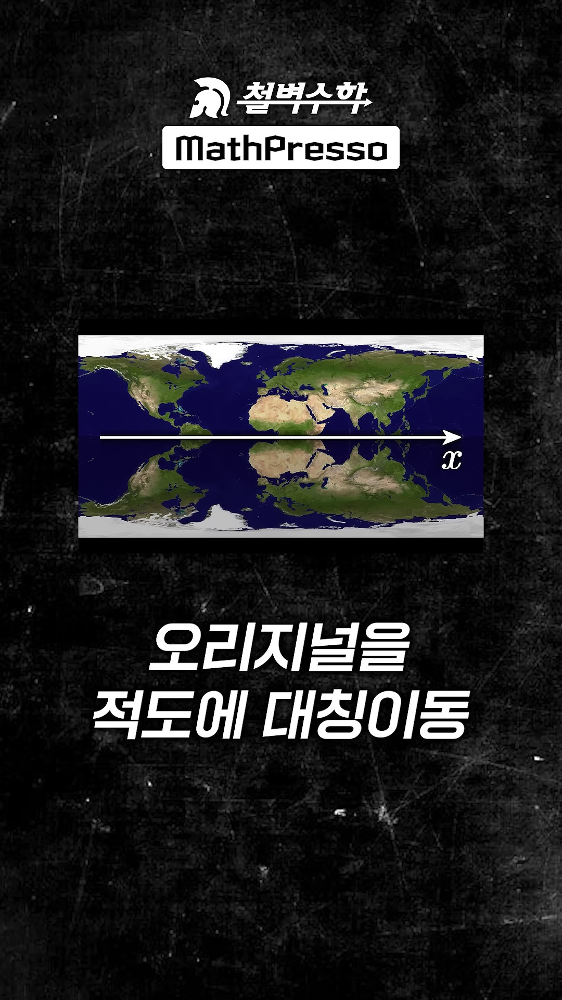
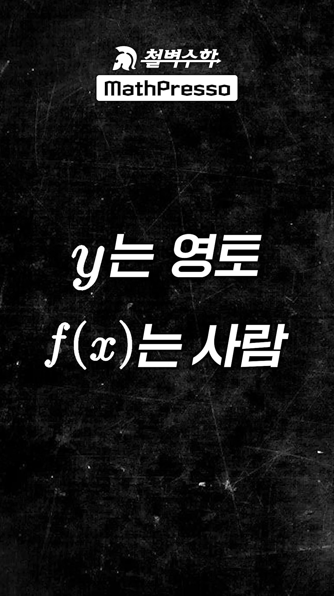

# [고1 수학] $y$와 $f(x)$의 본질적 차이 : 영역(영토) vs 그래프(사람) & 4대 절댓값 함수의 완전 정복

> **원본 영상 정보**
> - **출처**: [매스프레소 MathPresso YouTube Shorts](https://youtube.com/shorts/-Kcc-4UwVCg)
> - **영상 제목**: "y와 f(x) 차이" 솔직히 모르지?!
> - **강사**: 배상면 선생님 (철벽수학 / MathPresso 대표강사)
> - **영상 길이**: 52초
> - **주요 태그**: `#고1수학 #함수 #절댓값그래프 #대칭이동 #배상면 #철벽수학 #매스프레소 #수능수학 #수학하`

---

## 1. 핵심 요약 (Key Summary)

중·고등학교 수학에서 함수를 정의할 때 습관적으로 $y = f(x)$라는 등식을 사용합니다.
그러다 보니 대부분의 학생들은 **"$y$와 $f(x)$는 결국 똑같은 것이 아닌가?"**라는 착각에 빠집니다.

하지만 **도형의 이동, 대칭이동, 절댓값 기호가 붙는 순간**, 둘의 본질적인 차이가 극명하게 드러납니다:

> **"지구가 스케치북이라면 $x$축은 적도!  
> $y$가 음($y < 0$)인 것은 $x$축 아래 '영토(영역, Territory)'를 뜻하고,  
> $f(x)$가 음($f(x) < 0$)인 것은 $x$축 아래 살고 있는 '사람(그래프 곡선, Resident)'을 뜻한다!  
> 즉, $\mathbf{y}$는 영토이고, $\mathbf{f(x)}$는 사람이다!"**

---

### 📊 $|y| = f(x)$ vs $y = |f(x)|$ 기하학적 메커니즘 비교

| 구분 | $|y| = f(x)$ (종속변수 $y$에 절댓값) | $y = |f(x)|$ (함숫값 전체에 절댓값) |
| :--- | :--- | :--- |
| **절댓값의 대상** | **영토($y$, 좌표 공간)**에 씌움 | **사람($f(x)$, 함숫값 곡선)**에 씌움 |
| **수학적 정의** | $y \ge 0 \implies y = f(x)$<br>$y < 0 \implies -y = f(x) \iff y = -f(x)$ | $f(x) \ge 0 \implies y = f(x)$<br>$f(x) < 0 \implies y = -f(x)$ |
| **그래프 조작법** | $x$축 위쪽($y \ge 0$) 영토의 그래프를 남기고,<br>그것을 $x$축 대칭하여 **아래쪽 영토로 복사(상하 대칭형)** | $x$축 위쪽($f(x) \ge 0$)은 그대로 두고,<br>$x$축 아래 살던 사람($f(x) < 0$)만 **위로 꺾어 올림(V-Fold)** |
| **함수 판정** | 하나의 $x$에 $y$값이 2개 대응되므로 **함수가 아님 (도형의 관계식)** | 여전히 하나의 $x$에 하나의 $y$가 대응되는 **엄연한 함수** |
| **실제 치역** | $f(x) \ge 0$인 $x$에 대해서만 상하 2개 존재 | 모든 실수 $x$에 대해 항상 $y \ge 0$ |
| **배티의 비유** | **남반구 영토 복사**: 적도 대칭형 영토 분할 | **북반구 이주 정책**: 남쪽 사람만 북쪽으로 강제 이주 |

---

## 2. 영상 타임라인별 판서 캡처 & 10단계 상세 해설

### 1단계 [00:00:02] 인트로: "y와 f(x) 차이 솔직히 모른다에 한 표!"


* **선생님 설명**:
  > "y, f(x) 차이 솔직히 모른다! 절댓값 그래프를 접수하면 y와 f(x)의 차이는 덤이다."
* **수학적 배경**:
  * 교과서에서는 $y$를 종속변수, $f(x)$를 $x$에 대한 함숫값이라 부르지만, 학생들이 피부로 체감하기 어렵습니다.
  * 절댓값을 씌웠을 때 나타나는 그래프의 전혀 다른 거동을 통해 본질을 파악합니다.

---

### 2단계 [00:00:07] 오리지널 함수 $y = f(x)$ 그래프 세팅



* **선생님 설명**:
  > "$y = f(x)$ 오리지널 그래프가 요래 생겼을 때..."
* **수학적 분석**:
  * 원점을 지나며 $x$축 아래로 내려갔다가 다시 올라오는 전형적인 삼차함수/이차함수 형태의 곡선을 기본 함수 $y = f(x)$로 둡니다.

---

### 3단계 [00:00:11] $|y| = f(x)$ 식 제시 및 $y$ 영역 분할



* **선생님 설명**:
  > "y의 절댓값 씌운 그래프는 $y$가 0 이상일 때는 오리지널 유지..."
* **수학적 분석**:
  * 절댓값 정의에 의해:
    $$|y| = \begin{cases} y & (y \ge 0) \\ -y & (y < 0) \end{cases}$$
  * 따라서 $y \ge 0$인 영역(제1, 2사분면)에서는 원래 식 $y = f(x)$를 그대로 유지합니다.

---

### 4단계 [00:00:17] $|y| = f(x)$ 상하 대칭형 그래프 완성



* **선생님 설명**:
  > "...y가 0보다 작을 때는 오리지널을 x축 대칭 이동하면 상하 대칭형이 되고..."
* **수학적 분석**:
  * $y < 0$인 영역에서는 $-y = f(x) \iff y = -f(x)$가 되므로, $y \ge 0$에 그려진 그래프를 $x$축에 대하여 대칭 복사합니다.
  * 단, $f(x) < 0$인 구간에서는 $|y| = f(x) < 0$이 되어 만족하는 실수 $y$가 존재하지 않으므로 그래프가 완전히 비어있게 됩니다!
  * 완성된 형태는 $x$축을 기준으로 위아래가 똑같은 **상하 대칭형(Symmetric Wings)**입니다.

---

### 5단계 [00:00:22] $y = |f(x)|$ 식 제시 및 $f(x)$ 부호 분할



* **선생님 설명**:
  > "f(x)의 절댓값 씌운 그래프는 f(x)가 0 이상일 때 오리지널 유지..."
* **수학적 분석**:
  * 이번에는 $y$가 아니라 $f(x)$ 전체에 절댓값이 씌워졌습니다:
    $$y = |f(x)| = \begin{cases} f(x) & (f(x) \ge 0) \\ -f(x) & (f(x) < 0) \end{cases}$$
  * $f(x) \ge 0$인 구간($x$축 위에 있는 곡선 부분)은 오리지널 형태를 그대로 유지합니다.

---

### 6단계 [00:00:27] $y = |f(x)|$ $x$축 아래 꺾어 올리기 (V-Fold)



* **선생님 설명**:
  > "...f(x)가 0보다 작을 때 오리지널을 꺾어 올리기가 된다."
* **수학적 분석**:
  * $f(x) < 0$인 구간($x$축 아래로 처진 곡선 부분)은 $y = -f(x)$가 되어 $x$축 위로 접혀 올라옵니다.
  * 결과적으로 그래프의 모든 부분이 $x$축 위($y \ge 0$)에만 존재하는 형태가 됩니다.

---

### 7단계 [00:00:29] 학생들의 단골 의문: "아니, 식으로는 같은 거 아닌가요?"



* **선생님 설명**:
  > "아니, 식으로는 같은 거 아닌가요?"
* **핵심 질문 분석**:
  * $y = f(x)$니까, 좌변 $y$에 절댓값을 씌운 $|y| = f(x)$나 우변 $f(x)$에 절댓값을 씌운 $y = |f(x)|$나 똑같이 $|f(x)| = f(x)$ 또는 $|y| = y$가 되는 것 아니냐는 착각입니다.
  * 식의 외형이 아니라, **절댓값이 적용되는 수학적 대상(변수 공간 vs 결과값)**의 차이를 이해해야 합니다.

---

### 8단계 [00:00:34] $y$는 영역(영토), $f(x)$는 그래프(사람)의 본질



* **선생님 설명**:
  > "y가 음인 건 x축 아래 영역을 뜻하고, f(x)가 음인 건 x축 아래에 있는 그래프를 뜻한다."
* **개념적 대조**:
  * **$y < 0$**: 좌표평면의 $x$축 아래 반평면 전체 (공간/영역).
  * **$f(x) < 0$**: 곡선 위의 점들 중 높이가 음수인 특정 점들의 집합 (객체/그래프).

---

### 9단계 [00:00:41] 지구 스케치북 & 적도 대칭 비유 (Earth Analogy)



* **선생님 설명**:
  > "즉 지구가 스케치북이면 x축은 적도! 남반구 영토에는 오리지널을 적도에 대칭 이동시키고, 남쪽 사람은 적도 반대편 위로 이주시킨다."
* **기막힌 비유의 기하학적 해설**:
  * **적도 = $x$축**, **북반구 = $y \ge 0$**, **남반구 = $y < 0$**.
  * $|y| = f(x)$는 남반구라는 **영토 전체**에 북반구 지도를 데칼코마니처럼 찍어내는 것!
  * $y = |f(x)|$는 남반구 영토에 사는 **사람들(음수 곡선)**만 북반구로 올려보내는 것!

---

### 10단계 [00:00:47] 최종 결론: "$y$는 영토, $f(x)$는 사람이다!"



* **선생님 설명**:
  > "y는 영토, f(x)는 사람이다!"
* **최종 결론**:
  * **$y$**: 좌표평면의 위치와 구역(Territory)을 통제하는 변수.
  * **$f(x)$**: 그 공간 안에서 움직이며 좌표를 형성하는 함수값(Resident).
  * 이 한 문장을 가슴에 새기면 모든 대칭이동과 절댓값 그래프 문제가 1초 만에 풀립니다!

---

## 3. 고1 수학(하) 필수 테마: 4대 절댓값 함수의 완전 정복

기본 함수 $y = f(x)$가 주어졌을 때, 시험에 출제되는 4가지 절댓값 변형 그래프를 완벽히 정리합니다:

```
                  [ 4대 절댓값 함수 그래프 마스터 테이블 ]
┌─────────────────────────┬────────────────────────────────────────────────────────┐
│ 형태                    │ 그리는 법 및 기하학적 의미                             │
├─────────────────────────┼────────────────────────────────────────────────────────┤
│ ① y = |f(x)|            │ f(x) < 0인 부분(x축 아래 사람)을 위로 꺾어 올림 (V-Fold)│
│ ② |y| = f(x)            │ y ≥ 0(북반구 영토)만 남기고 x축 대칭 복사 (상하 대칭) │
│ ③ y = f(|x|)            │ x ≥ 0(동반구 영토)만 남기고 y축 대칭 복사 (좌우 대칭) │
│ ④ |y| = f(|x|)          │ 제1사분면(x≥0, y≥0)만 남기고 x축, y축, 원점 3중 복사   │
└─────────────────────────┴────────────────────────────────────────────────────────┘
```

### 💡 수능/내신 킬러 연결 포인트
1. **수학Ⅱ 미분가능성 킬러 ($g(x) = |f(x) - t|$)**:
   - $y = t$라는 새로운 적도(기준선)를 잡고, 그 아래에 있는 그래프를 꺾어 올렸을 때 뾰족점(첨점)에서 미분 불가능해지는 원리의 기본 뿌리가 바로 $y = |f(x)|$입니다.
2. **도형의 넓이 킬러 ($|y| = f(x)$ 및 $|x| + |y| \le k$)**:
   - $|y| = f(x)$는 상하 대칭이므로, $y \ge 0$인 윗부분의 정적분 넓이를 구한 뒤 **정확히 2배**를 해주면 둘러싸인 도형의 총넓이가 나옵니다!
