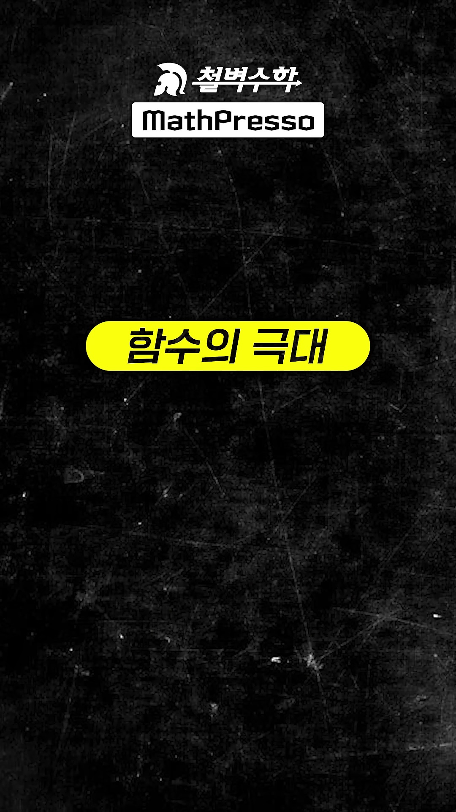
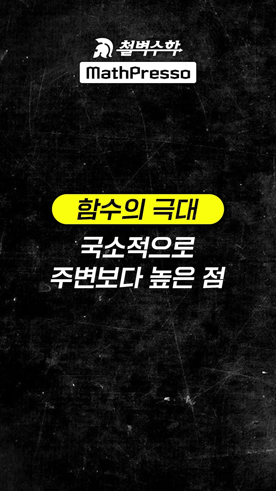
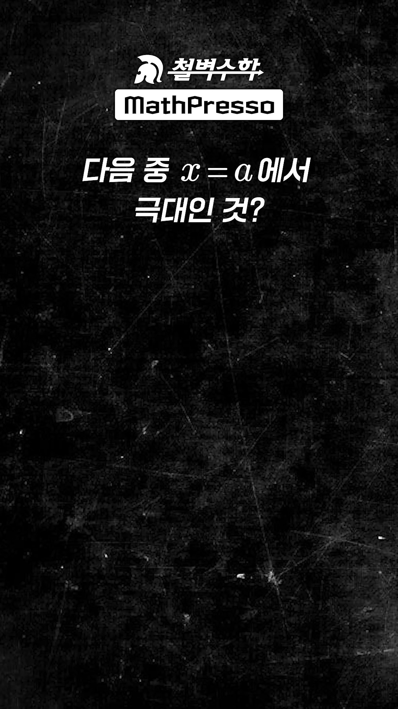
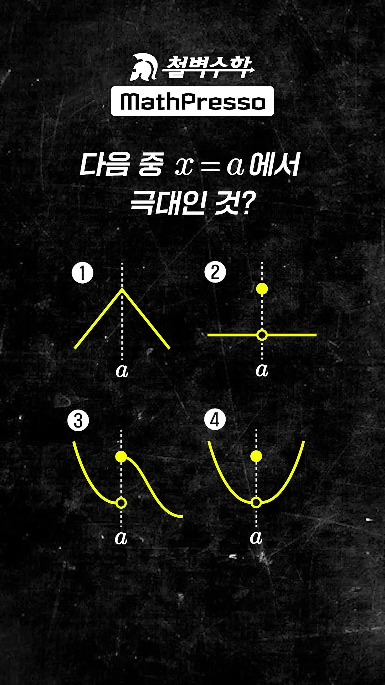
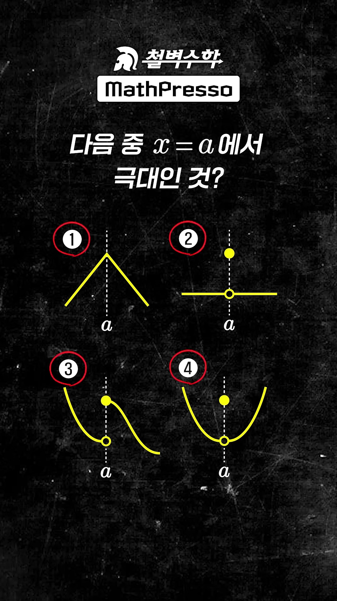
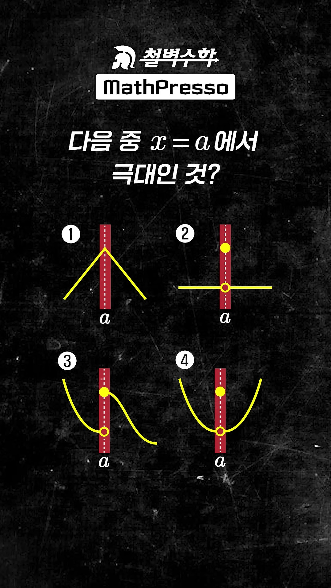
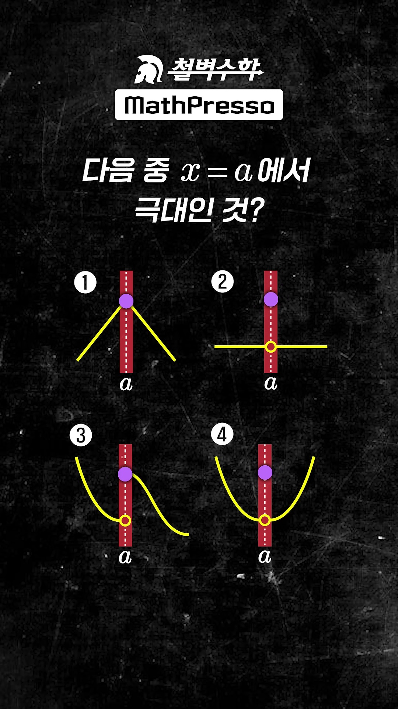
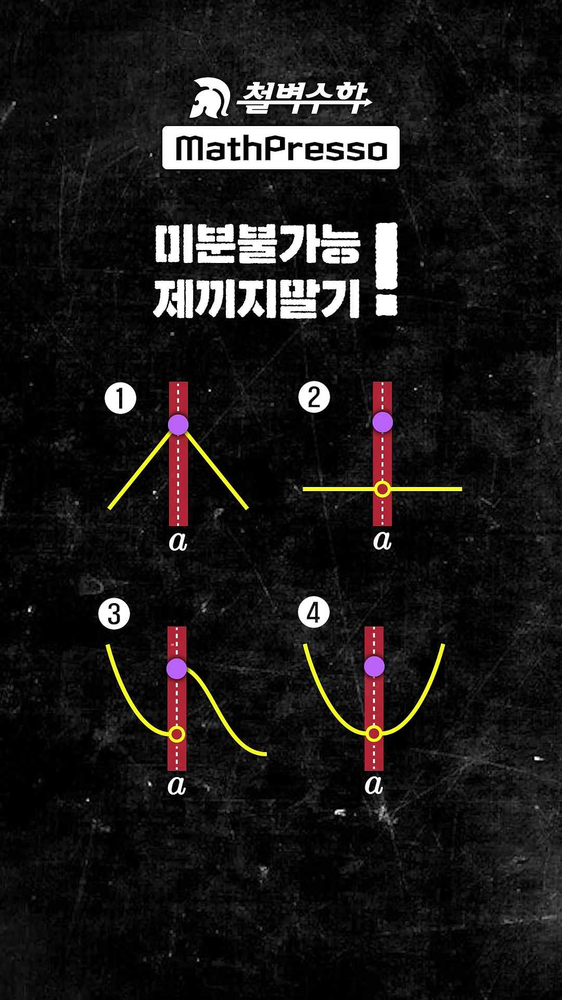

# [고1·고2 수학Ⅱ] 이게 극대라고?! 함수의 극대·극소의 진짜 수학적 정의와 극뾰대·극뻥대

> **원본 영상 정보**
> - **출처**: [매스프레소 MathPresso YouTube Shorts](https://youtube.com/shorts/-yso0bScGvY)
> - **영상 제목**: 이게 극대라고 ?!!
> - **강사**: 배상면 선생님 (철벽수학 / MathPresso 대표강사)
> - **영상 길이**: 33초
> - **주요 태그**: `#수학2 #함수의극대 #극대극소 #미분 #배상면 #철벽수학 #매스프레소 #수능수학 #진위판정`

---

## 1. 핵심 요약 (Key Summary)

대한민국 고등학생 및 수험생의 90% 이상이 극대(Local Maximum)에 대해 심각한 오개념(Misconception)을 가지고 있습니다:
* ❌ *"극대점에서는 접선의 기울기가 0이어야 한다 ($f'(a) = 0$)?"* $\implies$ **거짓!**
* ❌ *"극대가 되려면 함수가 연속이어야 한다?"* $\implies$ **거짓!**
* ❌ *"뾰족점(첨점)이나 펑크 난 점은 극대가 될 수 없다?"* $\implies$ **거짓!**

2015/2022 개정 교육과정 수학Ⅱ 교과서 및 세계 표준 수학에서 규정하는 **극대(Local Maximum)의 엄밀한 정의**:

> **"함수 $f(x)$에서 $x = a$를 포함하는 어떤 열린구간(Open Interval)에 속하는 모든 $x$에 대하여  
> $\mathbf{f(x) \le f(a)}$  
> 가 성립할 때, 함수 $f(x)$는 $\mathbf{x = a}$에서 극대(Local Maximum)라 하고, $\mathbf{f(a)}$를 극댓값이라 한다!"**

즉, **미분가능성이나 연속성과는 완전히 무관**하며, 오직 $x=a$ 주변을 아주 좁게 현미경으로 관찰했을 때 **"국소적으로 주변보다 높거나 같기만 하면 무조건 극대"**입니다!

---

### 📊 영상에 등장하는 4대 충격적 극대 판정 매트릭스

| 번호 | 그래프 형태 | 연속성 여부 | 미분가능성 | 극대 판정 | 배티의 명쾌한 해설 |
| :---: | :--- | :---: | :---: | :---: | :--- |
| **①** | **뾰족한 산봉우리 (첨점, Cusp)** | 연속 | **미분불가 ❌** | **극대 맞음! ⭕** | **"극뾰대"**: 뾰족해도 주변보다 높으면 당연히 극대! |
| **②** | **상수함수에 펑크 뚫리고 위에 점 찍힘** | **불연속 ❌** | **미분불가 ❌** | **극대 맞음! ⭕** | **"극뻥대"**: 구멍이 뻥 뚫려도 점이 위에 있으면 극대! |
| **③** | **계단식 불연속 (좌우 모두 아래로 분리)** | **불연속 ❌** | **미분불가 ❌** | **극대 맞음! ⭕** | 좌우로 좁은 열린구간을 잡으면 $f(a)$가 가장 높음! |
| **④** | **U자형 곡선 바닥에 펑크 + 상단에 점 찍힘** | **불연속 ❌** | **미분불가 ❌** | **극대 맞음! ⭕** | 포물선 최솟값 자리여도 점이 위에 튀어나오면 국소 최댓값! |

---

## 2. 영상 타임라인별 판서 캡처 & 10단계 상세 해설

### 1단계 [00:00:01] 인트로: "함수의 극대"

* **선생님 설명**:
  > "함수의 극대란..."
* **수학적 배경**:
  * 미적분을 배울 때 '극대·극소'라는 단어를 접하지만, 대부분 $f'(x) = 0$ 방정식 풀이에만 매몰되어 본질적인 정의를 잊어버립니다.

---

### 2단계 [00:00:03] 극대의 본질적 정의: "국소적으로 주변보다 높은 점"

* **선생님 설명**:
  > "...국소적으로 주변보다 높은 점을 뜻한다."
* **수학적 분석**:
  * '국소적(Locally)'이란 전체 실수 집합이 아니라, 점 $x=a$를 중심으로 좌우로 아주 좁은 반경 $(a - \delta, a + \delta)$ 안에서만 비교한다는 뜻입니다.
  * 글로벌 최댓값(Global Maximum)이 아니라 동네 1등(Local Maximum)을 찾는 개념입니다.

---

### 3단계 [00:00:06] 문제 제시: "다음 중 $x=a$에서 극대인 것?"

* **선생님 설명**:
  > "다음 중 $x=a$에서 극대인 것은? 1번, 2번, 3번, 4번."
* **출제 의도**:
  * 미분계수가 0인 부드러운 언덕이 아닌, 뾰족점과 구멍 뚫린 불연속 그래프 4개를 제시하여 학생들의 고정관념을 시험합니다.

---

### 4단계 [00:00:11] 4대 후보 그래프 등장 (수험생 멘붕 구간)

* **그래프 분석**:
  * **①번**: 좌우 직선이 만나 뾰족한 각을 이루는 첨점 ($f(x) = -|x-a| + M$)
  * **②번**: 수평선인데 $x=a$에 펑크가 나고 점이 수평선보다 높은 곳에 찍힘
  * **③번**: 좌측 곡선 끝에 구멍, $x=a$에 높은 점, 우측 곡선이 아래로 이어지는 불연속
  * **④번**: 아래로 볼록한 U자형 포물선인데 바닥에 구멍이 뚫리고 점이 붕 떠 있음

---

### 5단계 [00:00:14] 충격의 정답 공개: "네 개 모두 극대!"

* **선생님 설명**:
  > "정답은 네 개 모두 극대!"
* **핵심 반전**:
  * 미분이 불가능하거나 불연속이라는 이유로 오답으로 제꼈던 모든 선지가 **수학적으로 완벽한 극대**입니다.

---

### 6단계 [00:00:16] 수학적 증명: 열린구간(Open Interval)의 설정

* **선생님 설명**:
  > "$x=a$의 좌우로 충분히 작은 구간을 잡았을 때..."
* **수학적 증명 원리**:
  * 점 $x=a$를 중심으로 폭이 좁은 빨간색 수직 띠(열린구간 $(a-\epsilon, a+\epsilon)$)를 설정합니다.
  * 이 구간 내의 모든 $x$에 대해 함숫값들의 높이를 비교합니다.

---

### 7단계 [00:00:19] 보라색 점의 절대적 우위 확인 ($f(x) \le f(a)$)

* **선생님 설명**:
  > "...$x=a$에서 주변보다 높기 때문이다."
* **시각적 검증**:
  * 빨간 띠 영역 안에서 $x=a$에 찍힌 **보라색 점**이 주변의 노란색 그래프의 모든 점보다 명백히 높은 위치에 안착해 있습니다!
  * 따라서 정의 $f(x) \le f(a)$를 네 그래프 모두 100% 만족합니다.

---

### 8단계 [00:00:21] 수험생 필독 경고: "미분불가능하다고 제끼지 말기!"

* **선생님 설명**:
  > "미분 불가능하다고 제끼지 말기!"
* **수능 킬러 함정 탈출**:
  * "극값 $\implies f'(a) = 0$"이라는 잘못된 공식 암기 때문에 뾰족점이나 불연속점을 탈락시키는 치명적 실수를 원천 차단합니다.

---

### 9단계 [00:00:27] 배티의 마법 암기 공식: "극대, 극뻥대, 뾰족해도 극대!"

* **선생님 설명**:
  > "이렇게 기억해라. 극대, 극뻥대, 뾰족해도 극대!"
* **라임(Rhyme) 암기법**:
  * **극뾰대**: 뾰족해도 극대!
  * **극뻥대**: 구멍이 뻥 뚫려도 점이 위에 있으면 극대!

---

### 10단계 [00:00:31] 최종 정의 재확인: "주변보다 높으면 극대다!"

* **선생님 설명**:
  > "구멍이 뻥 뚫려도 주변보다 높으면 극대다."
* **최종 결론**:
  * 극대의 본질은 **'미분'이 아니라 '부등식($f(x) \le f(a)$)'**입니다.
  * 주변 동네에서 제일 높거나 같으면 무조건 극대입니다!

---

## 3. 수능/내신 대비 심화 수학: 참/거짓(ㄱ, ㄴ, ㄷ) 킬러 분석

### (1) 단골 기출 명제 판정

| 명제 | 참/거짓 | 이유 및 반례 |
| :--- | :---: | :--- |
| **명제 1**: 함수 $f(x)$가 $x=a$에서 극값을 가지면 $f'(a) = 0$이다. | **거짓 ❌** | **반례**: $f(x) = -\|x\|$는 $x=0$에서 극대이지만 $f'(0)$은 존재하지 않음. |
| **명제 2**: 함수 $f(x)$가 $x=a$에서 **미분가능하고** 극값을 가지면 $f'(a) = 0$이다. | **참 ⭕** | 페르마의 정리(Fermat's Theorem on Stationary Points). |
| **명제 3**: $f'(a) = 0$이면 함수 $f(x)$는 $x=a$에서 극값을 가진다. | **거짓 ❌** | **반례**: $f(x) = x^3$은 $f'(0) = 0$이지만 변곡점(증가 상태). |
| **명제 4**: 상수함수 $f(x) = c$의 모든 점은 극대이자 극소이다. | **참 ⭕** | 모든 $x$에 대해 $f(x) \le f(a)$와 $f(x) \ge f(a)$가 동시에 성립함 ($c \le c$). |

### (2) 교육과정 변천사 (2009 개정 vs 2015/2022 개정)
* 과거(2009 개정 이전) 일부 교재에서는 '증가 상태에서 감소 상태로 바뀔 때'로 서술하여 불연속 함수에서 혼란이 있었습니다.
* **현행 2015 및 2022 개정 교육과정**에서는 고등학교 교과서 모두가 열린구간 부등식 $\mathbf{f(x) \le f(a)}$를 공식 정의로 채택하여, **첨점과 불연속점 모두 극값으로 엄밀히 인정**하고 있습니다!
