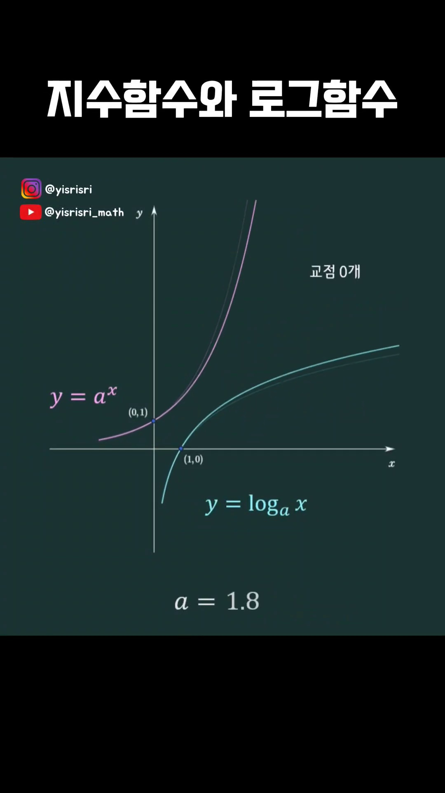
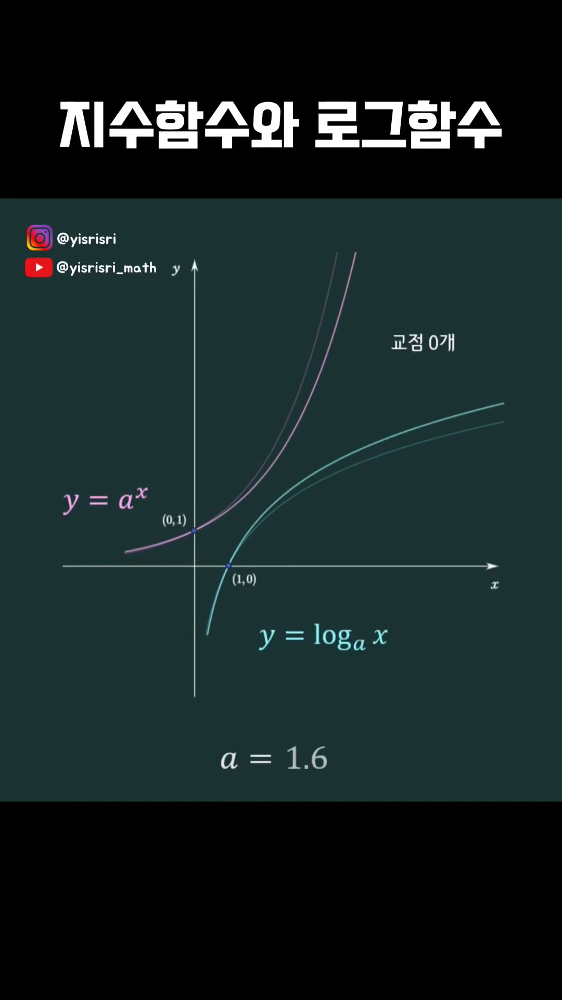
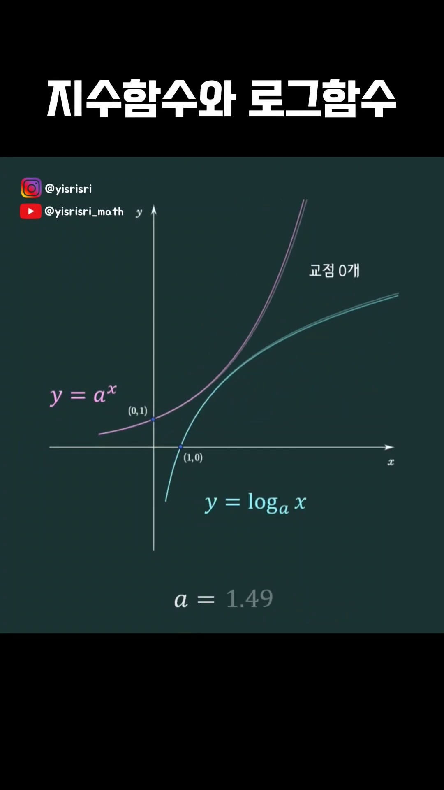
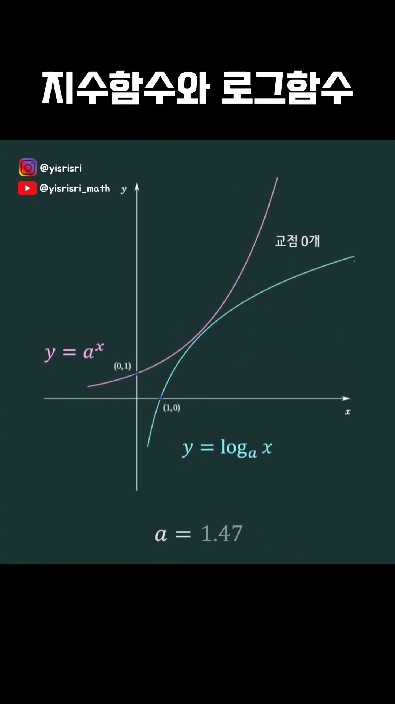
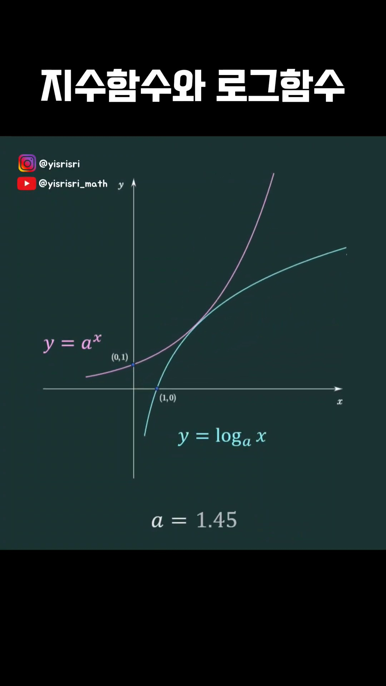
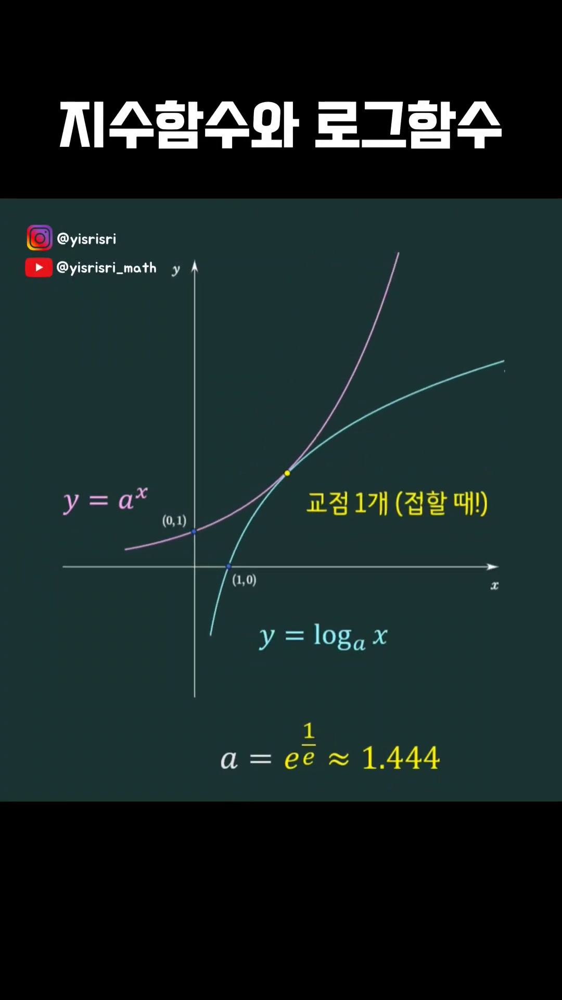
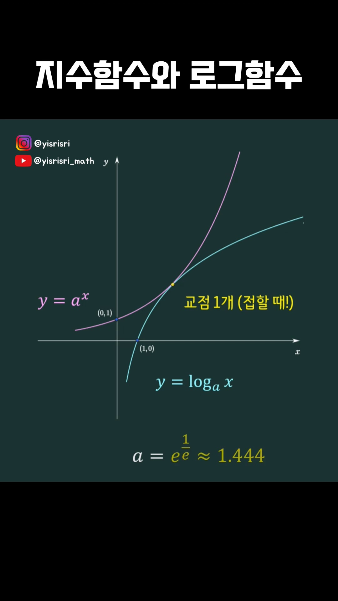
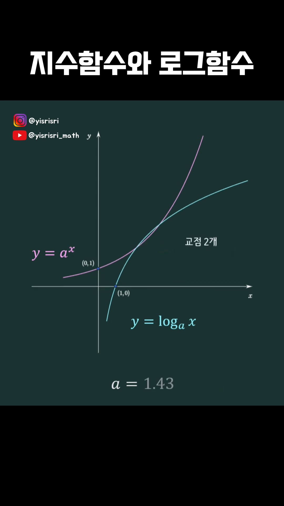
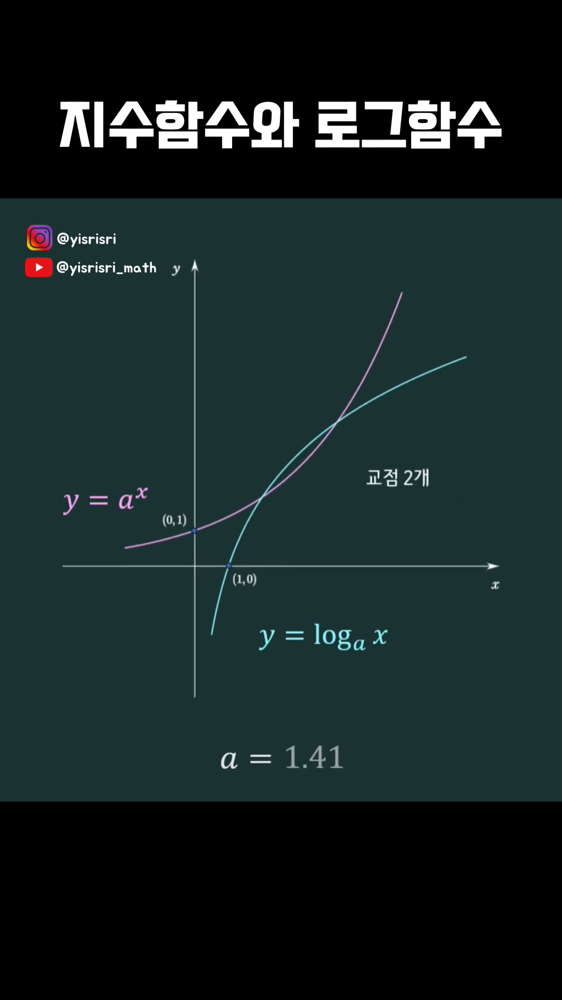

# [고2 수학Ⅰ · 미적분] 지수함수와 로그함수의 역함수 교점과 임계 밑 $a = e^{1/e}$

> **원본 영상 정보**
> - **출처**: [너도 아는 수학 YouTube Shorts](https://youtube.com/shorts/hTNIh08SkLA)
> - **영상 제목**: [수1/미적분] 지수함수와 로그함수 (역함수 교점)
> - **채널**: 너도 아는 수학
> - **영상 길이**: 8초
> - **주요 태그**: `#수학1 #미적분 #지수함수 #로그함수 #역함수교점 #수능수학 #자연상수e #임계값`

---

## 1. 핵심 요약 (Key Summary)

밑이 $a$로 동일한 두 함수:
$$f(x) = a^x \quad \text{와} \quad g(x) = \log_a x \quad (a > 0, \, a \ne 1)$$
는 서로 **역함수(Inverse Function)** 관계이며, 그래프는 직선 **$y = x$에 대하여 대칭**입니다.

수능과 내신에서 수많은 수험생들이 오해하는 대표적인 질문:
> *"지수함수와 로그함수는 서로 만나지 않거나, 만나더라도 교점은 최대 1개뿐이다?"* $\implies$ **완벽한 거짓!**  
> 밑 $a > 1$일 때, 두 곡선의 교점 개수는 **0개, 1개(접함), 2개** 모두 가능합니다!

---

### 📊 밑 $a > 1$에 따른 지수·로그함수 교점 판정 매트릭스

| 조건 | 밑의 범위 ($a > 1$) | 그래프 위치 관계 | 직선 $y=x$와의 교점 수 | 대표 예시 |
| :---: | :---: | :---: | :---: | :---: |
| **Case 1** | **$1 < a < e^{1/e} \approx 1.4447$** | 두 곡선이 서로를 관통함 | **서로 다른 2개 교점** | $a = \sqrt{2} \approx 1.414 \implies (2, 2), (4, 4)$ |
| **Case 2** | **$a = e^{1/e} \approx 1.4447$** | 두 곡선이 $y=x$에서 접함 | **1개 교점 (접점 $(e, e)$)** | $a = e^{1/e} \implies (e, e) \approx (2.718, 2.718)$ |
| **Case 3** | **$a > e^{1/e} \approx 1.4447$** | 두 곡선이 완전히 분리됨 | **0개 (만나지 않음)** | $a = 2 \implies 2^x > x$ 항상 성립 |

---

## 2. 엄밀한 수학적 증명 (Rigorous Derivation)

### [정리 1] $a > 1$일 때 교점은 반드시 직선 $y=x$ 위에만 존재한다

* **증명**:
  $a > 1$일 때 $f(x) = a^x$는 실수 전체에서 **엄격한 단조 증가 함수(Strictly Increasing)**입니다.
  단조 증가 함수의 역함수와의 교점은 반드시 항등함수 $y=x$ 위에 존재합니다.
  만약 $f(x) > x$라면 역함수 성질에 의해 $g(x) < x$가 되어 두 곡선은 교점을 가질 수 없습니다.
  따라서 $f(x) = g(x)$의 해는 곧 방정식 **$a^x = x$**의 실근과 완벽히 동치입니다.

---

### [정리 2] 임계 밑(Critical Base) $a = e^{1/e}$의 미분학적 유도

곡선 $y = a^x$가 직선 $y = x$에 접하는 접점의 좌표를 $(t, t)$라고 놓으면, 접함의 두 조건:

1. **함숫값 일치 조건**:
   $$a^t = t \quad \cdots\cdots \text{①}$$

2. **접선의 기울기 일치 조건**:
   $$\frac{d}{dx}(a^x)\Big|_{x=t} = a^t \ln a = 1 \quad \cdots\cdots \text{②}$$

식 ①의 $a^t = t$를 식 ②에 대입하면:
$$t \ln a = 1 \implies \ln(a^t) = 1 \implies a^t = e$$

따라서 식 ①과 비교하면:
$$t = e \approx 2.71828$$

접점의 좌표는 다름 아닌 자연상수 **$(e, e)$**가 됩니다!  
이제 $a^e = e$이므로 양변에 $\frac{1}{e}$제곱을 취하면:
$$\mathbf{a = e^{1/e} = \sqrt[e]{e} \approx 1.44466786...}$$

---

### [심화 보너스] $0 < a < 1$ 감소함수일 때의 킬러 반례

$0 < a < 1$일 때는 $f(x) = a^x$가 단조 감소 함수이므로, $y=x$ 위에 교점이 무조건 1개 존재합니다.  
그런데 놀랍게도 **$a < e^{-e} \approx 0.065988$**일 경우:
- $y = x$ 위의 교점 1개 외에,
- $y = x$ 대칭인 서로 다른 두 점 $(\alpha, \beta)$와 $(\beta, \alpha)$ ($\alpha \ne \beta$)가 추가로 생겨 **총 3개의 교점**을 갖게 됩니다!
이는 수능 및 평가원 모의고사 진위판정(ㄱ, ㄴ, ㄷ)에서 "역함수와의 교점은 항상 $y=x$ 위에만 존재한다"는 명제를 반박하는 최강의 반례로 빈출됩니다.

---

## 3. 영상 타임라인별 판서 캡처 & 상세 해설

### 1단계 [00:00:01] 인트로: "지수함수와 로그함수의 역함수 관계"

* **영상 내용**:
  * $f(x) = a^x$와 $g(x) = \log_a x$의 역함수 정의 제시.
* **수학적 분석**:
  * 동일한 밑 $a$를 갖는 지수함수와 로그함수는 서로의 정의역과 치역이 뒤바뀐 완전한 역함수입니다.

---

### 2단계 [00:00:02] 역함수 세팅: 대칭축 $y = x$

* **영상 내용**:
  * 좌표평면 위에 기준선 $y = x$를 점선으로 작도.
* **수학적 분석**:
  * $x$와 $y$를 맞바꾼 방정식이므로 모든 점 $(p, q)$는 $y=x$ 대칭이동되어 $(q, p)$가 됩니다.

---

### 3단계 [00:00:03] 대칭성의 시각화

* **영상 내용**:
  * 지수 곡선 $y=a^x$와 로그 곡선 $y=\log_a x$의 형태 비교.
* **수학적 분석**:
  * $y$절편 $(0, 1)$은 로그함수의 $x$절편 $(1, 0)$에 일대일 대칭 대응됩니다.

---

### 4단계 [00:00:04] 교점의 탐구: 과연 만날 수 있는가?

* **영상 내용**:
  * 보통 교과서에서 $a=2, 3$일 때 서로 만나지 않는 그래프만 보아온 학생들에게 의문을 제기합니다.
* **수학적 분석**:
  * 밑 $a$의 크기를 줄이면 $y=a^x$ 곡선이 아래로 완만해지면서 $y=x$와 만날 가능성이 생깁니다.

---

### 5단계 [00:00:05] 밑 $a$의 변화에 따른 곡선의 회전/완만화

* **영상 내용**:
  * $a$ 값이 $1$에 가까워질수록 곡선의 곡률이 줄어들며 $y=x$에 접근합니다.

---

### 6단계 [00:00:06] 임계 접점의 탄생: $(e, e)$와 $a = e^{1/e}$

* **영상 내용**:
  * $a = e^{1/e} \approx 1.4447$에서 두 곡선이 직선 $y=x$와 정확히 한 점에서 접하는 마법 같은 순간!
* **수학적 분석**:
  * 접점 $(e, e)$에서 $a^x$의 접선의 기울기는 정확히 $1$이 됩니다.

---

### 7단계 [00:00:06] 교점 2개 영역: $1 < a < e^{1/e}$

* **영상 내용**:
  * $a < 1.4447$일 때 지수함수가 $y=x$ 아래로 파고들며 2개의 뚜렷한 교점이 형성됩니다.
  * 대표적 정수격자 예시: $a = \sqrt{2} \implies (2, 2)$와 $(4, 4)$.

---

### 8단계 [00:00:07] 수능 핵심 테이크어웨이

* **영상 내용**:
  * 지수·로그 역함수 교점 문제에서 $a = e^{1/e}$가 왜 절대적인 기준선인지 정리합니다.

---

### 9단계 [00:00:08] 최종 요약 및 공식 각인

* **영상 내용**:
  * $a > e^{1/e} \implies 0$개
  * $a = e^{1/e} \implies 1$개
  * $1 < a < e^{1/e} \implies 2$개

---

## 4. 수능/모의고사 킬러 문제 풀이 실전 팁

1. **방정식 $a^x = x$의 실근 판정**:
   * $a$의 밑이 $1.4$ 미만이면 실근이 2개 존재함을 직관적으로 기억하십시오.
   * $a = \sqrt{2} \approx 1.414$는 수능 빈출 예시입니다: $(\sqrt{2})^2 = 2$, $(\sqrt{2})^4 = 4$.
2. **미적분 접선의 방정식 연계**:
   * 곡선 $y = a^x$와 직선 $y = mx$가 접하는 조건 또한 같은 맥락에서 $t = \frac{1}{\ln a}$로 유도됩니다.
3. **진위 판정(ㄱ, ㄴ, ㄷ) 단골 함정**:
   * "지수함수와 로그함수의 교점 개수는 최대 2개이다" $\implies$ $0 < a < 1$일 때 최대 3개까지 가능하므로 거짓!
   * "밑이 $1$보다 큰 지수함수와 로그함수의 교점은 항상 $y=x$ 위에 있다" $\implies$ 참!
