# [수학 II / 미적분] 정적분 넓이 공식 만능 정리: 이거 하나면 끝! (유도과정 & 완전 해설)

> **원본 영상 정보**
> - **출처**: [math2918 YouTube](https://youtu.be/2RL3NvNVHS0?si=6Jt_yvz7gxg83eVX)
> - **영상 제목**: 정적분 넓이공식 | 이거 하나면 끝 | 유도과정 |
> - **영상 길이**: 19분 44초 (1,184초)
> - **주요 태그**: `#수학2 #미적분 #정적분 #넓이공식 #이차함수넓이 #삼차함수넓이 #사차함수넓이 #부분적분법 #베타함수`

---

## 1. 핵심 요약 (Key Summary)

수능과 내신에서 수험생들을 가장 헷갈리게 만드는 2차, 3차, 4차 다항함수의 정적분 넓이 공식들($\frac{1}{6}$, $\frac{1}{12}$, $\frac{1}{20}$, $\frac{1}{30}$)은 개별적으로 따로 외울 필요가 전혀 없습니다.

두 교점(접점) $\alpha, \beta$ 사이에서 인수분해되는 모든 다항함수의 정적분 넓이는 **단 하나의 만능 공식(Universal Formula)**으로 완벽히 통합됩니다:

$$\mathbf{S = |a| \cdot \frac{m! \, n!}{(m+n+1)!} (\beta - \alpha)^{m+n+1}}$$

* **$a$**: 최고차항의 계수
* **$\alpha, \beta$**: 함수의 두 근 ($\alpha < \beta$)
* **$m, n$**: 각 근의 인수 거듭제곱 차수 (인수분해 시 $(x-\alpha)^m (\beta-x)^n$)
  * **단순 교점(관통)**: 거듭제곱 $= 1$
  * **접점(중근)**: 거듭제곱 $= 2$
  * **변곡 접점(삼중근)**: 거듭제곱 $= 3$

### 📊 4대 필수 정적분 공식의 한방 적용표

| 다항함수 유형 | 근의 형태 및 그래프 모양 | 인수 차수 ($m, n$) | 공식 계수 계산 $\frac{m! n!}{(m+n+1)!}$ | 최종 넓이 공식 |
| :--- | :--- | :---: | :---: | :---: |
| **2차함수** | 두 실근 관통 | $m=1, n=1$ | $\frac{1! \cdot 1!}{3!} = \frac{1}{6}$ | $\mathbf{\frac{\|a\|}{6}(\beta-\alpha)^3}$ |
| **3차함수** | 한 근 접하고, 한 근 관통 | $m=2, n=1$ | $\frac{2! \cdot 1!}{4!} = \frac{2}{24} = \frac{1}{12}$ | $\mathbf{\frac{\|a\|}{12}(\beta-\alpha)^4}$ |
| **4차함수 (삼중근)** | 한 근 삼중접선, 한 근 관통 | $m=3, n=1$ | $\frac{3! \cdot 1!}{5!} = \frac{6}{120} = \frac{1}{20}$ | $\mathbf{\frac{\|a\|}{20}(\beta-\alpha)^5}$ |
| **4차함수 (이중접선)** | 두 근 모두 접함 (W자 대칭) | $m=2, n=2$ | $\frac{2! \cdot 2!}{5!} = \frac{4}{120} = \frac{1}{30}$ | $\mathbf{\frac{\|a\|}{30}(\beta-\alpha)^5}$ |

---

## 2. 타임라인별 강의 캡처 & 상세 설명

### 1단계 [00:45] 학생들이 가장 헷갈려하는 4대 넓이 공식의 문제 제기

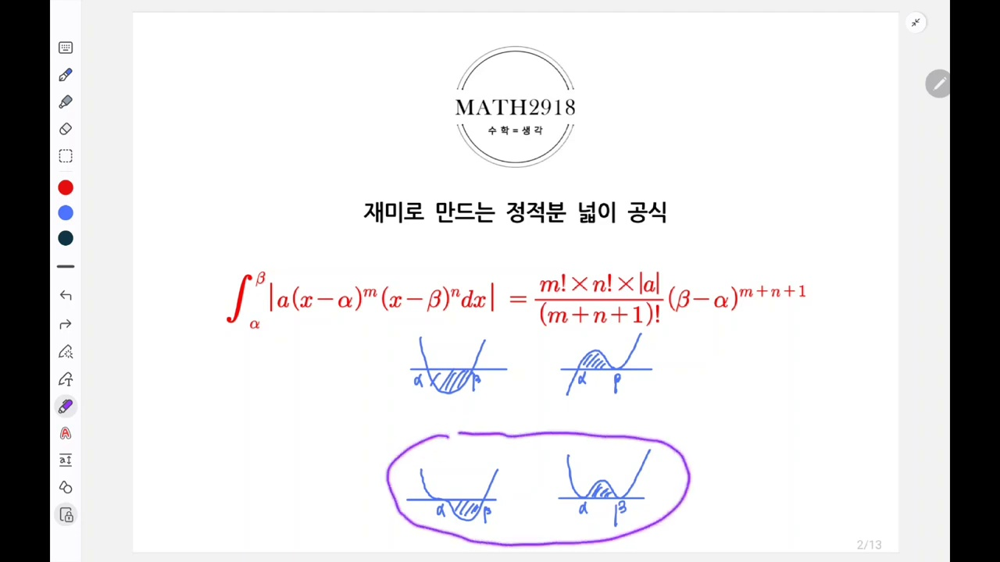

* **선생님 설명**:
  > "수투에서 정적분 넓이 공식을 외워서 풀다 보면 종종 헷갈리는 부분들이 있습니다. 2차함수와 x축, 3차함수 접선, 4차함수 3중근과 2중근 접선 등 상황마다 분모가 6, 12, 20, 30으로 달라져 시험 볼 때 혼동이 옵니다."
* **핵심 포인트**:
  * 각각 따로따로 외우면 시험장에서 분모가 $12$였는지 $20$이었는지 헷갈려 치명적인 실수가 발생함.
  * 일관된 원리를 알면 공식을 잊어버려도 3초 만에 복원 가능함.

---

### 2단계 [02:40] 외우지 않고 하나로 끝내는 해법 소개

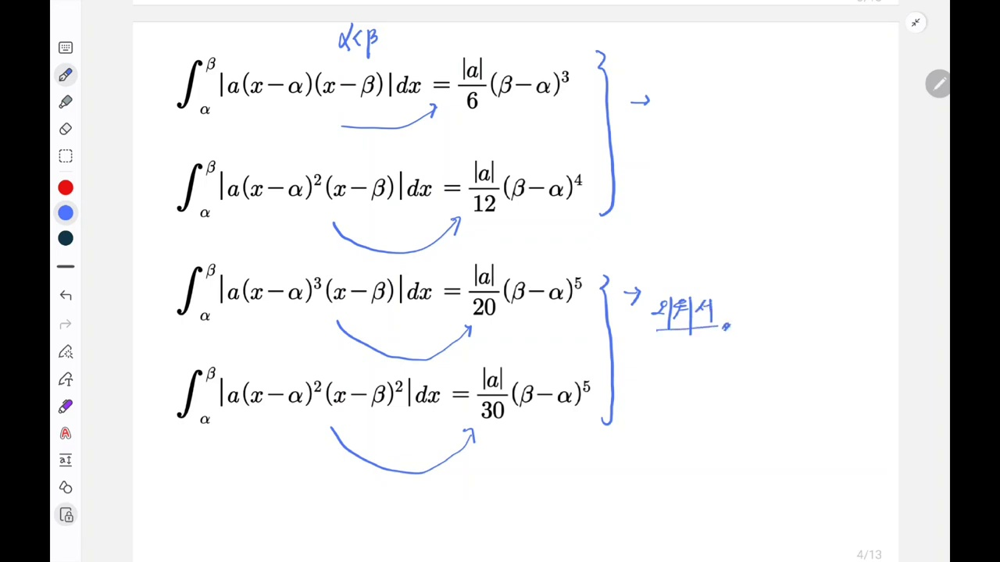

* **선생님 설명**:
  > "이 4개를 동시에 외우면 막 헷갈립니다. 그래서 공식 하나만 외워 두면 4개 다 적용시킬 수 있는 만능 공식이 있습니다. 이걸 먼저 연습하고 유도 과정도 보여드리겠습니다."

---

### 3단계 [03:45] 만능 공식 (Universal Formula)의 구조

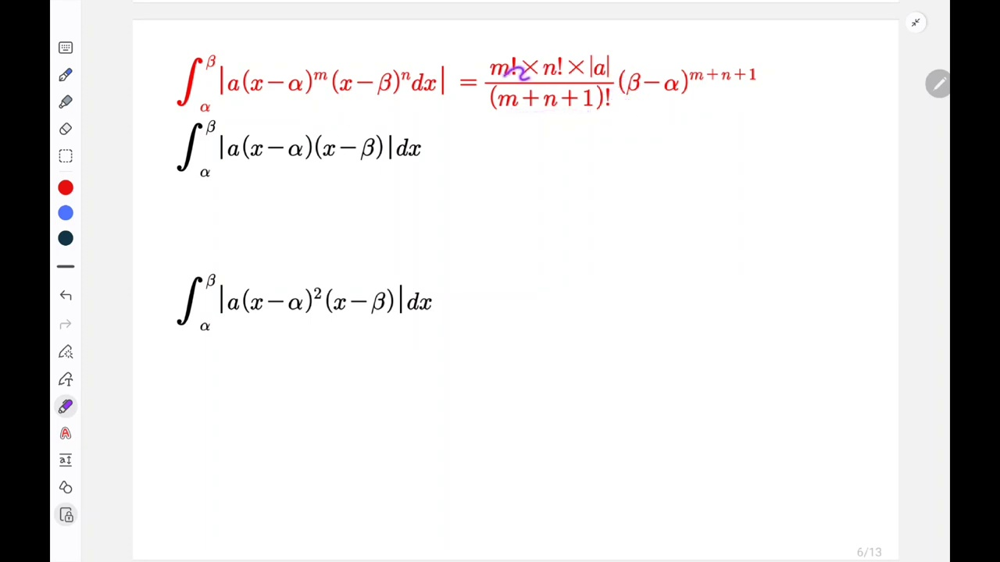

* **선생님 설명**:
  > "정적분 안의 함수가 인수로 $(x-\alpha)^m$과 $(\beta-x)^n$ 두 개만 갖고 있을 때, 지수 둘을 더해서 1을 더한 팩토리얼 분의 각 지수의 팩토리얼의 곱! 즉 $\frac{m! n!}{(m+n+1)!} \cdot |a|(\beta-\alpha)^{m+n+1}$입니다."
* **공식 구조 암기 팁**:
  * **분모**: 두 지수의 합에 $1$을 더한 팩토리얼 $\rightarrow (m+n+1)!$
  * **분자**: 각 지수의 팩토리얼의 곱 $\rightarrow m! \times n!$
  * **길이항**: $(\beta-\alpha)$의 지수는 분모의 팩토리얼 안의 숫자와 동일한 $m+n+1$ 거듭제곱!

---

### 4단계 [04:50] 2차함수에 적용 ($m=1, n=1$)

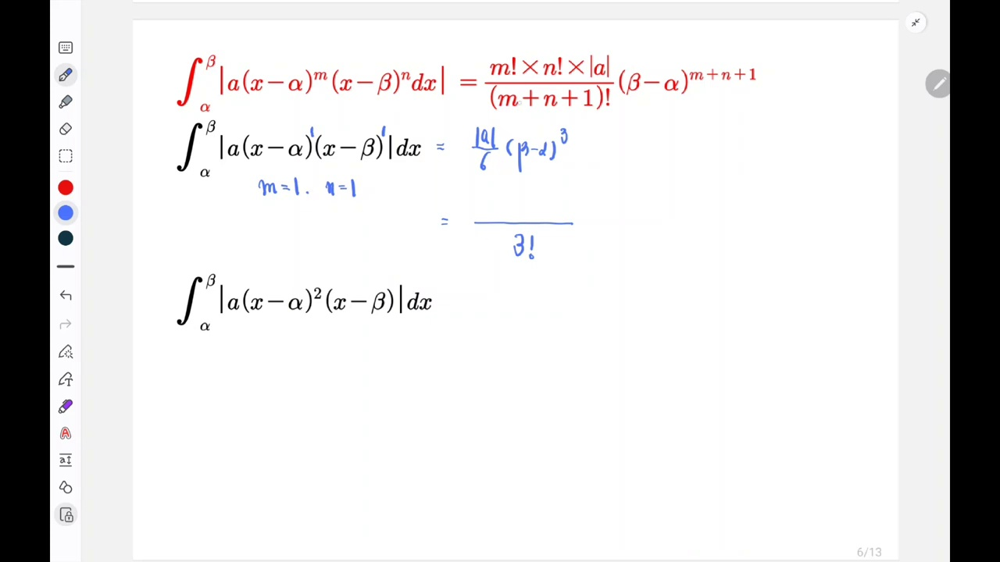

* **계산 과정**:
  $$m=1, \quad n=1 \implies m+n+1 = 3$$
  $$S = |a| \cdot \frac{1! \cdot 1!}{3!} (\beta-\alpha)^3 = \frac{|a|}{6}(\beta-\alpha)^3$$
* **결과**: 교과서에 나오는 2차함수 넓이 공식 $\frac{|a|}{6}(\beta-\alpha)^3$과 완벽히 일치!

---

### 5단계 [05:45] 3차함수 접선에 적용 ($m=2, n=1$)

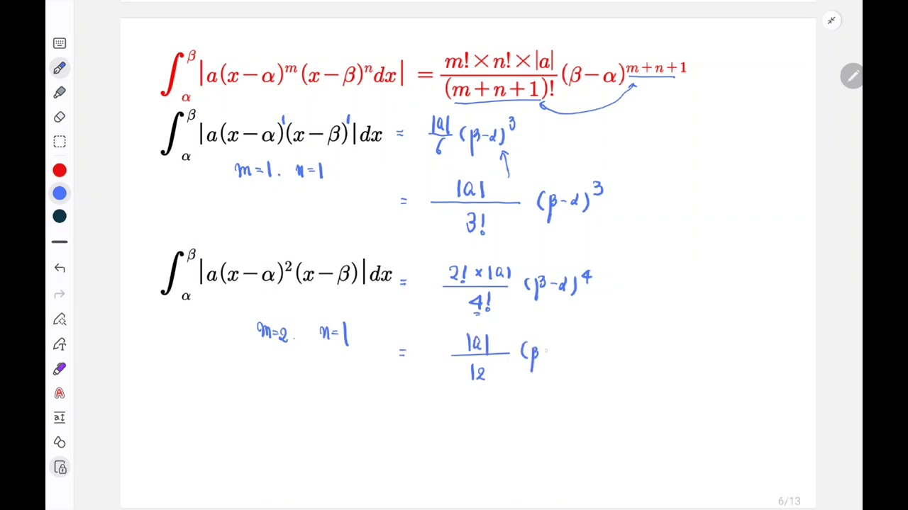

* **계산 과정**:
  $$m=2, \quad n=1 \implies m+n+1 = 4$$
  $$S = |a| \cdot \frac{2! \cdot 1!}{4!} (\beta-\alpha)^4 = |a| \cdot \frac{2}{24} (\beta-\alpha)^4 = \frac{|a|}{12}(\beta-\alpha)^4$$
* **결과**: 수능 킬러문항에서 가장 자주 쓰이는 3차함수 접선 넓이 공식 $\frac{|a|}{12}(\beta-\alpha)^4$ 도출!

---

### 6단계 [06:45] 4차함수 삼중근+관통점에 적용 ($m=3, n=1$)

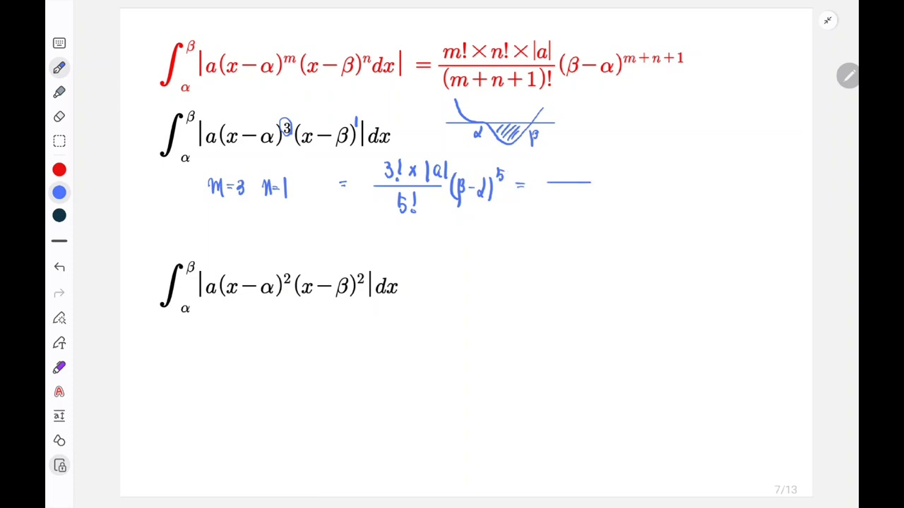

* **계산 과정**:
  $$m=3, \quad n=1 \implies m+n+1 = 5$$
  $$S = |a| \cdot \frac{3! \cdot 1!}{5!} (\beta-\alpha)^5 = |a| \cdot \frac{6}{120} (\beta-\alpha)^5 = \frac{|a|}{20}(\beta-\alpha)^5$$
* **결과**: 분모가 $20$인 4차함수 넓이 공식 완벽 확인!

---

### 7단계 [07:25] 4차함수 이중접선에 적용 ($m=2, n=2$)

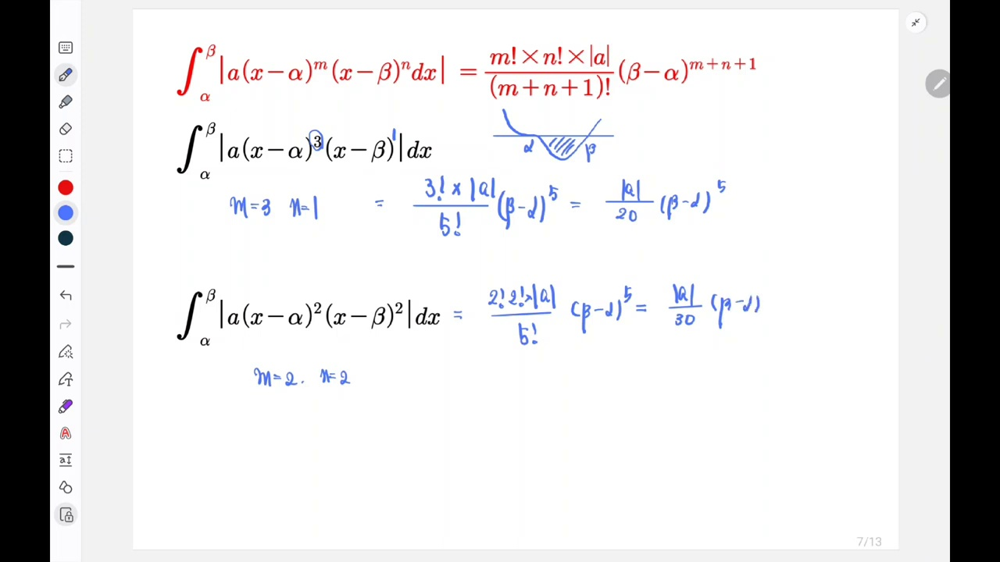

* **계산 과정**:
  $$m=2, \quad n=2 \implies m+n+1 = 5$$
  $$S = |a| \cdot \frac{2! \cdot 2!}{5!} (\beta-\alpha)^5 = |a| \cdot \frac{2 \times 2}{120} (\beta-\alpha)^5 = \frac{4}{120}|a|(\beta-\alpha)^5 = \frac{|a|}{30}(\beta-\alpha)^5$$
* **결과**: 대칭형 W자 4차함수의 이중 접선으로 둘러싸인 넓이 $\frac{|a|}{30}(\beta-\alpha)^5$ 즉시 도출!

---

### 8단계 [09:40] 공식의 수학적 증명 (부분적분법 1단계)

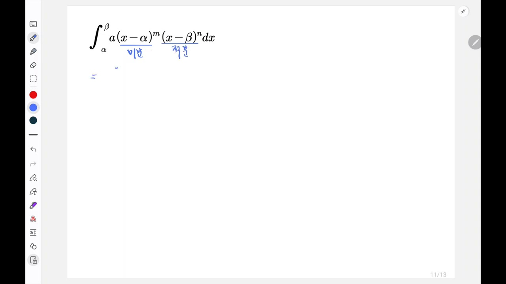

* **유도 아이디어**:
  $$I = \int_\alpha^\beta (x-\alpha)^m (x-\beta)^n \, dx$$
  * $f(x) = (x-\alpha)^m$으로 두고 **미분할 함수**로 선택
  * $g'(x) = (x-\beta)^n$으로 두고 **적분할 함수**로 선택
  * 부분적분 공식: $\int f g' dx = [f g]_\alpha^\beta - \int f' g dx$
* **첫 번째 경계값 소멸**:
  $$[f(x) g(x)]_\alpha^\beta = \left[ (x-\alpha)^m \cdot \frac{(x-\beta)^{n+1}}{n+1} \right]_\alpha^\beta = 0 - 0 = 0$$
  $(\beta$를 넣으면 $(x-\beta)$에 의해 $0$, $\alpha$를 넣으면 $(x-\alpha)$에 의해 $0$)

---

### 9단계 [13:40] $m$회 연속 부분적분을 통한 계수 형성

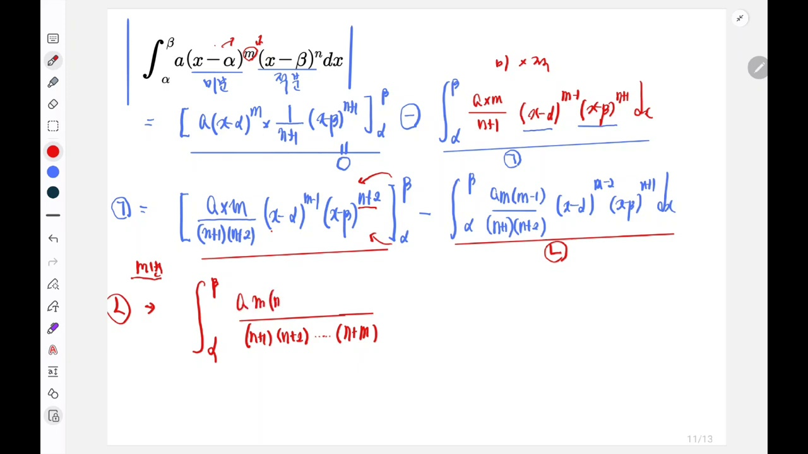

* **선생님 설명**:
  > "$(x-\alpha)$ 인수가 완전히 사라질 때까지 $m$번 연속으로 부분적분을 실행합니다. 한 번 할 때마다 분모에는 $n+1, n+2, \dots, n+m$이 곱해지고, 분자에는 $m, m-1, \dots, 1$ 즉 $m!$이 곱해집니다!"

---

### 10단계 [15:50] 최종 만능 공식 증명 완성

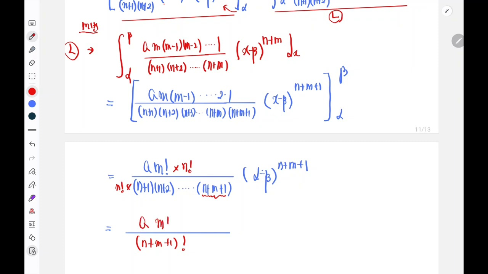

* **수식 정리**:
  $$I = (-1)^m \frac{m!}{(n+1)(n+2)\dots(n+m)(n+m+1)} (\beta-\alpha)^{m+n+1}$$
  * 분모와 분자에 $n!$을 곱해주면:
  $$\text{분모} = n! \times (n+1)(n+2)\dots(n+m+1) = (m+n+1)!$$
  $$\text{분자} = m! \cdot n!$$
  * 절댓값을 취하여 넓이 $S$로 변환하면:
  $$S = |a| \cdot \frac{m! \, n!}{(m+n+1)!} (\beta-\alpha)^{m+n+1}$$

---

### 11단계 [18:10] 수투(수학 II) 과정 수준의 평행이동 유도법

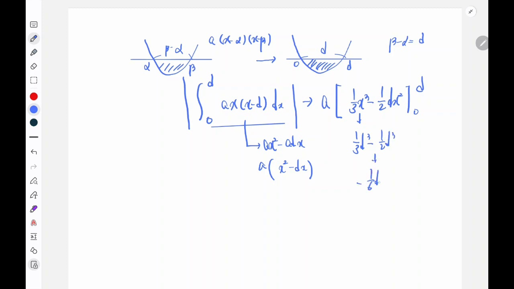

* **미적분을 배우지 않은 학생을 위한 평행이동**:
  * $\alpha$를 원점($0$)으로 평행이동: $X = x-\alpha$, 구간은 $[0, d]$ (단, $d = \beta-\alpha$)
  * 2차함수의 경우: $\int_0^d x(x-d) dx = \left[ \frac{1}{3}x^3 - \frac{d}{2}x^2 \right]_0^d = \left(\frac{1}{3} - \frac{1}{2}\right)d^3 = -\frac{1}{6}d^3$
  * 절댓값을 씌우면 $\frac{1}{6}d^3 = \frac{1}{6}(\beta-\alpha)^3$으로 손쉽게 확인 가능!

---

## 3. 고등수학과 대학수학(오일러 베타 함수)의 연결

이 공식은 대학교 미적분학 및 해석학에서 다루는 **오일러 베타 함수(Euler Beta Function)**의 형태와 정확히 일치합니다:

$$B(p, q) = \int_0^1 t^{p-1} (1-t)^{q-1} \, dt = \frac{\Gamma(p)\Gamma(q)}{\Gamma(p+q)} = \frac{(p-1)! \, (q-1)!}{(p+q-1)!}$$

$t = \frac{x-\alpha}{\beta-\alpha}$로 치환하면 $dt = \frac{dx}{\beta-\alpha}$가 되어:
$$\int_\alpha^\beta (x-\alpha)^m (\beta-x)^n dx = (\beta-\alpha)^{m+n+1} \int_0^1 t^m (1-t)^n dt = (\beta-\alpha)^{m+n+1} B(m+1, n+1)$$
$$= \frac{m! \, n!}{(m+n+1)!} (\beta-\alpha)^{m+n+1}$$

따라서 고등학교 수능 수학의 모든 정적분 공식은 오일러 베타 함수의 자연스러운 귀결입니다.

---

## 4. 수능/모의고사 3초 실전 킬러 테크닉

1. **접점 여부로 지수 $(m, n)$ 파악하기**:
   - 그래프가 직선이나 축을 **스치듯 지나가면(접함)** $\rightarrow$ 거듭제곱 $2$
   - 그래프가 **변곡점을 이루며 뚫고 접하면** $\rightarrow$ 거듭제곱 $3$
   - 그래프가 **일반 교점으로 통과하면** $\rightarrow$ 거듭제곱 $1$

2. **분모 계산 3초 치트키**:
   - $(1, 1) \rightarrow 3! = 6$
   - $(2, 1) \rightarrow \frac{4!}{2!} = \frac{24}{2} = 12$
   - $(3, 1) \rightarrow \frac{5!}{3!} = \frac{120}{6} = 20$
   - $(2, 2) \rightarrow \frac{5!}{2! \times 2!} = \frac{120}{4} = 30$

정적분 전개식에 위끝, 아래끝을 대입하여 분수 통분하느라 5분씩 소비하지 않고, 단 3초 만에 암산으로 넓이를 계산할 수 있습니다!
