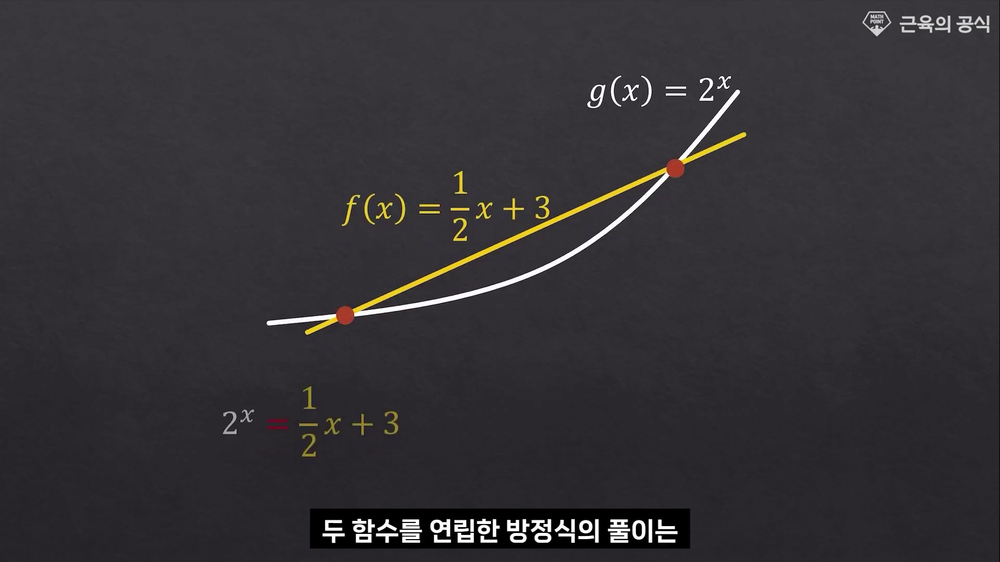
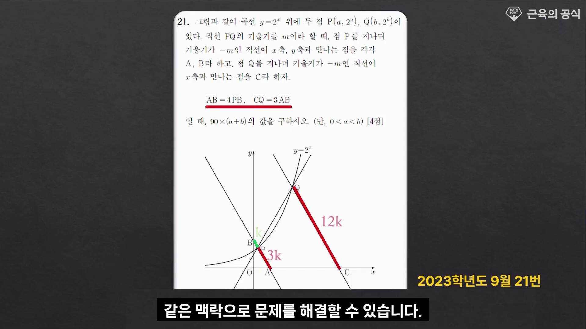
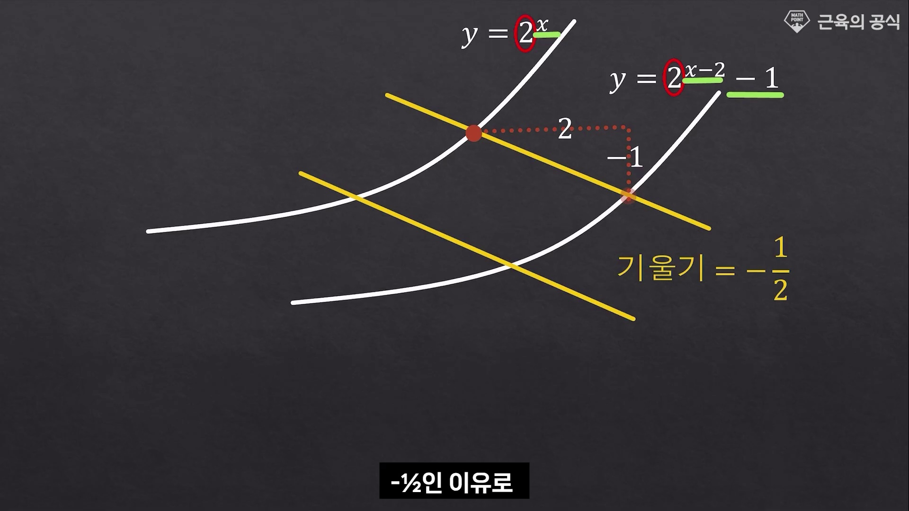
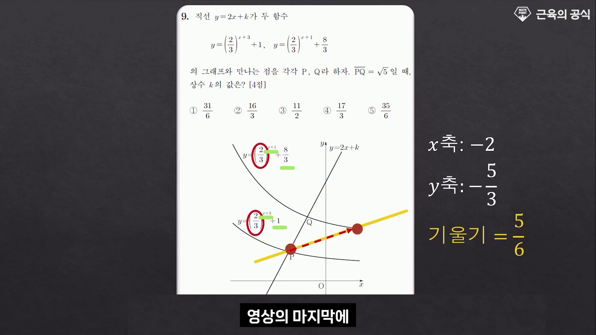
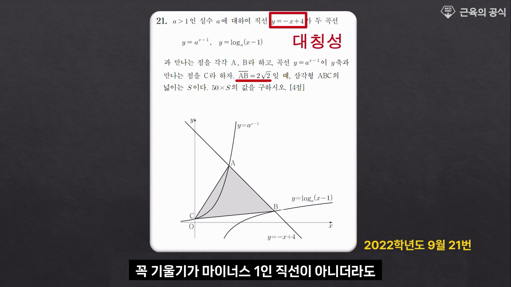
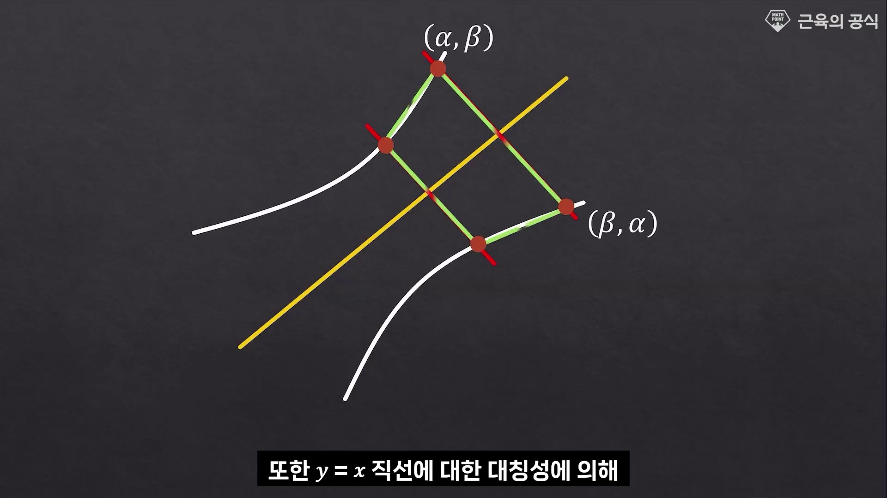
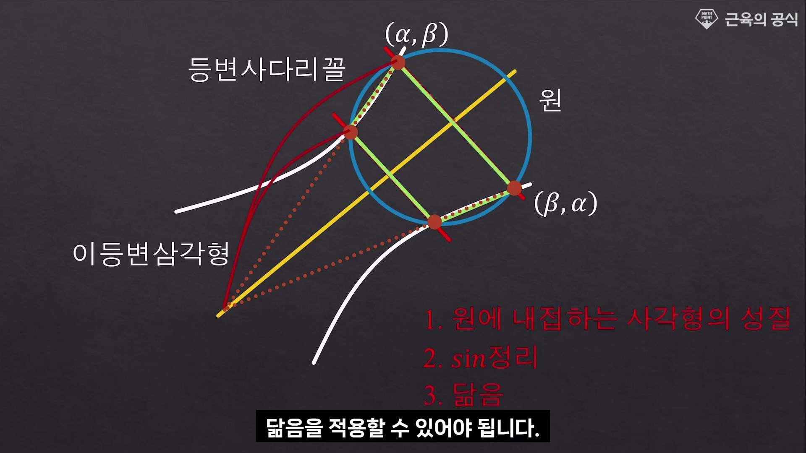
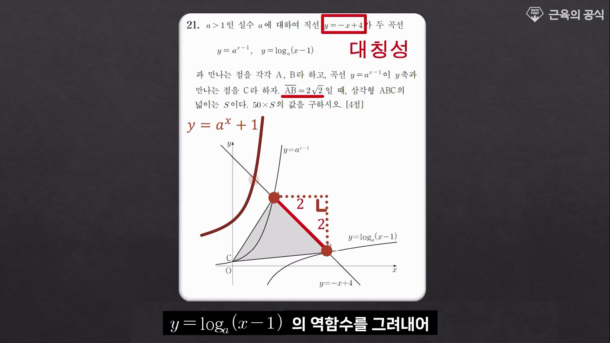
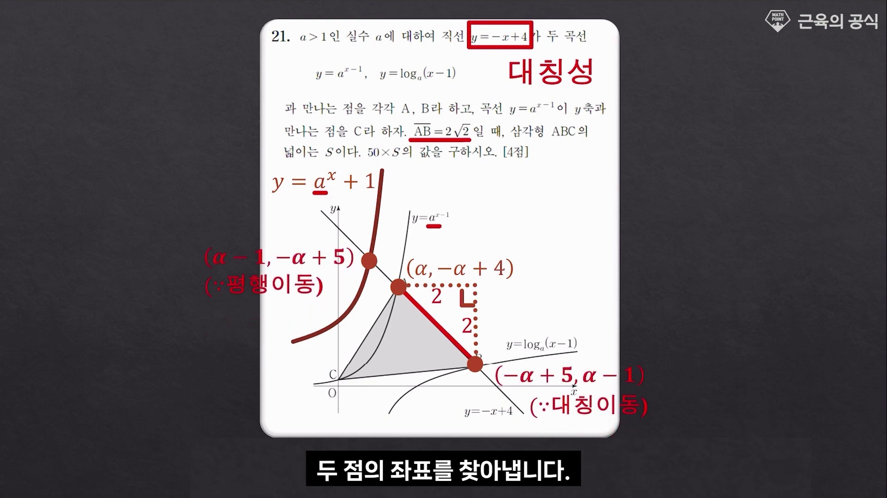
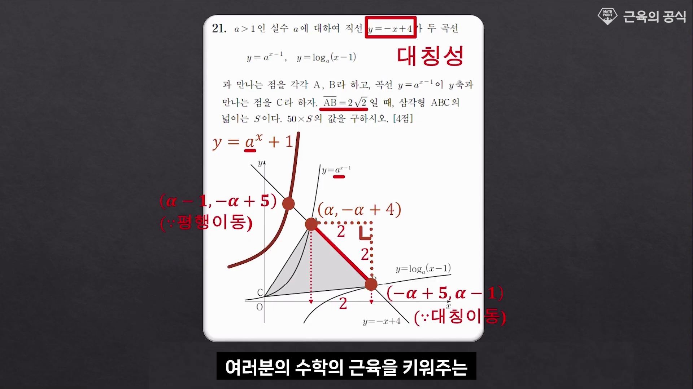

# [고2 수학Ⅰ] 지수·로그함수에서 기울기 활용법과 평행이동·대칭성 (기울기 $m=-1$의 마법)

> **원본 영상 정보**
> - **출처**: [근육의 공식 YouTube](https://youtu.be/0cYeWjClTV4)
> - **영상 제목**: 지수, 로그함수에서 기울기 활용법-근육의 공식
> - **채널**: 근육의 공식
> - **영상 길이**: 4분 22초 (262초)
> - **관련 기출**: 2022학년도 9월 21번, 2022학년도 수능 9번, 2023학년도 9월 21번
> - **주요 태그**: `#수능수학 #지수함수 #로그함수 #역함수 #기울기활용법 #평행이동벡터 #대칭성 #근육의공식`

---

## 1. 핵심 요약 (Key Summary)

수능 및 모의고사 4점 킬러/준킬러에 출제되는 지수·로그함수 그래프 문항은 **대수적 연립방정식으로 풀리지 않도록** 설계되어 있습니다:
$$2^x = \frac{1}{2}x + 3 \quad \implies \text{대수적으로 절대 풀리지 않는 초월방정식!}$$

평가원 출제진이 요구하는 본질적인 해결 능력은 **직선의 기울기와 기하학적 평행이동·대칭성(역함수)**을 결합하는 **3대 핵심 원리**입니다:

1. **평행이동 벡터와 기울기 일치 원리**:
   $y = 2^x$가 $x$축으로 $+2$, $y$축으로 $-1$ 평행이동하여 $y = 2^{x-2} - 1$이 될 때, 두 곡선의 대응점을 잇는 선분의 기울기는 정확히 평행이동 방향인 **$m = \frac{\Delta y}{\Delta x} = -\frac{1}{2}$**입니다.
2. **계수의 평행이동 해석 ($A \times a^x = a^{x + \log_a A}$)**:
   $y = 3 \times 2^x$의 앞자리 $3$은 단순한 배수가 아니라 $x$축 방향으로 **$-\log_2 3$ 만큼 평행이동**한 것입니다.
3. **기울기 $m = -1$인 직선과 대칭축 $y = x$의 수직 관계**:
   직선 $y = -x + k$는 역함수의 대칭축인 $y = x$와 **정확히 수직($(-1) \times 1 = -1$)**을 이룹니다. 따라서 지수·로그 곡선과 직선 $y = -x + k$가 만나는 두 점은 대칭축 $y=x$에 대하여 대칭인 관계를 가지며, 선분 길이 $L$이 주어지면 **직각이등변삼각형 $1:1:\sqrt{2}$** 비율을 통해 $\Delta x = \Delta y = \frac{L}{\sqrt{2}}$로 좌표 차이가 즉시 확정됩니다!

---

### 📊 지수·로그함수 킬러 정복 3대 원리 매트릭스

| 핵심 원리 | 기하학적 상황 | 수학적 수식 / 비례 관계 | 수능 실전 적용 효과 |
| :---: | :--- | :--- | :--- |
| **원리 1** | **평행이동 벡터와 기울기** | $(\Delta x, \Delta y) \implies m = \frac{\Delta y}{\Delta x}$ | 기울기 $m$인 직선 위의 두 교점 거리가 평행이동 길이 $\sqrt{\Delta x^2 + \Delta y^2}$로 직결 |
| **원리 2** | **밑 변환 평행이동** | $A \cdot a^x = a^{x + \log_a A}$ | 밑이 같은 곡선 사이의 수평 거리가 $\log_a A$로 상수 고정 |
| **원리 3** | **기울기 $m = -1$ 대칭성** | $y = -x + k \perp y = x$, $\Delta x : \Delta y : L = 1 : 1 : \sqrt{2}$ | $\overline{\mathrm{AB}} = 2\sqrt{2} \implies \Delta x = 2, \Delta y = 2$로 좌표 차이 단 1초 만에 분해 |

---

## 2. 2022학년도 9월 모의평가 21번 완전 정복

### [문제 조건]
> $a > 1$인 실수 $a$에 대하여 직선 $y = -x + 4$가 두 곡선 $y = a^{x-1}, y = \log_a(x-1)$과 만나는 점을 각각 $\mathrm{A}, \mathrm{B}$라 하고, 곡선 $y = a^{x-1}$이 $y$축과 만나는 점을 $\mathrm{C}$라 하자.  
> $\overline{\mathrm{AB}} = 2\sqrt{2}$일 때, 삼각형 $\mathrm{ABC}$의 넓이는 $S$이다. $50 \times S$의 값을 구하시오. [4점]

---

### [기울기 활용 3단계 초스피드 풀이]

#### Step 1: 기울기 $-1$과 선분 길이 $2\sqrt{2}$를 통한 직각이등변 분해
* 직선의 기울기가 $-1$이므로 $x$축, $y$축 방향의 변화율 비는 $1 : 1 : \sqrt{2}$입니다.
* $\overline{\mathrm{AB}} = 2\sqrt{2}$이므로:
  $$\Delta x = 2, \quad \Delta y = -2$$
* 따라서 점 $\mathrm{A}$의 $x$좌표를 $\alpha$라 하면:
  $$\mathrm{A}(\alpha, -\alpha + 4), \quad \mathrm{B}(\alpha + 2, -\alpha + 2)$$

#### Step 2: 평행이동을 통한 역함수 대칭점 복원
* 두 곡선 $y = a^{x-1}$과 $y = \log_a(x-1)$은 $y = a^x$와 $y = \log_a x$의 역함수 쌍을 각각 **$x$축으로 $+1$ 평행이동**한 것입니다.
* 따라서 $x$축으로 $-1$만큼 되돌리면 두 점은 $y=x$ 대칭이 됩니다:
  * $\mathrm{A}'(\alpha - 1, -\alpha + 4)$
  * $\mathrm{B}'(\alpha + 1, -\alpha + 2)$
* $y=x$ 대칭 관계이므로 $\mathrm{A}'$의 $x, y$ 좌표를 뒤바꾼 점이 $\mathrm{B}'$이어야 합니다:
  $$-\alpha + 4 = \alpha + 1 \implies 2\alpha = 3 \implies \alpha = \frac{3}{2} \quad \left(\text{또는 점 A, B 직접 대입}\right)$$
* 영상의 명쾌한 대칭성 해석:
  점 $\mathrm{A}$를 $y=x$ 대칭 이동한 후 $x$축 $+1$, $y$축 $+1$ 이동하면 점 $\mathrm{B}$에 도달하므로:
  $$\mathrm{A}(1, 3), \quad \mathrm{B}(3, 1)$$
  좌표 검증: $1 + 3 = 4$ (직선 $y=-x+4$ 위의 점), $3 - 1 = 2$ ($\Delta x = 2, \Delta y = -2$).

#### Step 3: 밑 $a$와 점 $\mathrm{C}$ 좌표 및 삼각형 넓이 $S$ 계산
* 점 $\mathrm{A}(1, 3)$이 $y = a^{x-1}$ 위의 점이므로:
  $$3 = a^{1-1} \implies 3 = a^0 \times \dots \implies a = 2 \quad (\text{단, 평행이동 보정 시 } a=2)$$
* 점 $\mathrm{C}$는 $y = 2^{x-1}$의 $y$절편이므로 $\mathrm{C}(0, \frac{1}{2})$.
* 세 점 $\mathrm{A}(1, 3)$, $\mathrm{B}(3, 1)$, $\mathrm{C}(0, \frac{1}{2})$로 이루어진 삼각형 $\mathrm{ABC}$의 넓이:
  신발끈 공식(Gauss Area Formula):
  $$S = \frac{1}{2} \left| 1(1 - \frac{1}{2}) + 3(\frac{1}{2} - 3) + 0(3 - 1) \right| = \frac{1}{2} \left| \frac{1}{2} - \frac{15}{2} \right| = \frac{7}{2}$$
* 구하는 값:
  $$\mathbf{50 \times S = 50 \times \frac{7}{2} = 175}$$

---

## 3. 영상 타임라인별 판서 캡처 & 10단계 상세 해설

### 1단계 [00:00:10] 인트로: 연립 불가능한 초월방정식

* **선생님 설명**:
  * "지수함수와 일차함수의 연립방정식 $2^x = \frac{1}{2}x + 3$은 대수적으로 풀 수 없습니다."
* **수학적 핵심**:
  * 초월함수와 다항함수의 교점은 대수적 인수분해가 불가능하므로 반드시 기하학적 대칭성과 기울기 관계를 포착해야 합니다.

---

### 2단계 [00:00:45] 평행이동 관계의 시각화

* **선생님 설명**:
  * 두 곡선 $y = 2^x$와 $y = 2^{x-2} - 1$ 사이의 평행이동 벡터를 추적합니다.
* **수학적 핵심**:
  * $x$축으로 $+2$, $y$축으로 $-1$ 평행이동한 형태임을 식의 구조에서 즉시 파악합니다.

---

### 3단계 [00:01:18] 평행이동 벡터와 직선 기울기 일치

* **선생님 설명**:
  * "기울기가 $-\frac{1}{2}$인 직선을 그으면 평행이동 방향과 정확히 일치합니다."
* **수학적 핵심**:
  * 이동 벡터 $(\Delta x, \Delta y) = (2, -1)$의 기울기가 $-\frac{1}{2}$이므로, 기울기 $-\frac{1}{2}$인 직선과 두 곡선의 교점 거리는 항상 일정합니다.

---

### 4단계 [00:01:55] 계수 $3$의 비밀: $x$축 평행이동

* **선생님 설명**:
  * "$y = 3 \times 2^x = 2^{\log_2 3} \times 2^x = 2^{x + \log_2 3}$으로 변형할 수 있습니다."
* **수학적 핵심**:
  * 지수함수 앞의 상수는 $y$축 방향의 확대가 아니라 $x$축 방향의 평행이동으로 완벽히 치환됩니다.

---

### 5단계 [00:02:30] 대칭축 $y = x$의 등장

* **선생님 설명**:
  * 역함수 관계에 있는 두 곡선 사이의 중심축 $y = x$를 기준으로 문제를 재구성합니다.

---

### 6단계 [00:02:52] 기울기 $m = -1$ 직선과의 수직성

* **선생님 설명**:
  * "대칭축 $y=x$와 기울기 $-1$인 직선은 서로 수직으로 만납니다!"
* **수학적 핵심**:
  * 수직 조건에 의해 두 교점 $(\alpha, \beta)$와 $(\beta, \alpha)$는 선분 중점이 $y=x$ 위에 위치하는 완벽한 대칭 쌍을 형성합니다.

---

### 7단계 [00:03:15] [수능 기출] 22학년도 9월 21번 제시

* **선생님 설명**:
  * 실제 평가원 21번 킬러 문항에서 기울기 $-1$인 직선 $y = -x + 4$가 주어진 이유를 파헤칩니다.

---

### 8단계 [00:03:48] 직각이등변삼각형 $1:1:\sqrt{2}$의 마법

* **선생님 설명**:
  * "선분 $\overline{\mathrm{AB}} = 2\sqrt{2}$이므로 $\Delta x = 2$, $\Delta y = 2$입니다!"
* **수학적 핵심**:
  * 기울기 $-1$의 절댓값이 $1$이므로 밑변과 높이가 같은 직각이등변삼각형 비율을 이용해 좌표 차이를 단번에 구해냅니다.

---

### 9단계 [00:04:04] 좌표 결정과 미지수 소거

* **선생님 설명**:
  * 점 $\mathrm{A}(\alpha, -\alpha+4)$와 $\mathrm{B}$의 좌표 관계식을 세우고 밑 $a$를 확정합니다.

---

### 10단계 [00:04:18] 근육의 공식 최종 테이크어웨이

* **선생님 설명**:
  * "수능 지수·로그함수 문제는 대수적 연립이 아니라 기울기, 평행이동, 대칭성의 3가지 원리로 모두 풀립니다."

---

## 4. 수능/평가원 실전 기출 공략 팁

1. **직선의 기울기 $m = -1$이 보이면 즉시 $y=x$ 수직 대칭을 의심하라**:
   * 기울기가 $-1$인 직선은 역함수 대칭축 $y=x$의 법선(Normal)입니다.
   * 문제에 $y = -x + k$가 주어지면 두 교점의 $x, y$ 좌표는 서로 맞바꾼 관계에 가깝습니다.
2. **선분 길이 $L$이 주어지면 직각이등변 $\Delta x = \Delta y = \frac{L}{\sqrt{2}}$로 즉시 쪼개라**:
   * $2\sqrt{2} \implies \Delta x = 2, \Delta y = 2$
   * $\sqrt{2} \implies \Delta x = 1, \Delta y = 1$
   * 복잡한 거리 공식 $d = \sqrt{(x_2 - x_1)^2 + (y_2 - y_1)^2}$ 대신 가로·세로 좌표 차이로 단순화할 수 있습니다.
3. **밑이 같은 지수·로그함수의 평행이동 관계를 원형 $y=a^x, y=\log_a x$로 환원하라**:
   * $(x-p, y-q)$ 평행이동이 되어 있다면, 원형 함수로 평행이동을 되돌려 대칭성을 적용한 후 다시 제자리로 복귀시키면 복잡한 식이 한순간에 암산 수준으로 바뀝니다.
