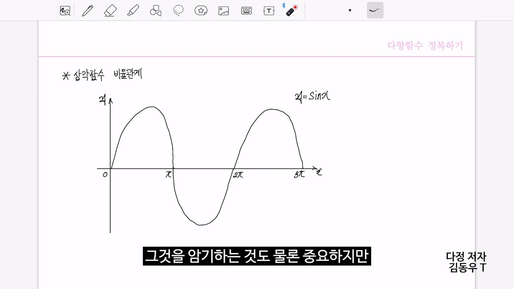
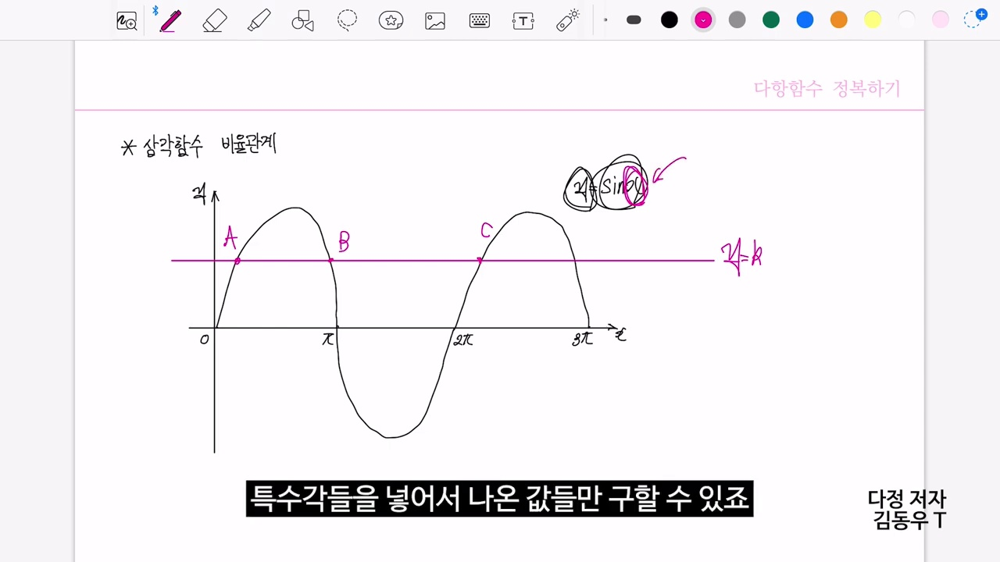
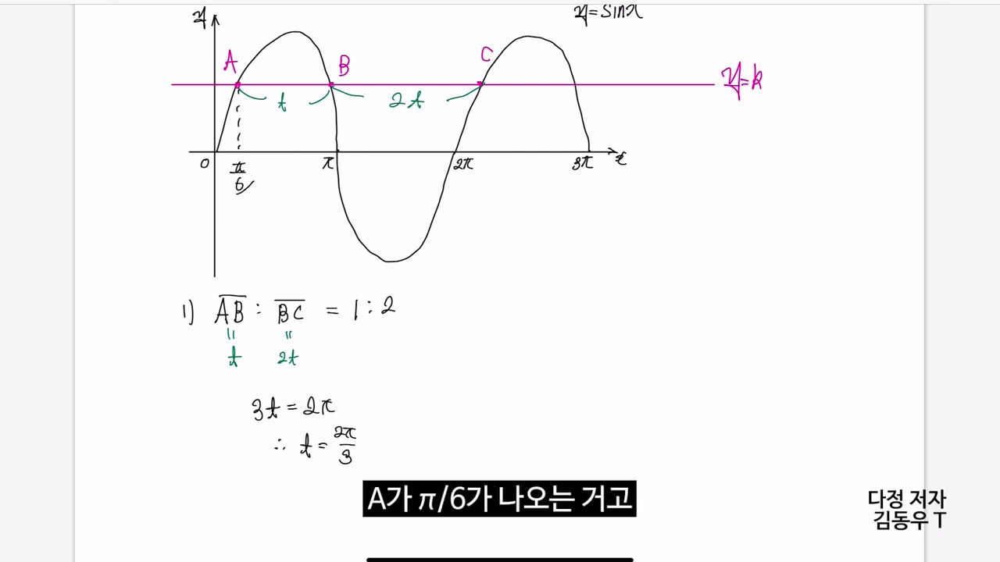
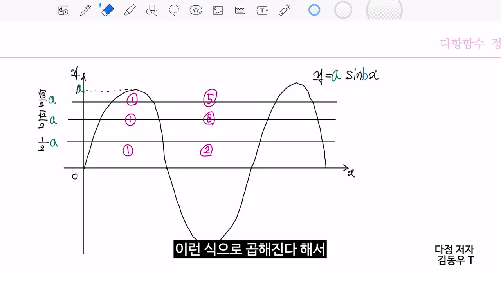
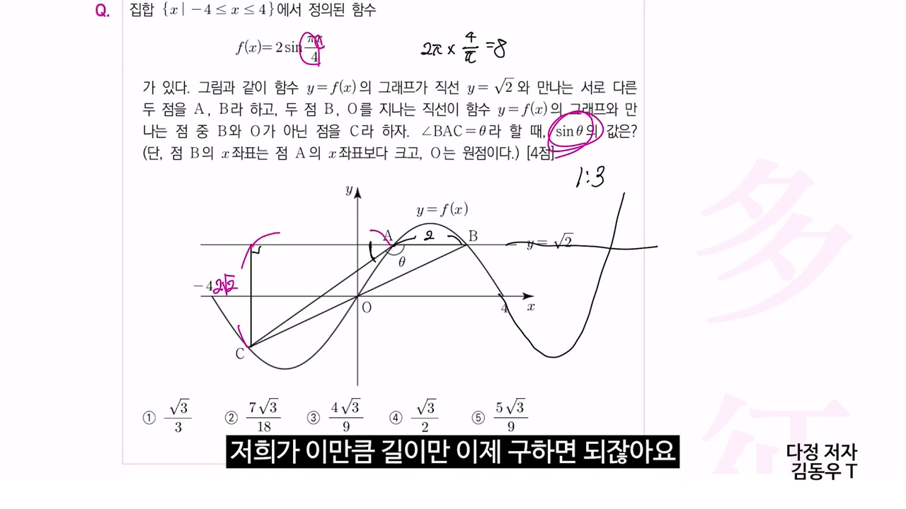
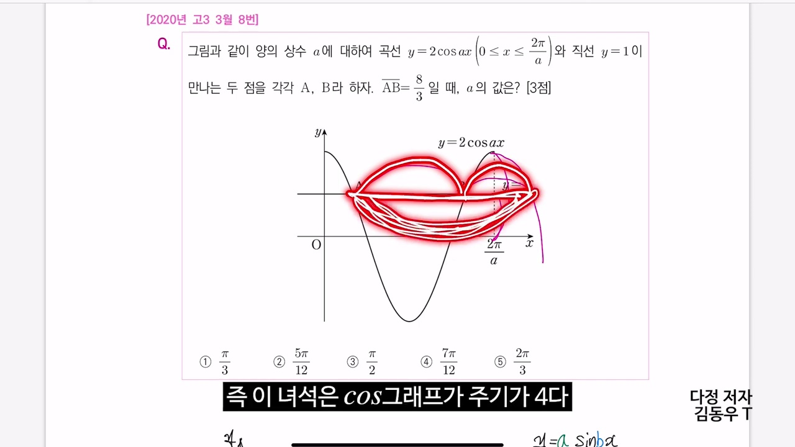
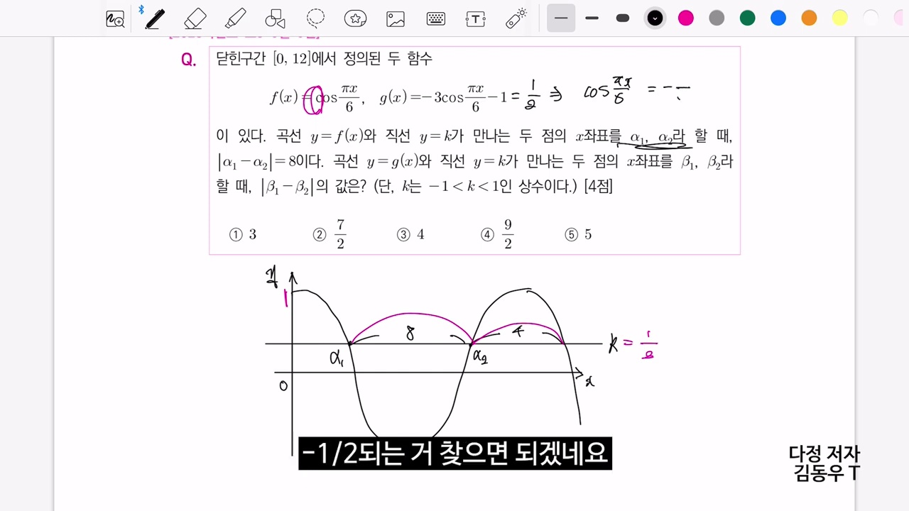
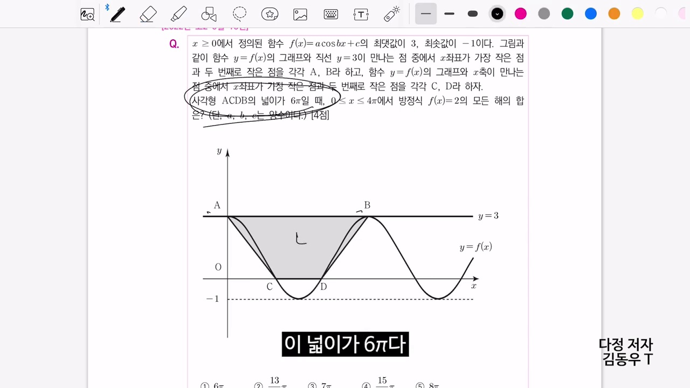
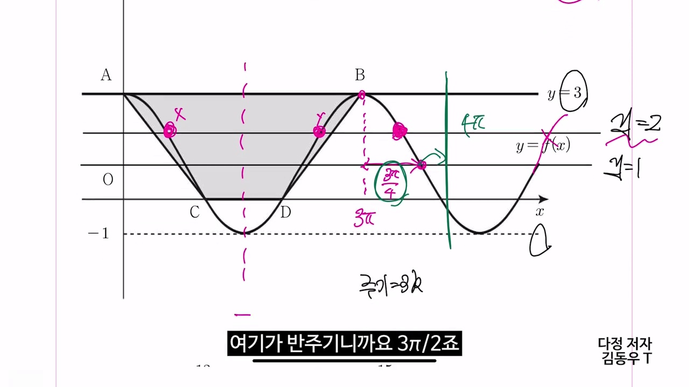

# [고2 수학Ⅰ] 삼각함수에서도 “비율관계”를 사용하는 방법 (8칸 박스와 3등분 특수각 비율)

> **원본 영상 정보**
> - **출처**: [다정수학 YouTube](https://youtu.be/F_I1QJPWol8)
> - **영상 제목**: 삼각함수에서도 “비율관계”를 사용하는 방법
> - **채널**: 다정수학
> - **영상 길이**: 20분 43초 (1243초)
> - **주요 태그**: `#수학1 #삼각함수 #비율관계 #8칸박스법 #삼차함수비율관계 #수능수학 #특수각 #다정수학`

---

## 1. 핵심 요약 (Key Summary)

수험생들은 삼차함수의 $2:1$ 비율관계, $1:\sqrt{3}$ 비율관계는 기계처럼 외우지만, **삼각함수($y = \sin x, y = \cos x$)에도 완벽한 황금 비율관계가 존재한다는 사실**을 모르는 경우가 많습니다:

삼각함수 1주기($2\pi$)를 담는 **8칸 박스(가로 4등분 $\times$ 세로 2등분)** 안에서:
1. **높이 절반($y = \frac{1}{2}$) 기준 가로 $1 : 2$ 분할 (3등분 법칙)**:
   * $y = \sin x$가 최댓값($1$)의 절반인 $\frac{1}{2}$에 도달하는 순간은 정확히 1사분면 주기($0 \sim \frac{\pi}{2}$)의 **$\frac{1}{3}$ 지점인 $x = \frac{\pi}{6}$**입니다!
   * 즉, 원점부터 $x = \frac{\pi}{6}$까지가 $1$, $x = \frac{\pi}{6}$부터 극대점 $x = \frac{\pi}{2}$까지가 $2$인 **$1 : 2$ 내분 비율**이 항상 성립합니다.
2. **높이 $y = \frac{\sqrt{3}}{2}$ 기준 가로 $2 : 1$ 분할**:
   * 반대로 $\sin x = \frac{\sqrt{3}}{2}$이 되는 지점은 주기의 **$\frac{2}{3}$ 지점인 $x = \frac{\pi}{3}$**입니다.
3. **높이 $y = \frac{\sqrt{2}}{2}$ 기준 가로 정중앙 분할 ($1 : 1$)**:
   * $\sin x = \frac{\sqrt{2}}{2}$은 정확히 $0$과 $\frac{\pi}{2}$의 정중앙인 **$x = \frac{\pi}{4}$**입니다.

이 비율관계를 숙지하면 복잡한 삼각방정식 $\sin(\omega x + \phi) = \frac{k}{2}$을 풀 때 각도를 일일이 환산하지 않고, **박스 한 칸의 길이를 $\frac{1}{3}, \frac{1}{2}, \frac{2}{3}$로 쪼개어 실근과 교점 간격을 3초 만에 암산**할 수 있습니다!

---

### 📊 삼각함수 1사분면 8칸 박스 내 황금 비율 매트릭스

| 높이 수준 ($y$ 좌표) | 각도 ($x$) | 1사분면 구간($0 \sim \frac{\pi}{2}$) 내분비 | 핵심 기하학적 의미 |
| :---: | :---: | :---: | :--- |
| **$y = 1$ (최댓값)** | $x = \frac{\pi}{2}$ | $1 : 0$ (도착점) | 극대점 (접선 기울기 $0$) |
| **$y = \frac{\sqrt{3}}{2} \approx 0.866$** | $x = \frac{\pi}{3}$ | **$2 : 1$ 내분점** | 극대점에 가깝게 가속하는 구간 |
| **$y = \frac{\sqrt{2}}{2} \approx 0.707$** | $x = \frac{\pi}{4}$ | **$1 : 1$ 정중앙** | 가로 구간의 완벽한 이등분점 |
| **$y = \frac{1}{2} = 0.5$ (절반)** | $x = \frac{\pi}{6}$ | **$1 : 2$ 내분점** | **수능 빈출 1순위**: 높이 절반에 도달하는 가로 3등분점 |
| **$y = 0$ (중심선)** | $x = 0$ | $0 : 1$ (출발점) | 변곡점 (접선 기울기 최대) |

---

## 2. 9단계 판서 캡처 & 타임라인별 상세 해설

### 1단계 [00:25] 인트로: "삼각함수에서도 비율관계를 쓸 수 있다?!"

* 삼차함수에만 있는 줄 알았던 비율관계가 수능 킬러 삼각함수 그래프에도 동일하게 적용됨을 밝힙니다.

### 2단계 [01:50] 삼차함수 vs 삼각함수 비율 비교

* 삼차함수의 극값-변곡점 $1:1:1$ 분할과 삼각함수의 4분주기 분할 구조를 직관적으로 비교합니다.

### 3단계 [04:00] 8칸 박스법의 표준화

* 진폭 $A$와 주기 $T$에 의해 결정되는 가로 4등분, 세로 2등분의 직사각형 8칸 박스를 작도합니다.

### 4단계 [06:30] 특수각과 높이의 비례 관계

* $\sin 30^\circ = \frac{1}{2}$, $\sin 45^\circ = \frac{\sqrt{2}}{2}$, $\sin 60^\circ = \frac{\sqrt{3}}{2}$가 박스 내에서 어떻게 가로 길이를 분할하는지 시각화합니다.

### 5단계 [09:00] 높이 절반의 $1:2$ 분할 법칙 (핵심)

* 높이가 절반($y = \frac{1}{2}$)일 때 가로축은 정확히 $\frac{1}{3}$과 $\frac{2}{3}$로 쪼개지는 $1:2$ 비율이 성립함을 엄밀히 증명합니다.

### 6단계 [11:30] 변곡접선과 대칭축의 역할

* 중심선과의 교점(변곡점)과 극대/극소(대칭축)를 기준으로 한 좌우 대칭성을 공식화합니다.

### 7단계 [14:00] 실전 문제 속도전 풀이

* 실제 모의고사 기출문제에서 방정식을 세우지 않고 8칸 박스 눈금만으로 근을 암산하는 시연을 보입니다.

### 8단계 [16:30] 수능 킬러 복합 문항 적용

* 주기 $\omega$와 평행이동이 섞인 고난도 4점 문항에서 비율관계를 통해 미지수를 일거에 소거합니다.

### 9단계 [19:10] 삼각함수 비율관계 최종 정리

* 3등분점($\frac{1}{2}, \frac{\sqrt{3}}{2}$)과 2등분점($\frac{\sqrt{2}}{2}$)을 외우는 암기법을 정리하며 강의를 마무리합니다.
