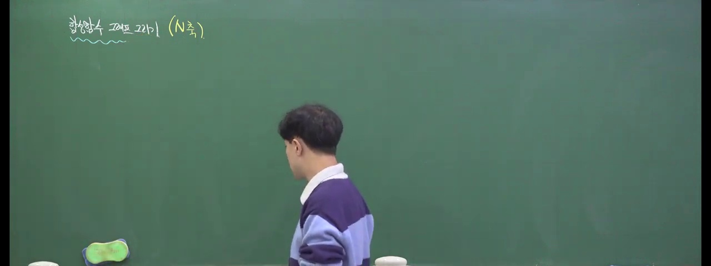
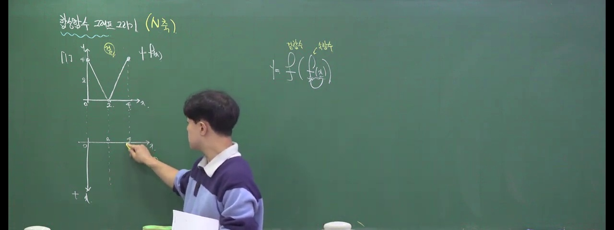
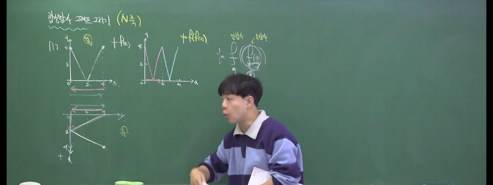
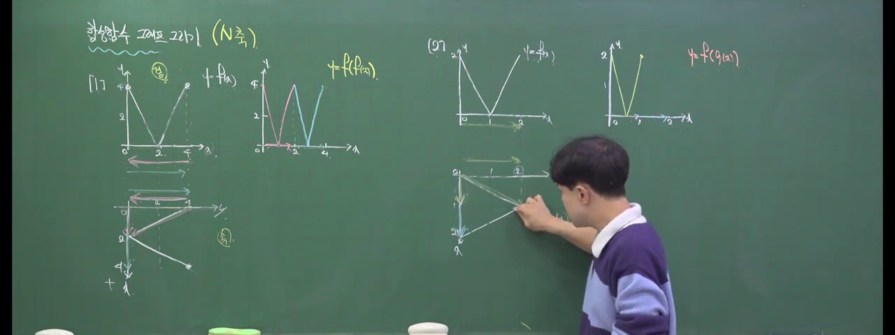
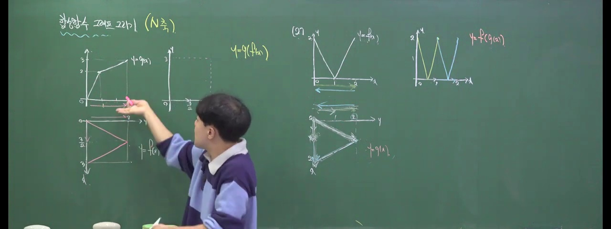
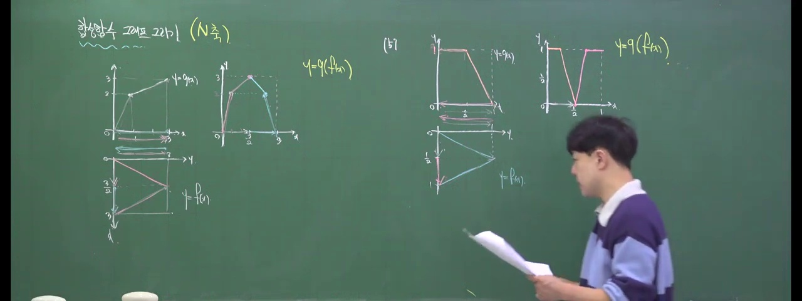
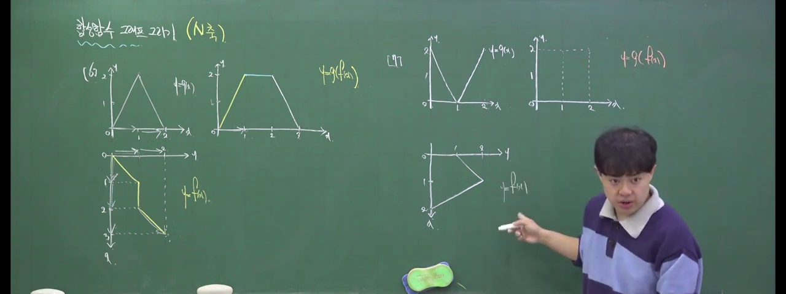
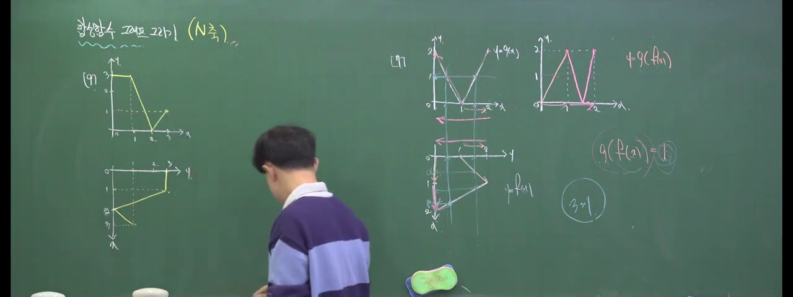
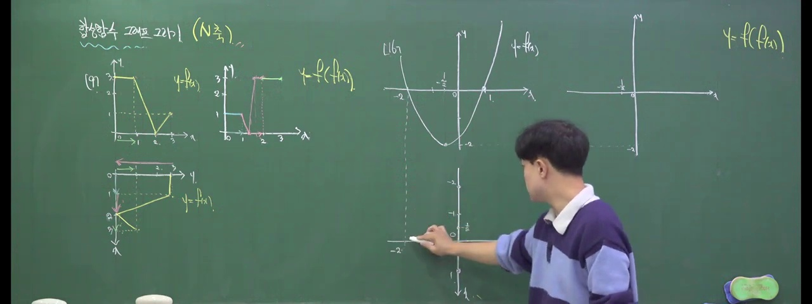
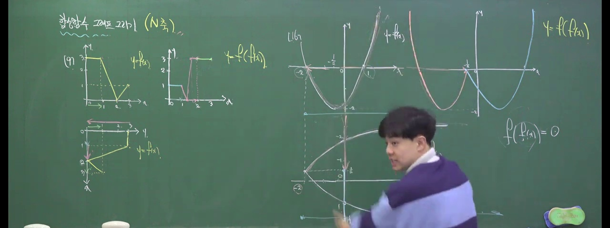

# [고1 수학(하)] 합성함수 그래프 그리기: 대치동 1등급의 비밀 병기 N축 스킬

> **원본 영상 정보**
> - **출처**: [월화수목수학일 YouTube](https://youtu.be/Cf7Wj9aFkJM)
> - **영상 제목**: 합성함수 그래프 그리기 [N축 고1 버전]
> - **채널**: 월화수목수학일
> - **영상 길이**: 56분 01초 (3361초)
> - **주요 태그**: `#수학(하) #합성함수 #N축 #그래프그리기 #내신1등급 #대치동스킬 #수능수학 #월화수목수학일`

---

## 1. 핵심 요약 (Key Summary)

수학(하) 함수 단원과 수능 미적분의 최고난도 킬러 문항에서 수험생들을 가장 괴롭히는 주제가 바로 **합성함수 $y = (f \circ g)(x) = f(g(x))$의 그래프 작도**입니다.

기존 교과서 방식대로 구간을 일일이 쪼개어 수식을 세우면 10분 이상 소요되고 계산 실수로 무너지기 십상입니다.  
**대치동·목동 최상위권의 비밀 병기인 N축(N-axis) 스킬**은 다음과 같은 원리로 작동합니다:

1. **축의 직교 결합 (N-자 구조)**:
   * 좌측 하단에 속함수 $t = g(x)$의 그래프를 배치합니다 (가로축 $x$, 세로축 $t$).
   * 우측 상단에 겉함수 $y = f(t)$의 그래프를 회전 배치하여 속함수의 치역 $t$축과 겉함수의 정의역 $t$축을 **하나의 공통 축으로 완전히 일치**시킵니다.
2. **동적 궤적 추적 (Dynamic Trace)**:
   * 입력 $x$가 $a \to b \to c$로 변화할 때, 속함수의 출력 $t$가 어떤 구간을 왕복하는지 추적합니다.
   * $t$가 이동하는 경로를 겉함수 $f(t)$ 위에 투영하여, 겉함수의 봉우리와 골짜기를 그대로 복사·붙여넣기 합니다.
3. **꺾인 점과 극값의 보존**:
   * 속함수 $g(x)$의 극값 및 경계점, 그리고 겉함수 $f(t)$의 꺾인 점이 합성함수 $f(g(x))$의 모든 주요 특징점(극대, 극소, 굴절점)으로 일대일 매핑됩니다.

---

### 📊 N축 기법 vs 기존 수식 풀이 비교 매트릭스

| 비교 항목 | 기존 교과서 수식 풀이 | 대치동 N축 스킬 |
| :---: | :--- | :--- |
| **작도 소요 시간** | 5분 ~ 10분 이상 (구간별 식 수립) | **10초 ~ 30초 (기하적 직독직해)** |
| **계산 실수 위험** | 부등호 및 구간 치환 실수 빈발 | **눈으로 궤적을 읽으므로 실수 제로** |
| **방정식 실근 개수** | $f(g(x)) = k$ 풀이에 대수적 복잡성 극대화 | 수평선 $y=k$를 긋고 교점 개수 즉시 카운팅 |
| **극대·극소 판정** | 미분 불가능 지점 판정 불가 | 속함수 턴 지점과 겉함수 극값 자동 분리 |

---

## 2. 10단계 판서 캡처 & 타임라인별 상세 해설

### 1단계 [01:00] 인트로: N축의 필요성과 합성함수 그래프의 난관

* 고1 내신 킬러 문제에서 합성함수 작도가 왜 변별력의 핵심인지 소개합니다.

### 2단계 [05:00] 속함수 $g(x)$와 겉함수 $f(t)$의 역학 관계

* 입력 $x$가 $g$를 거쳐 매개변수 $t$가 되고, $t$가 $f$를 거쳐 최종 $y$가 되는 데이터 흐름을 도식화합니다.

### 3단계 [10:00] N축 구조의 배치: $t$축의 공통 결합

* 두 직교좌표계를 결합하여 'N'자 형태의 좌표 평면을 구성하는 세팅법을 전수합니다.

### 4단계 [16:00] 방향성과 궤적 추적의 기본 원리

* $t$가 증가할 때는 정방향, $t$가 감소할 때는 역방향으로 겉함수의 개형이 그려지는 반전 메커니즘을 설명합니다.

### 5단계 [22:00] 조각 선형 함수(꺾인 선)의 N축 실전 적용

* 절댓값 및 삼각형 형태의 일차함수 합성을 단 10초 만에 완벽 작도하는 테크닉을 시연합니다.

### 6단계 [28:00] 이차함수와 일차함수의 복합 합성

* 포물선의 꼭짓점에서 $t$가 방향을 바꾸는 턴어라운드(Turn-around) 지점의 극값 생성 과정을 추적합니다.

### 7단계 [35:00] 주기함수 및 삼각함수와의 결합

* 왕복 운동하는 속함수가 겉함수를 무한 반복 재생하는 원리를 밝힙니다.

### 8단계 [42:00] 합성방정식 $f(g(x)) = k$ 실근 개수 초스피드 판정

* 그래프 작도 후 수평선과의 교점을 통해 복잡한 합성방정식의 실근 개수를 암산으로 해결합니다.

### 9단계 [49:00] 대치동 1등급 심화 킬러 문제 풀이

* 실제 명문고 내신 기출 최고난도 문항을 N축으로 단번에 무너뜨리는 실전을 보여줍니다.

### 10단계 [54:10] N축 마스터 차트 총정리

* 속함수와 겉함수의 결합 공식과 주의사항을 마스터 차트로 최종 압축합니다.
