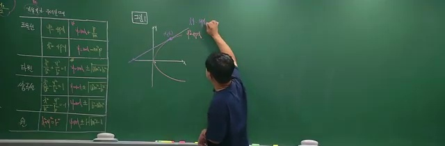
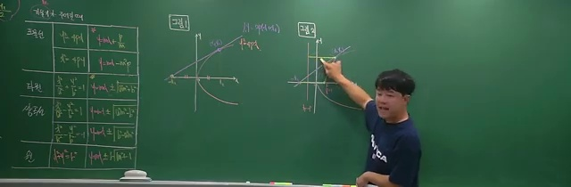
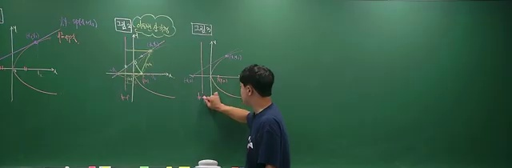
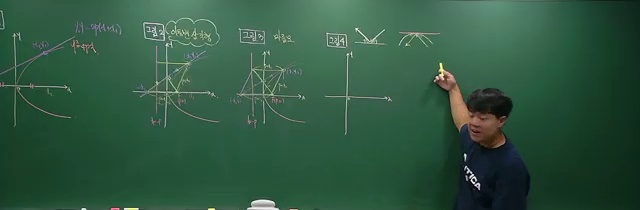
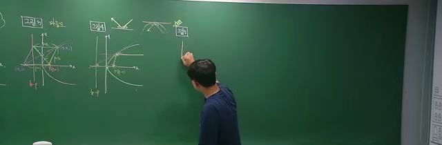
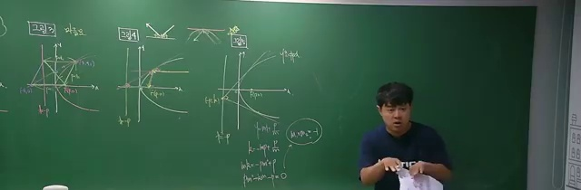
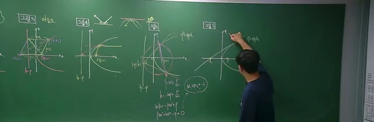
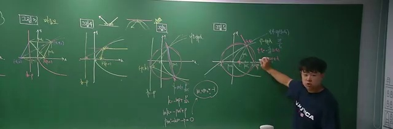
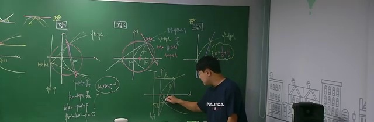
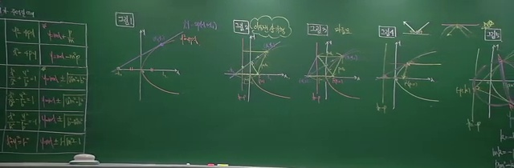

# [수능·내신 기하] 포물선의 기하학적 성질 7가지 완전 정복

> **원본 영상 정보**
> - **출처**: [월화수목수학일 YouTube](https://youtu.be/z7SQOrKT7xY)
> - **영상 제목**: [기하] 포물선의 기하학적 성질 7가지 (시험에 자주 출제되는)
> - **채널**: 월화수목수학일
> - **영상 길이**: 35분 00초 (2100초)
> - **주요 태그**: `#기하 #이차곡선 #포물선 #초점 #준선 #기하학적성질 #수능기하 #내신대비 #월화수목수학일`

---

## 1. 핵심 요약 (Key Summary)

기하 이차곡선에서 포물선($y^2 = 4px$)은 수능 및 내신 시험에 **공식 유도 없이 기하학적 성질만으로 3초 만에 답을 내는 7대 정리**가 존재합니다.

---

### 📊 수능 빈출 포물선 7대 기하 정리 매트릭스

| 번호 | 정리 명칭 | 핵심 기하학적 공식 / 비례 관계 | 시험 출제 빈도 |
| :---: | :--- | :--- | :---: |
| **1** | **초점 현의 조화평균** | $\mathbf{\frac{1}{\overline{AF}} + \frac{1}{\overline{BF}} = \frac{1}{p}}$ | ⭐⭐⭐⭐⭐ (수능 1순위) |
| **2** | **준선 위 접선의 직교성** | 준선 $x = -p$ 위의 점에서 그은 두 접선은 **서로 수직 ($90^\circ$)** | ⭐⭐⭐⭐⭐ (수능 빈출) |
| **3** | **접선 마름모 성질** | 접선 $x$절편 $T(-x_1, 0) \implies \mathbf{\overline{FP} = \overline{FT} = \overline{PH}}$ (마름모 형성) | ⭐⭐⭐⭐ (각의 이등분선) |
| **4** | **광학적 반사 법칙** | 대칭축에 평행하게 입사한 광선은 반사되어 **초점 $F$에 집광** | ⭐⭐⭐⭐ (응용 문항) |
| **5** | **초하위선(Subnormal) 일정** | 점 $P(x_1, y_1)$에서의 법선 $x$절편은 $x_1 + 2p$ $\implies$ **길이 $2p$로 일정** | ⭐⭐⭐ (법선 방정식) |
| **6** | **초점 현 지름원과 준선** | 초점 현 $\overline{AB}$를 지름으로 하는 원은 **준선 $x = -p$에 접함** | ⭐⭐⭐⭐ (원과의 결합) |
| **7** | **아르키메데스 넓이비** | 포물선과 현으로 둘러싸인 넓이와 두 접선 삼각형의 넓이비는 **$2 : 1$** | ⭐⭐⭐ (정적분/넓이비) |

---

## 2. 10단계 판서 캡처 & 타임라인별 상세 해설

### 1단계 [01:00] 인트로: 포물선 정의($\overline{PF} = \overline{PH}$)와 7대 성질 개괄

* 포물선의 기본 정의로부터 유도되는 7가지 강력한 기하학적 무기를 소개합니다.

### 2단계 [04:00] 제1성질: 초점 현의 조화평균 공식 ($\frac{1}{a} + \frac{1}{b} = \frac{1}{p}$)

* 초점을 지나는 직선과 두 초점거리 $\overline{AF}, \overline{BF}$ 사이의 조화평균 관계를 완벽 증명합니다.

### 3단계 [08:00] 제2성질: 준선 위에서의 두 접선 직교 ($90^\circ$)

* 준선 위의 임의의 점에서 그은 두 접선의 기울기 곱이 $-1$이 됨을 판별식과 근과 계수 관계로 증명합니다.

### 4단계 [12:00] 제3성질: 접선의 $x$절편과 마름모 형성

* 접선이 $x$축과 만나는 점 $T$가 $-x_1$이며, $\triangle FPT$가 이등변삼각형이 되어 마름모가 탄생함을 보입니다.

### 5단계 [16:00] 제4성질: 포물선 거울과 광학적 반사 법칙

* 접선과 법선의 각의 이등분선 성질로부터 평행 광선이 초점으로 모이는 광학적 원리를 설명합니다.

### 6단계 [20:00] 제5성질: 법선의 $x$절편과 $2p$ 일정 법칙

* 접선에 수직인 법선을 그었을 때 $x$축 위의 발과 수선의 발 사이의 거리가 항상 $2p$로 일정함을 증명합니다.

### 7단계 [24:00] 제6성질: 초점 현을 지름으로 하는 원과 준선의 접함

* 사다리꼴의 중점 연결 정리에 의해 초점 현의 중점에서 준선까지의 거리가 반지름과 같음을 시각화합니다.

### 8단계 [28:00] 제7성질: 아르키메데스 포물선 $2:1$ 넓이 비

* 포물선의 활꼴 넓이와 외접 삼각형의 넓이비가 $2:1$임을 아르키메데스의 고전 기하로 확인합니다.

### 9단계 [32:00] 수능 및 내신 기출문제 실전 3초 풀이

* 4점 킬러 기하 문제를 복잡한 연립방정식 없이 성질 1~7을 적용하여 암산으로 격파합니다.

### 10단계 [34:10] 7대 기하 공식 마스터 총정리

* 시험 직전 머릿속에 반드시 넣어야 할 포물선의 7가지 기하 공식을 마스터 카드로 최종 정리합니다.
