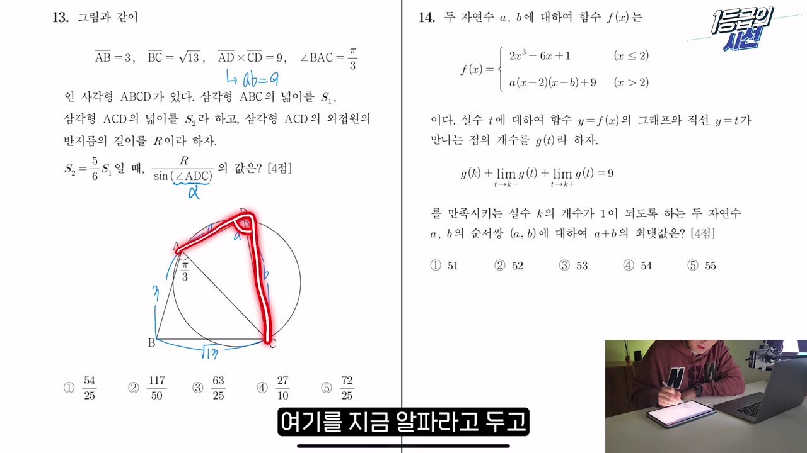
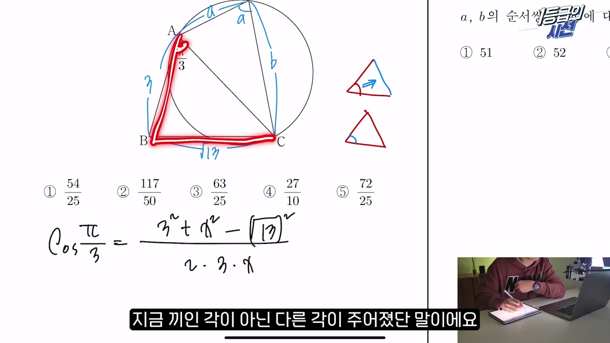
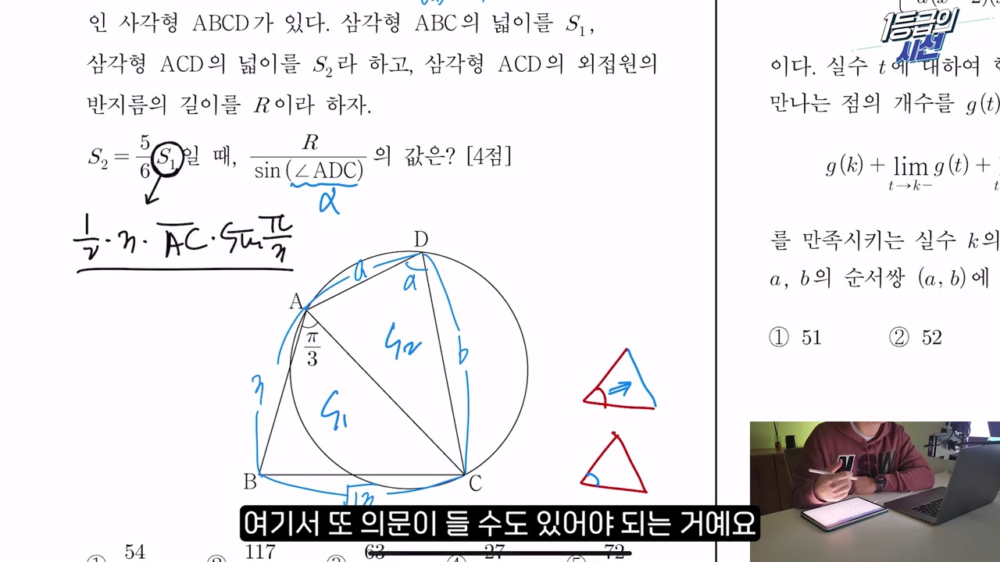
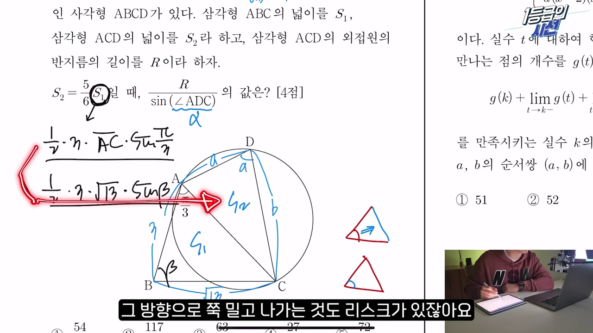
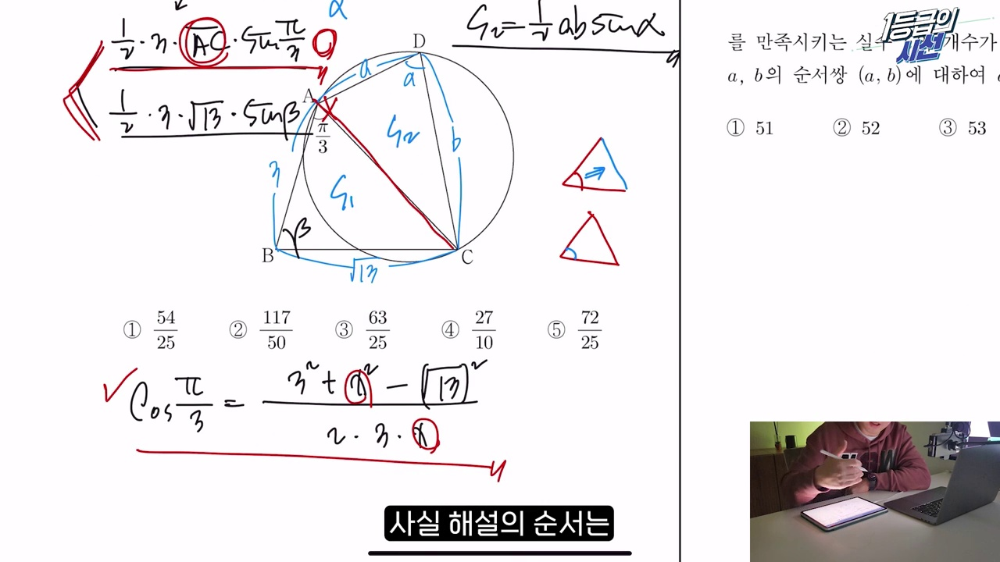
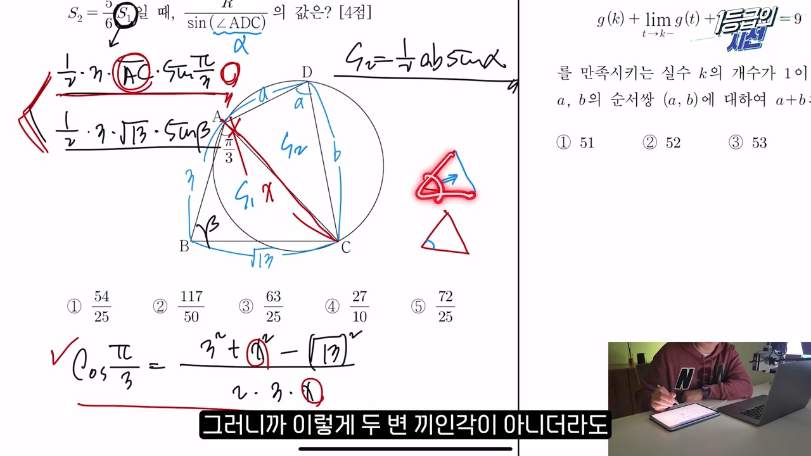
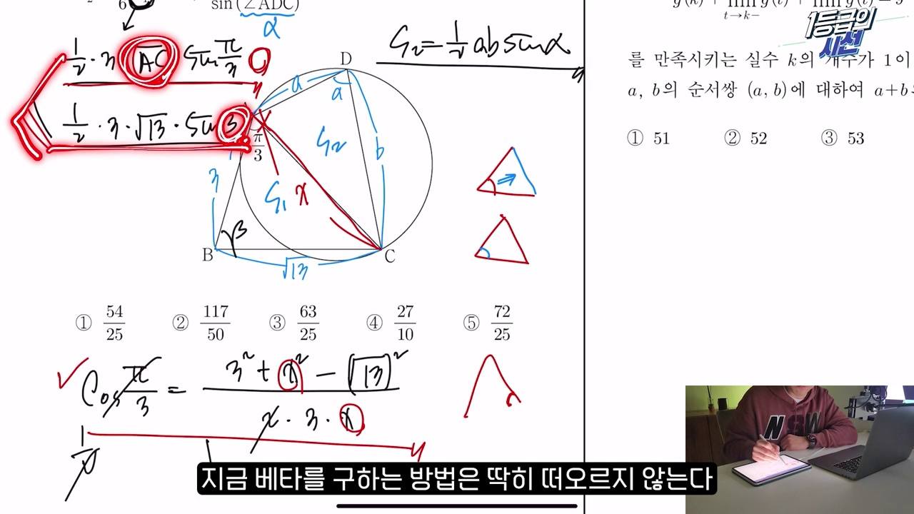
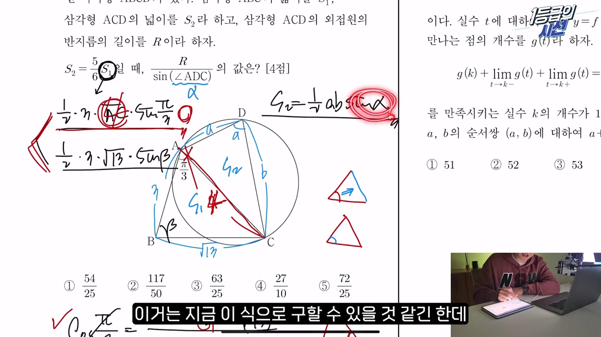
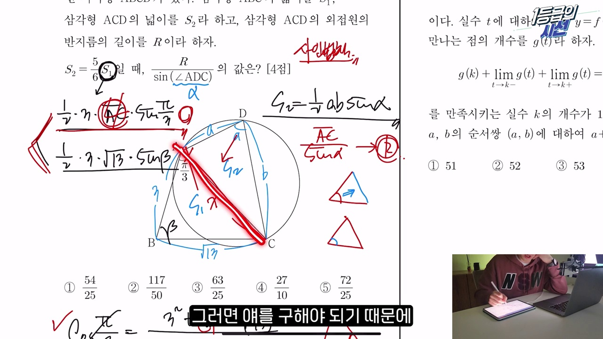
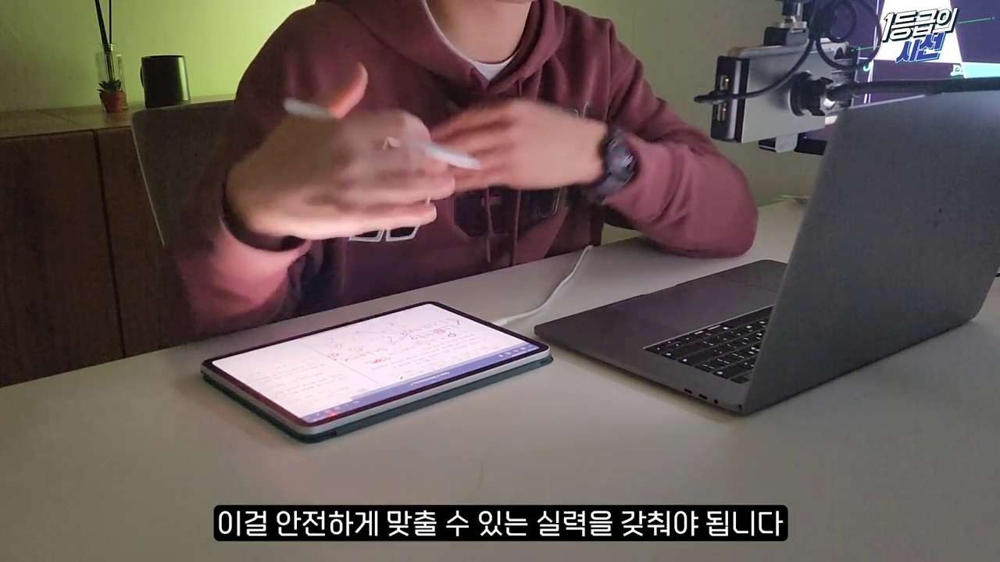

# [고2 수학Ⅰ] 도형 문제를 풀 때 최상위권들이 '반드시' 하는 생각 1가지 (1등급의 시선 ep6)

> **원본 영상 정보**
> - **출처**: [사오수학 YouTube](https://youtu.be/M6ngQiHlH2M)
> - **영상 제목**: 도형 문제를 풀때 최상위권들이 '반드시' 하는 생각 1가지 l 1등급의 시선 ep6
> - **채널**: 사오수학
> - **영상 길이**: 10분 38초 (638초)
> - **주요 태그**: `#수학1 #삼각함수활용 #사인법칙 #코사인법칙 #수능수학 #1등급의시선 #도형문제 #사오수학`

---

## 1. 핵심 요약 (Key Summary)

수능 및 모의고사에서 삼각함수의 활용(사인법칙 & 코사인법칙) 고난도 4점 킬러 문제를 마주했을 때, 대부분의 학생들은 수많은 선택지 앞에서 길을 잃고 헤매거나 우왕좌왕하다 시간을 낭비합니다.  
**대치동·전국 1등급 최상위권들이 도형 문제를 풀 때 본능적으로 거치는 단 1가지의 필연적 사고 알고리즘**을 2024학년도 수능 13번 킬러 문항을 통해 완벽히 정리합니다.

### 💡 1등급의 3대 필연적 사고 원칙
1. **미지수 설정의 필연성 (결정 가능성 우선 법칙)**:
   * 넓이 $S = \frac{1}{2}ab\sin\theta$를 표현할 때, 변의 길이를 미지수로 둘 것인가? 각도를 미지수로 둘 것인가?
   * **공통선분(Common Segment)**은 인접한 2개 이상의 삼각형에 동시에 걸쳐 있으므로 **정보량이 2배**입니다! 따라서 각도보다는 공통선분 $\overline{AC}$를 미지수로 택하는 것이 압도적으로 유리합니다.
2. **비(非)끼인각에서의 코사인 법칙 (2차 방정식 메커니즘)**:
   * 코사인 법칙은 통상 "두 변과 끼인각"에서 한 변을 구할 때 쓰이지만, **"두 변과 비끼인각"**이 주어져도 코사인 법칙을 쓰면 미지수 $x$에 대한 2차 방정식이 유도됩니다.
   * 수능 평가원은 이 2차 방정식이 깔끔하게 **유리수 범위에서 인수분해**되도록 정밀 설계합니다.
3. **사인법칙과 외접원 반지름($2R$)의 결합**:
   * 각의 크기를 직접 알지 못해도 $\frac{\sin A}{\sin B}$ 비율 관계는 외접원의 반지름 $R$과 마주보는 대변의 비례식으로 직결됩니다.

---

### 📊 수능 삼각함수 도형 킬러 선택지 결정 매트릭스

| 고민 포인트 | 하위권·중위권의 접근 (우왕좌왕) | 1등급 최상위권의 필연적 판단 (3초 결정) |
| :---: | :--- | :--- |
| **코사인 법칙 사용 시점** | "각이 나왔으니 일단 아무 생각 없이 써보자" | **"세 변과 한 각(총 4개 요소) 중 3개를 알고 있으므로 미지수 1개 확정!"** |
| **넓이 $S_1$ 표현의 갈림길** | 미지수 $x = \overline{AC}$ vs 각 $\beta$ 중 무작위 선택 | **공통변 $x$는 $S_1, S_2$ 양쪽에 정보를 전달하므로 $x$를 미지수로 확정** |
| **비끼인각 코사인 방정식** | 2차 방정식이 나오면 당황하거나 계산 포기 | **평가원 출제 원리상 반드시 인수분해됨을 확신하고 $x$를 즉시 인수분해** |
| **사인값 비율 $\frac{\sin \alpha}{\sin \beta}$** | 각도를 직접 구하려다 실패 | **사인법칙 $\frac{a}{\sin A} = 2R$로 변의 길이비로 치환** |

---

## 2. 10단계 판서 캡처 & 타임라인별 상세 해설

### 1단계 [00:30] 인트로: 2024학년도 수능 13번 도형 문제와 1등급의 시선

* 학생들이 시험장에서 가장 흠칫하는 삼각함수 활용 킬러 문항을 소개하고, 1등급 학생들의 생각 차이를 밝힙니다.

### 2단계 [01:30] 문제 조건 정리와 주어진 도형 분석

* 주어진 길이($3, \sqrt{13}$), 특수각 $\frac{\pi}{3}$, 넓이 비율 조건 및 구하고자 하는 각 $\alpha = \angle ADC$를 좌표평면과 도형에 명확히 표기합니다.

### 3단계 [02:40] 코사인 법칙을 '왜' 쓰는가? (기계적 적용 vs 필연적 이유)

* "각이 주어졌다고 무조건 코사인 법칙을 쓰는 것이 아니다!" 세 변과 한 각의 4요소 중 3요소가 채워졌는지를 점검하는 필연적 이유를 제시합니다.

### 4단계 [03:50] 넓이 $S_1$ 표현의 2가지 갈림길 ($\overline{AC}$ 변 vs $\beta$ 각)

* $S_1 = \frac{1}{2} \cdot 3 \cdot \overline{AC} \cdot \sin\frac{\pi}{3}$과 $S_1 = \frac{1}{2} \cdot 3 \cdot \sqrt{13} \cdot \sin\beta$ 중 무엇을 골라야 하는지의 갈림길을 짚어냅니다.

### 5단계 [05:10] 공통선분의 중요성과 정보 결합

* $\overline{AC}$는 삼각형 2개에 공통으로 걸쳐 있는 핵심 선분이므로, $\overline{AC}$를 알아내면 두 번째 삼각형의 모든 정보가 도미노처럼 풀림을 증명합니다.

### 6단계 [06:20] 비(非)끼인각 코사인법칙과 2차 방정식 유도

* $13 = 3^2 + x^2 - 2 \cdot 3 \cdot x \cdot \cos\frac{\pi}{3}$로부터 $x^2 - 3x - 4 = 0$이라는 깔끔한 2차 방정식을 도출합니다.

### 7단계 [07:30] 인수분해를 통한 선분 길이 $\overline{AC} = 4$ 확정

* $(x - 4)(x + 1) = 0 \implies x = 4$로 공통선분의 길이가 단 5초 만에 정확히 확정됩니다.

### 8단계 [08:30] 사인법칙과 외접원 반지름($2R$)의 연결 고리

* 외접원을 공유하거나 비율 관계가 주어졌을 때 사인법칙을 통해 미지의 각 $\alpha$를 구하는 매핑 과정을 시각화합니다.

### 9단계 [09:30] $\sin \alpha$와 최종 답 도출 과정

* $S_1, S_2$의 넓이 비율과 사인법칙을 결합하여 평가원 정답을 실수 없이 완벽하게 계산합니다.

### 10단계 [10:20] 1등급의 도형 문제 해결 1가지 필연적 사고 알고리즘 요약

* "선택지가 많을수록 정보량이 많은 미지수를 선택하라!"는 1등급의 황금 규칙을 마스터 카드로 최종 정리합니다.
