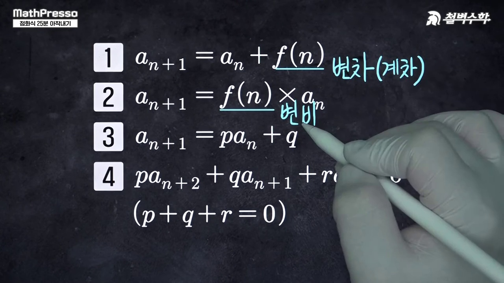
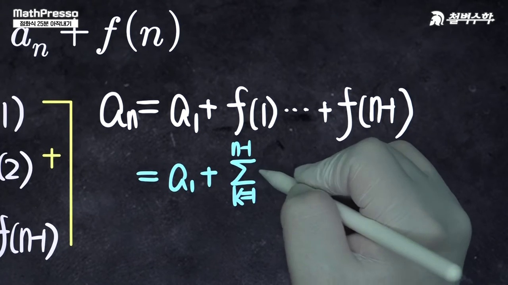
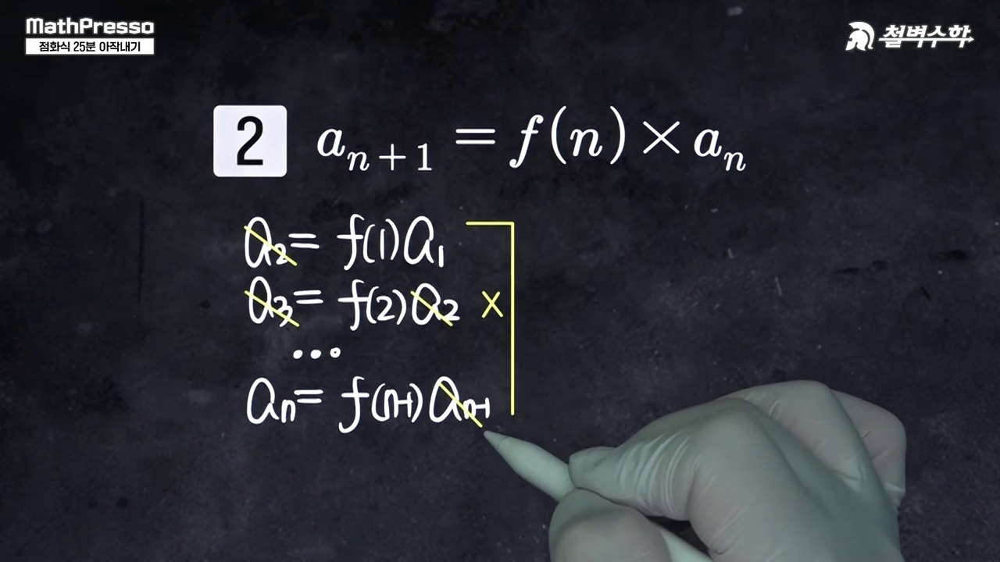
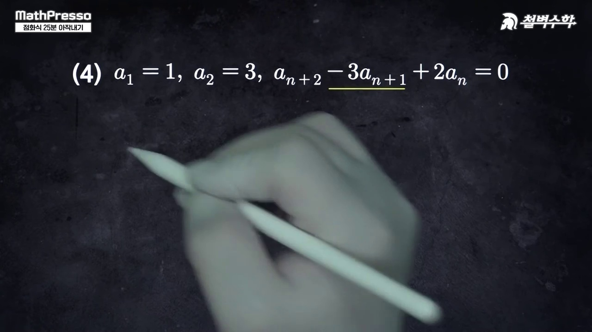
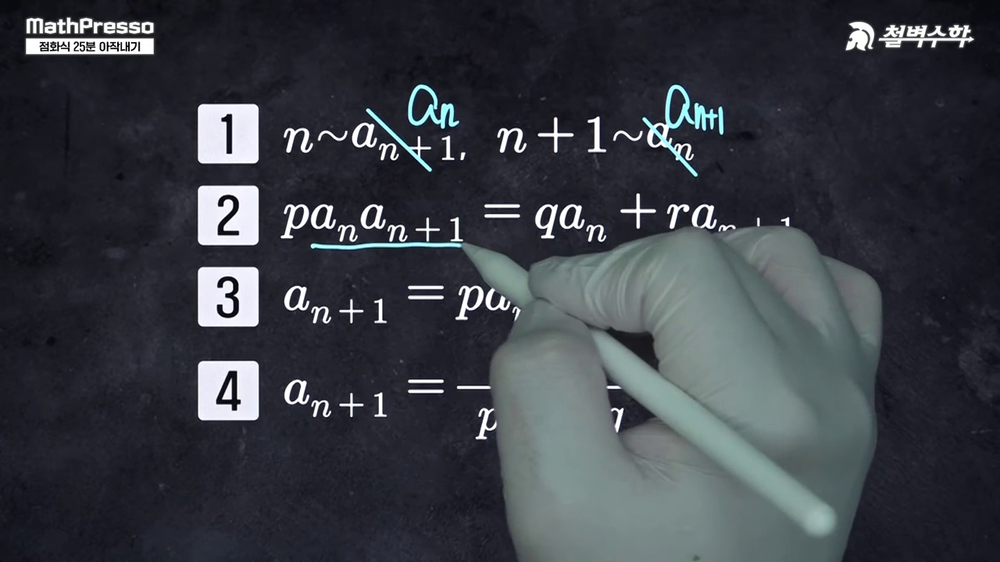
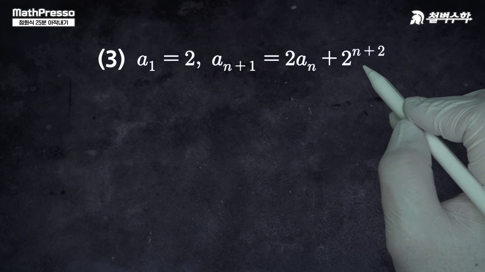
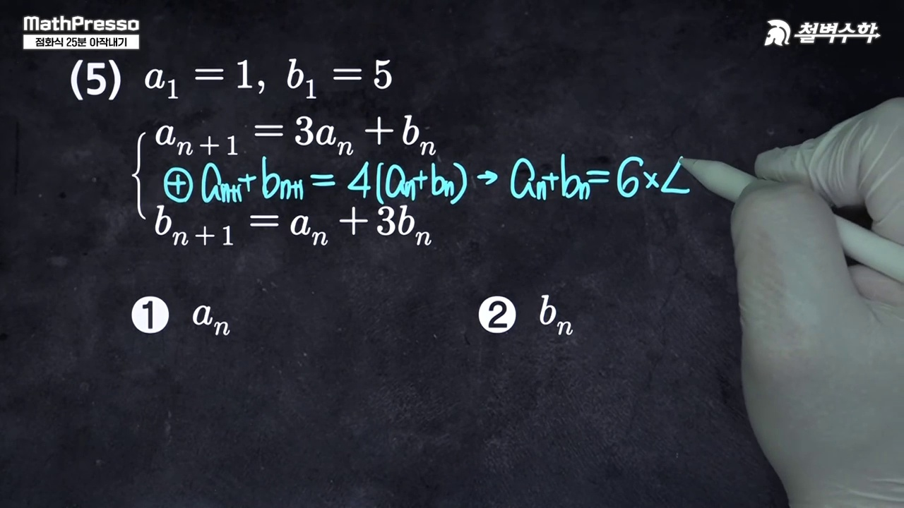
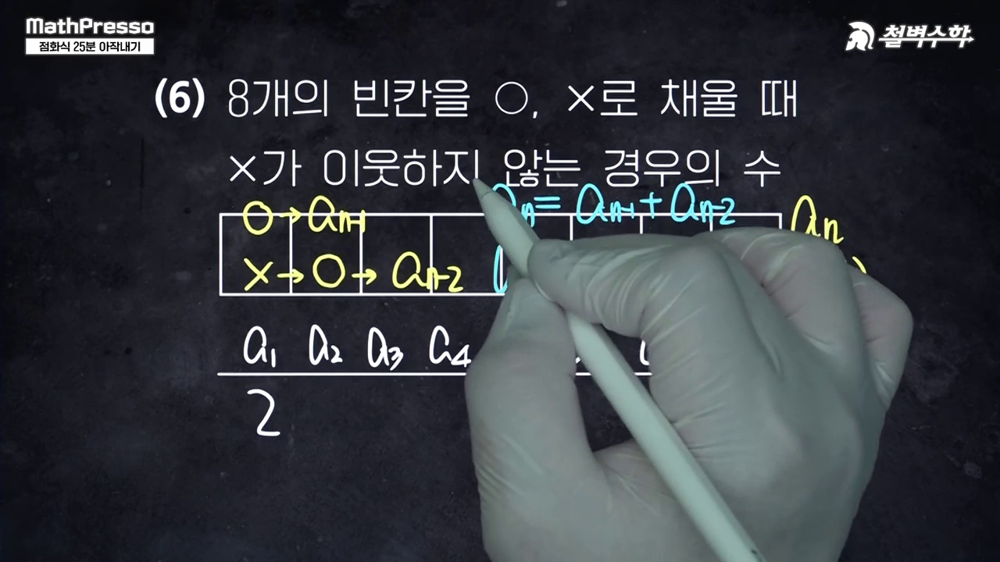

# [고2 수학Ⅰ] 점화식 25분 아작내기 (등차·등비수열 Big 4 & 응용 6대 점화식)

> **원본 영상 정보**
> - **출처**: [매스프레소 YouTube](https://youtu.be/OP2qIiPfKJo)
> - **영상 제목**: 점화식 25분 아작내기 | 매스프레소
> - **채널**: 매스프레소 MathPresso
> - **영상 길이**: 25분 40초 (1540초)
> - **주요 태그**: `#수학1 #수열 #점화식 #수열의귀납적정의 #축차대입법 #계차수열 #매스프레소`

---

## 1. 핵심 요약 (Key Summary)

수열 단원의 최종 보스인 **수열의 귀납적 정의(점화식, Recurrence Relation)**는 수능과 내신에서 반드시 출제되는 핵심 영역입니다.  
배티 선생님의 명쾌한 25분 총정리로 **기본 점화식 Big 4와 응용 점화식 6종**을 체계적으로 분류하고 일반항 $a_n$을 3초 만에 구하는 공식을 정복합니다.

---

### 📊 수열 점화식 Big 4 & 응용 6 매트릭스

| 유형 | 점화식 형태 | 핵심 해법 및 일반항 유도 공식 | 수능·내신 출제 포인트 |
| :---: | :--- | :--- | :---: |
| **Big 1** | $a_{n+1} - a_n = d$ | **등차수열**: $a_n = a_1 + (n-1)d$ | 기본 등차 점화식 |
| **Big 2** | $\frac{a_{n+1}}{a_n} = r$ | **등비수열**: $a_n = a_1 \cdot r^{n-1}$ | 기본 등비 점화식 |
| **Big 3** | $a_{n+1} = a_n + f(n)$ | **계차수열**: $a_n = a_1 + \sum_{k=1}^{n-1} f(k)$ (변변 더하기) | 축차대입 1순위 |
| **Big 4** | $a_{n+1} = f(n) \cdot a_n$ | **계비수열**: $a_n = a_1 \cdot \prod_{k=1}^{n-1} f(k)$ (변변 곱하기) | 축차대입 2순위 |
| **응용 1** | $a_{n+1} = p a_n + q$ ($p \neq 1$) | $a_{n+1} - \alpha = p(a_n - \alpha)$ 특성방정식 $\alpha = \frac{q}{1-p}$ | 등비수열 치환 |
| **응용 2** | $p a_{n+2} + q a_{n+1} + r a_n = 0$ ($p+q+r=0$) | $a_{n+2} - a_{n+1} = \frac{r}{p}(a_{n+1} - a_n)$ 계차 등비형 | 3항간 점화식 |
| **응용 3** | $a_{n+1} = \frac{p a_n}{q a_n + r}$ | 양변 역수 취하여 $\frac{1}{a_n} = b_n$ 치환 | 역수치환꼴 |
| **응용 4** | $a_{n+1} = p a_n + q^n$ | 양변을 $q^{n+1}$로 나누어 $\frac{a_n}{q^n} = b_n$ 치환 | 지수 나눗셈형 |
| **응용 5** | $a_{n+1} = a_n^p$ | 양변에 상용로그 또는 자연로그 취함 | 로그 치환형 |
| **응용 6** | $S_n$과 $a_n$의 혼합식 | $a_{n+1} = S_{n+1} - S_n$ 관계 대입하여 소거 | 수열의 합 연계 |

---

## 2. 10단계 판서 캡처 & 타임라인별 상세 해설

### 1단계 [00:20] 수열의 표현법: 일반항 vs 귀납적 정의

* 수열을 나타내는 2가지 축인 일반항 표현과 이웃하는 항 사이의 관계식(점화식)을 비교합니다.

### 2단계 [01:40] 등차수열과 등비수열의 기본 점화식

* 공차 $d$와 공비 $r$을 나타내는 2항간, 3항간(등차중항/등비중항) 점화식을 정리합니다.

### 3단계 [03:00] 점화식 Big 4 개괄

* 고교 수학을 지배하는 4대 기본 점화식(등차, 등비, 계차, 계비)의 계통도를 제시합니다.

### 4단계 [05:30] Big 3: $a_{n+1} = a_n + f(n)$ 변변 더하기

* 축차대입법으로 1부터 $n-1$까지 나열한 후 변변 더하여 시그마 공식을 이끌어냅니다.

### 5단계 [08:20] Big 4: $a_{n+1} = f(n) a_n$ 변변 곱하기

* 연속 곱셈을 통해 대각선으로 상쇄 소거되는 계비수열의 일반항 유도법을 시연합니다.

### 6단계 [11:40] 응용 1: $a_{n+1} = p a_n + q$ (알파 테크닉)

* 특성근 $\alpha = p\alpha + q$를 이용해 새로운 등비수열 $\{a_n - \alpha\}$로 변환하는 마법을 전수합니다.

### 7단계 [15:00] 응용 2: 계수의 합이 0인 3항간 점화식

* $p+q+r=0$ 조건에서 계차수열이 공비 $r/p$인 등비수열을 이룸을 시각화합니다.

### 8단계 [18:20] 응용 3: 분수형 점화식과 역수 치환

* 분모와 분자를 뒤집어 $b_n = 1/a_n$으로 치환하면 친숙한 등차/알파형으로 귀결됨을 보입니다.

### 9단계 [21:40] 응용 4 & 5: 지수형 및 로그 치환형 점화식

* 지수로 나누거나 로그를 취해 복잡한 곱셈을 덧셈 점화식으로 단순화합니다.

### 10단계 [24:30] 점화식 10대 마스터 맵 총정리

* 수능 시험장에 들어갈 때 머릿속에 가져가야 할 점화식 의사결정 트리를 최종 정리합니다.
