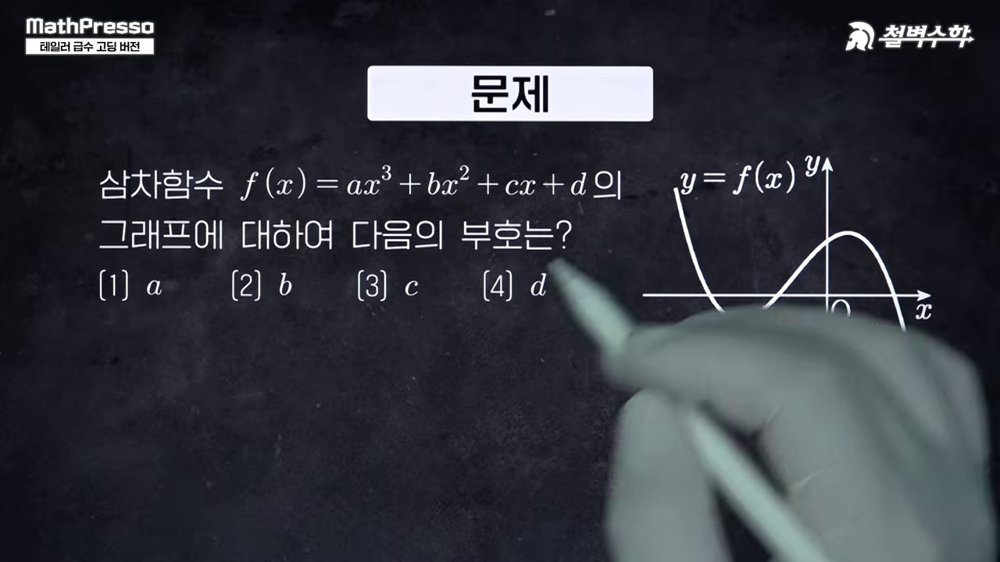
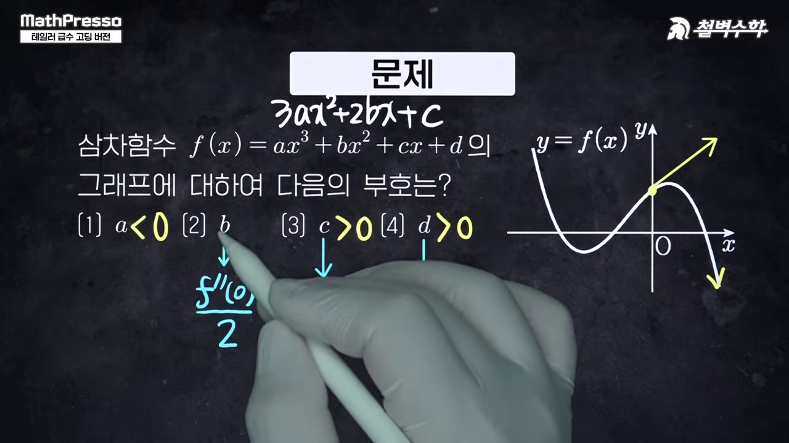
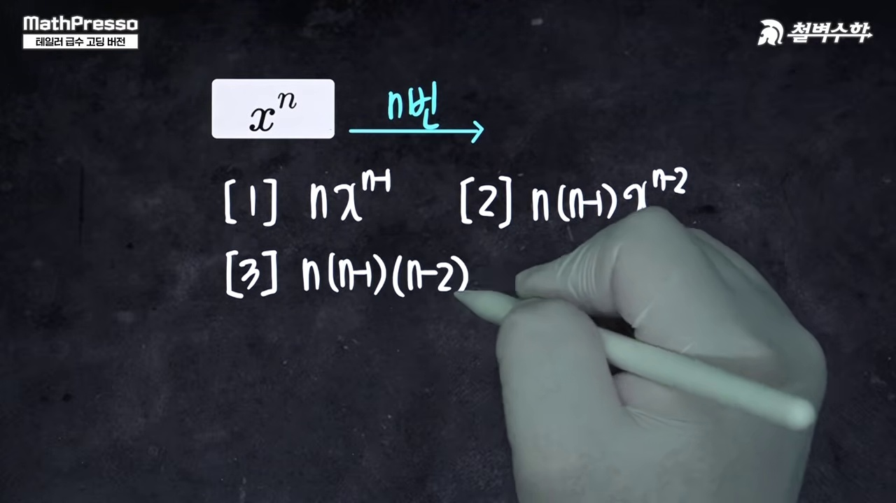
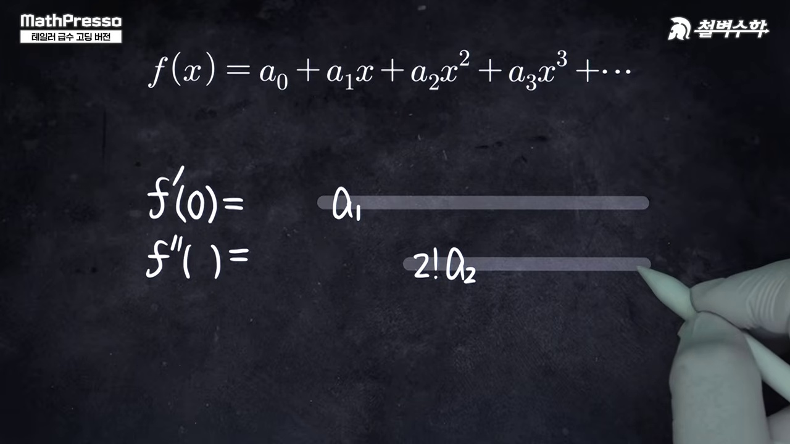
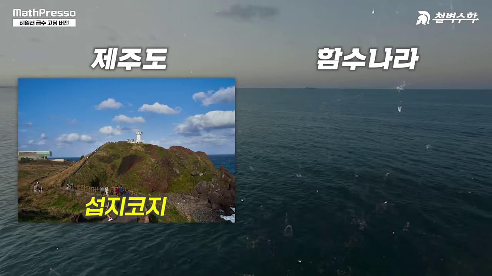
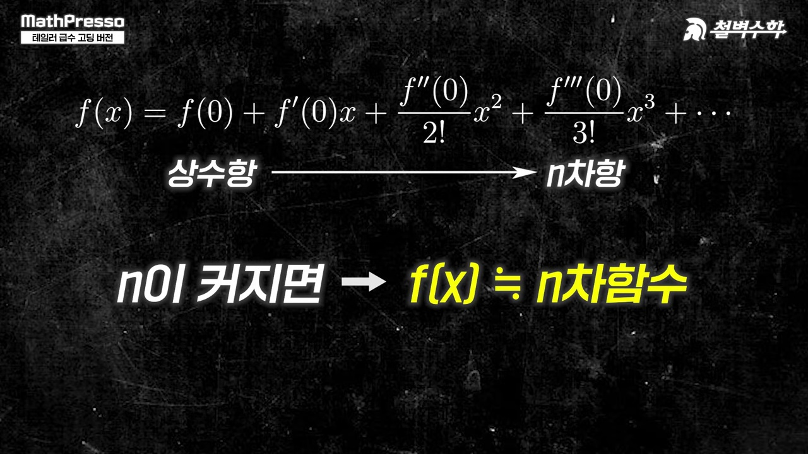
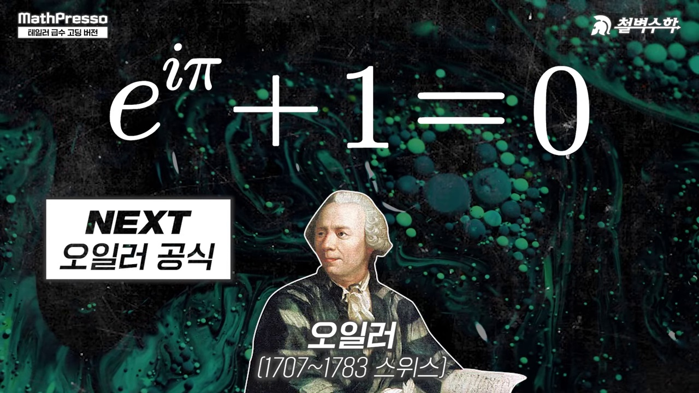

# [미적분] 테일러 급수: 초월함수가 다항함수로 변신하는 기적 (매클로린 다항식 근사)

> **원본 영상 정보**
> - **출처**: [매스프레소 YouTube](https://youtu.be/YHl5jqL-yZA)
> - **영상 제목**: [고딩 버전] 테일러 급수 | 초월함수가 다항함수?!
> - **채널**: 매스프레소 MathPresso
> - **영상 길이**: 6분 18초 (378초)
> - **주요 태그**: `#미적분 #테일러급수 #매클로린급수 #초월함수 #다항함수근사 #수학사 #매스프레소`

---

## 1. 핵심 요약 (Key Summary)

"다항함수가 인간이 만든 지상의 함수라면, 초월함수는 신이 빚은 천상의 함수이다!"  
수학사에서 미적분이 탄생한 이후, **영국의 수학자 브룩 테일러(Brook Taylor)**는 초월함수($e^x, \sin x, \cos x$)를 인간이 다루기 쉬운 $n$차 다항함수로 정밀하게 근사하는 위대한 다리를 놓았습니다.

### 💡 테일러 & 매클로린 급수의 핵심 원리
1. **함수값과 고계 도함수의 일치**:
   * 원점 근방($x=0$)에서 $f(0) = P(0)$, $f'(0) = P'(0)$, $f''(0) = P''(0)$, $\dots$, $f^{(n)}(0) = P^{(n)}(0)$를 만족하는 다항식 $P(x)$를 구성합니다.
2. **매클로린 급수 공식 (Maclaurin Series)**:
   $$f(x) = f(0) + f'(0)x + \frac{f''(0)}{2!}x^2 + \frac{f'''(0)}{3!}x^3 + \dots = \sum_{n=0}^{\infty} \frac{f^{(n)}(0)}{n!} x^n$$
3. **3대 대표 초월함수 다항식 전개**:
   * **지수함수**: $e^x = 1 + x + \frac{x^2}{2!} + \frac{x^3}{3!} + \frac{x^4}{4!} + \dots$
   * **사인함수 (기함수/홀수차수)**: $\sin x = x - \frac{x^3}{3!} + \frac{x^5}{5!} - \frac{x^7}{7!} + \dots$
   * **코사인함수 (우함수/짝수차수)**: $\cos x = 1 - \frac{x^2}{2!} + \frac{x^4}{4!} - \frac{x^6}{6!} + \dots$

---

## 2. 8단계 판서 캡처 & 타임라인별 상세 해설

### 1단계 [00:15] 인트로: 지상의 다항함수 vs 천상의 초월함수

* 대수적인 다항함수와 미지의 초월함수를 잇는 테일러 급수의 철학적 배경을 소개합니다.

### 2단계 [01:00] 접선 근사 (1차 근사)

* $x=0$에서의 접선 $y = f(0) + f'(0)x$가 가장 단순한 1차 다항식 근사임을 확인합니다.

### 3단계 [02:00] 곡률 반영 (2차 근사)

* 2계 도함수 $f''(0)$를 일치시키며 곡률까지 똑같은 포물선 $P_2(x)$를 유도합니다.

### 4단계 [03:00] 팩토리얼($n!$)의 등장과 일반화

* $x^n$을 $n$번 미분할 때 생기는 $n!$ 계수를 상쇄하기 위해 분모에 $n!$이 붙는 원리를 밝힙니다.

### 5단계 [03:50] 지수함수 $e^x$의 매클로린 전개

* 미분해도 자기 자신이 되는 $e^x$의 무한 다항식 전개식을 유도합니다.

### 6단계 [04:40] 사인함수 $\sin x$의 홀수차 전개

* $0, 1, 0, -1$이 순환하며 홀수 차수만 남는 사인함수의 아름다운 교대급수를 시각화합니다.

### 7단계 [05:20] 코사인함수 $\cos x$의 짝수차 전개

* 짝수 차수 항들로 구성되어 완벽한 우함수 대칭을 이루는 코사인 급수를 확인합니다.

### 8단계 [06:00] 오일러 공식과의 연결 및 총정리

* $e^{ix} = \cos x + i\sin x$로 이어지는 인류 최고의 수학 공식을 조망하며 수업을 마무리합니다.
