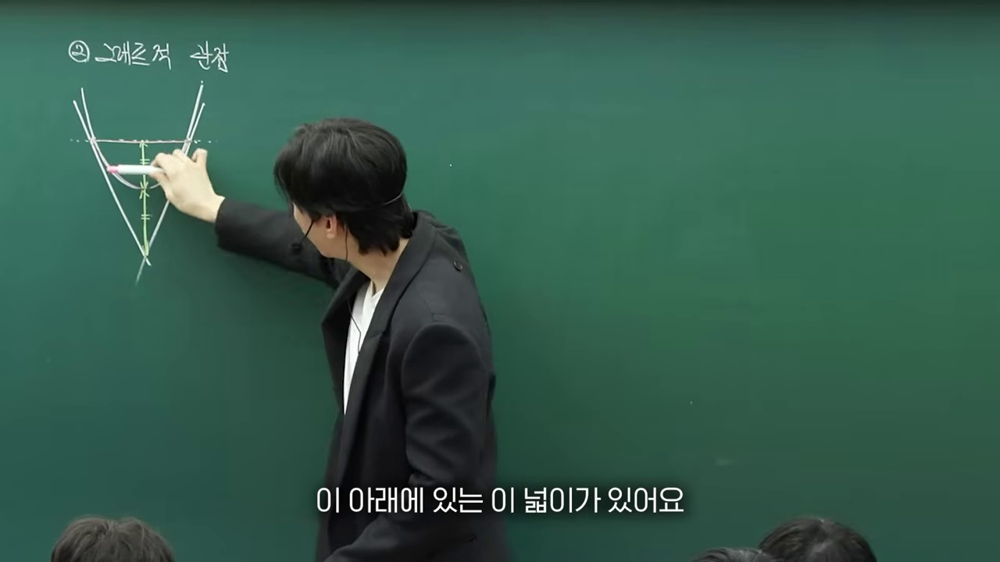
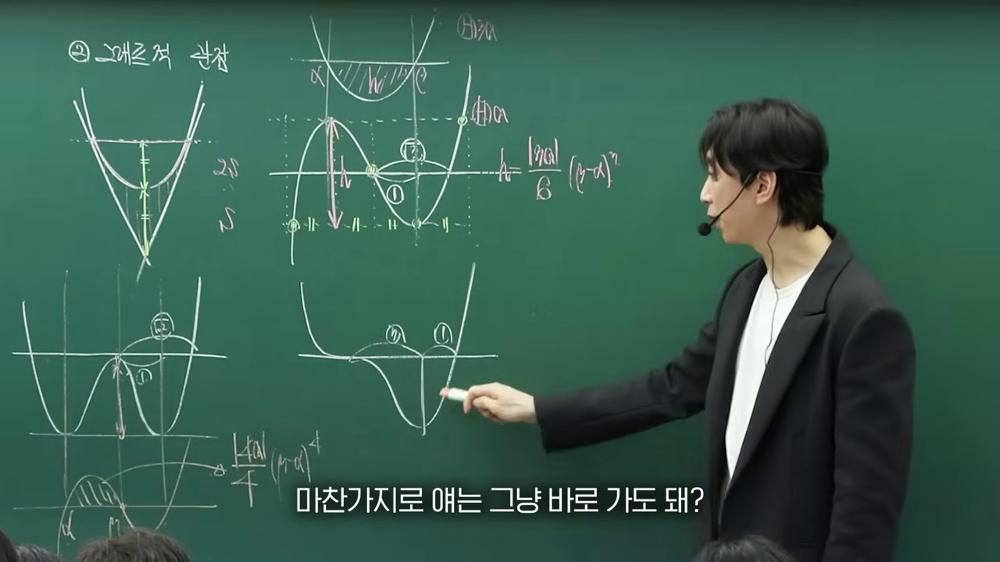
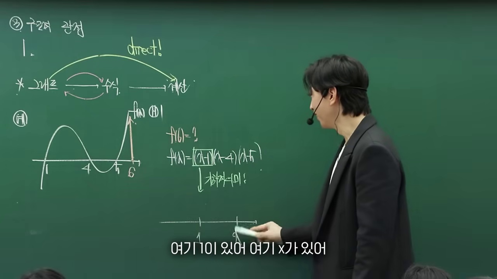
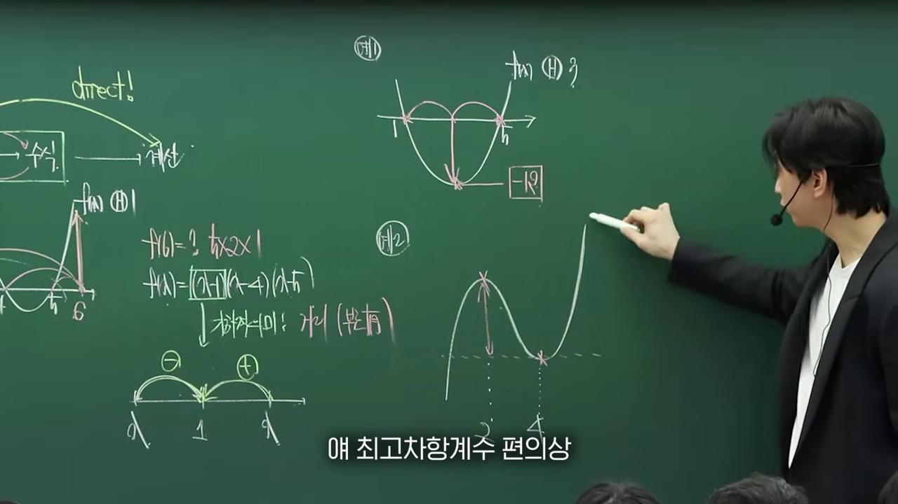
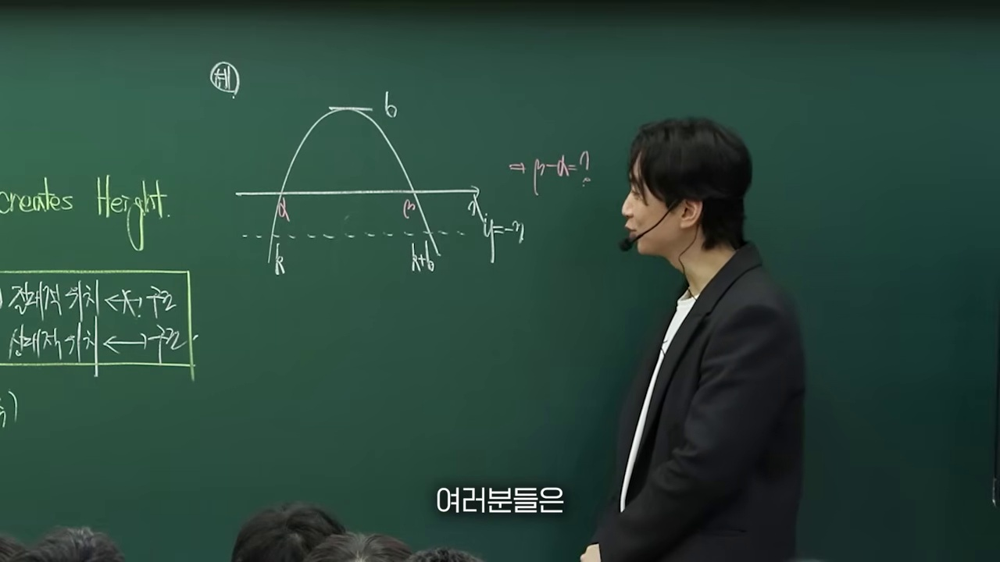
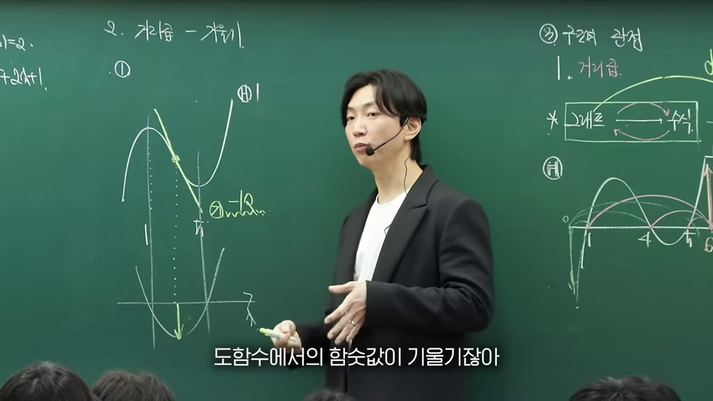
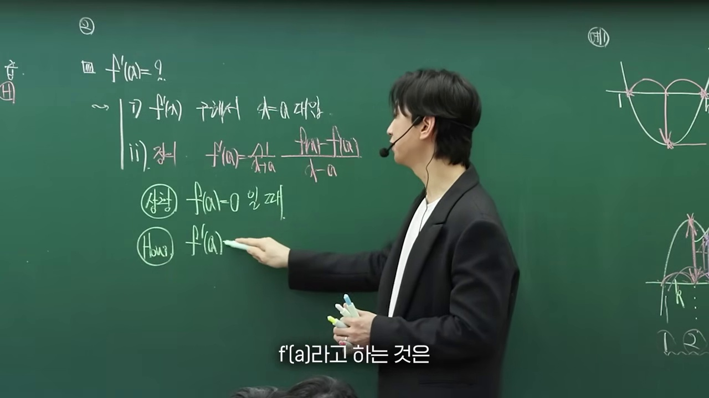
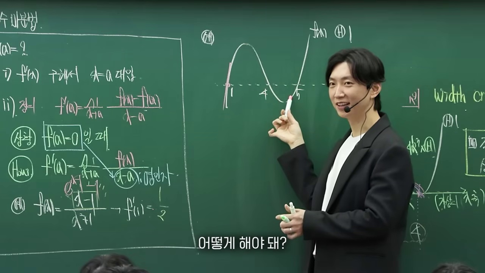
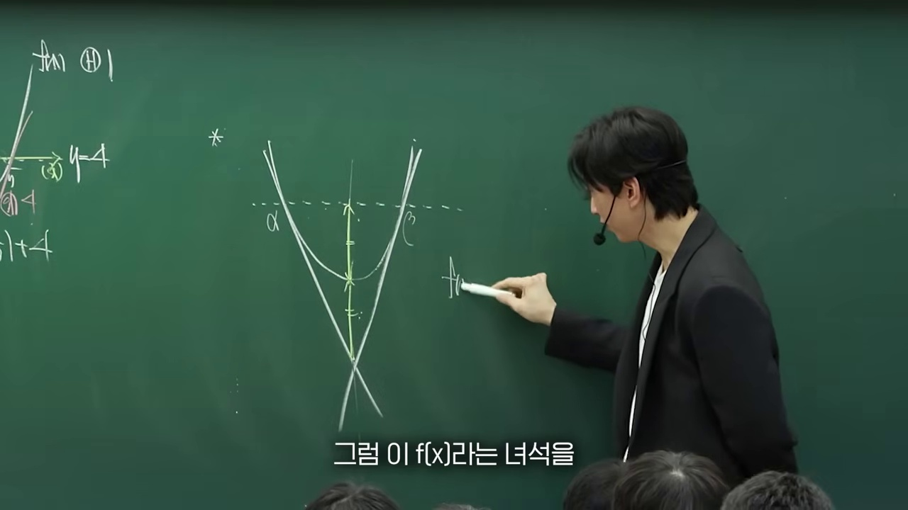
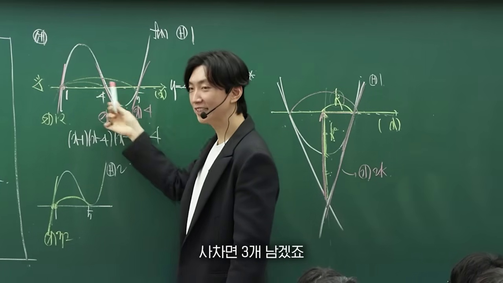

# [고2 수학Ⅱ] 다항함수를 보는 눈이 완전히 바뀔 겁니다 (인수 관점과 대칭성)

> **원본 영상 정보**
> - **출처**: [수능 수학은 이동준 YouTube](https://youtu.be/Jw8F2akj_T0)
> - **영상 제목**: 다항함수를 보는 눈이 완전히 바뀔 겁니다.
> - **채널**: 수능 수학은 이동준 (시대인재 이동준T)
> - **영상 길이**: 25분 23초 (1523초)
> - **주요 태그**: `#수학2 #다항함수 #삼차함수 #사차함수 #인수정리 #변곡점 #비율관계 #수능수학 #시대인재 #이동준`

---

## 1. 핵심 요약 (Key Summary)

수능 수학 II 킬러 문항을 지배하는 삼차함수와 사차함수 그래프 해석의 패러다임을 바꿉니다.  
기계적인 미분($f'(x)=0$)에만 의존하던 기존의 낡은 관점에서 벗어나, **"인수(Factor)의 거듭제곱 관점과 점대칭·선대칭성"**으로 식을 3초 만에 작성하는 실전 수능 알고리즘입니다.

### 💡 다항함수를 보는 1등급의 3대 시선
1. **인수 차수와 접촉 차수 (Contact Order)**:
   * $(x - \alpha)^1$: 단순 관통 (기울기 $f'(\alpha) \neq 0$)
   * $(x - \alpha)^2$: 접함 (극값, 접선 기울기 $0$)
   * $(x - \alpha)^3$: 접하면서 관통 (변곡접선, $f'(\alpha) = 0$ 및 $f''(\alpha) = 0$)
   * $(x - \alpha)^4$: 완만한 평탄 접촉 (사차함수 극소/극대)
2. **최고차항 계수 $a$의 기하학적 결정 공식**:
   * 삼차함수 극대-극소 높이 차: $\Delta y = \frac{|a|}{2} (\Delta x)^3$
   * 접선과 교점 사이의 거리 비 $2:1$, 변곡점 기준 $1:1:1$
3. **평행선($y = k$)과의 차함수 인수 분해**:
   * $f(x) - k = a(x - \alpha)^2(x - \beta)$ 형태로 미지수를 최소화하여 단 1줄로 식을 완성합니다.

---

## 2. 10단계 판서 캡처 & 타임라인별 상세 해설

### 1단계 [01:00] 인트로: 다항함수를 식보다 개형으로 먼저 보는 힘

* 미분 공식을 쓰기 전 개형의 기하학적 특징으로부터 식을 역추적하는 핵심 관점을 제시합니다.

### 2단계 [03:30] 인수의 차수와 그래프의 교점 거동

* 1차(관통), 2차(접함), 3차(변곡접선) 인수가 함수에 부여하는 기하학적 거동을 도식화합니다.

### 3단계 [06:00] 삼차함수의 점대칭성(변곡점)의 본질

* 변곡점 $x = -\frac{b}{3a}$을 중심으로 모든 점과 접선이 180도 회전대칭을 이룸을 증명합니다.

### 4단계 [09:00] 8칸 박스법과 $2:1$ 접선 비율관계

* 극대점을 지나는 수평접선이 삼차함수와 다시 만나는 점 사이의 $2:1$ 분할비를 시각화합니다.

### 5단계 [12:00] 최고차항 계수와 극값 높이차 공식

* $\Delta y = \frac{|a|}{2} L^3$ 공식을 통해 미분 연립 없이 암산으로 극값을 계산합니다.

### 6단계 [15:30] 차함수 $g(x) = f(x) - (mx + n)$의 마법

* 기울어진 접선에서도 비율관계와 접촉 차수가 그대로 보존되는 차함수 원리를 설명합니다.

### 7단계 [18:00] 사차함수의 이중접선과 선대칭성

* W자 대칭 사차함수에서 $1:\sqrt{2}$ 비율관계와 이중접선 인수를 분석합니다.

### 8단계 [20:30] 사차함수의 삼중근 변곡접선 ($3:1$ 비율)

* 한 극값이 평탄해지며 삼중근을 갖는 사차함수 개형의 $3:1$ 분할을 도출합니다.

### 9단계 [22:50] 수능 평가원 킬러 기출 실전 1줄 식작성

* 실제 22번 킬러 문항을 인수와 대칭성만으로 30초 만에 완벽 해결하는 과정을 시연합니다.

### 10단계 [24:40] 다항함수 마스터 맵 총정리

* 시험장에서 반드시 떠올려야 할 다항함수의 인수 거동과 비율 공식을 한눈에 정리합니다.
