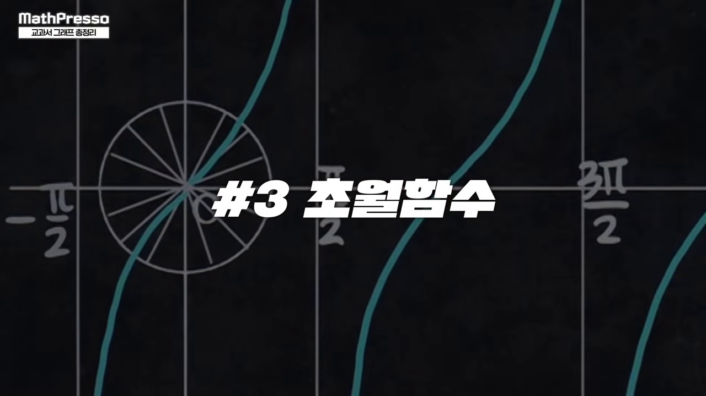
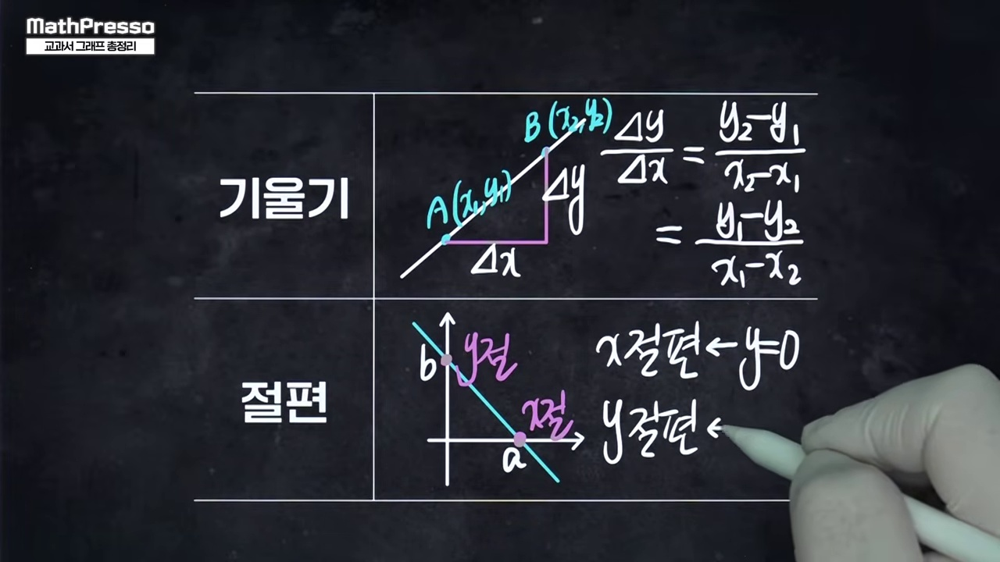
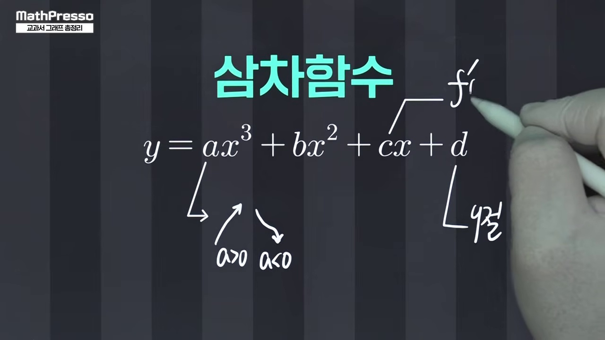
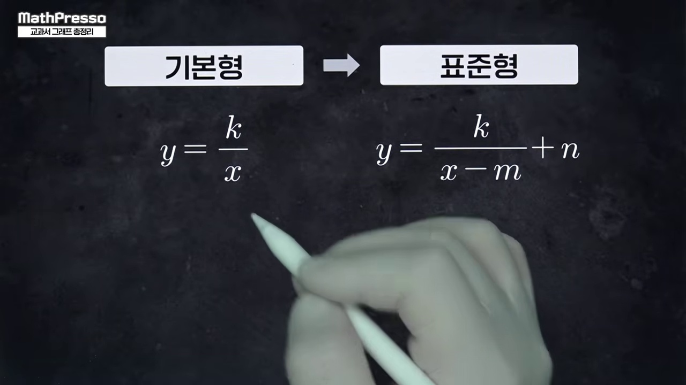
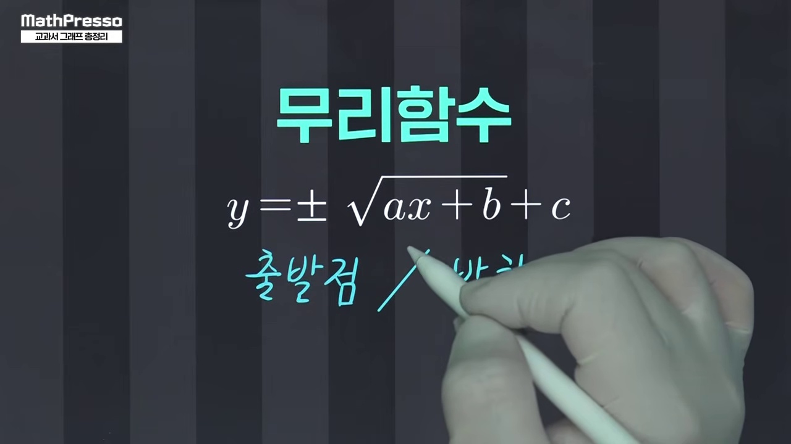
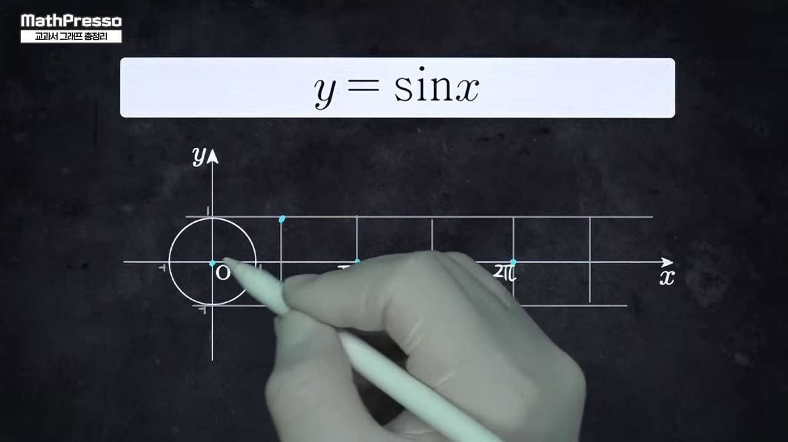
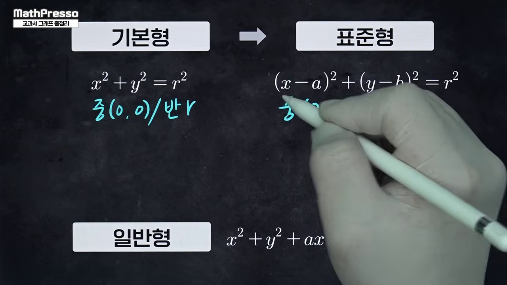
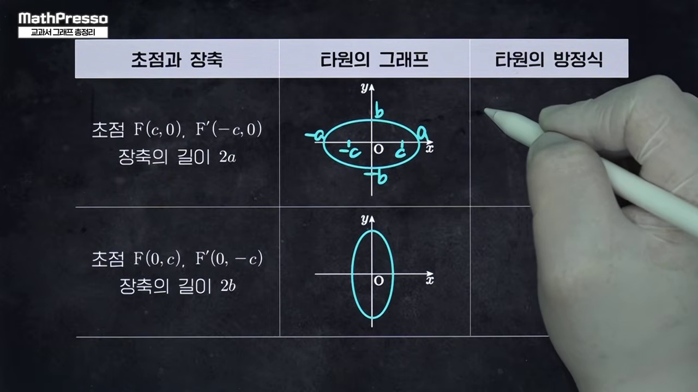
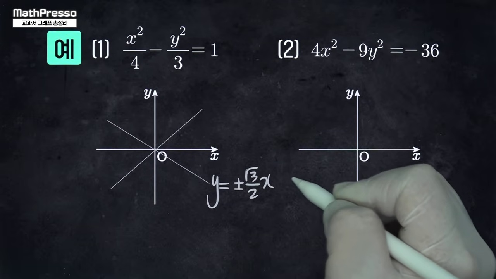

# [수학 전체] 교과서 14대 핵심 그래프 총정리: 다항·유리무리·초월함수·이차곡선

> **원본 영상 정보**
> - **출처**: [매스프레소 YouTube](https://youtu.be/hRpteAyG2Ts)
> - **영상 제목**: 교과서 14개 그래프 총정리 - 다항함수 / 유·무리함수 / 초월함수 / 이차곡선
> - **채널**: 매스프레소 MathPresso
> - **영상 길이**: 43분 20초 (2600초)
> - **주요 태그**: `#고교수학 #다항함수 #유리함수 #무리함수 #지수함수 #로그함수 #삼각함수 #이차곡선 #매스프레소`

---

## 1. 핵심 요약 (Key Summary)

고등학교 3년 전과정을 관통하는 **교과서 14대 핵심 그래프의 표준형, 성질, 대칭성, 점근선**을 40분 만에 완벽 정리하는 대한민국 수학교육의 마스터피스입니다.

---

### 📊 교과서 14대 그래프 패밀리 트리

| 분류 (4대 대단원) | 번호 | 그래프 명칭 | 표준형 방정식 | 핵심 기하학적 특징 및 대칭성 |
| :---: | :---: | :--- | :--- | :--- |
| **I. 다항함수** | **1** | 일차함수 (직선) | $y = mx + n$ | 기울기 $m$, $y$절편 $n$ |
| | **2** | 이차함수 (포물선) | $y = a(x-p)^2 + q$ | 꼭짓점 $(p, q)$, 축 $x=p$ 선대칭 |
| | **3** | 삼차함수 (N자 곡선) | $y = ax^3 + bx^2 + cx + d$ | 변곡점 $(-\frac{b}{3a}, \dots)$ 점대칭 |
| | **4** | 사차함수 (W자 곡선) | $y = ax^4 + bx^3 + \dots$ | 이중극소 선대칭 or 삼중근 완만한 평탄 |
| **II. 분수·무리식** | **5** | 유리함수 (직각쌍곡선) | $y = \frac{k}{x-p} + q$ | 점근선 교점 $(p, q)$ 점대칭, 기울기 $\pm 1$ 선대칭 |
| | **6** | 무리함수 (곡선) | $y = a\sqrt{bx+c} + d$ | 시작점 $(-\frac{c}{b}, d)$, 포물선의 역함수 반쪽 |
| **III. 초월함수** | **7** | 지수함수 | $y = a^{x-p} + q$ | 점근선 $y=q$, 정점 $(p, q+1)$ |
| | **8** | 로그함수 | $y = \log_a(x-p) + q$ | 점근선 $x=p$, 지수함수와 $y=x$ 역함수 대칭 |
| | **9** | 삼각함수 (사인·코사인) | $y = A\sin(\omega x + \phi) + B$ | 주기 $T = \frac{2\pi}{\omega}$, 8칸 박스 대칭 |
| | **10** | 삼각함수 (탄젠트) | $y = A\tan(\omega x) + B$ | 주기 $T = \frac{\pi}{\omega}$, 점근선 $x = \frac{\pi}{2\omega} + \frac{n\pi}{\omega}$ |
| **IV. 이차곡선** | **11** | 원 | $(x-a)^2 + (y-b)^2 = r^2$ | 중심 $(a, b)$, 반지름 $r$, 완전 대칭 |
| | **12** | 포물선 | $y^2 = 4px$ or $x^2 = 4py$ | 초점 $F(p, 0)$, 준선 $x = -p$ |
| | **13** | 타원 | $\frac{x^2}{a^2} + \frac{y^2}{b^2} = 1$ | 두 초점거리 합 $= 2a$, 원점 대칭 |
| | **14** | 쌍곡선 | $\frac{x^2}{a^2} - \frac{y^2}{b^2} = \pm 1$ | 두 초점거리 차 $= 2a$, 점근선 $y = \pm \frac{b}{a}x$ |

---

## 2. 10단계 판서 캡처 & 타임라인별 상세 해설

### 1단계 [00:30] 인트로: 고교 수학을 지배하는 14대 그래프 지도

* 고등학교 수학에서 다루는 모든 곡선을 4대 그룹으로 분류한 전체 로드맵을 제시합니다.

### 2단계 [03:00] 다항함수 4형제 (1차, 2차, 3차, 4차)

* 차수 증가에 따른 굴절 횟수와 극값의 최대 개수 규칙을 완벽 정리합니다.

### 3단계 [07:30] 삼차함수와 사차함수의 대칭성 비교

* 홀수차수(점대칭)와 짝수차수(선대칭)의 본질적 차이를 시각화합니다.

### 4단계 [12:00] 유리함수: 직각쌍곡선과 점근선의 교점

* 평행이동과 대칭의 중심이 되는 두 점근선 $(x=p, y=q)$의 역할을 설명합니다.

### 5단계 [16:00] 무리함수: 포물선의 역함수와 정의역·치역 제한

* 근호 안이 0 이상이어야 한다는 제약조건에서 발생하는 곡선의 출발점 메커니즘을 밝힙니다.

### 6단계 [20:00] 지수함수와 로그함수의 역함수 대칭

* 직선 $y=x$를 기준으로 포개어지는 지수와 로그의 상호 보완적 기하 구조를 분석합니다.

### 7단계 [24:30] 삼각함수: 단위원 회전과 8칸 파동

* 원운동이 시간축으로 펼쳐지며 만들어지는 사인, 코사인, 탄젠트의 주기성과 점근선을 다룹니다.

### 8단계 [29:00] 이차곡선 1: 원과 포물선

* 원뿔을 비스듬히 자를 때 생기는 원과 준선-초점 거리가 같은 포물선의 정의를 점검합니다.

### 9단계 [35:00] 이차곡선 2: 타원과 쌍곡선

* 거리의 합이 일정한 타원과 거리의 차가 일정한 쌍곡선의 점근선 공식을 비교합니다.

### 10단계 [41:00] 대한민국 14대 그래프 올인원 마스터 차트

* 14개 그래프의 수식, 대칭성, 점근선, 핵심 암기법을 한눈에 담은 종합 차트로 마무리합니다.
