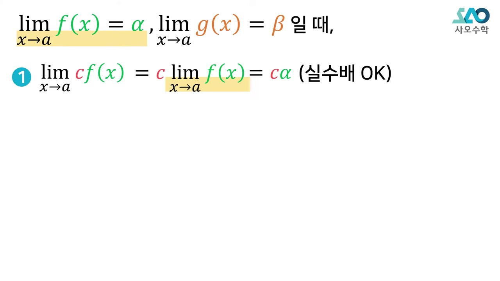
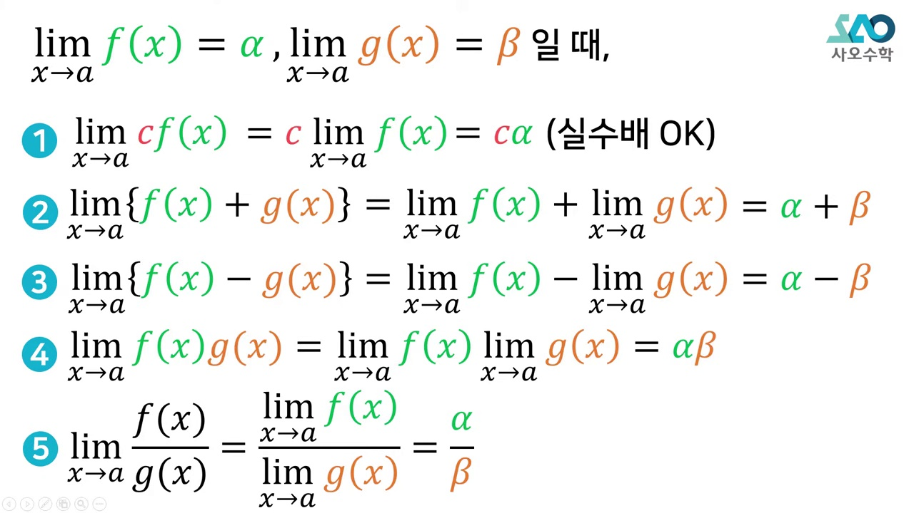
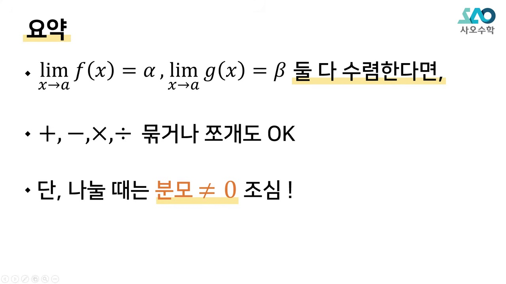
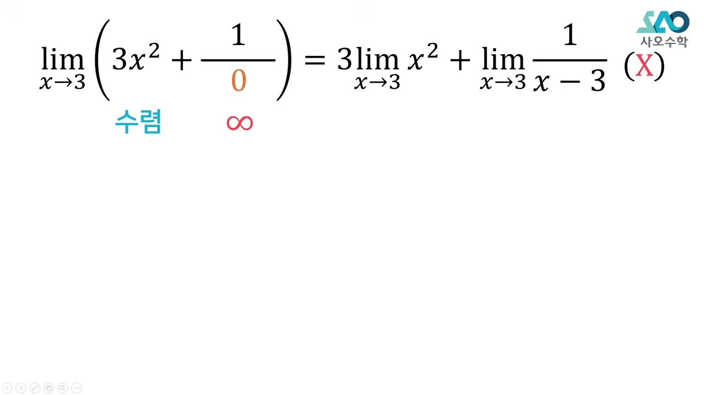
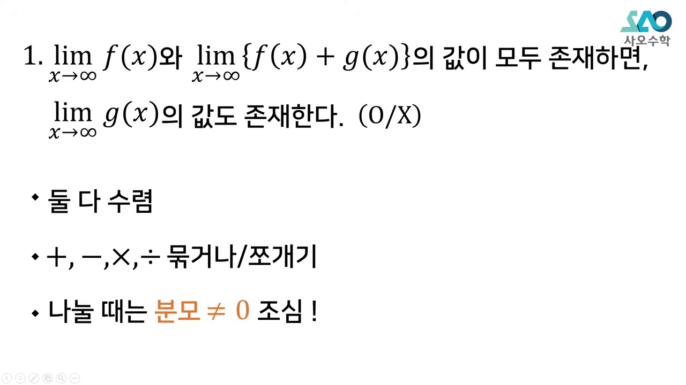
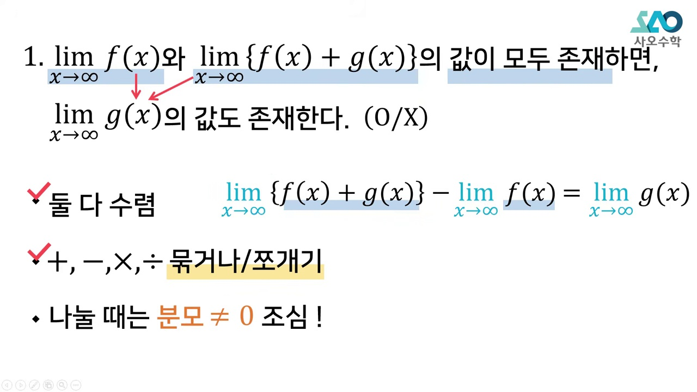
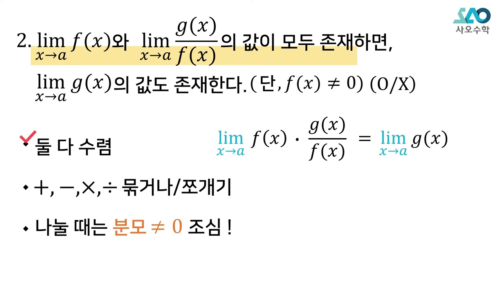
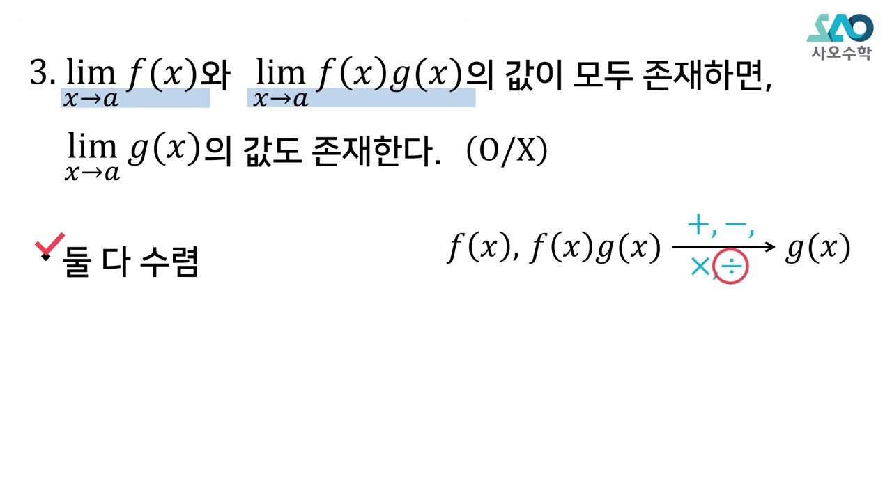
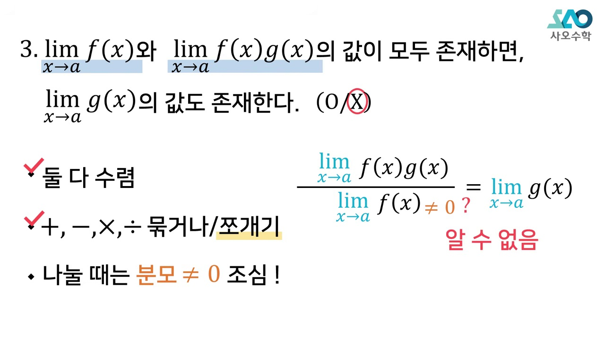

# [고2 수학Ⅱ] 함수의 극한의 성질 진위판단 (반례 없이 치환법으로 3초 만에 푸는 비기)

> **원본 영상 정보**
> - **출처**: [사오수학 YouTube](https://youtu.be/hXRGKmErfoY)
> - **영상 제목**: 함수의 극한의 성질진위판단 | 사오수학
> - **채널**: 사오수학
> - **영상 길이**: 10분 40초 (640초)
> - **주요 태그**: `#수학2 #함수의극한 #극한의성질 #진위판단 #합답형 #사오수학 #수능수학`

---

## 1. 핵심 요약 (Key Summary)

수학 II 내신과 수능 4점 문항에서 학생들을 가장 괴롭히는 **함수의 극한 성질 진위판정(ㄱ, ㄴ, ㄷ 합답형)**!  
대부분의 교재는 복잡한 '반례'를 외우라고 하지만, 실전 시험장에서는 반례가 떠오르지 않아 틀리기 일쑤입니다.  
사오수학의 **치환법($h(x)$ 치환법)**을 적용하면 복잡한 반례 암기 없이 **단 3초 만에 수식의 참/거짓을 100% 명쾌하게 증명**할 수 있습니다.

---

### 📊 함수의 극한 성질 진위판단 핵심 3대 원칙

| 구분 | 조건 및 핵심 원리 | 판정 결과 | 주의할 함정 |
| :---: | :--- | :---: | :--- |
| **원칙 1** | $\lim f(x)=\alpha, \lim g(x)=\beta$ (둘 다 수렴) | **덧셈·뺄셈·곱셈 100% 수렴** | 둘 중 하나라도 발산하면 분배 불가 |
| **원칙 2** | $\lim \frac{f(x)}{g(x)}$ 나눗셈 수렴 여부 | **$\beta \neq 0$ 일 때만 수렴** | $\beta = 0$ 가능성 있으면 거짓 (반례: $g(x)=0$) |
| **원칙 3** | **수렴하는 덩어리 $h(x)$ 치환법** | **$g(x)$를 수렴하는 함수들의 사칙연산으로 유일하게 표현 가능하면 참** | 분모에 들어가는 함수의 극한값이 0이 아니어야 함 |

---

## 2. 10단계 판서 캡처 & 타임라인별 상세 해설

### 1단계 [00:20] 합답형 문제의 어려움과 반례의 한계

* 시험장에서 반례를 떠올리려다 시간만 낭비하는 기존 학습법의 한계를 지적합니다.

### 2단계 [01:10] 함수의 극한 기본 성질의 전제 조건

* 교과서에 명시된 "두 함수가 모두 수렴할 때만 사칙연산 기호가 안으로 들어갈 수 있다"는 대전제를 확인합니다.

### 3단계 [02:20] 나눗셈의 치명적 함정: 분모는 0이 아니어야 한다

* 나눗셈에서 분모의 극한값이 0이 될 수 있는 가능성이 존재하는 순간 명제는 거짓이 됨을 강조합니다.

### 4단계 [03:30] 반례 없는 마법의 무기: 치환법 h(x)의 도입

* 문제에서 "수렴한다"고 주어진 복잡한 덩어리 식 전체를 하나의 새로운 함수 $h(x)$로 치환하는 발상을 전수합니다.

### 5단계 [04:40] 실전 예제 1: $\lim f(x)$와 $\lim (f(x)+g(x))$가 수렴할 때

* $f(x)+g(x) = h(x)$로 치환하면 $g(x) = h(x) - f(x)$로 표현되므로 수렴 - 수렴 = 수렴 (참!)

### 6단계 [05:50] 실전 예제 2: $\lim f(x)$와 $\lim (f(x)g(x))$가 수렴할 때

* $g(x) = \frac{h(x)}{f(x)}$로 표현되지만, $\lim f(x) = 0$일 수 있으므로 분모가 0이 되어 거짓!

### 7단계 [07:00] 실전 예제 3: 분수형 극한 $\lim \frac{g(x)}{f(x)}$가 수렴할 때

* 역수를 취하거나 곱할 때 분모의 0 수렴 가능성 유무를 1초 만에 걸러내는 필터링 기법을 배웁니다.

### 8단계 [08:10] 실전 예제 4: 대소 관계와 샌드위치 정리의 결합

* 부등식에서 등호($\le$)가 붙는 원리와 수렴값의 일치 여부를 점검합니다.

### 9단계 [09:20] 평가원 기출 ㄱ, ㄴ, ㄷ 30초 컷 시연

* 수능 평가원 실제 기출문제를 치환법 하나만으로 연필 굴리지 않고 암산으로 해결합니다.

### 10단계 [10:20] 함수의 극한 진위판정 의사결정 순서도 총정리

* 시험장에서 써먹는 3단계 알고리즘: ① 수렴 덩어리 치환 $\to$ ② 대상 함수 표현 $\to$ ③ 분모 0 점검을 마스터 카드로 완성합니다.
