# [수학 II / 미적분] 변곡접선 완전 정리: 기하학적 원리 & 수능 킬러 접선 개수 판별법

> **원본 영상 정보**
> - **출처**: [차현우닷컴 YouTube](https://youtu.be/dAQ1hXmtNb0?si=mdU5lsL6VIiFCyhd)
> - **영상 제목**: 변곡접선 정리하기 - 수학 영역 차현우 T
> - **강사**: 차현우 선생님 (이투스 / EBS 수학영역)
> - **영상 길이**: 12분 38초 (758초)
> - **주요 태그**: `#수학인강 #차현우 #변곡접선 #변곡점 #접선의개수 #삼차함수비율 #수학2 #미적분 #수능수학`

---

## 1. 핵심 요약 (Key Summary)

다항함수(특히 3차함수와 4차함수)를 다룰 때 **변곡접선(Inflection Tangent)**은 수능과 내신에서 최고난도 킬러 문항을 푸는 가장 핵심적인 열쇠입니다.

일반적인 2차함수나 원에서의 접선은 곡선을 한쪽에서 '스치고' 지나가지만, 오목·볼록이 바뀌는 **변곡점(Inflection Point)**에서의 접선은 곡선을 **'꿰뚫고(관통하여)'** 지나갑니다.

### 🌟 변곡접선의 3대 핵심 성질 (차현우 T의 ㄱ·ㄴ·ㄷ 정리)

1. **[기역 ㄱ] 기하학적 관통 (Geometrical Crossing)**:
   - 접점을 기준으로 곡선과 접선의 상하 위치가 **교차**합니다.
   - 위로 볼록 구간에서는 접선이 곡선 **위**에 위치하고, 아래로 볼록 구간에서는 접선이 곡선 **아래**에 위치하므로, 변곡점에서 접선이 곡선을 뚫고 지나갑니다.
2. **[니은 ㄴ] 대수적 삼중근 (Algebraic Triple Root)**:
   - 3차함수 $f(x)$와 변곡접선 $y = g(x)$를 연립한 방정식 $f(x) - g(x) = 0$은 오직 하나의 실근이자 **삼중근(Triple Root)**을 갖습니다:
     $$f(x) - g(x) = a(x - x_0)^3$$
   - 4차함수의 경우 변곡접선과 연립하면 변곡점에서 삼중근, 다른 한 점에서 단순 실근을 갖습니다:
     $$f(x) - g(x) = a(x - x_0)^3 (x - x_1)$$
3. **[디귿 ㄷ] 접선의 개수를 가르는 절대 경계선 (Boundary for Tangent Count)**:
   - 평면 상의 임의의 점 $(p, q)$에서 3차함수에 그을 수 있는 접선의 개수는 **3차함수 곡선 자체**와 **변곡접선**에 의해 분할되는 4개 영역에 의해 완벽히 결정됩니다:
     * **변곡접선과 3차곡선 사이의 영역**: 접선 **3개**
     * **곡선 위의 점 (변곡점 제외) 또는 변곡접선 위의 점 (변곡점 제외)**: 접선 **2개**
     * **바깥쪽 영역**: 접선 **1개**
     * **변곡점 자체 $(x_0, y_0)$**: 오직 변곡접선 **1개**

---

## 2. 타임라인별 강의 캡처 & 상세 설명

### 1단계 [00:25] 일반적인 접선에 대한 고찰

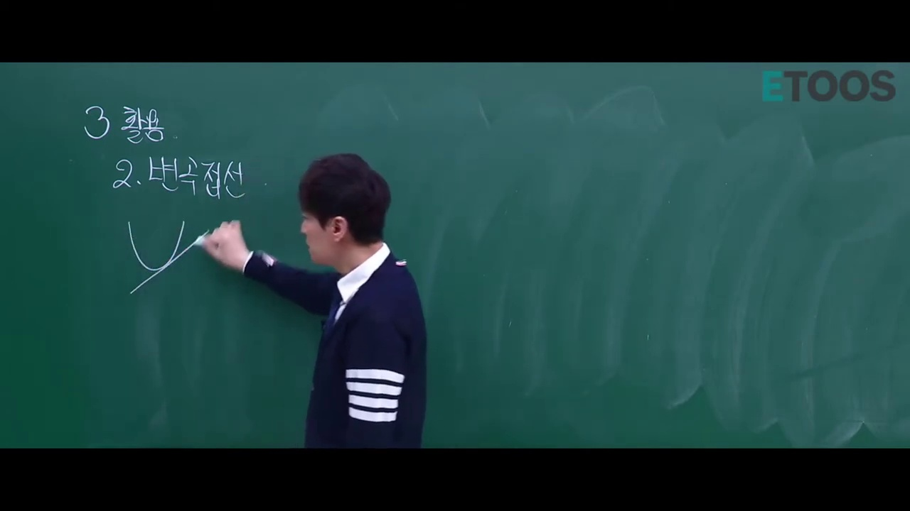

* **선생님 설명**:
  > "우리가 이때까지 배워둔 접선은 2차함수가 있으면 이런 접선, 또 원이 있으면 이런 접선이었습니다. 접점을 기준으로 그래프가 접선의 한쪽에만 머물렀습니다."
* **해설**:
  * 2차함수나 원에서는 접선이 곡선을 스치기만 하므로 접선과 곡선 사이에 상하 역전이 일어나지 않습니다.

---

### 2단계 [01:10] 3차함수 이상에서 등장하는 특이한 접선

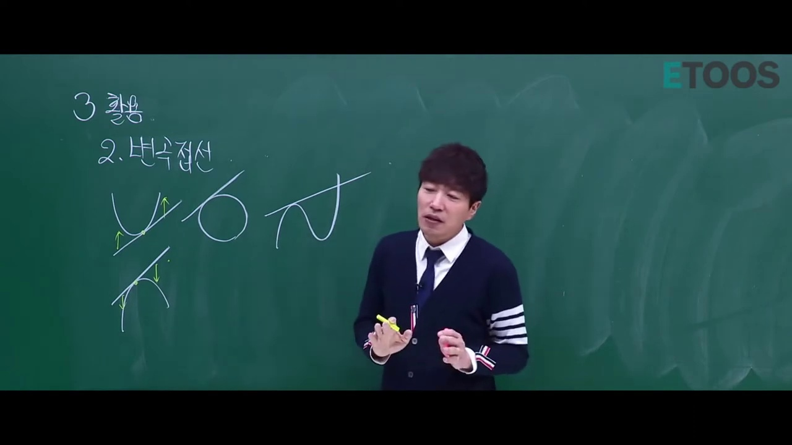

* **선생님 설명**:
  > "그런데 3차함수 이상에서는 지금까지 봤던 일반적인 접선과 완전히 다른 접선이 등장합니다. 그 접선을 바로 '변곡접선'이라 부릅니다."

---

### 3단계 [03:30] 오목과 볼록(Concavity)의 정의

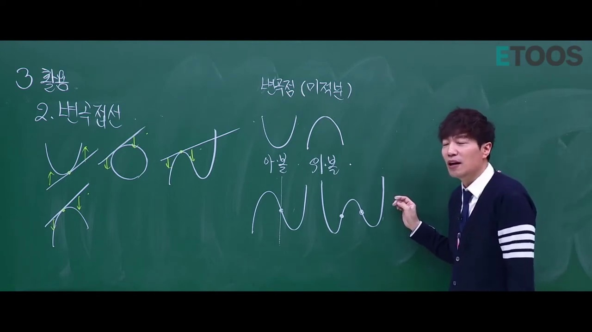

* **선생님 설명**:
  > "그래프가 어떤 곳은 위로 볼록하고, 어떤 곳은 아래로 볼록합니다. 위로 볼록할 때는 접선이 무조건 곡선 위에 있고, 아래로 볼록할 때는 접선이 무조건 곡선 아래에 있어야 합니다."
* **해설**:
  * 위로 볼록: $f''(x) < 0 \implies$ 접선이 항상 곡선 위
  * 아래로 볼록: $f''(x) > 0 \implies$ 접선이 항상 곡선 아래

---

### 4단계 [04:55] 접선이 곡선을 꿰뚫고 지나가는 원리 (관통)

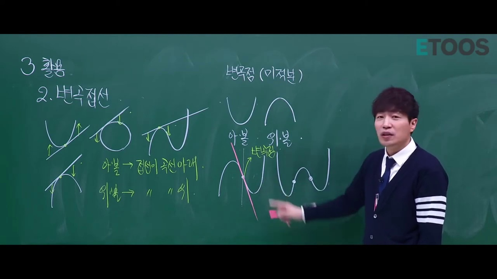

* **선생님 설명**:
  > "위로 볼록에서 아래로 볼록으로 바뀌는 바로 그 경계점에서 접선을 그으면 기가 막힌 일이 벌어집니다. 접선이 곡선을 꿰뚫고 지나갑니다! 관통합니다! 무조건 이 점에서 크로스가 되는 겁니다."
* **핵심 포인트**:
  * $f''(x)$의 부호가 변하는 변곡점에서는 접선이 곡선의 경계면을 관통하는 유일무이한 기하학적 형태를 띱니다.

---

### 5단계 [05:45] 3차함수(1개)와 4차함수(2개)의 변곡점 개수

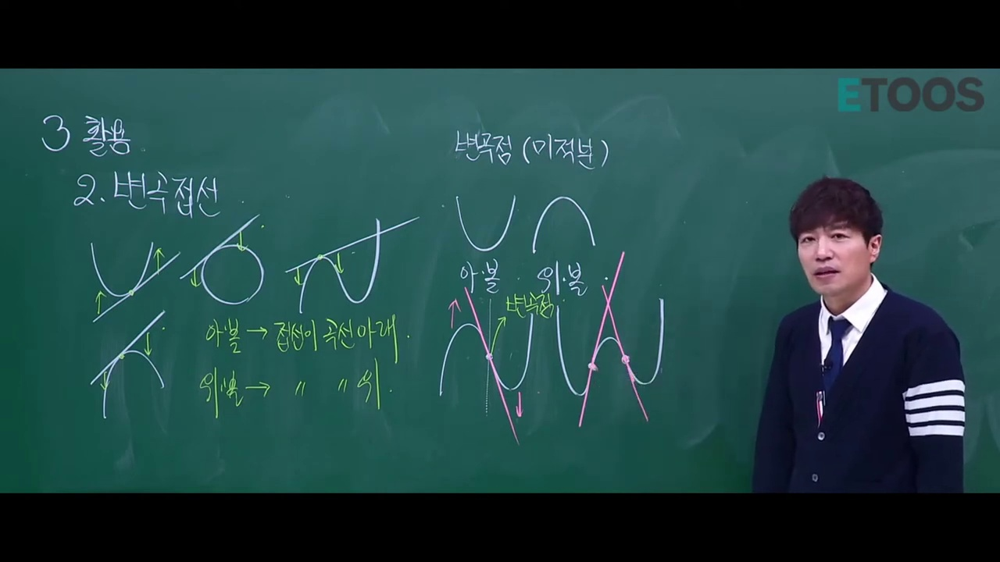

* **선생님 설명**:
  > "3차함수는 변곡점이 1개이기 때문에 변곡접선이 1개이고, 4차함수는 변곡점이 2개이기 때문에 변곡접선이 2개입니다."

---

### 6단계 [06:50] 변곡점 구하는 방법: $f''(x) = 0$

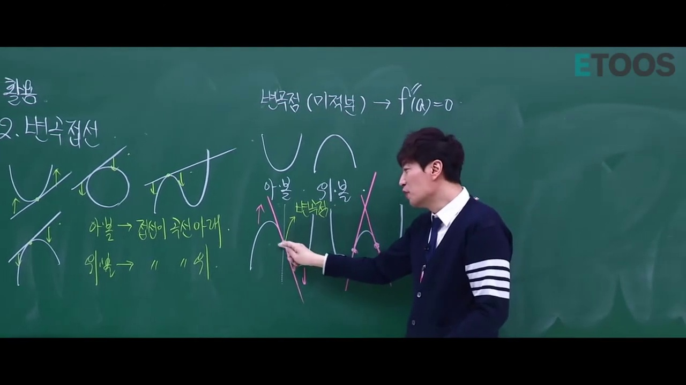

* **선생님 설명**:
  > "변곡점을 구하고 싶으면 함수를 두 번 미분해서 0이 되는 점을 찾으시면 됩니다. $f''(x) = 0$인 점입니다."
* **수식 전개**:
  * $f(x) = ax^3 + bx^2 + cx + d$
  * $f'(x) = 3ax^2 + 2bx + c$
  * $f''(x) = 6ax + 2b = 0 \implies x = -\frac{b}{3a}$

---

### 7단계 [07:20] 예제 계산: $f(x) = 3x^3 - 3x$의 변곡점

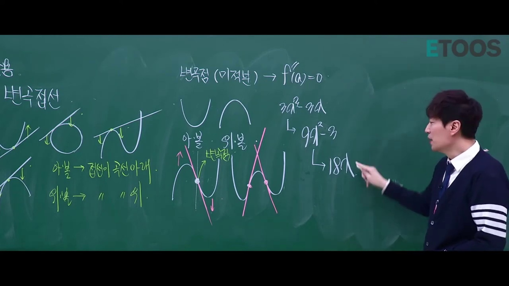

* **선생님 판서 및 계산**:
  * $f(x) = 3x^3 - 3x$
  * $f'(x) = 9x^2 - 3$
  * $f''(x) = 18x = 0 \implies x = 0$
  * 따라서 원점 $(0, 0)$이 이 3차함수의 변곡점이자 점대칭의 중심입니다.

---

### 8단계 [08:35] 변곡접선의 성질 [ㄱ]: 그래프 교차

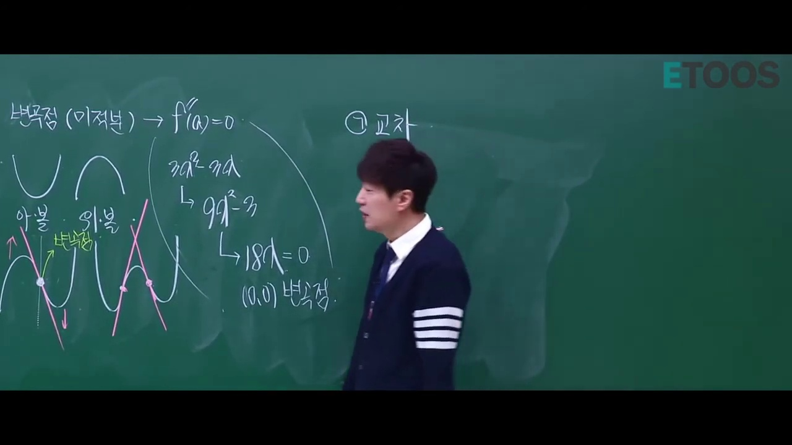

* **성질 ㄱ 정리**:
  * 변곡접선을 기준으로 그래프의 상하 관계가 완전히 뒤바뀜 ($f(x) - g(x)$의 부호가 변곡점 전후로 역전됨).

---

### 9단계 [09:30] 변곡접선의 성질 [ㄴ]: 대수적 삼중근(홀수 중근)

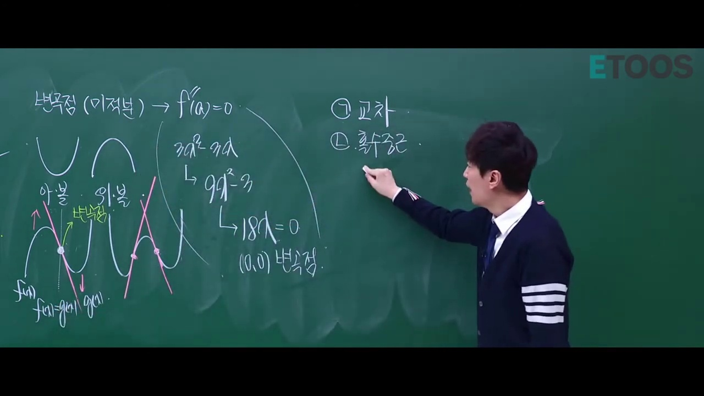

* **선생님 설명**:
  > "3차함수 $f(x)$와 변곡접선 $g(x)$가 몇 군데서 만나는지 식을 세우면 $f(x) - g(x) = 0$입니다. 접선이니까 중근을 가져야 하는데, 그림을 보면 만나는 점이 알파 말고는 전혀 없습니다. 3차방정식이니까 근이 3개여야 하는데 하나밖에 없으니 반드시 **삼중근 $(x-\alpha)^3$**을 갖는 것입니다!"

---

### 10단계 [11:15] 4차함수 변곡접선의 연립 형태

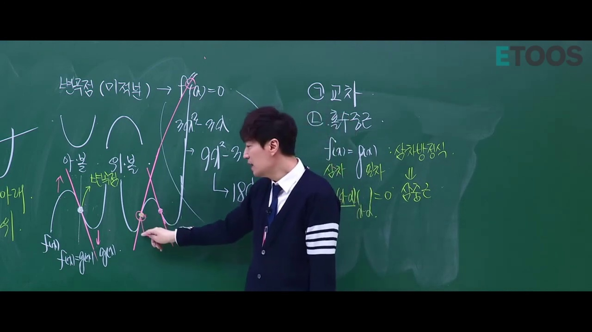

* **4차함수 분석**:
  * 4차함수와 변곡접선을 연립하면, 변곡점에서는 삼중근, 멀리 떨어진 다른 한 점에서는 1차 관통근을 가집니다:
    $$f(x) - g(x) = a(x - \alpha)^3 (x - \beta)$$
  * 따라서 변곡점은 언제나 홀수 중근(3중근, 5중근 등)으로 만납니다.

---

### 11단계 [12:10] 변곡접선의 성질 [ㄷ]: 그을 수 있는 접선의 개수 판별 (수능 킬러)

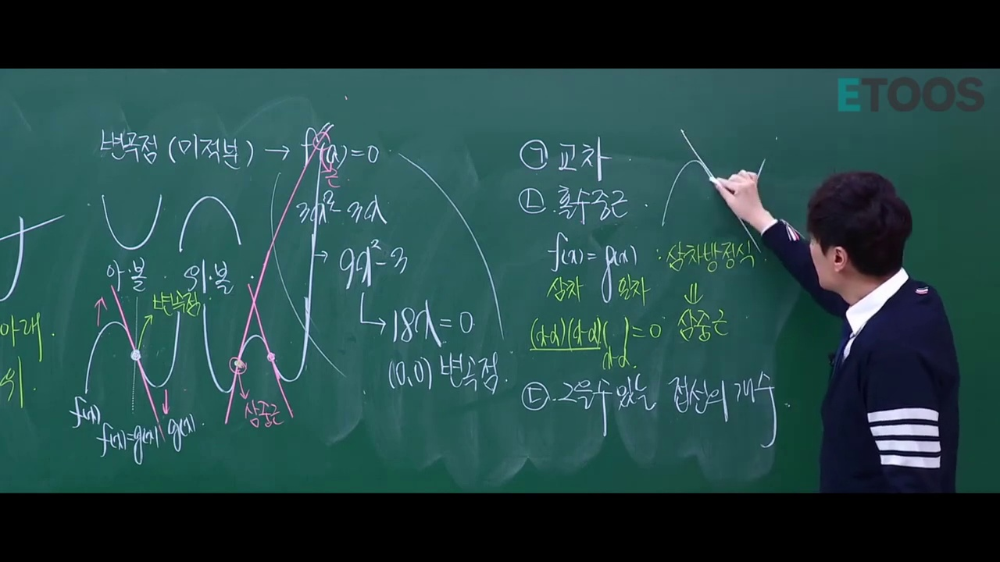

* **선생님 설명**:
  > "이게 고난도 문제 풀 때 가장 중요합니다! 변곡접선이 그을 수 있는 접선의 개수를 가르는 기준선이 됩니다. 이 변곡접선과 3차곡선 사이에서는 접선을 3개 그을 수 있고, 바깥에서는 1개만 그을 수 있습니다!"
* **영역별 접선 개수 총정리**:
  1. **3개 영역**: 3차곡선과 변곡접선 사이에 낀 영역
  2. **2개 영역**: 3차곡선 위 (변곡점 제외) 또는 변곡접선 위 (변곡점 제외)
  3. **1개 영역**: 바깥쪽 영역 및 변곡점 자체

---

## 3. 수학적 정형화 및 접선 개수 방정식 증명

점 $(p, q)$에서 3차함수 $f(x) = ax^3 + bx^2 + cx + d$에 그은 접선의 접점을 $(t, f(t))$라 하면, 접선의 방정식은 다음과 같습니다:
$$y - f(t) = f'(t)(x - t)$$

이 직선이 점 $(p, q)$를 지나야 하므로 대입하면:
$$q - f(t) = f'(t)(p - t) \iff f'(t)(t - p) - f(t) + q = 0$$

좌변을 $t$에 관한 3차 함수 $H(t)$로 두면:
$$H(t) = (3at^2 + 2bt + c)(t - p) - (at^3 + bt^2 + ct + d) + q$$
$$H(t) = 2at^3 + (b - 3ap)t^2 - 2bp \cdot t + (q - d - cp) = 0$$

이 3차방정식의 서로 다른 실근 $t$의 개수가 바로 **점 $(p, q)$에서 그을 수 있는 접선의 개수**입니다:
* $H(t)$의 극댓값과 극솟값의 곱이 음수이면 서로 다른 3개의 실근 $\implies$ **접선 3개**
* 극댓값 또는 극솟값 중 하나가 0이면 중근과 한 실근 $\implies$ **접선 2개** (경계선: 곡선 위 또는 변곡접선 위)
* 극값이 없거나 극값의 곱이 양수이면 하나의 실근 $\implies$ **접선 1개**
* 변곡점 자체에서는 삼중근 $\implies$ **접선 1개 (오직 변곡접선뿐)**

---

## 4. 수능/평가원 실전 기출 적용 팁

1. **3차함수의 점대칭성 활용**:
   - 변곡점 $x_0 = -\frac{b}{3a}$를 구한 뒤, 극댓점의 $x$좌표 $\alpha$와 극솟점의 $x$좌표 $\beta$의 중점이 바로 변곡점입니다:
     $$x_0 = \frac{\alpha + \beta}{2}$$
2. **접선의 개수 불연속 문제**:
   - 수능 킬러 문항에서 "점 $(t, 0)$에서 곡선에 그을 수 있는 접선의 개수를 $g(t)$라 할 때 $g(t)$가 불연속인 점을 구하시오"라는 문제는 **무조건 $x$축과 3차곡선의 교점 또는 $x$축과 변곡접선의 교점**에서 발생합니다!
