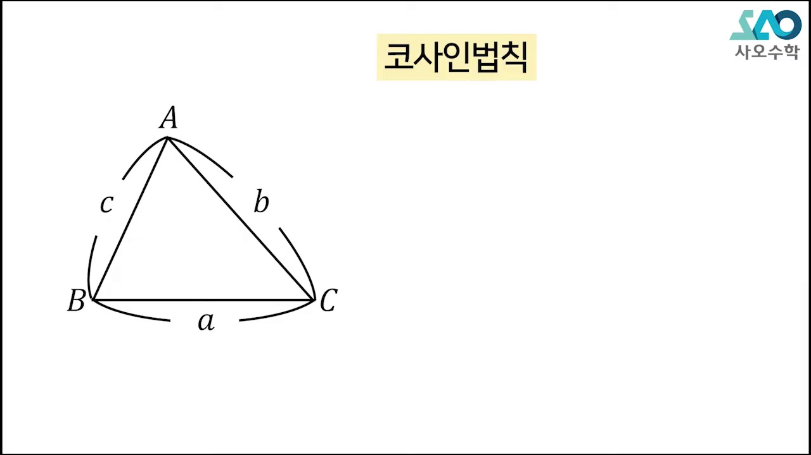
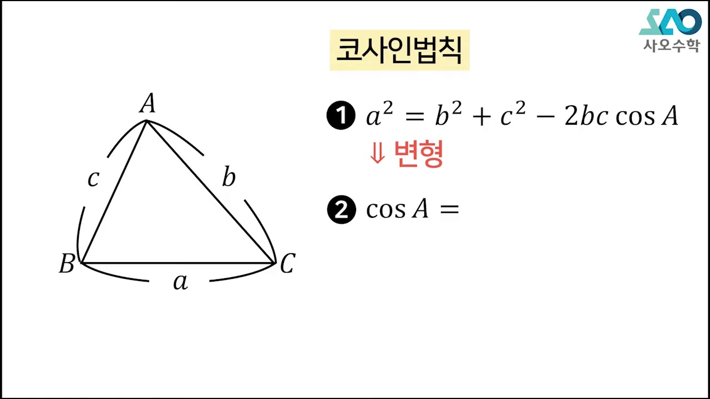
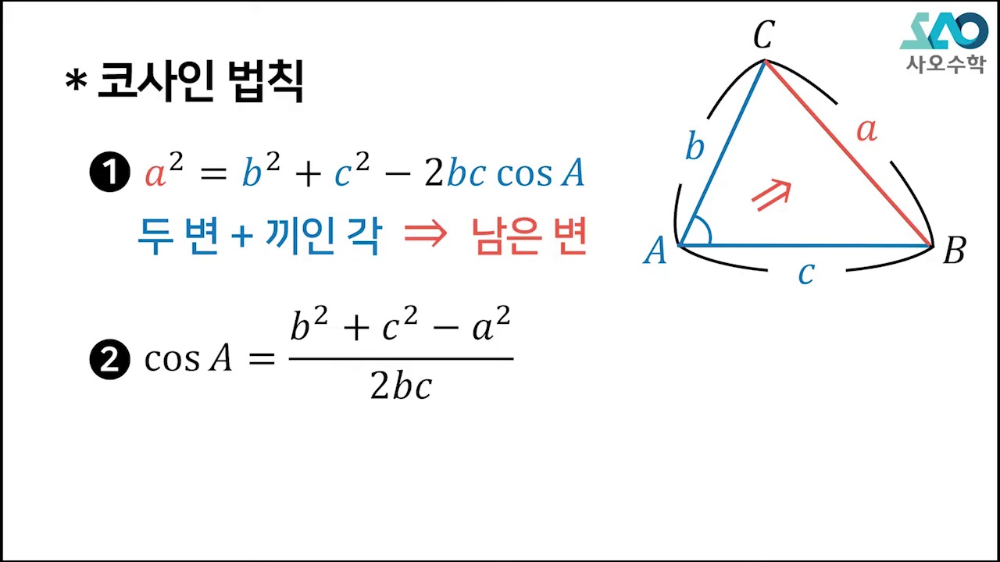
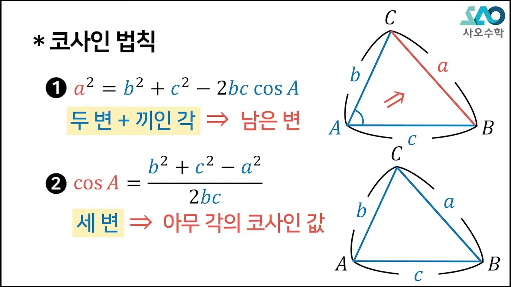
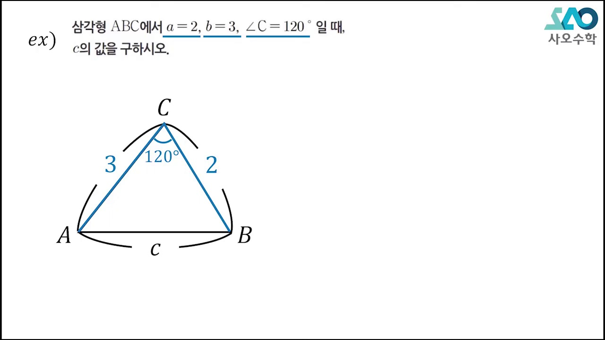
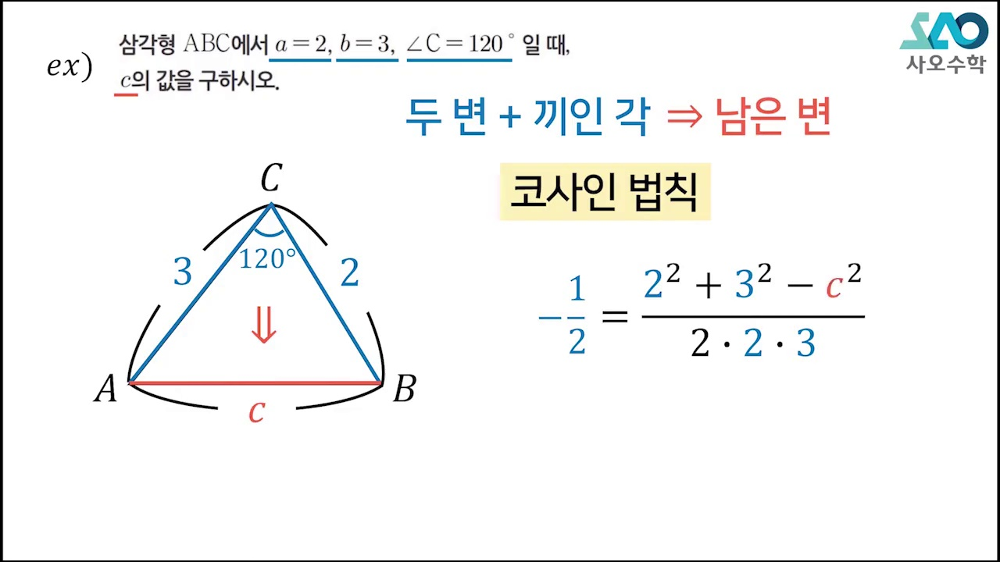
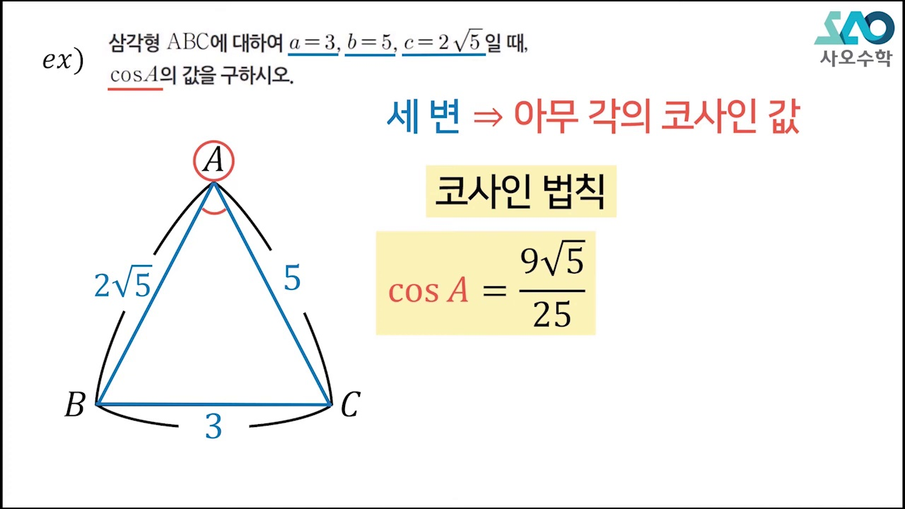
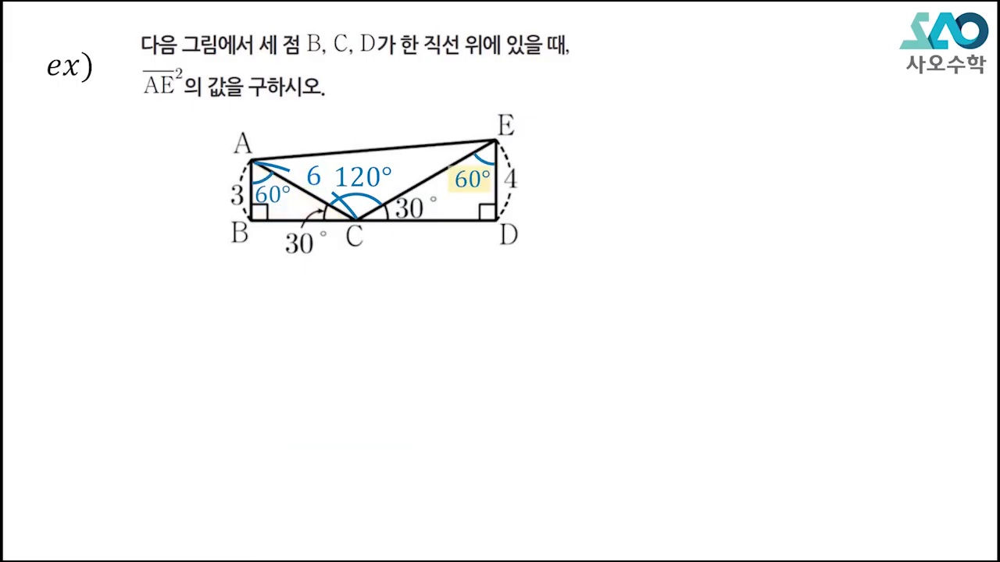
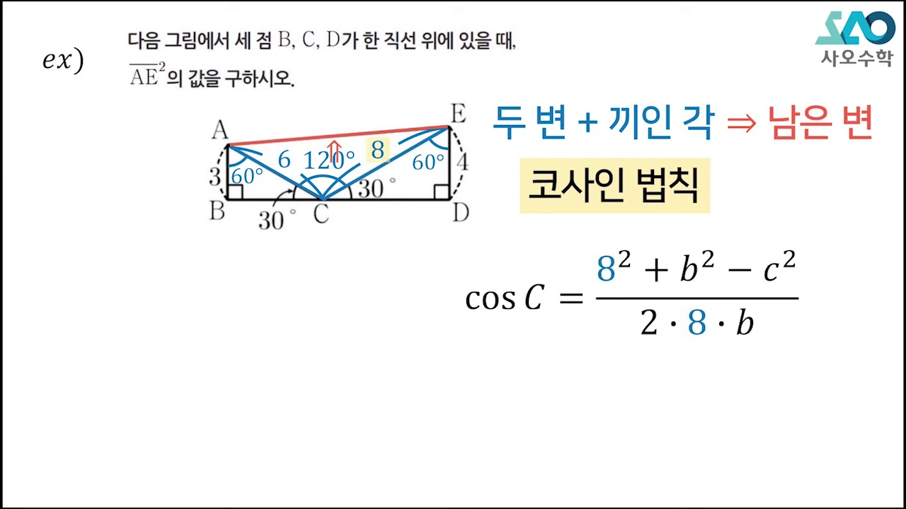
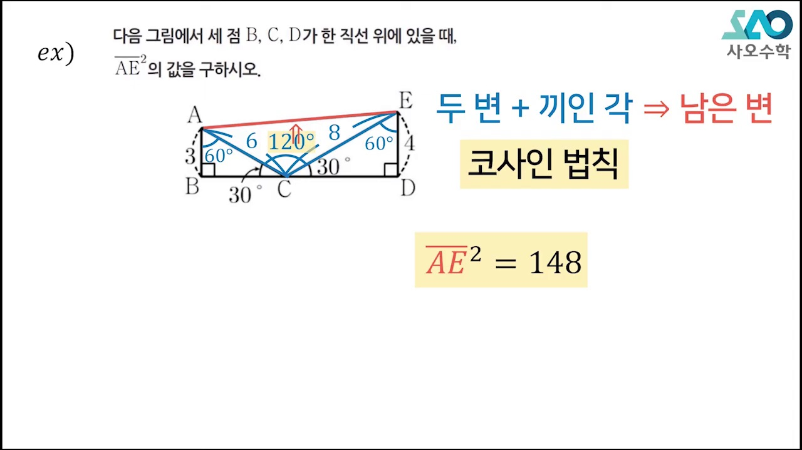

# [고2 수학Ⅰ] 삼각함수 활용 · 코사인법칙 (원리와 기하학적 직관)

> **원본 영상 정보**
> - **출처**: [사오수학 YouTube](https://youtu.be/Z-uQkyyWUAQ)
> - **영상 제목**: [수Ⅰ][LV 1] 24강. 삼각함수 활용_코사인법칙 | 사오수학
> - **채널**: 사오수학
> - **영상 길이**: 10분 41초 (641초)
> - **주요 태그**: `#수학1 #삼각함수 #코사인법칙 #삼각함수활용 #도형 #수능수학 #사오수학`

---

## 1. 핵심 요약 (Key Summary)

사인법칙과 함께 고교 삼각함수 기하의 양대 축을 이루는 **코사인법칙(Law of Cosines)**!  
단순히 공식을 암기하는 것을 넘어 **"어떤 조건이 주어졌을 때 코사인법칙을 선택해야 하는가?"**에 대한 명확한 기준을 세웁니다.

---

### 📊 코사인법칙 공식 & 사용 결정 매트릭스

| 공식 형태 | 수식 표현 | 최적 활용 상황 |
| :---: | :--- | :--- |
| **길이 산출형 (표준형)** | $a^2 = b^2 + c^2 - 2bc \cos A$ | **두 변과 끼인각(SAS)**이 주어져 마주보는 대변을 구할 때 |
| **각도 산출형 (변형형)** | $\cos A = \frac{b^2 + c^2 - a^2}{2bc}$ | **세 변의 길이(SSS)**가 주어져 내각의 크기를 구할 때 |
| **비끼인각 2차방정식** | $c^2 = a^2 + x^2 - 2ax\cos C$ | 한 각과 마주보는 대변, 이웃변으로 **미지의 변 $x$**를 구할 때 |

---

## 2. 10단계 판서 캡처 & 타임라인별 상세 해설

### 1단계 [00:20] 코사인법칙의 소개와 중요성

* 피타고라스 정리를 일반적인 모든 삼각형으로 확장한 코사인법칙의 기하학적 위상을 소개합니다.

### 2단계 [01:10] 코사인법칙을 '언제' 쓰는가? 3대 조건

* 주어진 조건(SAS, SSS, 비끼인각)을 보고 연필을 들기 전 코사인법칙을 확신하는 시선을 제시합니다.

### 3단계 [02:20] 직각삼각형 분할을 통한 코사인법칙 유도

* 꼭짓점에서 수선의 발을 내려 피타고라스 정리를 적용해 $a^2 = b^2 + c^2 - 2bc \cos A$를 유도합니다.

### 4단계 [03:40] 두 변과 끼인각(SAS) 적용 실전 예제

* $b=5, c=8, A=60^\circ$일 때 대변 $a$의 길이를 10초 만에 계산하는 표준 풀이를 시연합니다.

### 5단계 [05:00] 세 변의 길이(SSS)로 각도 구하기 (변형 공식)

* 세 변의 길이로부터 $\cos A$를 구하고, 이를 통해 $\sin A$ 및 삼각형의 넓이까지 확장합니다.

### 6단계 [06:20] 코사인 부호를 통한 삼각형 형태 판별

* $\cos A > 0$이면 예각, $\cos A = 0$이면 직각, $\cos A < 0$이면 둔각이 되는 판별법을 정리합니다.

### 7단계 [07:30] 사인법칙 vs 코사인법칙 선택 기준 가이드

* 외접원이나 마주보는 한 쌍이 있으면 사인법칙, 끼인각이나 세 변이 있으면 코사인법칙을 쓰는 구분 기준표를 제시합니다.

### 8단계 [08:40] 수능·내신 기출 도형 복합 응용

* 사각형이나 원에 내접하는 복합 다각형에서 보조선을 그어 코사인법칙을 연쇄 적용하는 비기를 다룹니다.

### 9단계 [09:40] 계산 실수 방지 및 특수각 단축 팁

* $\cos 120^\circ = -\frac{1}{2}$, $\cos 135^\circ = -\frac{\sqrt{2}}{2}$ 등 둔각 부호 실수를 원천 차단하는 팁을 전수합니다.

### 10단계 [10:20] 코사인법칙 올인원 요약

* 시험장에서 즉각 적용할 수 있는 코사인법칙 공식과 의사결정 트리를 최종 정리합니다.
