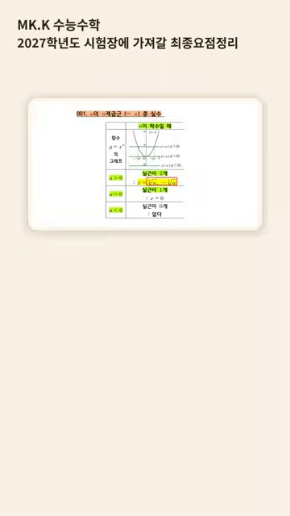
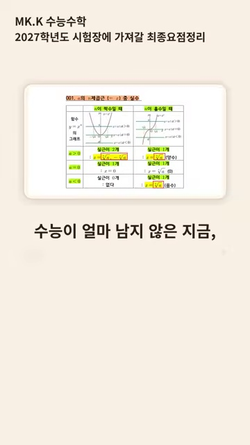
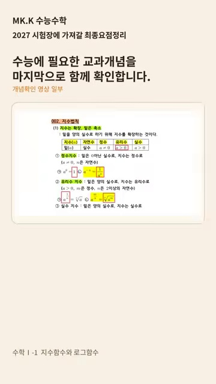
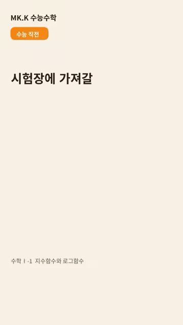

# [고2 수학Ⅰ] 지수함수와 로그함수 (수능 직전 초스피드 개념 총정리)

> **원본 영상 정보**
> - **출처**: [MK.K 수능 수학 YouTube Shorts](https://youtube.com/shorts/fYaT7Lk1FjQ)
> - **영상 제목**: 수학Ⅰ-1 지수함수와 로그함수 | 수능 직전 개념확인 #shorts
> - **채널**: MK.K 수능 수학
> - **영상 길이**: 23초
> - **주요 태그**: `#수학1 #지수함수 #로그함수 #수능수학 #수능직전요약 #shorts`

---

## 1. 핵심 요약 (Key Summary)

수능 시험장에 들어가기 직전, 23초 만에 지수함수와 로그함수의 필수 기하학적 성질을 점검하는 **초압축 파이널 서머리**!  
밑 $a$의 범위에 따른 그래프의 증가/감소 방향과 점근선, 그리고 직선 $y=x$에 대한 완벽한 역함수 대칭 구조를 한눈에 정리합니다.

---

### 📊 지수함수 vs 로그함수 핵심 성질 비교표

| 비교 항목 | 지수함수 $y = a^x$ | 로그함수 $y = \log_a x$ |
| :---: | :--- | :--- |
| **정의역 / 치역** | 정의역: 실수 전체 / 치역: $\{y \mid y > 0\}$ | 정의역: $\{x \mid x > 0\}$ / 치역: 실수 전체 |
| **밑 $a > 1$ 일 때** | $x$ 증가 시 $y$ 증가 (우상향) | $x$ 증가 시 $y$ 증가 (우상향) |
| **밑 $0 < a < 1$ 일 때** | $x$ 증가 시 $y$ 감소 (우하향) | $x$ 증가 시 $y$ 감소 (우하향) |
| **반드시 지나는 정점** | $(0, 1)$ | $(1, 0)$ |
| **점근선 (Asymptote)** | **수평 점근선 $y = 0$ ($x$축)** | **수직 점근선 $x = 0$ ($y$축)** |
| **상호 관계** | **직선 $y = x$에 대하여 완벽한 대칭 (역함수)** |

---

## 2. 5단계 쇼츠 캡처 & 상세 해설

### 1단계 [02초] 인트로: 수능 직전 지수·로그함수 퀵 체크

* 시험 전 반드시 머릿속에 각인해야 할 지수함수와 로그함수의 기본형을 소개합니다.

### 2단계 [06초] 밑 $a$에 따른 그래프 개형 (증가 vs 감소)

* 밑이 1보다 크면 증가함수, 0과 1 사이이면 감소함수가 되는 거동을 시각화합니다.

### 3단계 [11초] 점근선과 반드시 지나는 정점의 위치

* 지수함수의 수평 점근선($y=0$)과 로그함수의 수직 점근선($x=0$)을 명확히 대조합니다.

### 4단계 [16초] 직선 $y = x$에 대한 역함수 대칭

* 두 함수가 $y=x$를 접는 선으로 하여 완전히 포개어지는 역함수 성질을 확인합니다.

### 5단계 [21초] 수능 시험장 30초 체크포인트

* 평행이동 $y = a^{x-p}+q$에서의 점근선 $y=q$ 결정 공식으로 마무리합니다.
