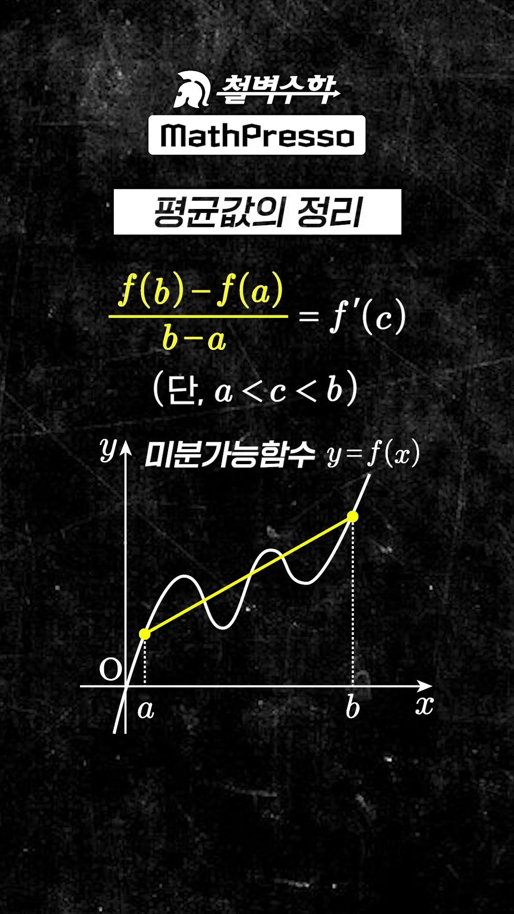
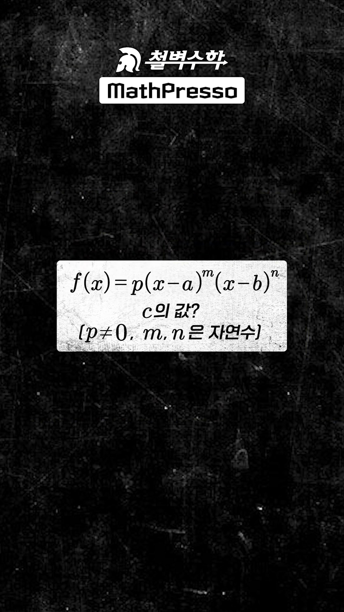
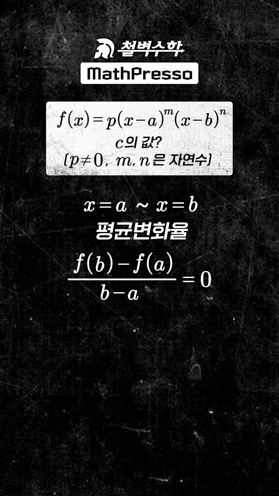
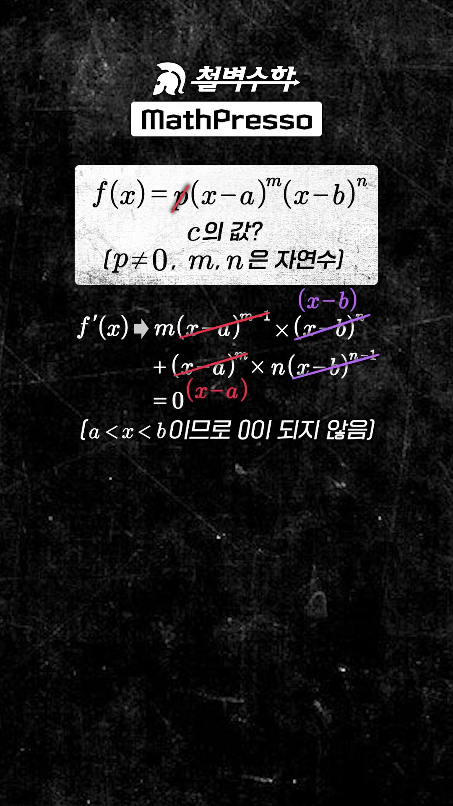
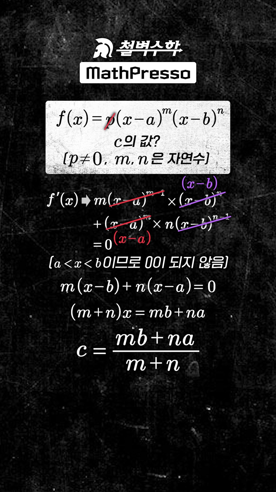
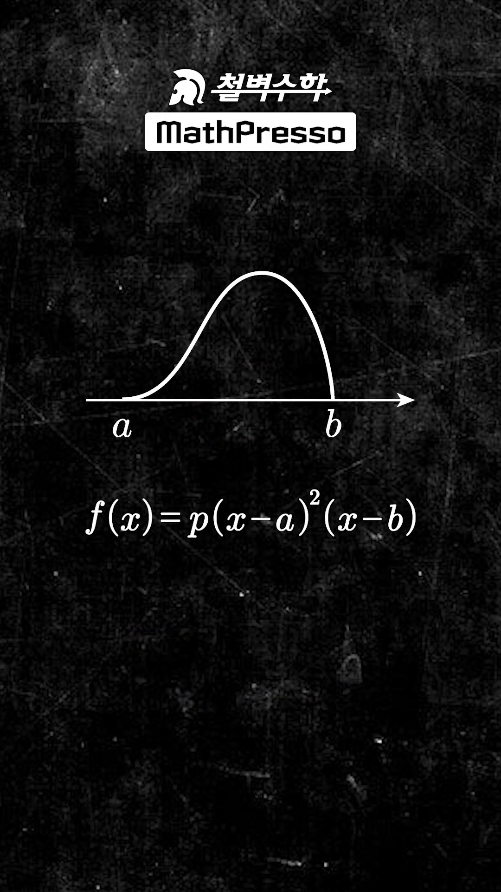
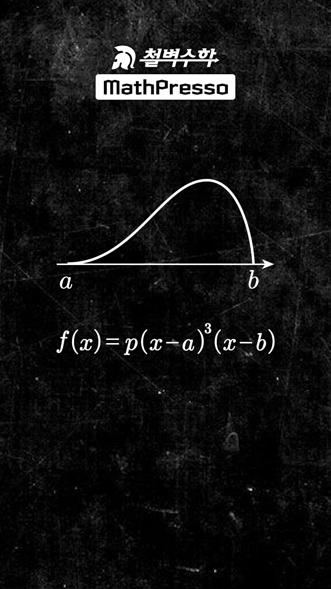
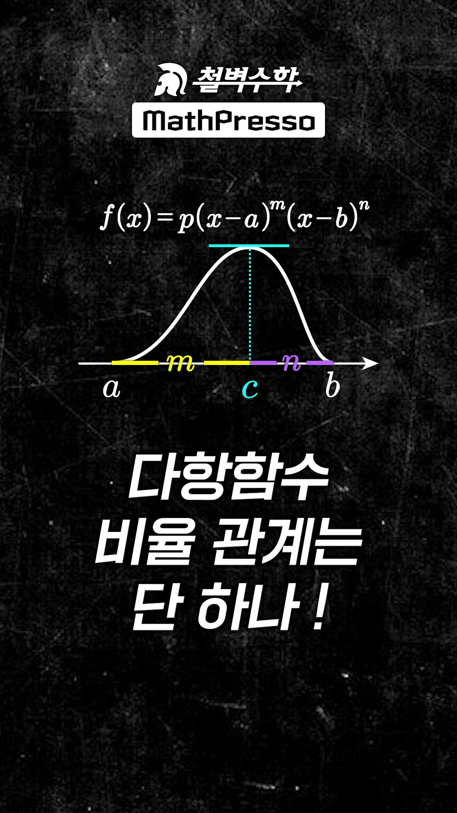

# [수학 II] 다항함수 비율 관계는 단 하나! : 평균값의 정리와 m : n 내분점 공식 완전 해설

> **원본 영상 정보**
> - **출처**: [매스프레소 MathPresso YouTube](https://youtube.com/shorts/er4fNVTEjC0?si=c761w72vz7zeGOX2)
> - **영상 제목**: 다항함수 비율 관계는 단 하나!
> - **채널**: 매스프레소 MathPresso (철벽수학 배수민 선생님)
> - **영상 길이**: 66초 (YouTube Shorts)
> - **주요 태그**: `#다항함수 #다항함수비율 #평균값의정리 #롤의정리 #내분점 #수능수학 #수학2`

---

## 1. 핵심 요약 (Key Summary)

수능 수학에서 학생들이 3차함수의 $2:1$ 비율 관계, 4차함수의 $3:1$ 비율 관계를 각각 개별적으로 외우다 보니 적용할 때 혼란을 겪습니다.

하지만 사실 **모든 다항함수의 극값 비율 관계는 "단 하나"**입니다:

두 실근 $x = a, x = b$ ($a < b$)를 각각 $m$중근, $n$중근으로 갖는 다항함수
$$f(x) = p(x - a)^m (x - b)^n \quad (p \neq 0, \; m, n \in \mathbb{N})$$
에서 구간 $(a, b)$ 내에 존재하는 극값(접선의 기울기가 0이 되는 점 $c$)의 위치는 **선분 $AB$를 $m : n$으로 내분하는 내분점**입니다:

$$\mathbf{c = \frac{mb + na}{m + n} \quad (\text{선분 } AB\text{를 } m : n \text{으로 내분})}$$

---

### 📊 다항함수 차수별 $m : n$ 내분점 일람표

| 다항함수 유형 | 함수 형태 $f(x)$ | 인수 차수 ($m, n$) | 비율 관계 ($m : n$) | 극값 위치 ($c$) | 수능 실전 활용 |
| :--- | :--- | :---: | :---: | :---: | :---: |
| **2차함수** | $p(x-a)(x-b)$ | $m=1, n=1$ | $\mathbf{1 : 1}$ | $c = \frac{a+b}{2}$ | 꼭짓점(대칭축) 위치 |
| **3차함수 (접선·관통)** | $p(x-a)^2(x-b)$ | $m=2, n=1$ | $\mathbf{2 : 1}$ | $c = \frac{2b+a}{3}$ | 접점과 교점 사이 극값 위치 |
| **4차함수 (삼중접선·관통)** | $p(x-a)^3(x-b)$ | $m=3, n=1$ | $\mathbf{3 : 1}$ | $c = \frac{3b+a}{4}$ | 삼중접점과 교점 사이 극값 위치 |
| **4차함수 (이중접선 대칭)** | $p(x-a)^2(x-b)^2$ | $m=2, n=2$ | $\mathbf{2 : 2 = 1 : 1}$ | $c = \frac{a+b}{2}$ | 두 극솟점 사이 극댓값 위치 |
| **임의의 다항함수** | $p(x-a)^m(x-b)^n$ | $m, n$ | $\mathbf{m : n}$ | $c = \frac{mb+na}{m+n}$ | **만능 내분 공식** |

---

## 2. 타임라인별 강의 캡처 & 상세 설명

### 1단계 [00:04] 평균값의 정리와 롤의 정리 도입

* **선생님 설명**:
  > "평균값의 정리. 이는 미분가능 함수의 경우 $a$부터 $b$까지의 평균변화율과 $c$에서의 접선의 기울기가 같아지는 $c$가 반드시 존재한다는 이론입니다."
* **해설**:
  * $f(a) = f(b) = 0$이므로 구간 $[a, b]$에서 평균변화율은 $\frac{f(b) - f(a)}{b - a} = 0$입니다.
  * 따라서 롤의 정리에 의해 $f'(c) = 0$을 만족하는 $c \in (a, b)$가 존재합니다.

---

### 2단계 [00:13] $c$의 위치와 다항함수 비율 관계의 본질

* **선생님 설명**:
  > "이에 따르면 다항함수가 두 실근 $a, b$만 가지는 경우 평균값 정리를 만족하는 $c$의 위치는 이미 정해져 있는데, 이게 바로 함수의 비율 관계입니다."

---

### 3단계 [00:20] 일반적인 다항함수 $f(x) = p(x-a)^m(x-b)^n$ 설정

* **함수 세팅**:
  * $f(x) = p(x-a)^m(x-b)^n$
  * $a$는 $m$중근, $b$는 $n$중근을 의미합니다.

---

### 4단계 [00:26] 평균변화율 0과 도함수 계산

* **선생님 설명**:
  > "$a$부터 $b$까지의 평균변화율은 0이고 $p \neq 0$이므로, $f'(x) = 0$이 되는 값을 구해봅시다."

---

### 5단계 [00:34] 곱의 미분법과 공통인수 약분

* **미분 과정**:
  $$f'(x) = p \left[ m(x-a)^{m-1}(x-b)^n + n(x-a)^m(x-b)^{n-1} \right]$$
  공통인수 $(x-a)^{m-1}(x-b)^{n-1}$를 묶어내면:
  $$f'(x) = p(x-a)^{m-1}(x-b)^{n-1} \left[ m(x-b) + n(x-a) \right]$$
* **방정식 도출**:
  구간 $(a, b)$ 안에서는 $x \neq a, x \neq b$이므로 괄호 안의 식이 0이어야 합니다:
  $$m(x - b) + n(x - a) = 0$$

---

### 6단계 [00:41] 내분점 공식 $c = \frac{mb + na}{m + n}$ 도출

* **선생님 설명**:
  > "$(m + n)x = mb + na$에서 $x$의 값 $c$는 $\frac{mb + na}{m + n}$! 아하! $c$는 선분 $ab$의 $m : n$ 내분점입니다!"
* **핵심 결론**:
  * 기하학에서 배우는 선분의 내분점 공식 $\frac{m \cdot b + n \cdot a}{m + n}$과 토시 하나 틀리지 않고 100% 일치합니다.

---

### 7단계 [00:49] 3차함수에 적용: 2 : 1 내분점

* **선생님 설명**:
  > "$f(x) = p(x-a)^2(x-b)$일 때 $c$는 $2 : 1$ 내분점!"
* **적용**:
  * 접점 $a$의 차수 $m=2$, 교점 $b$의 차수 $n=1 \implies \mathbf{2 : 1}$

---

### 8단계 [00:54] 4차함수에 적용: 3 : 1 내분점

* **선생님 설명**:
  > "$f(x) = p(x-a)^3(x-b)$일 때 $c$는 $3 : 1$ 내분점이 되겠군요!"
* **적용**:
  * 삼중접점 $a$의 차수 $m=3$, 교점 $b$의 차수 $n=1 \implies \mathbf{3 : 1}$

---

### 9단계 [00:59] 다항함수 비율 관계의 대통합 요약

* **선생님 설명**:
  > "다항함수 비율 관계는 단 하나! $m : n$ 내분점입니다."

---

## 3. 수학적 엄밀 증명 및 일반화

임의의 다항함수 $f(x) = p(x-a)^m (x-b)^n$ ($a < b, \; m, n \in \mathbb{N}$)에 대하여:

1. **로그 미분법(Logarithmic Differentiation)을 통한 직관적 증명**:
   $x \in (a, b)$에서 $\ln |f(x)| = \ln |p| + m \ln(x-a) + n \ln(b-x)$
   양변을 $x$에 대해 미분하면:
   $$\frac{f'(x)}{f(x)} = \frac{m}{x-a} - \frac{n}{b-x}$$
   $f'(c) = 0$이 되려면 우변이 0이어야 하므로:
   $$\frac{m}{c-a} = \frac{n}{b-c} \implies m(b-c) = n(c-a)$$
   $$mb - mc = nc - na \implies (m+n)c = na + mb$$
   $$\mathbf{c = \frac{na + mb}{m+n}}$$

2. **기하학적 해석**:
   * 점 $c$에서 접선의 기울기가 0이 되려면, $x=a$에서의 인력(차수 $m$)과 $x=b$에서의 인력(차수 $n$)이 평형을 이루어야 합니다.
   * 이는 마치 질량 $m$인 물체가 $a$에 있고, 질량 $n$인 물체가 $b$에 있을 때의 **무게중심(Center of Mass)**과 완전히 동일한 원리입니다!

---

## 4. 수능/모의고사 1초 암산 실전 테크닉

1. **접점과 교점만 보면 미분 없이 극값 $x$좌표 즉시 도출**:
   - 예: 삼차함수 $f(x) = (x-1)^2(x-7)$의 극소점을 구하시오.
     - $a=1$ (접점, $m=2$), $b=7$ (교점, $n=1$)
     - $c$는 $1$과 $7$을 $2 : 1$로 내분하는 점:
       $$c = 1 + \frac{2}{3}(7 - 1) = 1 + 4 = \mathbf{5}$$
     - 미분해서 전개하고 인수분해할 필요 없이 **암산으로 1초 만에 $c = 5$**가 나옵니다!
2. **사차함수 삼중근 극값**:
   - 예: 사차함수 $f(x) = (x-2)^3(x-10)$의 극소점:
     - $a=2$ ($m=3$), $b=10$ ($n=1$) $\implies 3 : 1$ 내분
     - $c = 2 + \frac{3}{4}(10 - 2) = 2 + 6 = \mathbf{8}$
