# [수능 수학 기하 총정리] 수능 도형 기본 성질 & 도형 공부 꿀팁 완전 해설

> **원본 영상 정보**
> - **출처**: [수학딜러 YouTube](https://youtu.be/xTnNZ0N-Qt8)
> - **영상 제목**: 수능 도형 정리, 도형공부 꿀팁 [수능 파이널 필수영상] [모든 등급 필수시청]
> - **채널**: 수학딜러
> - **영상 길이**: 26분 29초 (1589초)
> - **주요 태그**: `#수능수학 #도형정리 #삼각함수 #원과비례 #방멱정리 #할선정리 #접현각 #수능파이널 #기하`

---

## 1. 핵심 요약 (Key Summary)

수능 수학(공통과목 수학I 삼각함수 도형 문항, 미적분 무한등비급수 및 삼각함수 극한/미분 도형 등)에서 학생들이 가장 크게 좌절하는 부분은 **"중학도형의 기본 성질"**이 수능식 상황과 결합될 때 이를 직관적으로 발견하지 못하는 점입니다.

수학딜러 선생님은 수능 직전에 반드시 챙겨야 할 핵심 기하학적 성질을 크게 **평행선**, **직각삼각형의 엮임**, **원의 본질적 성질(현, 접선, 외접사각형, 접현각, 공통접선, 원주각, 내접사각형, 할선정리)**로 선별하여 체계화했습니다.

---

### 📊 수능 기하 7대 핵심 정리 및 실전 행동 요령

| 대분류 | 핵심 도형 원리 | 수식 및 관계식 | 수능 실전 행동 강령 (Action Plan) |
| :--- | :--- | :--- | :--- |
| **1. 평행선** | 동위각 · 엇각의 역발견 | $l \parallel m \iff \angle \alpha = \angle \beta$ | 두 각이 같음을 발견하면 즉시 **평행선**을 긋고, 닮음비($AA$ 닮음)를 폭발시킨다. |
| **2. 직각삼각형** | 엮인 직각삼각형 & 각도 추적 | $\bigcirc + \triangle = 90^\circ$ | 공통각이나 맞물린 각에 $\bigcirc, \triangle$를 표기하여 닮음 삼각형과 삼각비 체인을 완성한다. |
| **3. 등비수열 체인** | 삼각비의 연속 곱 | $a \to a\tan\theta \to a\tan^2\theta$ | 연쇄 직각삼각형에서 변의 길이는 **등비수열(공비 $\tan\theta$)**을 이룸을 간파한다. |
| **4. 현의 성질** | 현의 수직이등분선과 이등변삼각형 | $OM \perp AB \implies AM = MB$ | 수직이등분선이 보이면 즉시 **이등변삼각형**과 **외접원의 중심**을 작도한다. |
| **5. 접선과 사각형** | 접선의 길이 & 외접사각형 | $PA = PB, \quad a + c = b + d$ | 외부 한 점에서 그은 접선 길이는 같고, 외접 사각형은 **(마주보는 대변의 합)이 서로 같다**. |
| **6. 접현각 & 공통접선** | 접선과 현의 각 = 원주각 | $\angle TAB = \angle BCA$ | 외접/내접하는 두 원의 공통접선에서 접현각을 징검다리 삼아 **두 현의 평행**을 유도한다. |
| **7. 할선정리 (방멱)** | 원과 비례 (3대 공식) | $PA \cdot PB = PC \cdot PD$   $PT^2 = PA \cdot PB$ | 원 내부 교차현, 외부 두 할선, 접선-할선에서 **선분의 곱 일정 공식**으로 길이를 단번에 구한다. |

---

## 2. 타임라인별 강의 캡처 & 상세 설명 (14단계)

### 1단계 [00:01:10] 평행선과 동위각 · 엇각의 역발견

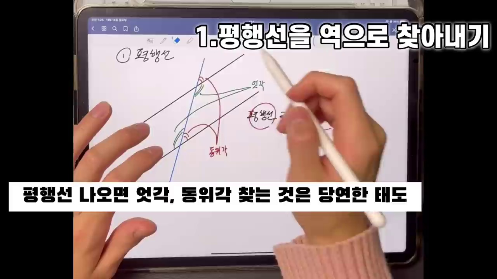

* **선생님 설명**:
  > "평행선이 주어지면 동위각과 엇각을 찾는 것은 누구나 합니다. 하지만 수능 고난도 문제의 핵심은 역발견입니다! 두 각이 같다는 것(엇각/동위각)을 발견했을 때, 거꾸로 '이 두 직선이 평행하구나!'를 떠올리는 것이 진짜 실력입니다."
* **해설**:
  * 문제에서 직접적으로 "평행하다"는 힌트를 주지 않는 경우가 많습니다.
  * 도형 내부에서 각의 크기가 같은 두 각이 엇각 위치에 놓여 있다면, 즉시 평행선을 인식하고 $AA$ 닮음 삼각형을 설정해야 합니다.

---

### 2단계 [00:03:30] 직각삼각형 2개 엮임과 $\bigcirc + \triangle = 90^\circ$ 각도 마킹

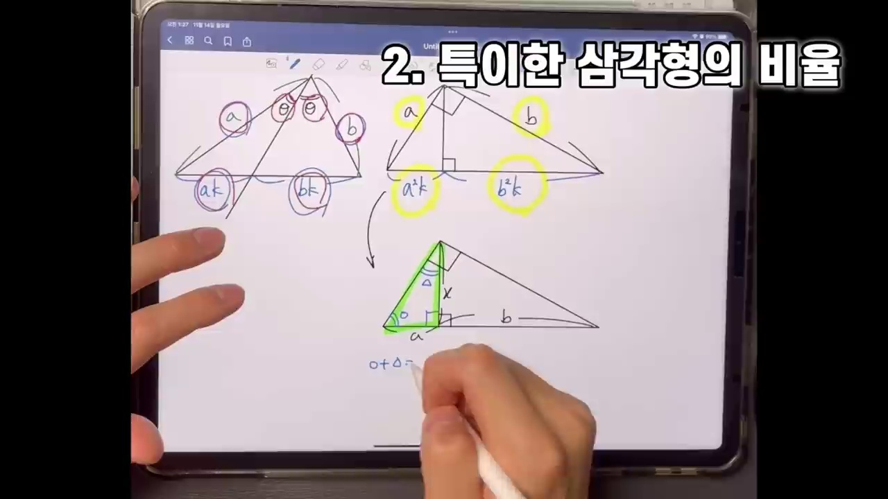

* **선생님 설명**:
  > "직각삼각형 두 개가 엮여 있을 때는 각도를 무조건 $\bigcirc$와 $\triangle$로 잡으세요. 직각삼각형이니까 $\bigcirc + \triangle = 90^\circ$입니다. 맞꼭지각이나 여각을 타고 넘어가면 다른 직각삼각형의 각도도 자연스럽게 채워집니다."
* **해설**:
  * 한 각을 $\theta$, 다른 한 각을 $90^\circ - \theta$로 계산식으로 푸는 것보다, 기호 $\bigcirc, \triangle$를 직관적으로 마킹하는 것이 수능 시험장 실수를 줄이는 비결입니다.
  * 각도가 같아지는 순간 두 직각삼각형은 바로 **$AA$ 닮음**이 됩니다.

---

### 3단계 [00:04:45] 삼각비의 연쇄 전개와 등비수열($\tan\theta$ 체인)

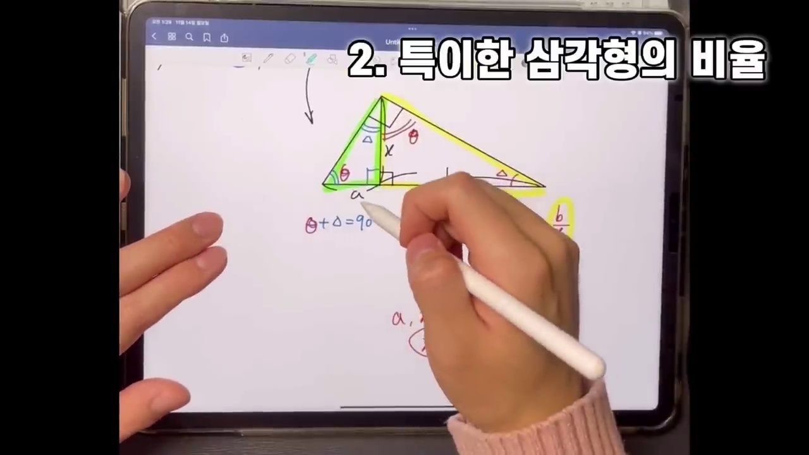

* **선생님 설명**:
  > "밑변이 $a$이고 각이 $\theta$라면 높이는 $a\tan\theta$입니다. 그 높이를 다시 밑변으로 하는 또 다른 직각삼각형이 맞물려 있다면 다음 변은 $a\tan^2\theta$가 됩니다. 즉, 변의 길이들이 공비가 $\tan\theta$인 등비수열을 이룹니다. 이 소재 하나만으로 출제된 평가원 기출도 있습니다!"
* **핵심 공식**:
  $$L_0 = a \implies L_1 = a\tan\theta \implies L_2 = a\tan^2\theta \implies L_n = a(\tan\theta)^n$$
  * 밑변과 높이, 빗변이 연쇄적으로 맞물리는 기하 구조는 미적분 등비급수 문항뿐만 아니라 수학I 수열 킬러 문항과도 직결됩니다.

---

### 4단계 [00:08:15] 원의 중심과 현의 수직이등분선 & 이등변삼각형

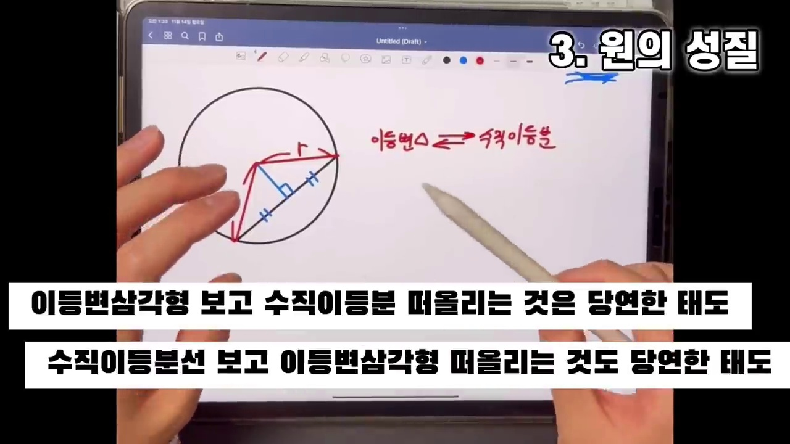

* **선생님 설명**:
  > "원의 중심에서 현에 수선을 내리면 무조건 수직이등분합니다. 반대로 문제에서 선분의 수직이등분선이 주어지면 두 점을 잇는 이등변삼각형과 그 점들을 지나는 외접원의 중심을 떠올리셔야 합니다. 이게 양방향으로 왔다 갔다 잘 돼야 합니다."
* **해설**:
  * 원의 중심 $O$에서 현 $AB$에 내린 수선의 발을 $M$이라 하면 $AM = MB$입니다.
  * $\triangle OAB$는 $OA = OB = R$(외접원 반지름)인 이등변삼각형이므로 피타고라스 정리 $OM^2 + AM^2 = R^2$이 자연스럽게 성립합니다.

---

### 5단계 [00:10:00] 원 외부 한 점에서 그은 접선의 길이의 상등

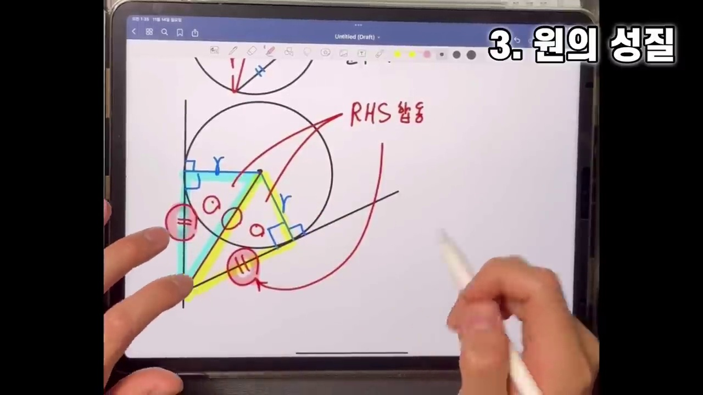

* **선생님 설명**:
  > "원 외부의 점 $P$에서 원에 접선을 두 개 그으면, 접점까지의 거리는 무조건 같습니다 ($PA = PB$). $RHS$ 합동이기 때문입니다."
* **해설**:
  * 중심 $O$와 접점 $A, B$를 이으면 $OA \perp PA$, $OB \perp PB$ ($90^\circ$).
  * 공통 빗변 $OP$와 반지름 $OA = OB = R$에 의해 $\triangle OAP \equiv \triangle OBP$ ($RHS$ 합동).
  * 따라서 $PA = PB$가 성립하며, $\angle APO = \angle BPO$로 각의 이등분선 성질까지 동시에 확보됩니다.

---

### 6단계 [00:11:15] 원에 외접하는 사각형의 대변의 합 공식

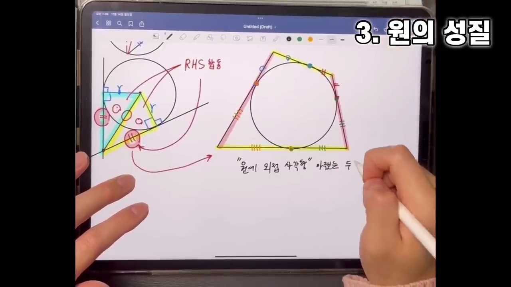

* **선생님 설명**:
  > "원에 외접하는 사각형이 나온다면 고민할 것 없이 대변의 합을 쓰세요! 윗변 + 아랫변 = 왼쪽변 + 오른쪽변 입니다."
* **증명**:
  * 사각형의 네 꼭짓점에서 원에 그은 접선의 길이를 각각 $x, y, z, w$라 하면:
  $$\text{윗변} + \text{아랫변} = (x + y) + (z + w)$$
  $$\text{왼쪽변} + \text{오른쪽변} = (x + w) + (y + z)$$
  $$\mathbf{\text{상} + \text{하} = \text{좌} + \text{우} = x + y + z + w}$$

---

### 7단계 [00:13:30] 접선과 현이 이루는 각 (접현각, Tangent-Chord Theorem)

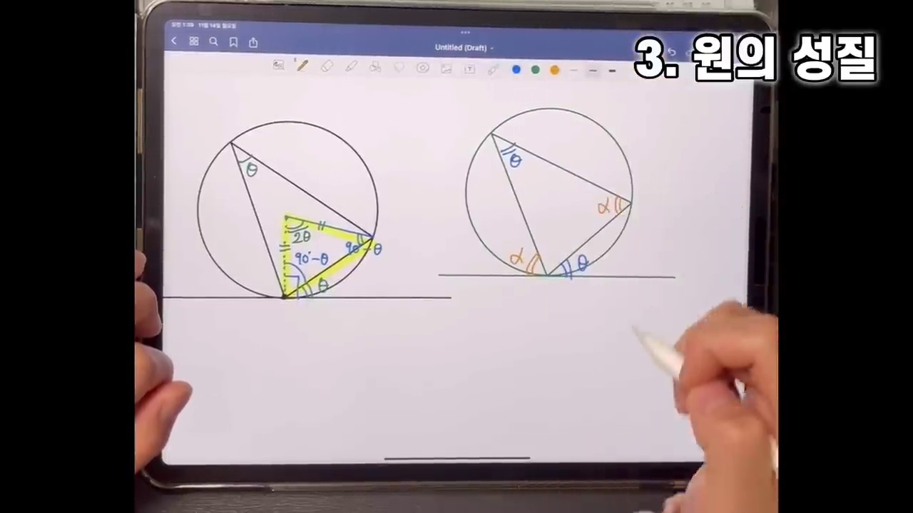

* **선생님 설명**:
  > "원의 접선과 그 접점을 지나는 현이 이루는 각은, 그 현에 대한 원주각의 크기와 정확히 같습니다. 이걸 접현각이라고 부릅니다. 그림을 보자마자 같은 각 $\theta$를 표시할 수 있어야 합니다."
* **핵심 등식**:
  $$\angle TAB = \angle BCA = \theta$$
  * 지름을 지나는 직각삼각형을 보조선으로 그으면 $90^\circ - \angle$ 관계를 통해 $10$초 만에 완벽히 유도됩니다.

---

### 8단계 [00:15:20] 외접하는 두 원과 공통내접선: 엇각을 통한 평행선 발견

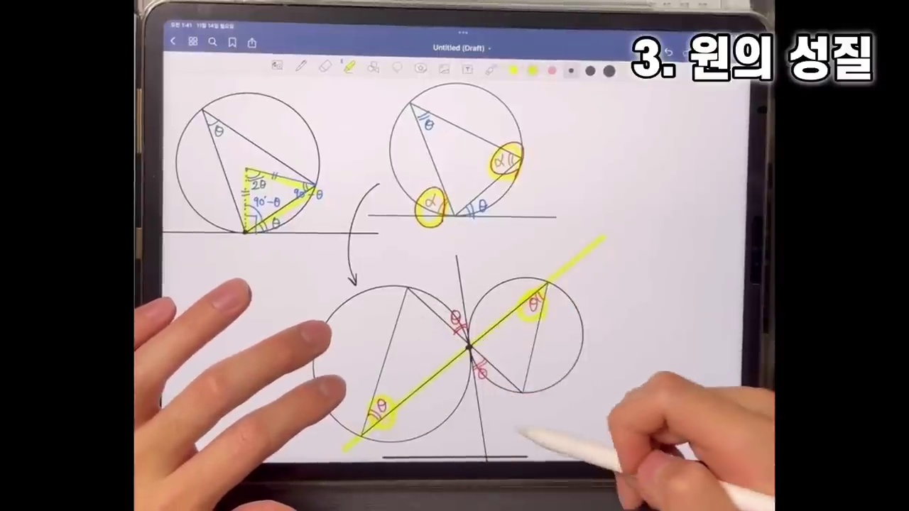

* **선생님 설명**:
  > "외접하는 두 원의 접점에 공통접선을 긋고, 접점을 통과하는 직선 두 개를 그어보세요. 맞꼭지각과 접현각을 타고 넘어가면 두 현이 이루는 엇각이 정확히 같아집니다! 따라서 두 직선은 평행합니다. 수능 출제진이 사랑하는 킬러 태도입니다."
* **논리 흐름**:
  1. 공통접선과 현 $AB$ 사이의 각 = 접현각 $\theta$
  2. 맞꼭지각에 의해 반대편 각도 $\theta$
  3. 두 번째 원에서 접현각 성질에 의해 현 $CD$의 각도 $\theta$
  4. $\implies$ 두 직선 $AB, CD$의 **엇각이 같으므로 $AB \parallel CD$!**

---

### 9단계 [00:17:15] 내접하는 두 원과 공통외접선: 동위각을 통한 평행선 발견

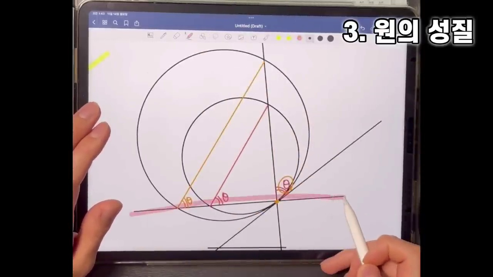

* **선생님 설명**:
  > "이번엔 안쪽에서 접하는(내접하는) 두 원입니다. 공통접선에서 접현각을 적용하면 작은 원의 각이 $\theta$이고 큰 원의 각도 $\theta$가 됩니다. 동위각 위치의 각이 같으므로 두 선분은 평행합니다!"
* **핵심 결과**:
  * 한 접점을 지나는 두 할선이 만드는 현들은 언제나 **평행($\parallel$)**하며, 이에 따라 두 삼각형은 $AA$ 닮음을 이룹니다.

---

### 10단계 [00:18:15] 원주각과 중심각의 $2:1$ 관계

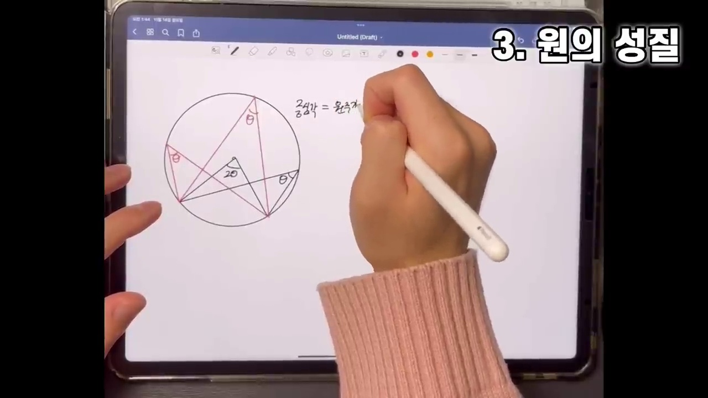

* **선생님 설명**:
  > "원에서 가장 중요한 단 하나의 개념을 꼽으라면 무조건 원주각과 중심각입니다. 같은 호에 대한 중심각이 $2\theta$라면 원주각은 무조건 $\theta$입니다."
* **성질**:
  * $\angle APB = \frac{1}{2} \angle AOB$
  * 호 $AB$가 정해져 있다면 원주 위의 점 $P$가 어디에 위치하든 원주각의 크기는 항상 일정합니다.
  * 특히 지름에 대한 원주각은 항상 **$90^\circ$**입니다.

---

### 11단계 [00:19:35] 원에 내접하는 사각형: 대각의 합 $180^\circ$ & 외각 = 내대각

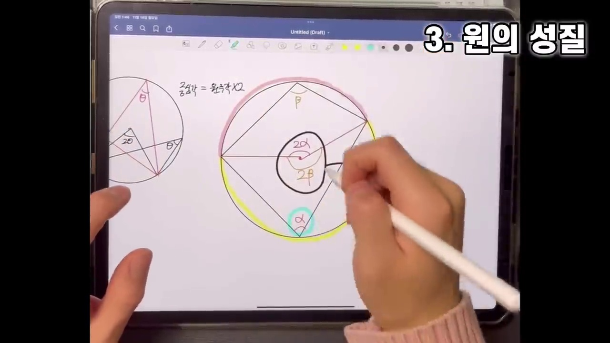

* **선생님 설명**:
  > "원에 내접하는 사각형이 보이면 바로 쓰세요. 마주보는 두 대각의 합은 무조건 $180^\circ$입니다 ($\alpha + \beta = 180^\circ$). 따라서 한 외각의 크기는 마주보는 안쪽 각(내대각)과 완벽히 같습니다."
* **증명**:
  * 두 대각에 대응하는 호의 중심각의 합은 원 전체의 둘레각인 $360^\circ$입니다.
  * 중심각의 합이 $360^\circ$이므로 원주각의 합은 $\frac{360^\circ}{2} = 180^\circ$가 됩니다.

---

### 12단계 [00:21:30] 할선정리 (방멱) 1: 접선과 할선 ($PT^2 = PA \cdot PB$)

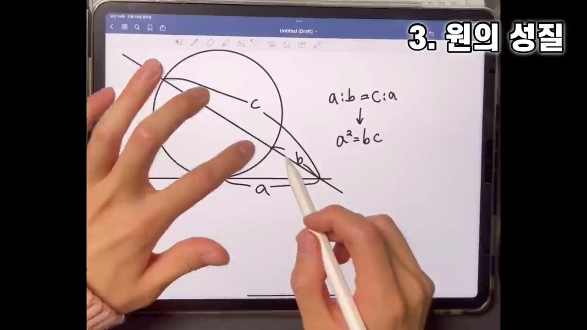

* **선생님 설명**:
  > "할선정리 첫 번째! 접선과 할선이 만날 때입니다. 접점까지의 길이의 제곱은 짧은 할선 곱하기 긴 할선입니다. 즉, $PT^2 = PA \cdot PB$ ($t^2 = a(a+b)$)입니다. 수능에서는 유도할 시간 따위 없습니다. 무조건 외우고 바로 쓰셔야 합니다!"
* **닮음 유도**:
  * $\angle PTA = \angle PBT$ (접현각)이고 $\angle P$는 공통각입니다.
  * $\triangle PTA \sim \triangle PBT$ ($AA$ 닮음)
  * $\frac{PT}{PB} = \frac{PA}{PT} \implies \mathbf{PT^2 = PA \cdot PB}$

---

### 13단계 [00:23:45] 할선정리 (방멱) 2: 외부 두 할선 ($PA \cdot PB = PC \cdot PD$)

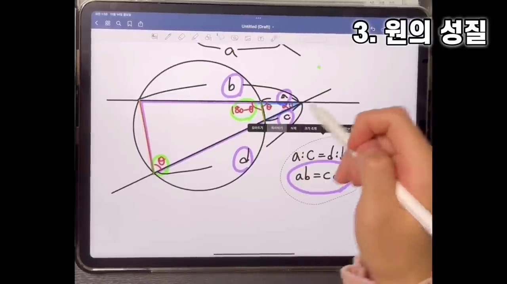

* **선생님 설명**:
  > "원 외부의 점 $P$에서 할선을 두 개 그었을 때입니다. 내접사각형의 외각 성질 때문에 $\triangle PAC$와 $\triangle PDB$가 $AA$ 닮음이 됩니다. 그래서 $PA \cdot PB = PC \cdot PD$ ($a(a+b) = c(c+d)$)가 성립합니다."
* **비례식 유도**:
  * $\angle PAC = \angle PDB$ (내접사각형 외각 = 내대각), $\angle P$ 공통.
  * $\triangle PAC \sim \triangle PDB \implies \frac{PA}{PD} = \frac{PC}{PB} \implies \mathbf{PA \cdot PB = PC \cdot PD}$

---

### 14단계 [00:25:40] 할선정리 (방멱) 3: 원 내부에서 교차하는 두 현 ($PA \cdot PB = PC \cdot PD$)

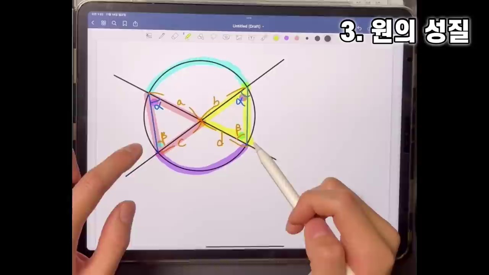

* **선생님 설명**:
  > "마지막 할선정리 세 번째는 원 내부에서 현 두 개가 교차할 때입니다. 같은 호에 대한 원주각을 표시하면 두 맞꼭지 삼각형이 닮음이 됩니다. 따라서 내항의 곱과 외항의 곱에 의해 $PA \cdot PB = PC \cdot PD$ ($a \cdot b = c \cdot d$)가 성립합니다!"
* **비례식 유도**:
  * 호 $AC$에 대한 원주각 $\angle B = \angle D$, 호 $BD$에 대한 원주각 $\angle A = \angle C$
  * $\triangle PAB \dots \implies \triangle PAC \sim \triangle PDB$ ($AA$ 닮음)
  * $\frac{PA}{PD} = \frac{PC}{PB} \implies \mathbf{PA \cdot PB = PC \cdot PD}$

---

## 3. 수학교과서식 엄밀한 증명 & 수능 기출 심층 연계

### [증명 1] 접현각 정리 (The Alternate Segment Theorem)
* **정리**: 원의 접선 $l$과 접점 $A$를 지나는 현 $AB$가 이루는 각 $\angle TAB$는 호 $AB$에 대한 원주각 $\angle BCA$와 같다.
* **증명**:
  1. 접점 $A$를 지나 원의 중심 $O$를 통과하는 지름 $AD$를 작도한다.
  2. 지름에 대한 원주각의 성질에 의해 $\angle ABD = 90^\circ$이다.
  3. 반지름과 접선은 수직이므로 $\angle TAD = 90^\circ$이다.
  4. $\angle TAB = 90^\circ - \angle DAB$
  5. 직각삼각형 $ABD$에서 $\angle BDA = 90^\circ - \angle DAB$
  6. 따라서 $\angle TAB = \angle BDA$이다.
  7. 호 $AB$에 대한 원주각은 일정하므로 $\angle BDA = \angle BCA$이다.
  8. $\therefore \angle TAB = \angle BCA \quad \blacksquare$

---

### [증명 2] 방멱의 정리 (Power of a Point Theorem) 통합
* 점 $P$를 지나는 임의의 직선이 원 $O$ (반지름 $R$)와 만나는 두 점을 $A, B$라 하자.
* 중심 $O$와 점 $P$ 사이의 거리를 $d = OP$라 할 때:
  $$\mathbf{PA \cdot PB = |d^2 - R^2| = \text{const (상수)}}$$
* 이 상수를 점 $P$의 원 $O$에 대한 **방멱(Power)**이라 부릅니다.
  1. $P$가 원 외부($d > R$): $PA \cdot PB = d^2 - R^2 = PT^2$ (접선 길이의 제곱)
  2. $P$가 원 내부($d < R$): $PA \cdot PB = R^2 - d^2$
  * 이로써 3가지 할선정리가 사실상 **단 하나의 대수적 불변량(방멱)**임을 수학적으로 이해할 수 있습니다!

---

### [수능 실전 팁] 평가원 킬러/준킬러 문항 적용 알고리즘
1. **삼각함수 도형 문항(사인법칙/코사인법칙)과 결합**:
   * 외접원 반지름 $R$이 등장하면 사인법칙 $\frac{a}{\sin A} = 2R$을 먼저 쓰되,
   * 변의 길이를 구할 때 미지수가 2개 이상이면 **할선정리($PA \cdot PB = PC \cdot PD$)**를 연립하여 계산량을 $\frac{1}{3}$로 단축한다.
2. **원주각과 코사인법칙의 콜라보**:
   * 원에 내접하는 사각형이 주어지면 마주보는 두 각 $\theta, 180^\circ - \theta$에 대해 $\cos(180^\circ - \theta) = -\cos\theta$임을 이용하여 대각선 길이에 대한 코사인법칙 식을 연립한다.
