# [수학 I · 미적분] 삼각비부터 삼각함수까지의 수학적 본질 완전 해설

> **원본 영상 정보**
> - **출처**: [매쓰의 본질 YouTube](https://youtu.be/DTKyrAyLWb8)
> - **영상 제목**: 삼각비부터 삼각함수까지 제대로 정리해드립니다 | sin(사인), cos(코사인), tan(탄젠트) | 호도법
> - **채널**: 매쓰의 본질
> - **영상 길이**: 16분 19초 (979초)
> - **주요 태그**: `#삼각함수 #삼각비 #호도법 #라디안 #단위원 #사인함수 #코사인함수 #수학1 #미적분 #수학의본질`

---

## 1. 핵심 요약 (Key Summary)

많은 학생들이 중학교 때 배우는 **삼각비(Trigonometric Ratio)**와 고등학교 때 배우는 **삼각함수(Trigonometric Function)**를 별개의 암기 공식으로 취급하거나, 호도법(Radian)의 필요성을 단순 각도 단위 변환 공식 정도로 치부합니다.

하지만 **삼각비 $\longrightarrow$ 삼각함수 $\longrightarrow$ 해석학적 미적분**으로 이어지는 흐름은 인류 수학사에서 가장 위대한 **"수학적 일반화(Generalization)와 추상화"**의 정수입니다:

1. **삼각비의 한계**: 직각삼각형의 내각에 갇혀 있어 $0^\circ < \theta < 90^\circ$에서만 정의됨.
2. **단위원을 통한 일반화**: 좌표평면 위의 단위원($x^2 + y^2 = 1$)과 동경의 회전각으로 재정의하여 음수 각, $360^\circ$ 초과 각, 4개 사분면 전체의 부호(올-사-탄-코)를 획득.
3. **호도법(Radian)의 필연성**: 육십분법($^\circ$)은 인위적인 각도 단위일 뿐, 실수 수직선에 놓일 수 없음. 호의 길이 $l = r\theta$를 통해 각을 **무차원 실수(Pure Real Number)**로 변환.
4. **미적분 체계의 완성**: 호도법을 채택함으로써 비로소 $\lim_{x \to 0} \frac{\sin x}{x} = 1$ 및 $(\sin x)' = \cos x$ 라는 가장 아름답고 군더더기 없는 도함수 체계가 성립.

---

### 📊 삼각비에서 삼각함수로의 3단계 개념 진화 비교표

| 비교 기준 | 1단계: 삼각비 (중학 기하) | 2단계: 각도 기반 삼각함수 | 3단계: 실수 기반 삼각함수 (현대 수학) |
| :--- | :--- | :--- | :--- |
| **정의 대상** | 직각삼각형 변들의 길이의 비율 | 단위원 위 동경의 끝점 좌표 $P(x, y)$ | 실수 전체 $\mathbb{R}$를 정의역으로 하는 함수 |
| **입력값 (정의역)** | 예각 ($0^\circ < \theta < 90^\circ$) | 모든 회전각 $\theta \in \mathbb{R}^\circ$ (일반각) | **순수 실수 $x \in \mathbb{R}$ (호도법 라디안)** |
| **$\sin$의 정의** | $\frac{\text{높이}}{\text{빗변}}$ | 동경 끝점의 $y$좌표 ($\frac{y}{r}$) | 실수 $x$ 라디안에 대응하는 단위원의 $y$좌표 |
| **$\cos$의 정의** | $\frac{\text{밑변}}{\text{빗변}}$ | 동경 끝점의 $x$좌표 ($\frac{x}{r}$) | 실수 $x$ 라디안에 대응하는 단위원의 $x$좌표 |
| **$\tan$의 정의** | $\frac{\text{높이}}{\text{밑변}}$ | 동경 직선의 기울기 ($\frac{y}{x}$) | 동경 직선의 기울기 ($\frac{\sin x}{\cos x}$) |
| **미적분 가능 여부** | 불가능 | 복잡한 계수 ($\frac{\pi}{180}$) 발생 | **자연스러운 미분: $(\sin x)' = \cos x$** |

---

## 2. 타임라인별 강의 캡처 & 상세 설명 (12단계)

### 1단계 [00:01:10] 직각삼각형과 삼각비의 기원

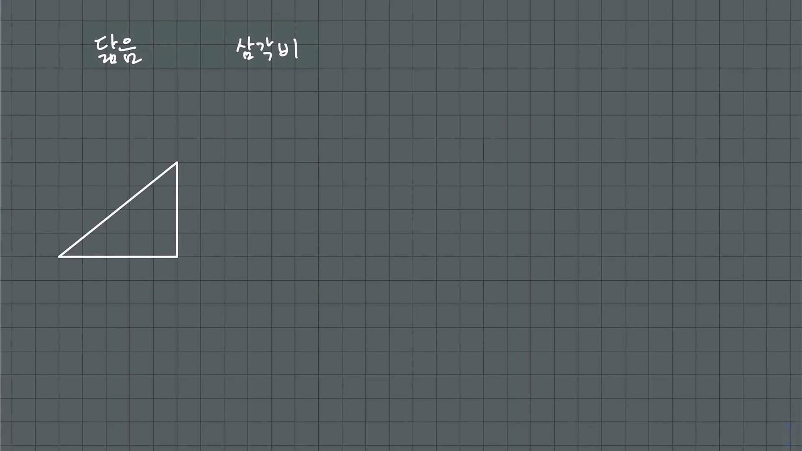

* **선생님 설명**:
  > "어떤 직각삼각형을 가져오더라도 빗변 분의 높이, 빗변 분의 밑변, 밑변 분의 높이라는 세 변 사이의 비율을 생각할 수 있습니다. 이것이 바로 우리가 중학교 때 처음 만나는 삼각비의 기원입니다."
* **해설**:
  * 직각삼각형 $ABC$ ($\angle C = 90^\circ$)에서:
  $$\sin A = \frac{a}{c} = \frac{\text{높이}}{\text{빗변}}, \quad \cos A = \frac{b}{c} = \frac{\text{밑변}}{\text{빗변}}, \quad \tan A = \frac{a}{b} = \frac{\text{높이}}{\text{밑변}}$$

---

### 2단계 [00:02:40] 닮음비와 각도-비율의 일대일 대응 (함수의 시작)

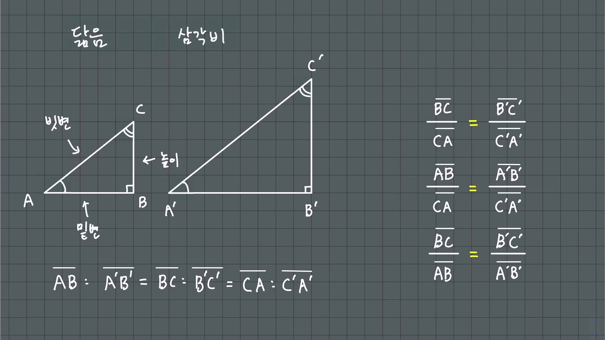

* **선생님 설명**:
  > "직각삼각형의 크기가 아무리 커지거나 작아져도, 밑각의 크기 $x$가 정해지면 닮음에 의해 세 변 사이의 비율은 오직 하나로 유일하게 결정됩니다. 즉, 각도에서 비율로의 대응 관계가 생겨나는 것입니다."
* **해설**:
  * 한 예각이 $x$인 모든 직각삼각형은 $AA$ 닮음입니다.
  * 변의 절대적인 길이가 달라도 비율 $\frac{a}{c}, \frac{b}{c}, \frac{a}{b}$는 불변하므로, 이는 **'각도 $x$'를 입력하면 '비율 값'이 단 하나로 출력되는 엄밀한 함수(Function)**의 싹을 틔웁니다.

---

### 3단계 [00:04:30] 빗변의 길이가 1인 직각삼각형의 발견

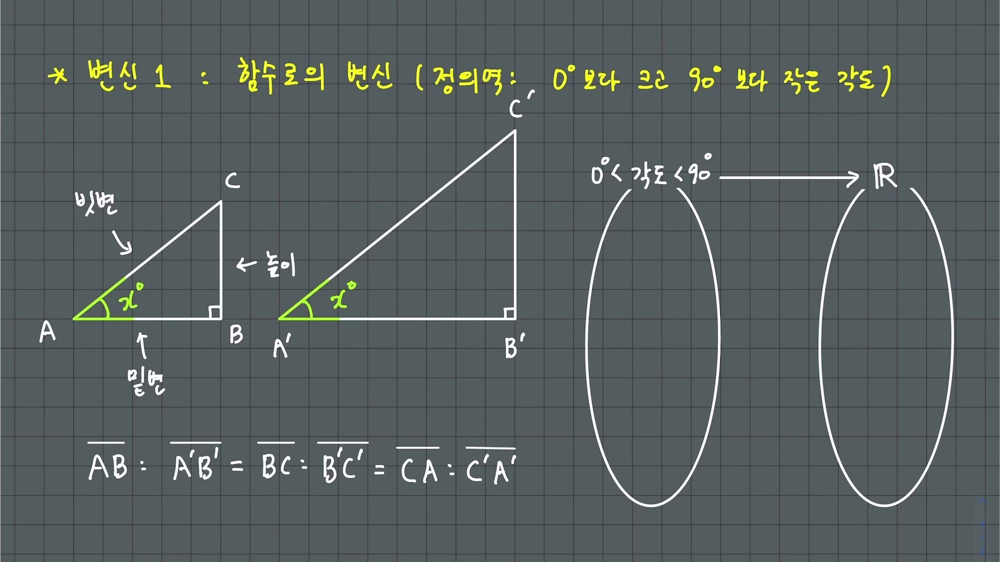

* **선생님 설명**:
  > "직각삼각형의 빗변의 길이를 1로 고정해 봅시다. 그러면 $\sin x$의 값은 정의상 정확히 높이의 길이가 되고, $\cos x$의 값은 밑변의 길이가 됩니다."
* **해설**:
  * 빗변 $c = 1$일 때:
  $$\text{높이} = 1 \cdot \sin x = \sin x, \quad \text{밑변} = 1 \cdot \cos x = \cos x$$
  * 이 단순한 발상의 전환이 훗날 **반지름이 1인 원(단위원)**을 통한 삼각함수의 폭발적 확장으로 연결되는 교두보가 됩니다.

---

### 4단계 [00:06:15] 각도의 확장과 직각삼각형의 한계(모순)

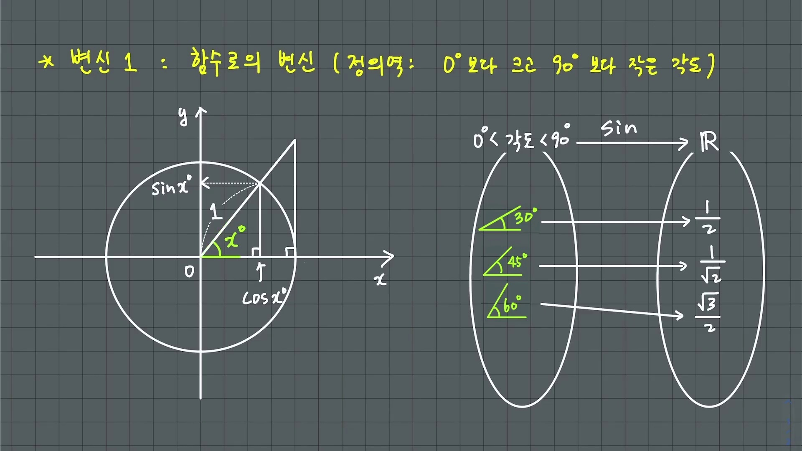

* **선생님 설명**:
  > "수학이 발전하면서 $\sin 120^\circ, \sin 570^\circ, \sin(-30^\circ)$와 같은 각도에 대해서도 값을 정의하고 싶어졌습니다. 그런데 한 내각이 $120^\circ$이거나 음수인 직각삼각형은 세상에 존재할 수 없습니다. 여기서 거대한 모순과 장벽에 부딪히게 됩니다."
* **해설**:
  * 삼각형 내각의 합은 $180^\circ$이므로 직각($90^\circ$)을 제외한 두 예각은 $0^\circ < x < 90^\circ$ 범위 내에 갇혀 있습니다.
  * 기하학적인 '삼각형의 변'이라는 구체적 틀에 갇혀 있는 한, 삼각비는 둔각이나 회전각으로 뻗어나갈 수 없습니다.

---

### 5단계 [00:07:45] 단위원(Unit Circle)과 동경의 회전을 통한 재정의

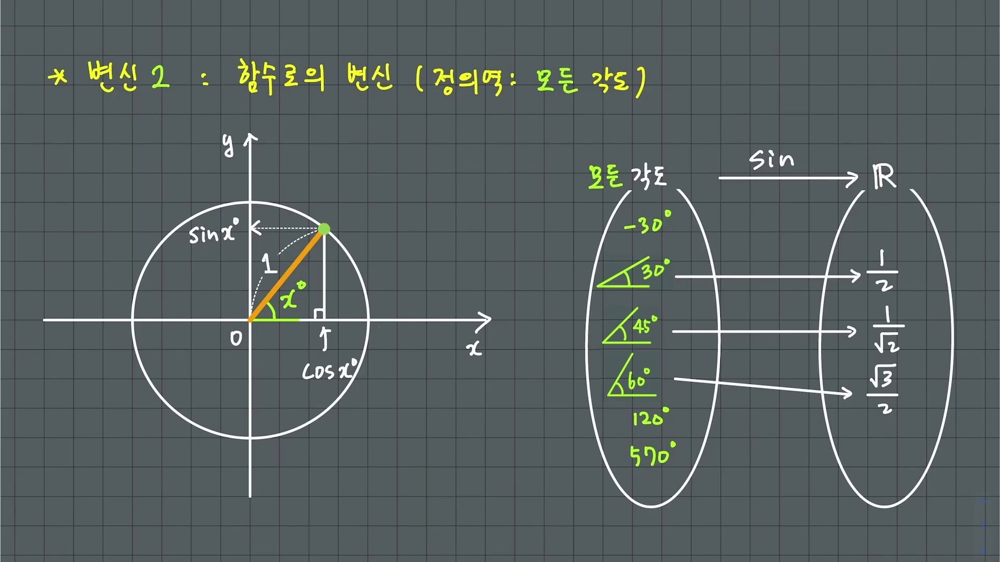

* **선생님 설명**:
  > "수학자들은 삼각형이라는 껍질을 과감하게 깨부수었습니다. 원점 중심의 반지름 1인 원(단위원)에서 $x$축 양의 방향에서 반시계 방향으로 각도 $x$만큼 회전시킨 막대기가 원과 만나는 점의 $y$좌표와 $x$좌표를 각각 $\sin x, \cos x$로 아예 새롭게 정의해 버린 것입니다!"
* **현대적 정의 (단위원 위의 점 P)**:
  $$\mathbf{P(x, y) = (\cos\theta, \; \sin\theta), \quad \tan\theta = \frac{y}{x} = \frac{\sin\theta}{\cos\theta}}$$
  * 이제 $\theta$가 $120^\circ$이든, 세 바퀴를 돈 $1100^\circ$이든, 거꾸로 돈 $-45^\circ$이든 점 $P$는 원주 위에서 항상 유일하게 존재합니다!

---

### 6단계 [00:08:45] 사분면 부호와 올-사-탄-코(All-Sin-Tan-Cos)의 본질

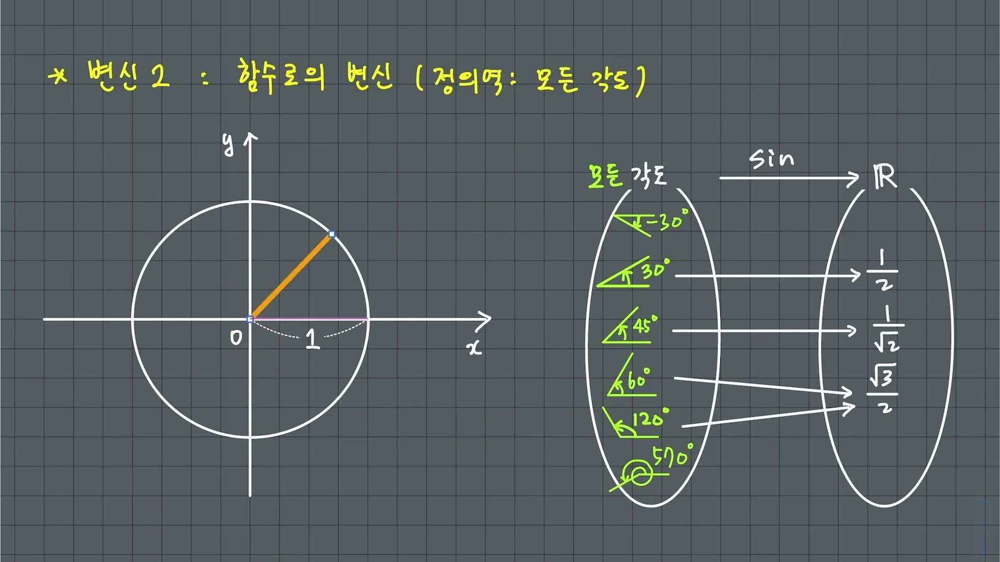

* **선생님 설명**:
  > "길이는 음수가 될 수 없지만 좌표는 음수가 될 수 있습니다! 2사분면에서는 $x$좌표가 음수, $y$좌표가 양수이므로 $\cos$은 음수, $\sin$은 양수가 됩니다. 우리가 기계적으로 외우던 '올-사-탄-코'는 바로 좌표평면의 $(x, y)$ 부호 체계 그 자체입니다."
* **사분면별 부호 정리**:
  * **제1사분면**: $x > 0, y > 0 \implies \mathbf{\text{All (+)}}$
  * **제2사분면**: $x < 0, y > 0 \implies \mathbf{\sin (+)}$ ($\cos < 0, \tan < 0$)
  * **제3사분면**: $x < 0, y < 0 \implies \mathbf{\tan (+)}$ ($\sin < 0, \cos < 0$)
  * **제4사분면**: $x > 0, y < 0 \implies \mathbf{\cos (+)}$ ($\sin < 0, \tan < 0$)

---

### 7단계 [00:10:05] 육십분법(Degree)의 한계와 호도법(Radian)의 탄생

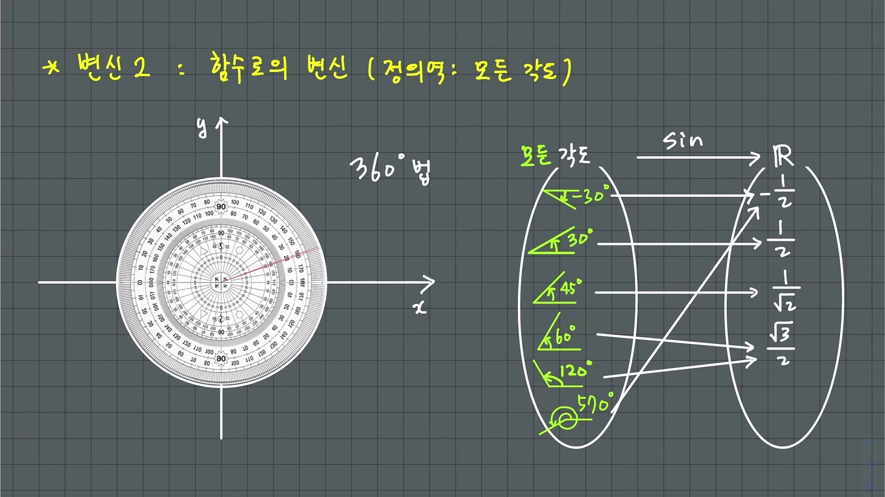

* **선생님 설명**:
  > "각도를 재는 고대 방식인 360도 법(육십분법)은 원 둘레를 임의로 360등분한 '단위'일 뿐입니다. 하지만 수학에서는 각도를 원의 반지름과 호의 길이의 비율로 정의하는 '호도법(Radian)'을 도입합니다. 반지름과 호의 길이가 같아질 때의 벌어진 각도를 1 라디안으로 정의합니다."
* **호도법의 수학적 정의**:
  $$\mathbf{\theta = \frac{l}{r} \quad \left[\frac{\text{길이 [m]}}{\text{길이 [m]}} = \text{무차원 실수}\right]}$$
  * 반지름이 $r = 1$인 단위원에서는 **호의 길이 $l$ 자체가 곧 각도의 크기 $\theta$**가 됩니다!

---

### 8단계 [00:10:50] $180^\circ = \pi \text{ rad}$ 변환 공식과 특수각 일람

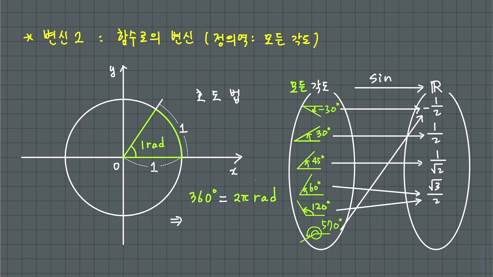

* **선생님 설명**:
  > "원 전체의 중심각은 360도이고 원 둘레는 $2\pi r$이므로, $360^\circ = 2\pi \text{ rad}$, 즉 $180^\circ = \pi \text{ rad}$입니다. 여기서부터 $1^\circ = \frac{\pi}{180} \text{ rad}$, $1 \text{ rad} = \frac{180^\circ}{\pi} \approx 57.3^\circ$라는 변환식이 나옵니다."
* **특수각 호도법 변환**:
  * $30^\circ = \frac{\pi}{6}, \quad 45^\circ = \frac{\pi}{4}, \quad 60^\circ = \frac{\pi}{3}, \quad 90^\circ = \frac{\pi}{2}, \quad 180^\circ = \pi, \quad 360^\circ = 2\pi$

---

### 9단계 [00:11:45] 각도 집합에서 실수 집합 $\mathbb{R}$로의 정의역 확장

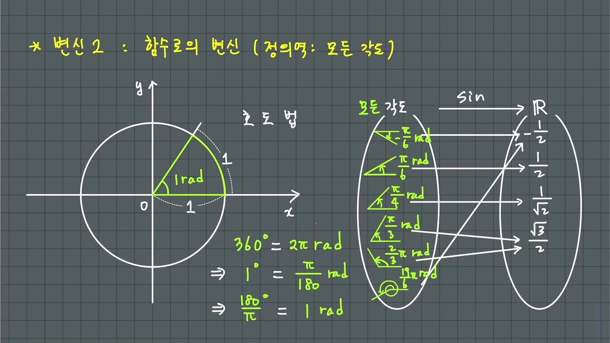

* **선생님 설명**:
  > "삼각함수의 그래프를 그릴 때 $x$축은 '각도 축'이 아니라 '실수 축'입니다. 호도법을 통해 우리는 각도를 순수한 숫자(실수)로 다룰 수 있게 되었고, 비로소 삼각함수는 실수 전체 $\mathbb{R}$를 정의역으로 하는 진정한 함수의 형태를 갖추게 됩니다."
* **해설**:
  * 데카르트 좌표계의 $x$축에 실수 $1, 2, 3, \pi, 2\pi \dots$를 자유롭게 대입할 수 있게 됨으로써 삼각함수의 연속성과 미분 가능성이 논의될 수 있는 토대가 마련됩니다.

---

### 10단계 [00:13:30] $y = \sin x$ vs $y = \sin x^\circ$ 의 결정적 차이

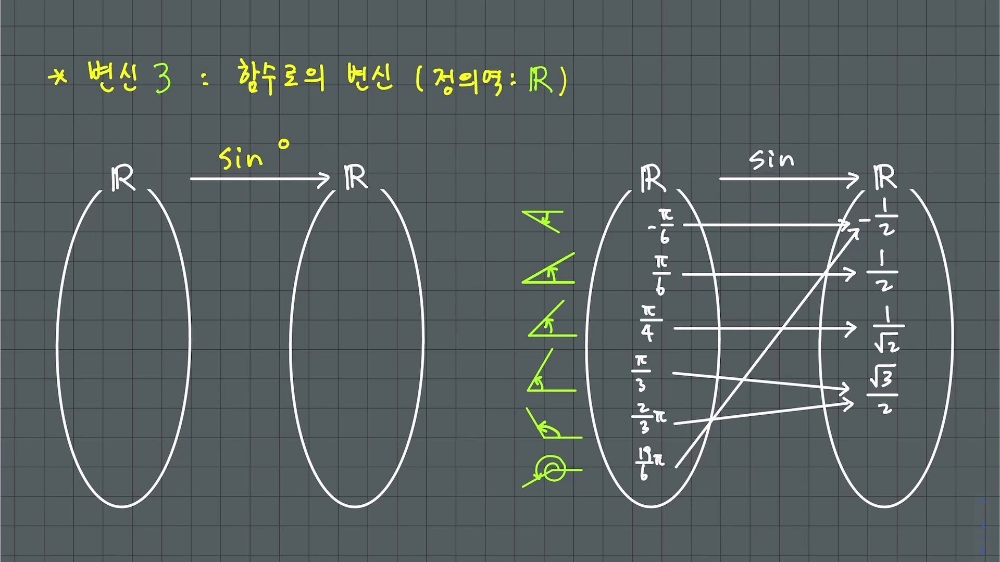

* **선생님 설명**:
  > "많은 학생들이 $y = \sin x$와 $y = \sin x^\circ$를 혼동합니다. $y = \sin x^\circ$에 30을 넣으면 $\sin 30^\circ = \frac{1}{2}$이 나옵니다. 하지만 $y = \sin x$에 30을 넣으면 30 라디안($\approx 1718.8^\circ$)에 대한 사잇값이 나옵니다. $y = \sin x$에서 $\frac{1}{2}$이 나오려면 $x = \frac{\pi}{6}$이라는 실수값을 넣어야 합니다!"
* **본질적 차이**:
  * $f(x) = \sin x^\circ$ : 주기가 $360$인 함수.
  * $g(x) = \sin x$ : 주기가 $2\pi \approx 6.283$인 함수.
  * 고등학교 수학교과서가 "라디안 단위를 생략한다"고 얼렁뚱땅 넘어가면서 생기는 치명적 오개념을 완벽하게 짚어냅니다.

---

### 11단계 [00:14:15] 호도법이 아니면 불가능한 자연스러운 미분 체계

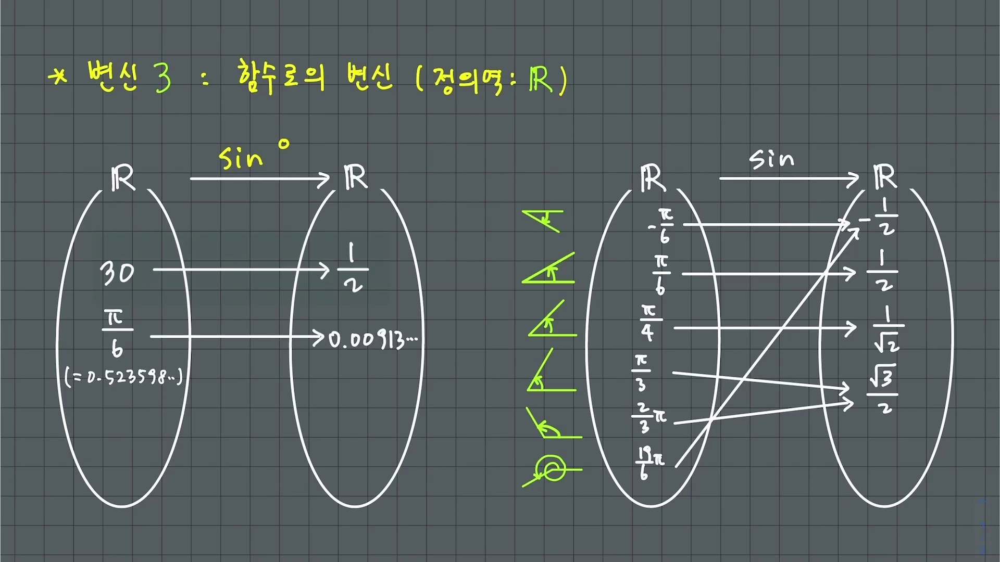

* **선생님 설명**:
  > "왜 수학자들은 $y = \sin x^\circ$ 대신 $y = \sin x$를 쓸까요? 미분을 해보면 바로 알 수 있습니다. 호도법을 쓸 때만 $(\sin x)' = \cos x$라는 가장 자연스러운 도함수가 나옵니다. 만약 도($^\circ$)를 쓰면 $(\sin x^\circ)' = \frac{\pi}{180}\cos x^\circ$처럼 지저분한 상수 $\frac{\pi}{180}$가 꼬리표처럼 붙어버립니다!"
* **미분 계수와 극한의 본질**:
  $$\lim_{x \to 0} \frac{\sin x}{x} = 1 \iff \lim_{x \to 0} \frac{\sin x^\circ}{x} = \frac{\pi}{180}$$
  * 원점에서 접선의 기울기가 정확히 $1$이 되게 만드는 유일한 각도 체계가 바로 **호도법(Radian)**입니다!

---

### 12단계 [00:15:20] 수학적 일반화(Generalization)의 본질

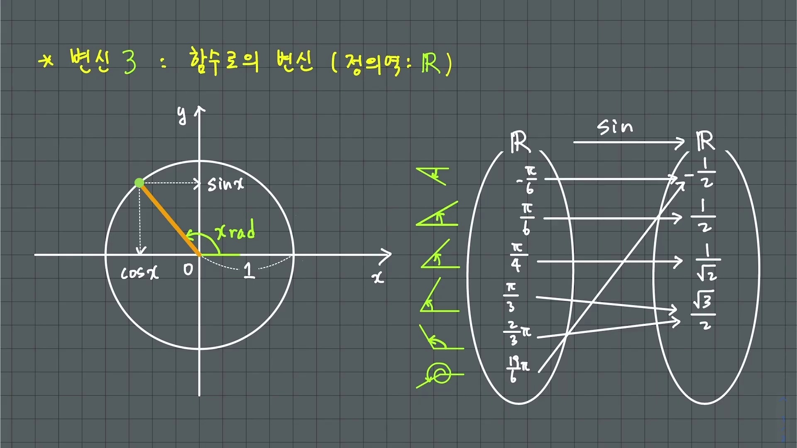

* **선생님 설명**:
  > "삼각비에서 출발하여 단위원 위의 좌표로, 그리고 실수 전체를 정의역으로 하는 함수로 확장되는 이 과정은 수학 내에서 정의가 끊임없이 발전하고 일반화된다는 것을 보여줍니다. 일상 언어의 한계를 벗어나 새로운 개념을 창조해나가는 것이 바로 수학의 본질입니다."

---

## 3. 수학교과서식 엄밀한 증명 & 수능 킬러 기출 연계

### [증명 1] 원점에서의 극한 $\lim_{x \to 0} \frac{\sin x}{x} = 1$ 의 기하학적 증명
1. 단위원에서 중심각이 $x$ ($0 < x < \frac{\pi}{2}$)인 부채꼴 $OAP$와 접선 삼각형 $OAT$를 고려한다.
2. 면적의 대소 관계:
   $$\text{삼각형 } OAP < \text{부채꼴 } OAP < \text{직각삼각형 } OAT$$
   $$\frac{1}{2}\sin x < \frac{1}{2}x < \frac{1}{2}\tan x$$
3. $\frac{1}{2}\sin x$로 각 변을 나누면 ($\sin x > 0$):
   $$1 < \frac{x}{\sin x} < \frac{1}{\cos x} \implies \cos x < \frac{\sin x}{x} < 1$$
4. $x \to 0^+$일 때 $\cos x \to 1$이므로 샌드위치 정리에 의해:
   $$\mathbf{\lim_{x \to 0} \frac{\sin x}{x} = 1 \quad \blacksquare}$$

---

### [수능 실전 팁] 평가원 삼각함수 킬러 문항 공략 3대 원칙
1. **단위원의 기하학적 시선**:
   * $\cos\theta$는 $x$좌표, $\sin\theta$는 $y$좌표, $\tan\theta$는 동경의 기울기라는 관점을 수능 문제에 즉각 대입한다.
   * 예: $\sin^2\theta + \cos^2\theta = 1$은 곧 피타고라스 정리이자 단위원의 방정식 $x^2 + y^2 = 1$이다!
2. **주기성과 선대칭/점대칭의 결합**:
   * 사인함수는 점 $(n\pi, 0)$에 대한 점대칭이자 직선 $x = \frac{\pi}{2} + n\pi$에 대한 선대칭이다.
   * 삼각방정식/부등식 실근의 합을 구할 때 직접 근을 구하지 말고 **대칭축의 2배**를 이용한다.
3. **호도법 각도와 길이의 즉시 일체화**:
   * 부채꼴의 호의 길이 $l = r\theta$, 넓이 $S = \frac{1}{2}r^2\theta = \frac{1}{2}rl$ 공식을 기계적으로 적용하지 말고, "호도법 각도 $\theta$는 곧 반지름 1일 때의 호의 길이"라는 비례적 감각을 유지한다.
