# [수학 I] 삼각함수 그래프 완전 정복 : sin, cos 그래프 그리기와 8칸 박스법

> **원본 영상 정보**
> - **출처**: [사오수학 YouTube](https://youtu.be/OErYVKR10Tw)
> - **영상 제목**: [수Ⅰ][LV 1] 17강. 삼각함수 그래프_sin, cos 그래프
> - **채널**: 사오수학
> - **영상 길이**: 14분 17초 (857초)
> - **주요 태그**: `#수학1 #삼각함수그래프 #사인그래프 #코사인그래프 #주기 #최대최소 #8칸박스법 #평행이동 #사오수학`

---

## 1. 핵심 요약 (Key Summary)

수능 수학 및 내신 시험에서 학생들이 삼각함수 그래프 단원에서 가장 많이 실수하는 원인은 복잡한 수식 $y = a\sin(bx + c) + d$를 만났을 때, 무작정 점을 대입하거나 좌표축을 그리다 비율이 깨져버리기 때문입니다.

사오수학 선생님은 삼각함수 그래프를 가장 직관적이고 정확하게 그리는 방법으로 **"8칸 박스법(4등분 분할법)"**을 제시합니다:
1. 주기를 먼저 구하여 가로축을 **4등분**한다 ($T/4, T/2, 3T/4, T$).
2. 진폭 $a$와 $y$축 평행이동 $d$를 통해 **상한선($y = M$)**, **중심선($y = d$)**, **하한선($y = m$)**의 가로선 3줄을 긋는다.
3. 형성된 $4 \times 2 = 8$칸 직사각형 박스 격자점 위에 사인(중심-최고-중심-최저-중심) 또는 코사인(최고-중심-최저-중심-최고)의 핵심 5개 점을 찍고 부드럽게 잇는다!

---

### 📊 삼각함수 일반형 $y = a\sin(b(x - p)) + d$ 핵심 4대 요소

| 구분 | 수식 및 결정 요인 | 기하학적 의미 | 수능 실전 판정법 |
| :--- | :--- | :--- | :--- |
| **최댓값 ($M$)** | $\mathbf{M = \|a\| + d}$ | 그래프의 가장 높은 $y$좌표 | $M = \frac{\text{최고점} + \text{최저점}}{2} + |a|$ |
| **최솟값 ($m$)** | $\mathbf{m = -\|a\| + d}$ | 그래프의 가장 낮은 $y$좌표 | 진폭 $|a| = \frac{M - m}{2}$ |
| **중심선** | $\mathbf{y = d = \frac{M + m}{2}}$ | 상하 대칭의 기준선 | 최고점과 최저점의 정중앙 평행선 |
| **주기 ($T$)** | $\mathbf{T = \frac{2\pi}{\|b\|}}$ | 한 파형이 완성되는 가로 길이 | 이웃한 두 최고점(마루) 사이의 거리 |
| **평행이동** | $x$축으로 $p$, $y$축으로 $d$ | 기준 박스의 시작점 위치 | 박스의 좌측 시작점이 $(p, d)$로 이동 |

---

## 2. 타임라인별 강의 캡처 & 상세 설명 (12단계)

### 1단계 [00:01:10] 사인 함수 그래프의 기본 작도와 4등분

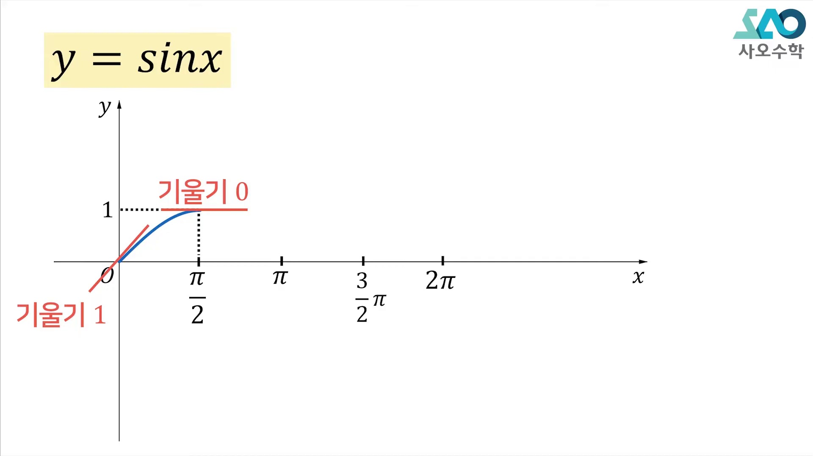

* **선생님 설명**:
  > "사인 그래프를 그릴 때는 $2\pi$를 먼저 찍고, 무조건 반의 반, 즉 4등분을 하고 시작하는 것입니다. $\frac{\pi}{2}, \pi, \frac{3\pi}{2}, 2\pi$를 찍어두고 맨 앞부분($0 \sim \frac{\pi}{2}$)만 잘 그려주면 나머지는 대칭으로 끝납니다."
* **해설**:
  * $0$에서 출발하여 $\frac{\pi}{2}$에서 1에 도달하는 $S$자 곡선의 첫 번째 4분면 파형을 잡는 것이 모든 작도의 출발점입니다.

---

### 2단계 [00:01:45] 원점 접선 기울기와 극댓점의 기울기 0

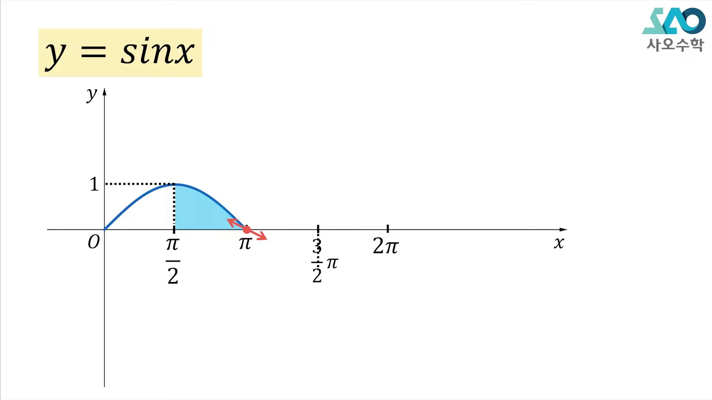

* **선생님 설명**:
  > "원점에서는 접선의 기울기가 1이 되도록 비스듬하게 올라가게 그려주시고, $x = \frac{\pi}{2}$ 꼭대기에서는 기울기가 0이 되도록 완만하게 둥글려 주셔야 합니다. 그 다음은 선대칭, 점대칭, 선대칭으로 이어주면 한 주기가 완성됩니다."
* **해설**:
  * $\lim_{x \to 0}\frac{\sin x}{x} = 1$이므로 원점에서 접선은 $y = x$입니다.
  * $x = \frac{\pi}{2}$에서는 미분계수가 $\cos(\frac{\pi}{2}) = 0$이므로 완만한 극댓값을 형성합니다.

---

### 3단계 [00:03:50] 코사인 함수 그래프의 작도: $(0, 1)$에서 하강 출발

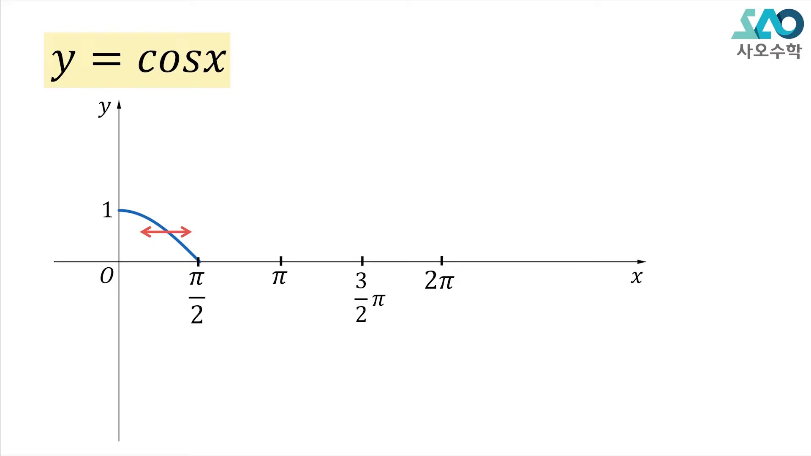

* **선생님 설명**:
  > "코사인 그래프는 사인 그래프를 옆으로 대칭 이동한 것입니다. $(0, 0)$에서 시작하는 게 아니라 $(0, 1)$ 꼭대기에서 출발하여 아래로 떨어지게 그려주시면 됩니다."
* **해설**:
  * $(0, 1) \to (\frac{\pi}{2}, 0) \to (\pi, -1) \to (\frac{3\pi}{2}, 0) \to (2\pi, 1)$의 5개 핵심 포인트를 따라 $V$자형 완만한 U-곡선 형태를 형성합니다.

---

### 4단계 [00:04:40] 코사인 함수의 대칭성과 치역 $[-1, 1]$

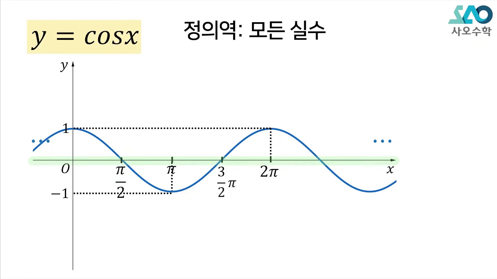

* **선생님 설명**:
  > "코사인의 $y$값도 역시 $-1$과 $+1$ 사이에 갇혀 있습니다. 그래서 최댓값은 $+1$, 최솟값은 $-1$이고, $y$축에 대하여 완벽하게 좌우 대칭(우함수)입니다."
* **핵심 성질**:
  * $\cos(-x) = \cos x$ (우함수, $y$축 선대칭)
  * $\sin(-x) = -\sin x$ (기함수, 원점 점대칭)
  * $\cos x = \sin(x + \frac{\pi}{2})$ (사인 그래프를 $x$축 방향 $-\frac{\pi}{2}$만큼 평행이동)

---

### 5단계 [00:06:05] 계수 $a$의 역할: 진폭과 상하 확대 ($y$값 $a$배)

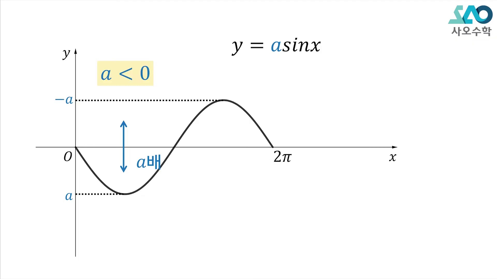

* **선생님 설명**:
  > "함수 전체에 $a$가 곱해져 있으면 위아래로 $a$배 늘려주시면 됩니다. 단, $a$가 음수일 수도 있으므로 최댓값은 $|a|$, 최솟값은 $-|a|$가 됩니다."
* **해설**:
  * $y = a\sin x$에서 $a > 0$이면 위로 늘어나고, $a < 0$이면 $x$축 대칭(위아래 반전)이 일어납니다.
  * 진폭(Amplitude)은 언제나 $|a| = \frac{M - m}{2}$입니다.

---

### 6단계 [00:06:55] 계수 $b$의 역할: $x$축 압축과 주기 $T = \frac{2\pi}{|b|}$

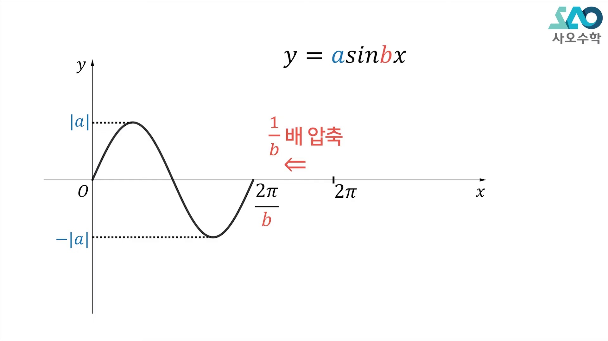

* **선생님 설명**:
  > "$x$ 앞에 $b$가 곱해져 있으면 그래프는 좌우로 $\frac{1}{|b|}$배 압축됩니다. 원래 한 바퀴 도는 데 $2\pi$가 걸렸는데, $b$배 빠르게 달리니까 주기는 $\frac{2\pi}{|b|}$로 줄어드는 것입니다!"
* **주기 공식의 본질**:
  $$bx = 2\pi \iff \mathbf{x = \frac{2\pi}{|b|}}$$
  * 속도가 $b$배 빨라졌으므로 완주 시간(주기)은 $\frac{1}{b}$로 단축됩니다.

---

### 7단계 [00:07:45] 일반형 $y = a\sin(bx + c) + d$의 8칸 박스 설계법

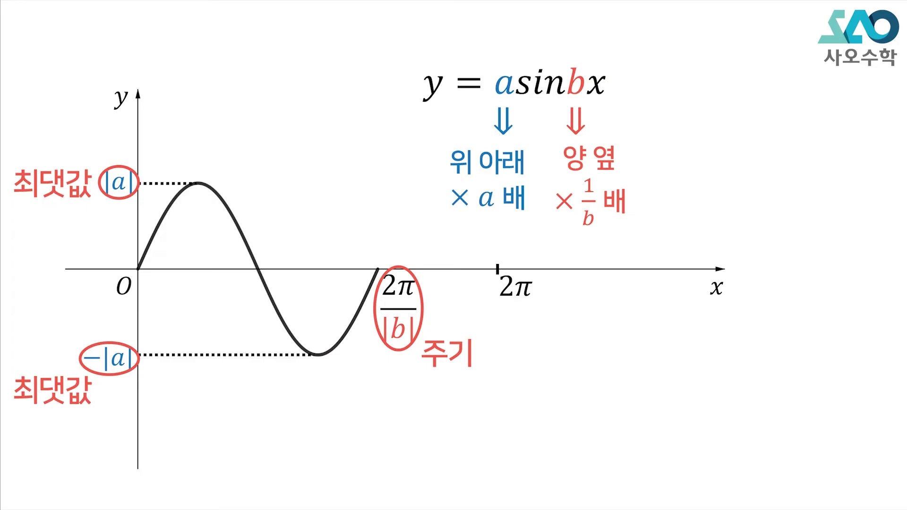

* **선생님 설명**:
  > "복잡한 삼각함수 식을 만나면 3가지만 먼저 뽑아내세요: 1번 최댓값과 최솟값, 2번 주기, 3번 평행이동! 이 세 가지로 박스를 만들면 어떤 문제든 풀립니다."
* **8칸 박스 가이드라인**:
  * 가로폭: 주기 $T = \frac{2\pi}{|b|}$를 4등분한 간격 $\frac{T}{4}$
  * 세로폭: 중심선 $y = d$를 기준으로 위로 $+|a|$, 아래로 $-|a|$

---

### 8단계 [00:08:45] 예제 1: $y = 3\sin x$ 의 작도와 치역 $[-3, 3]$

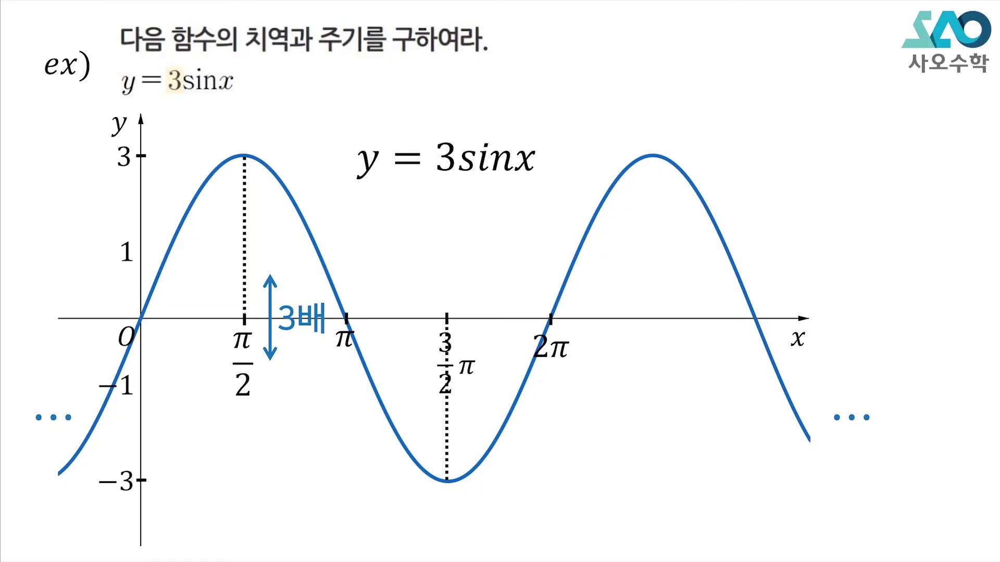

* **선생님 설명**:
  > "$y = 3\sin x$는 $2\pi$를 4등분하고 위아래를 3과 $-3$으로 잡은 뒤, 0에서 3으로 볼록하게 올라갔다가 내려오면 끝입니다. 치역은 $[-3, 3]$이고 주기는 변함없이 $2\pi$입니다."
* **분석**:
  * $a = 3, b = 1, d = 0 \implies M = 3, m = -3, T = 2\pi$.

---

### 9단계 [00:10:15] 예제 2: $y = 2\cos(x - \frac{\pi}{2})$ 의 평행이동 작도

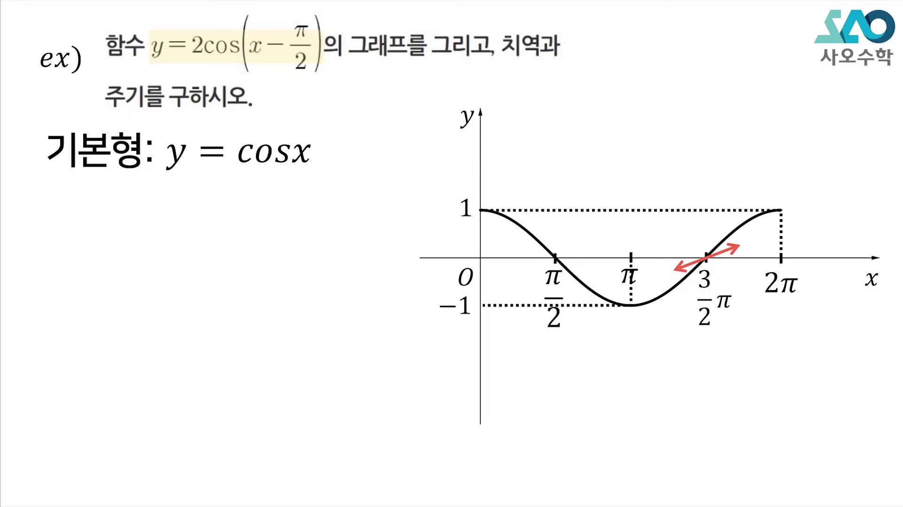

* **선생님 설명**:
  > "평행이동이 섞여 있을 때는 기본형 $y = 2\cos x$를 먼저 박스에 그리고, 모든 점을 $x$축 방향으로 $\frac{\pi}{2}$만큼 오른쪽으로 툭 밀어주면 됩니다. 그러면 정확하게 사인 그래프와 일치하게 됩니다!"
* **삼각함수의 각변환 공식 연계**:
  $$\cos\left(x - \frac{\pi}{2}\right) = \cos\left(-\left(\frac{\pi}{2} - x\right)\right) = \cos\left(\frac{\pi}{2} - x\right) = \sin x$$
  * 따라서 $y = 2\cos(x - \frac{\pi}{2}) = 2\sin x$ 임을 기하학적으로 완벽히 확인합니다!

---

### 10단계 [00:12:40] 예제 3: $y = 2\sin(3x) + 1$ 의 주기 단축 ($T = \frac{2\pi}{3}$)

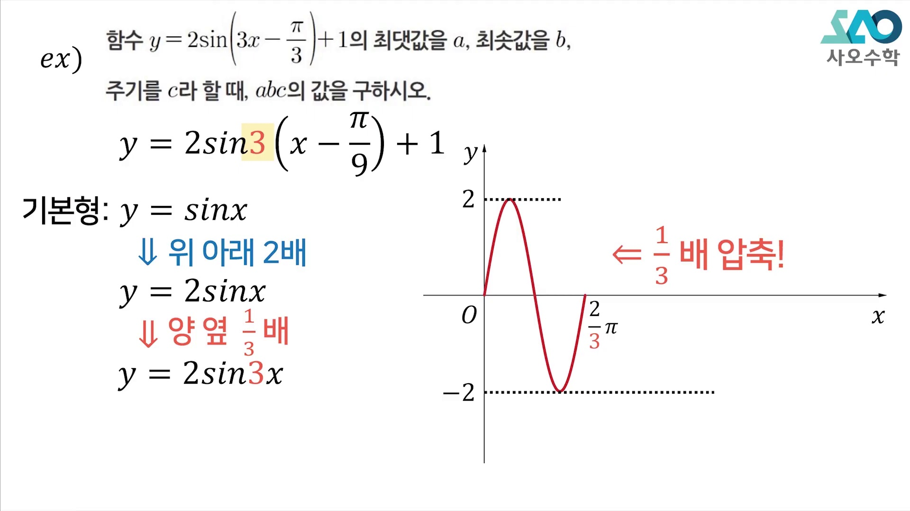

* **선생님 설명**:
  > "$x$ 앞에 3이 곱해져 있으니 주기는 $\frac{2\pi}{3}$입니다. 4등분하면 한 칸의 길이가 $\frac{\pi}{6}$가 됩니다. 중심선 $y = 1$을 기준으로 위로 2칸($y=3$), 아래로 2칸($y=-1$)을 잡아 박스를 치면 10초 만에 그려집니다."
* **분석**:
  * 최댓값: $M = 2 + 1 = 3$
  * 최솟값: $m = -2 + 1 = -1$
  * 주기: $T = \frac{2\pi}{3}$
  * 4등분점: $0, \frac{\pi}{6}, \frac{\pi}{3}, \frac{\pi}{2}, \frac{2\pi}{3}$

---

### 11단계 [00:13:40] 수능 스피드 해법: 그래프 없이 식에서 $M, m, T$ 즉시 추출

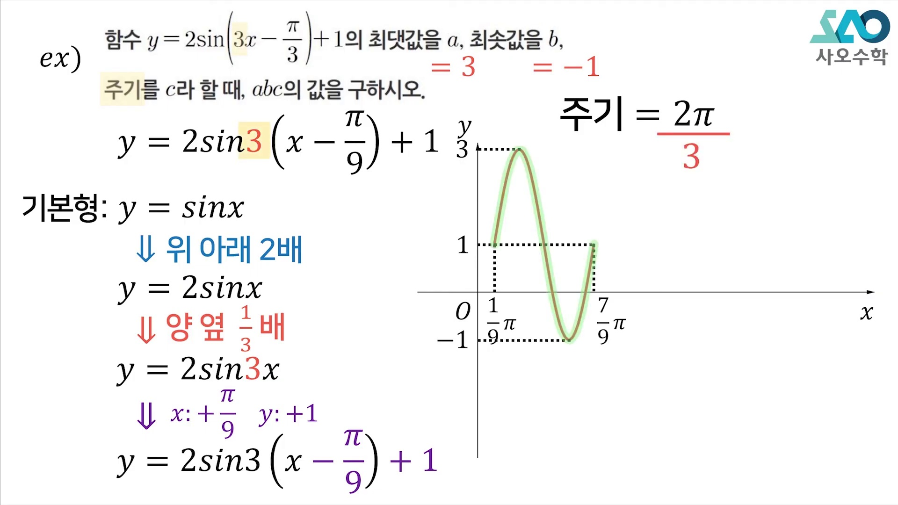

* **선생님 설명**:
  > "수능 시험장에서는 언제나 그래프를 다 그리고 있을 시간이 없습니다. 식을 보자마자 $x$ 앞의 계수로 주기를 나누고, 앞뒤 숫자로 최대최소를 구해서 5초 만에 답을 내는 기계적 훈련이 되어 있어야 합니다."
* **초고속 추출 공식**:
  $$\mathbf{T = \frac{2\pi}{|b|}, \quad M = |a| + d, \quad m = -|a| + d, \quad |a| = \frac{M - m}{2}, \quad d = \frac{M + m}{2}}$$

---

### 12단계 [00:14:10] 최종 요약: 8칸 박스법의 절대 규칙

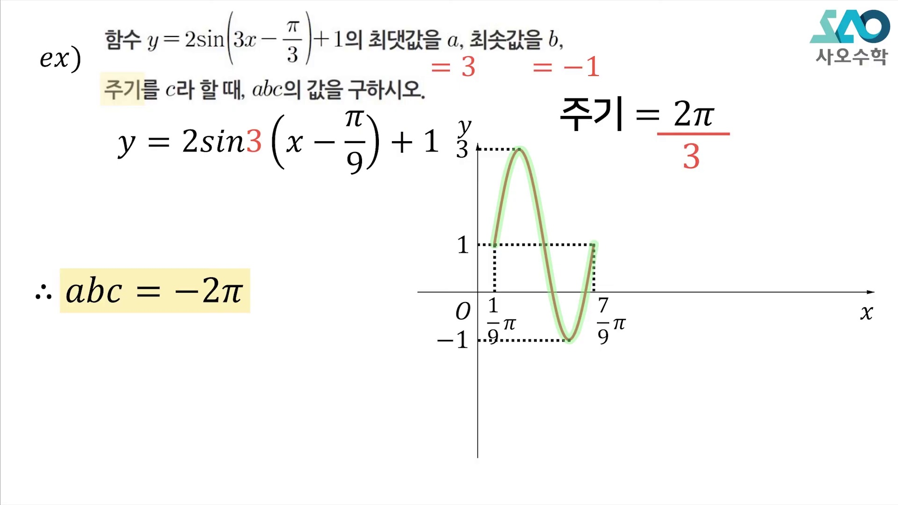

* **선생님 설명**:
  > "삼각함수 그래프는 8칸 박스법 하나로 모든 내신과 수능 문제가 종결됩니다. 주기를 4등분하고 최대최소 중심선을 그어 박스를 채우는 이 감각을 꼭 체화하시기 바랍니다."

---

## 3. 수학교과서식 엄밀한 증명 & 수능 킬러 기출 연계

### [증명] 삼각함수의 주기 $T = \frac{2\pi}{|b|}$ 대수적 증명
1. 함수 $f(x) = \sin(bx)$가 주기 $T > 0$를 갖는다는 것은 모든 실수 $x$에 대해 다음이 성립함을 뜻한다:
   $$\sin(b(x + T)) = \sin(bx + bT) = \sin(bx)$$
2. 사인함수의 기본 주기는 $2\pi$이므로, $bT$가 $2\pi$의 정수배가 되어야 한다:
   $$|b|T = 2\pi \implies \mathbf{T = \frac{2\pi}{|b|}}$$
3. 따라서 $x$에 곱해진 계수 $b$의 절댓값의 역수만큼 주기가 정비례하여 압축/팽창된다. $\blacksquare$

---

### [수능 실전 팁] 삼각함수 빈출 킬러 3대 패턴
1. **그래프를 보고 미지수 $a, b, c, d$ 역추적하기**:
   * 1단계: 최고점 $M$과 최저점 $m$의 차에서 $a = \frac{M - m}{2}$ 구하기.
   * 2단계: 중심선 $d = \frac{M + m}{2}$ 구하기.
   * 3단계: 연속한 마루와 골 사이의 거리($\frac{T}{2}$)에서 주기 $T$를 구하고 $b = \frac{2\pi}{T}$ 확정하기.
   * 4단계: 한 점(주로 $y$절편이나 최고점)을 대입하여 평행이동 상수 $c$ 범위 조건에 맞춰 결정하기.
2. **방정식 실근의 합 킬러 문항**:
   * $\sin(bx) = k$의 근을 직접 구하려 하지 말고, 4등분선 중 대칭축($x = \alpha$)을 찾아 실근의 합 $= 2\alpha$로 직격하기!
