# [수학 II] 정적분과 넓이 완전 정복 : 그래프의 넓이와 차함수의 마법

> **원본 영상 정보**
> - **출처**: [사오수학 YouTube](https://youtu.be/iIEeqxjQIBM)
> - **영상 제목**: [수Ⅱ][LV 1] 30강. 정적분과 넓이_그래프의 넓이
> - **채널**: 사오수학
> - **영상 길이**: 10분 36초 (636초)
> - **주요 태그**: `#수학2 #정적분과넓이 #그래프넓이 #차함수 #두곡선사이의넓이 #사오수학 #수능수학`

---

## 1. 핵심 요약 (Key Summary)

정적분($\int_a^b f(x)dx$)과 넓이($S$)는 얼핏 같아 보이지만, **"부호(Sign)의 유무"**라는 치명적인 차이점을 가집니다.
수학 II 정적분과 넓이 단원에서 1등급을 가르는 사오수학의 핵심 원리는 다음과 같습니다:

1. **정적분은 부호가 있는 면적(Signed Area)**:
   - $x$축 위쪽($f(x) \ge 0$)은 양수($+$)로 계산됩니다.
   - $x$축 아래쪽($f(x) \le 0$)은 음수($-$)로 계산됩니다.
   - 따라서 기하학적 **넓이($S \ge 0$)**를 구할 때는 $x$축 아래 구간에 반드시 **마이너스($-$)를 붙여 양수로 전환**해야 합니다!
   $$S = \int_a^b |f(x)|dx = \int_{\text{위}} f(x)dx - \int_{\text{아래}} f(x)dx$$

2. **두 곡선 사이의 넓이 = "차함수 $h(x) = f(x) - g(x)$의 $x$축 사이 넓이"**:
   - 두 곡선 $y = f(x)$와 $y = g(x)$가 복잡하게 얽혀 있을 때, 두 그래프를 개별적으로 그릴 필요가 전혀 없습니다.
   - **$f(x) - g(x)$를 하나의 새로운 함수 $h(x)$로 정의**하면, 기준선 $y = g(x)$는 마법처럼 **$x$축($y = 0$)으로 평탄화**됩니다.
   - 두 곡선의 교점은 곧 $h(x) = 0$의 실근이 되며, 둘러싸인 면적의 크기($S_1, S_2$)는 **완벽하게 보존(Invariance)**됩니다!

---

### 📊 정적분과 넓이 핵심 공식 비교표

| 구분 | 정적분 ($\int_a^b f(x)dx$) | 곡선과 $x$축 사이의 넓이 ($S$) | 두 곡선 $f(x), g(x)$ 사이의 넓이 ($S$) |
| :--- | :--- | :--- | :--- |
| **수식 정의** | $\int_a^b f(x)dx$ | $\int_a^b \|f(x)\|dx$ | $\int_a^b \|f(x) - g(x)\|dx$ |
| **부호 특성** | 양수, 0, 음수 모두 가능 | **항상 $S \ge 0$** | **항상 $S \ge 0$** |
| **기하학적 해석** | 순 면적 (위 면적 $-$ 아래 면적) | 절대 면적 (위 면적 $+$ 아래 면적) | 윗 곡선에서 아랫 곡선을 뺀 적분 |
| **실전 계산법** | 한 번에 원시함수 대입 | $x$절편 기준 구간 분할 $\to$ 아래쪽 $-$ 처리 | 차함수 $h(x) = f(x)-g(x)$의 근 구한 뒤 $x$축 적분 |
| **특수 공식** | 해당 없음 | 포물선: $\frac{\|a\|}{6}(\beta-\alpha)^3$ | 두 교점: $\frac{\|a\|}{6}(\beta-\alpha)^3$ |

---

## 2. 타임라인별 강의 캡처 & 상세 설명 (12단계)

### 1단계 [00:00:17] $y = x^2 - 5x$와 $x$축으로 둘러싸인 도형 넓이 문제

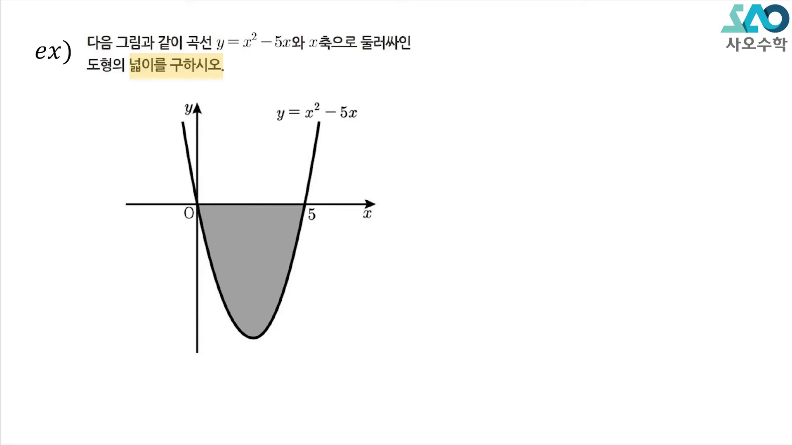

* **선생님 설명**:
  > "0과 5를 근으로 갖는 2차식이 그려져 있죠. 이 그래프와 $x$축으로 둘러싸인 도형의 넓이를 $S$라고 할 때, $S$를 구하는 과정이 어떻게 되는지 지금부터 설명해 드리겠습니다."
* **해설**:
  * $y = x(x-5)$는 아래로 볼록한 포물선이며, $0 \le x \le 5$ 구간 전체가 $x$축 아래에 위치합니다.

---

### 2단계 [00:00:55] 정적분과 음수 넓이: 마이너스 붙이기의 필연성

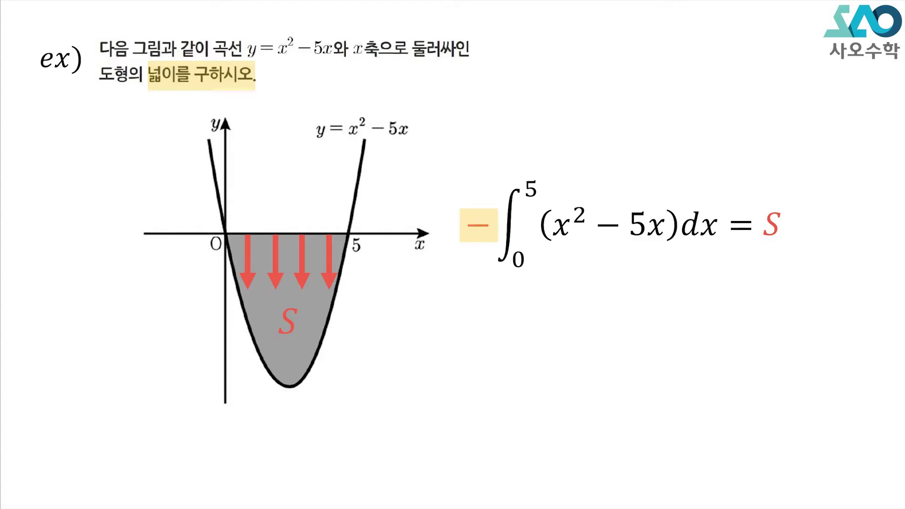

* **선생님 설명**:
  > "0부터 5까지 적분하면 $S$가 나오긴 하는데 문제는 정적분은 플러스 마이너스가 있어요. $x$축 밑의 넓이는 다 마이너스가 붙어 나옵니다. 그래서 $S$를 구하려면 양변에 마이너스를 붙여줘야 합니다."
* **수식 전개**:
  $$\int_0^5 (x^2 - 5x)dx = \left[ \frac{1}{3}x^3 - \frac{5}{2}x^2 \right]_0^5 = \frac{125}{3} - \frac{125}{2} = -\frac{125}{6}$$
  $$\therefore S = -\int_0^5 (x^2 - 5x)dx = \mathbf{\frac{125}{6}}$$

---

### 3단계 [00:01:40] 일반 함수 $f(x)$의 부호 분할 (별 $\star$과 세모 $\blacktriangle$)

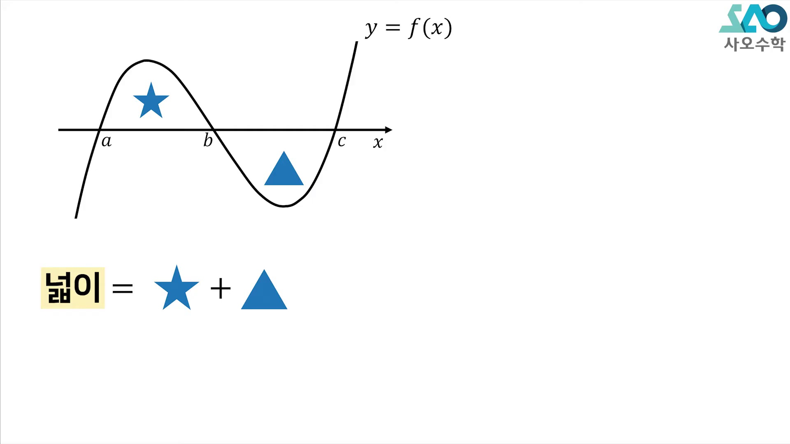

* **선생님 설명**:
  > "함수가 $x$축과 두 군데에서 영역을 만들 때, 하나를 별($\star$), 하나를 세모($\blacktriangle$)라고 해봅시다. 넓이를 구하라고 하면 별과 세모를 더해야 합니다. 별은 $x$축 윗부분이고, 세모는 아랫부분입니다."
* **해설**:
  * $[a, b]$ 구간은 $f(x) \ge 0$이므로 순수 정적분이 곧 넓이($\star$)입니다.
  * $[b, c]$ 구간은 $f(x) \le 0$이므로 순수 정적분 결과는 음수($-\blacktriangle$)입니다.

---

### 4단계 [00:02:20] 넓이 공식 정형화: $\int_a^b f(x)dx - \int_b^c f(x)dx$

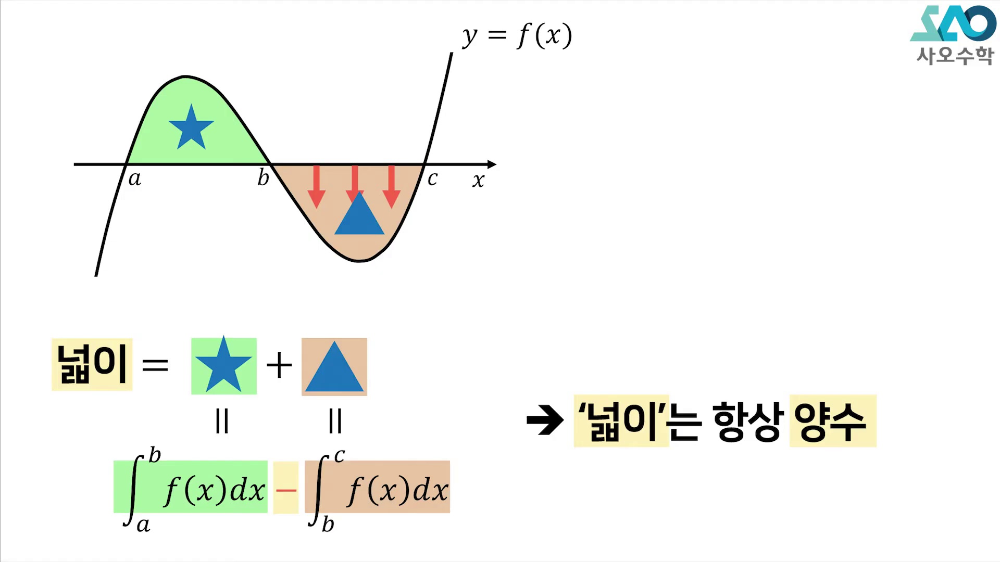

* **선생님 설명**:
  > "세모는 음수로 나오기 때문에 그냥 적분해버리면 안 되고 앞에 마이너스를 붙여야 양수가 됩니다. 그래서 전체 넓이는 $\int_a^b f(x)dx - \int_b^c f(x)dx$가 됩니다. 넓이는 항상 양수입니다!"
* **핵심 판서**:
  $$\text{넓이} = \star + \blacktriangle = \int_a^b f(x)dx - \int_b^c f(x)dx \quad (\text{넓이는 항상 } \ge 0)$$

---

### 5단계 [00:03:25] 예제 2: 3차함수와 $x$축 사이 양·음 구간 공존

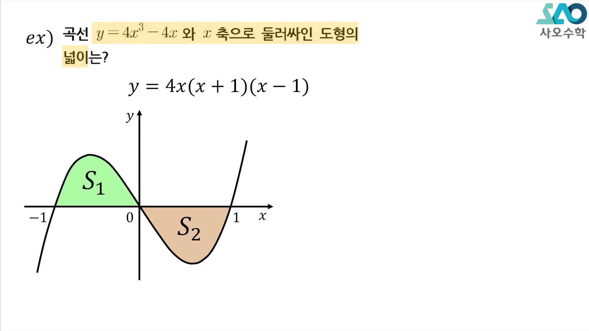

* **선생님 설명**:
  > "$-1$부터 $0$까지는 $x$축보다 윗부분 넓이니까 그냥 플러스로 나오고, $0$부터 $1$까지는 $x$축 아래에 있으니까 음수로 나와서 다시 앞에 마이너스를 곱해줘야 플러스가 됩니다."
* **구간 분할**:
  $$S = S_1 + S_2 = \int_{-1}^0 f(x)dx + \left( -\int_0^1 f(x)dx \right)$$

---

### 6단계 [00:04:15] 예제 2 계산 완결: 넓이 $S = 2$

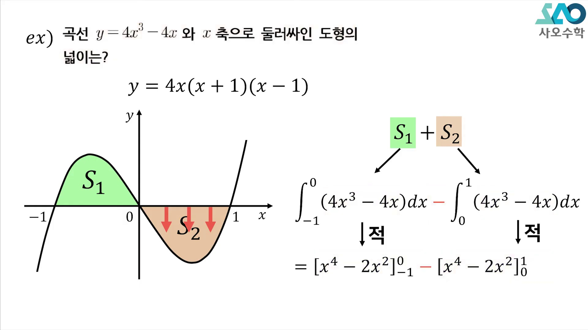

* **선생님 설명**:
  > "안에 있는 함수들의 부정적분을 구해서 대입 계산을 해 주면 각각 1이 나와서 최종 정답은 2가 됩니다."
* **수식 계산**:
  $$S_1 = 1, \quad S_2 = 1 \implies S = S_1 + S_2 = \mathbf{2}$$

---

### 7단계 [00:05:05] 두 곡선 사이의 넓이 등장 ($y = x(x-2)^2$과 $y = x$)

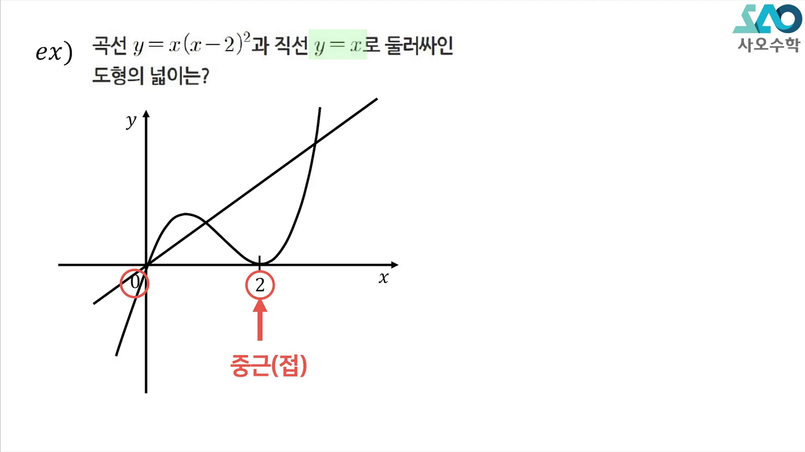

* **선생님 설명**:
  > "이번에는 3차식과 $y = x$라는 두 곡선으로 둘러싸인 도형의 넓이입니다. 어떤 함수와 $x$축이 아니라 두 함수 사이의 넓이를 구하라고 할 때 어떻게 푸는지 잘 보세요."
* **문제 상황**:
  * 3차 곡선 $f(x) = x(x-2)^2$과 직선 $g(x) = x$가 교점들을 형성하며 두 개의 둘러싸인 영역을 만듭니다.

---

### 8단계 [00:06:00] 차함수 $h(x) = f(x) - g(x)$의 마법

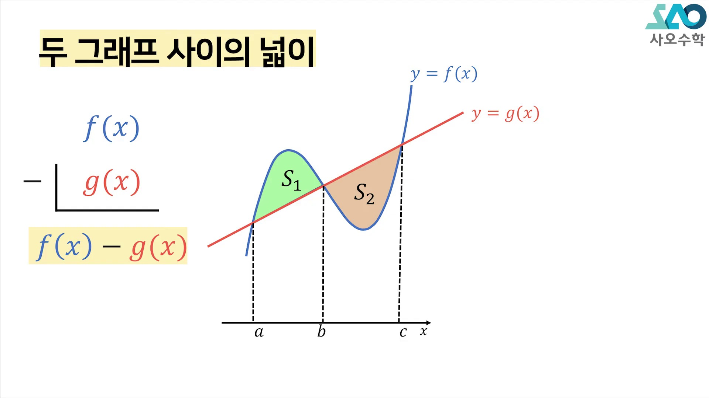

* **선생님 설명**:
  > "두 그래프 사이의 넓이를 구할 때 가장 먼저 해야 할 것은 두 함수를 빼는 것입니다. $f(x) - g(x)$를 만들어주면 교점 $a, b, c$는 함숫값이 같으므로 빼면 무조건 0이 됩니다!"
* **차함수의 본질**:
  * 교점 $x = a, b, c \iff f(x) = g(x) \iff f(x) - g(x) = 0$
  * 즉, $a, b, c$는 차함수 $h(x) = f(x) - g(x)$의 $x$절편이 됩니다.

---

### 9단계 [00:06:50] 기하학적 넓이 불변성의 원리 (Area Invariance)

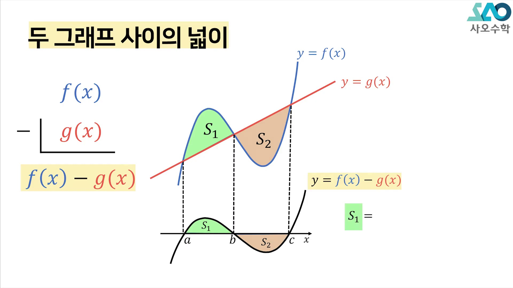

* **선생님 설명**:
  > "여기서 생긴 두 개의 넓이가 그대로 $S_1$이랑 $S_2$로 내려옵니다! 위에 있던 $g(x)$가 $x$축이 되었다고 생각하시면 됩니다. 넓이는 그대로 내려옵니다."
* **카발리에리의 원리와 정적분 증명**:
  $$\text{두 곡선 사이 세로 높이} = |f(x) - g(x)| = |h(x) - 0|$$
  $$S = \int_a^c |f(x) - g(x)|dx = \int_a^c |h(x)|dx$$
  따라서 기울어진 직선 $g(x)$를 수평 $x$축으로 회전·전단 변환한 것과 넓이가 수학적으로 완벽히 일치합니다!

---

### 10단계 [00:08:25] 3차 차함수의 인수분해와 교점 도출

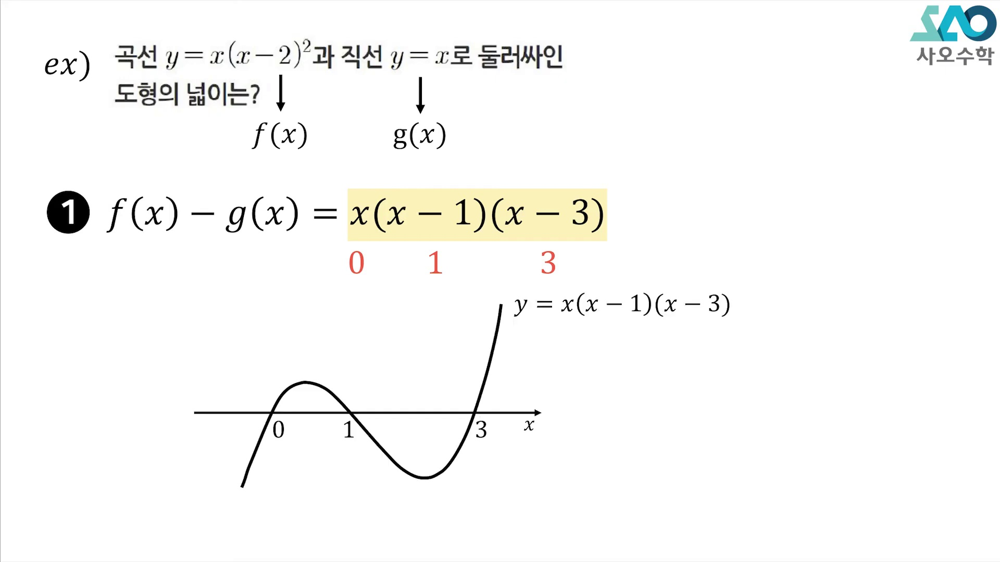

* **선생님 설명**:
  > "각각의 그래프를 굳이 그릴 필요가 없습니다! 둘을 뺀 함수를 구하면 $x^3 - 4x^2 + 3x$가 되고, 인수분해하면 근이 0, 1, 3이 나옵니다. 0, 1, 3을 지나는 3차 함수만 그리면 끝납니다."
* **계산 과정**:
  $$h(x) = x(x-2)^2 - x = x(x^2 - 4x + 4) - x = x^3 - 4x^2 + 3x$$
  $$h(x) = x(x^2 - 4x + 3) = \mathbf{x(x-1)(x-3) = 0} \implies x = 0, 1, 3$$

---

### 11단계 [00:09:15] 3차 차함수 넓이 계산 완결 ($S = \frac{37}{12}$)

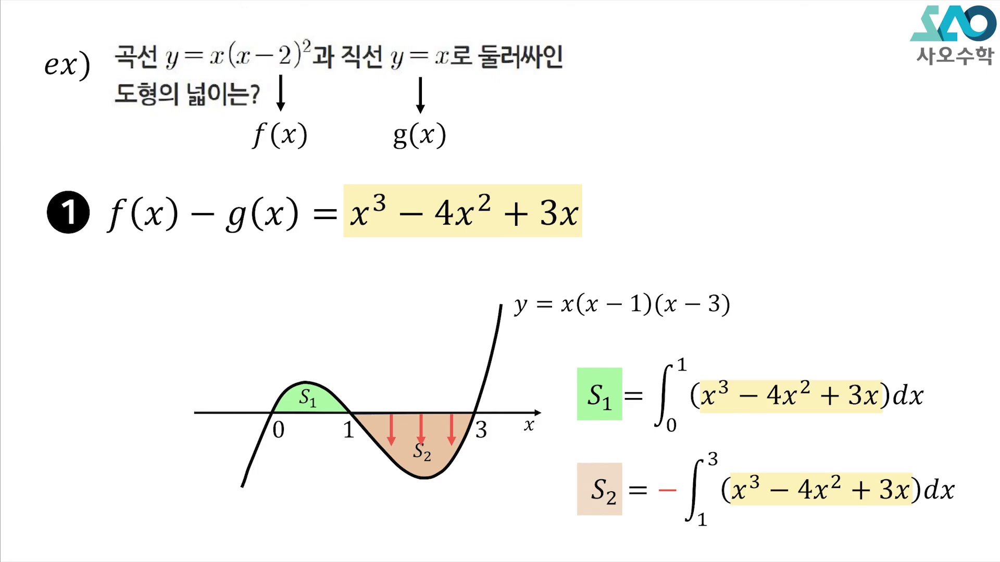

* **선생님 설명**:
  > "0부터 1까지는 $x$축 위에 있으니까 플러스, 1부터 3까지는 $x$축 아래니까 마이너스. 각각 정적분하면 12분의 5와 3분의 8이 나와서 둘을 더하면 12분의 37이 됩니다."
* **적분 수식**:
  $$\int (x^3 - 4x^2 + 3x)dx = \frac{1}{4}x^4 - \frac{4}{3}x^3 + \frac{3}{2}x^2$$
  $$S_1 = \left[ \frac{1}{4}x^4 - \frac{4}{3}x^3 + \frac{3}{2}x^2 \right]_0^1 = \frac{1}{4} - \frac{4}{3} + \frac{3}{2} = \frac{5}{12}$$
  $$S_2 = -\left[ \frac{1}{4}x^4 - \frac{4}{3}x^3 + \frac{3}{2}x^2 \right]_1^3 = -\left( -\frac{9}{4} - \frac{5}{12} \right) = \frac{8}{3} = \frac{32}{12}$$
  $$\mathbf{S = S_1 + S_2 = \frac{5}{12} + \frac{32}{12} = \frac{37}{12}}$$

---

### 12단계 [00:10:10] 예제 4: 2차곡선과 직선의 넓이 & 차수 팁

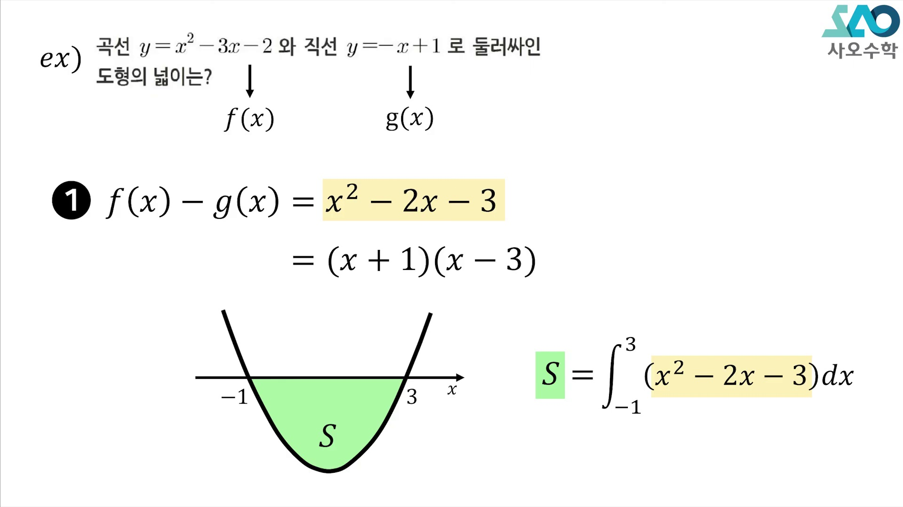

* **선생님 설명**:
  > "뺄 때 차수가 높은 것에서 낮은 것을 빼는 게 좋습니다. 그래야 최고차항 부호가 양수로 유지되어 그래프가 뒤집히지 않습니다. $(x+1)(x-3)$이므로 근은 -1과 3입니다. 적분하면 3분의 32가 나옵니다."
* **공식 대조**:
  $$h(x) = (x^2 - 3x - 2) - (-x + 1) = x^2 - 2x - 3 = (x+1)(x-3)$$
  $$\text{정석 적분}: S = -\int_{-1}^3 (x^2 - 2x - 3)dx = \mathbf{\frac{32}{3}}$$
  $$\text{포물선 공식 검산}: S = \frac{|a|}{6}(\beta - \alpha)^3 = \frac{1}{6}(3 - (-1))^3 = \frac{64}{6} = \mathbf{\frac{32}{3}} \quad (\text{완벽 일치!})$$

---

## 3. 수능/내신 실전 킬러 연계 분석

### [전략 1] 개별 그래프 작도 금지의 원칙
두 곡선 사이의 넓이 문제에서 $y = f(x)$와 $y = g(x)$를 따로 좌표평면에 그리려고 하면 시간 낭비와 형태 왜곡이 발생합니다.
반드시 **차함수 $h(x) = f(x) - g(x)$를 세우고 인수분해**하여, **$x$축과 만나는 교점만을 기준**으로 단순화된 다항함수를 그리십시오.

### [전략 2] 2차/3차 다항함수 넓이 공식 적극 활용
1. **2차함수와 직선 (또는 두 2차함수)**:
   $$S = \frac{|a|}{6}(\beta - \alpha)^3$$
2. **3차함수와 접선**:
   $$S = \frac{|a|}{12}(\beta - \alpha)^4$$
3. **3차함수 점대칭 넓이 ($S_1 = S_2$)**:
   변곡점을 기준으로 두 넓이가 같을 때는 정적분 전체 값이 0이 됨을 활용 ($\int_\alpha^\gamma h(x)dx = 0$).
